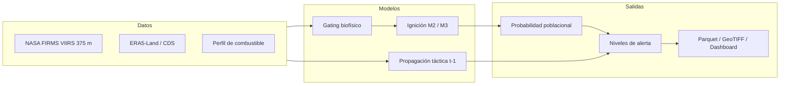

# Incendios_PY: Sistema Predictivo de Probabilidad de Fuego en Paraguay

[](https://opensource.org/licenses/MIT)
[](https://www.python.org/)
[](#)
[](#)
[](https://quarto.org)

Sistema integral para modelar la probabilidad diaria de ignición y propagación de incendios a resolución de $1 \times 1\text{ km}^2$ en la República del Paraguay. El repositorio prioriza la trazabilidad metodológica: separa ignición primaria de propagación táctica, usa priors históricos causales y reporta métricas tanto en la muestra case-control como en la población real de celdas-día.

> **Estado de esta versión (auditoría 2026):** se corrigieron la fuga de etiqueta en priors históricos, la calibración case-control, el análisis de sensibilidad del buffer y la medición de rendimiento. Los resultados del manuscrito deben leerse junto con `tablas/tabla07_evaluacion_poblacional.csv` y las limitaciones declaradas al final de este README. El perfil de combustible incluido es **sintético de referencia**; no sustituye a MapBiomas real. La validación espacial por bloques muestra que M3 no generaliza a celdas sin historia de fuego; M1 es más robusto para extrapolación. La corrección del clima histórico sigue pendiente por cuota de Open-Meteo/CDS.

---

## 1. Arquitectura



### Principios metodológicos

1. **Buffer de zona muerta de 20 km para pseudo-ausencias.** Para cada fecha, las ausencias se muestrean fuera de un radio de 20 km de los focos activos del mismo día. Esto reduce el sesgo de proximidad en el muestreo negativo. **No es un holdout espacial entre train y test**: la separación train/val/test es temporal.
2. **Priors históricos causales.** Para una fila del mes $M$ se usan únicamente focos anteriores al día 1 de $M$, con una ventana móvil de 3 años. Se excluyen el evento actual, el mismo mes y cualquier evento futuro. Esto sustituye la versión anterior, que incluía el propio fuego en `dist_foco_hist_km` y `freq_hist_1km`.
3. **Inercia multiescala de combustible y clima.** Variables de sequía atmosférica (VPD, CDD, FFMC, ISI), precipitación antecedente y cobertura de combustible. La cobertura actual es un perfil sintético de referencia y debe reemplazarse por MapBiomas real antes de interpretar resultados biofísicos.
4. **Cascada en dos etapas.** Etapa 1: descarte de celdas sin combustible, VPD < 0,8 kPa o precipitación acumulada de 48 h >= 10 mm. Etapa 2: discriminación LightGBM regionalizada (M2/M3) y kernel de propagación $t-1$.
5. **Calibración y umbrales en dos escalas.** El modelo se entrena y calibra sobre una muestra case-control 1:10 (prevalencia ~9,09 %). Las probabilidades y los umbrales se corrigen a la prevalencia poblacional real (~0,08 % Chaco, ~0,19 % Oriental) antes de emitir alertas. La evaluación poblacional se reporta por separado.

---

## 2. Datos y variables

### 2.1 Grilla nacional

- Proyección: **UTM Zona 21 Sur (EPSG:32721)**.
- Resolución: $1.000\text{ m} \times 1.000\text{ m}$.
- Total: **400.006 celdas** (240.880 Chaco; 159.126 Región Oriental).
- Indexación determinística $O(1)$: `cell_id = floor(X/1000) * 10.000.000 + floor(Y/1000)`.

### 2.2 NASA FIRMS VIIRS 375 m

Se ingieren Suomi-NPP y NOAA-20 (2018–2025). Filtros aplicados:

- `confidence != "low"`.
- `scan <= 1.5 km` (en los datos usados el máximo observado es 0,8 km; el filtro no descarta registros, pero se mantiene por robustez).
- Asignación espacial a la grilla de 1 km.
- Agregación celda-día: `num_focos_dia`, `max_frp_dia`, `sum_frp_dia`.

`bright_ti4`, `bright_ti5`, `daynight` y `satellite` se conservan en la capa cruda pero **no se usan como features** del modelo actual.

### 2.3 ERA5-Land

- Variables: temperatura máxima/mínima, punto de rocío, precipitación, viento 10 m, VPD.
- Nodos: **640 nodos** a 0,25° sobre el bounding box nacional; cada celda se asigna al nodo más cercano con cKDTree.
- Precipitación diaria: se solicita resolución horaria y se toma el acumulado de las 23:00 UTC para evitar truncar las últimas horas del día.
- Ráfagas: ERA5-Land no publica ráfagas; la columna `rafaga_max_kmh` es un proxy lineal documentado y **no se usa como feature**.
- ET0: no se solicita en la descarga CDS; la columna queda en 0 y no se usa.

### 2.4 Perfil de combustible

`datos/raw/mapbiomas/` no contiene GeoTIFFs en este repositorio. `scripts/03_procesar_combustible.py` exige `--permitir-sintetico` para generar el perfil de referencia y lo marca con `origen_datos = sintetico_referencia`. El servicio de alerta emite una advertencia si detecta ese origen. **No use ese perfil para afirmar resultados biofísicos ni para publicar SHAP de biomasa.**

---

## 3. Modelos

### 3.1 Variables

- **M2 (ignición base):** 24 variables: clima, FWI parcial (FFMC, ISI), calendario, cobertura de combustible, ecotono y priors causales a 25 km.
- **M3 (híbrido socio-ecológico):** 33–34 variables: M2 + corredor antrópico, densidades a 5/10 km, focalización local, armónicos estacionales, presión de quema en pasturas y sinergia accesibilidad × VPD.
- **Propagación táctica:** 27 variables: M2 + `dist_foco_t1_km`, `focos_25km_t1`, `frp_25km_t1`.

No se usa `rafaga_max_kmh` (proxy) ni variables de fuego del mismo día.

### 3.2 Calibración

- Calibrador sigmoide monótono de Platt, con $w \ge 0.1$, optimizando Brier.
- Calibración case-control sobre validación 2023.
- Corrección de intercepto a prevalencia poblacional:
  $$\text{logit}(p_{\text{pob}}) = \text{logit}(p_{\text{muestra}}) + \text{logit}(\pi_{\text{pob}}) - \text{logit}(\pi_{\text{muestra}})$$
- Prevalencias estimadas por `scripts/19_estimar_prevalencias.py` y guardadas en `modelos/calibradores/prevalencias_poblacionales.json`.

### 3.3 Particiones

- Train: 2018–2022.
- Validación: 2023 (calibración y umbrales).
- Test ciego: 2024–2025.
- El test es **temporal**, no espacialmente independiente. Para una validación espacial rigurosa falta un holdout por bloques/regiones.

---

## 4. Resultados de la versión corregida

### 4.1 Discriminación en test (case-control)

| Región | Modelo | ROC-AUC | PR-AUC | ECE | BSS |
|---|---|---:|---:|---:|---:|
| Chaco | M3 híbrido | 0,7858 | 0,2760 | 0,0204 | 0,0918 |
| Chaco | M2 base | 0,7705 | 0,2416 | 0,0206 | 0,0622 |
| Chaco | Propagación | 0,9121 | 0,7255 | 0,0047 | 0,5014 |
| Oriental | M3 híbrido | 0,8277 | 0,3708 | 0,0125 | 0,1627 |
| Oriental | M2 base | 0,8024 | 0,3046 | 0,0105 | 0,1198 |
| Oriental | Propagación | 0,8671 | 0,5490 | 0,0118 | 0,2994 |

La muestra case-control tiene prevalencia ~9,09 %. Estas cifras **no son precisión operativa**.

### 4.2 Evaluación poblacional (prevalencia real)

Generada por `scripts/18_evaluacion_poblacional.py` con reponderación por inverso de probabilidad de muestreo:

| Región | Modelo | ROC-AUC | PR-AUC | Precisión | Recall | BSS |
|---|---|---:|---:|---:|---:|---:|
| Chaco | M3 híbrido | 0,7911 | 0,0040 | 0,74 % | 12,54 % | 0,0016 |
| Chaco | Propagación | 0,9126 | 0,2287 | 11,87 % | 48,47 % | 0,0613 |
| Oriental | M3 híbrido | 0,8323 | 0,0230 | 1,96 % | 24,25 % | 0,0091 |
| Oriental | Propagación | 0,8662 | 0,1063 | 6,07 % | 31,89 % | 0,0353 |

Estas son las métricas que deben citarse como operativas. La reponderación usa todas las ausencias (no sólo las que quedan fuera del buffer de 20 km), por lo que es una estimación de primer orden y la precisión real podría ser aún menor.

### 4.3 Benchmarking

- Canadian FWI: ROC-AUC 0,5183 (Chaco) y 0,6055 (Oriental), usando ISI como proxy.
- Proxy INPE: ROC-AUC 0,5036 y 0,5865.
- FWI e INPE **no son probabilidades calibradas**: no se reportan ECE/BSS para ellos.
- La comparación es de discriminación (ROC-AUC/PR-AUC), no de precisión operativa.
- Bootstrap pareado B=1000: todas las comparaciones M3/propagación vs FWI/INPE dan p ≤ 0,001 (`tabla10_significancia_pareada.csv`).

### 4.4 Incertidumbre conformal

- Calibrador y `q_hat` se estiman en subconjuntos cronológicos distintos de validación.
- Cobertura empírica 2024–2025: 89,67 % (Chaco) y 90,30 % (Oriental) para nominal 90 %; 93,62 % y 93,96 % para nominal 95 %.
- Bajo cambio temporal no hay garantía formal de exchangeability; se reporta cobertura empírica, no una garantía finita.

### 4.5 Validación espacial por bloques

Holdout de bloques de 50 km con buffer de 20 km y priors que excluyen las celdas retenidas (`scripts/20_validacion_espacial_bloques.py`):

| Región | Modelo | ROC-AUC holdout | ROC-AUC held-in |
|---|---|---:|---:|
| Chaco | M1 biofísico | 0,5105 | 0,6395 |
| Chaco | M2 base | 0,4893 | 0,7962 |
| Chaco | M3 híbrido | 0,4737 | 0,8062 |
| Oriental | M1 biofísico | 0,6139 | 0,6113 |
| Oriental | M2 base | 0,5962 | 0,7798 |
| Oriental | M3 híbrido | 0,5942 | 0,8070 |

La conclusión es central: **M3 es un nowcast temporal para celdas con historia de fuego; no generaliza espacialmente**. Para celdas nuevas, M1 es más robusto. No se debe presentar M3 como un modelo de extrapolación espacial.

### 4.6 Evaluación con clima de t-1 (24 h de anticipación)

Sustituyendo las variables meteorológicas por las del día anterior (persistencia), M3 conserva ROC-AUC 0,7857/0,8243 y precisión case-control 34,14 %/44,17 %. M1 cae a 0,6146/0,5905. Esto confirma que la señal dominante de M3 son los priors de recurrencia; para operación real se requiere un pronóstico day-ahead, pero la persistencia es una cota viable.

### 4.7 Rendimiento computacional

Medición real de `scripts/14_auditoria_suplementaria.py` el 2024-09-09:

- Ingesta + priors causales + gating: ~1,13 s.
- Inferencia dual LightGBM: ~0,24 s.
- Agregación y boletín: ~0,015 s.
- Total: ~1,4 s.
- RAM pico medida: ~2.041 MB.

El valor depende del hardware; no se debe citar 0,75 s ni 600 MB como si fueran universales.

---

## 5. Estructura del repositorio

```text
Incendios_PY/
├── README.md
├── LICENSE
├── pyproject.toml
├── requirements.txt
├── _quarto.yml
├── manuscrito.qmd
├── material_suplementario.qmd
├── title_page.qmd
├── cover_letter.qmd
├── references.bib
├── datos/
│   ├── raw/                 # FIRMS, ERA5, vectores (no versionados)
│   ├── processed/           # grilla, clima, focos, train/val/test
│   └── outputs/             # alertas, boletines, GeoTIFF
├── docs/
│   ├── IDEAS.md
│   └── PROTOCOLO_BENCHMARKING.md
├── fuentes/
│   └── MANIFIESTO_DATOS.csv
├── src/
│   ├── alerta.py
│   ├── biomasa.py
│   ├── clima.py
│   ├── clima_cds.py
│   ├── constantes.py
│   ├── espaciotemporal.py   # priors causales, contagio t-1, ecotono
│   ├── firms.py
│   ├── fwi.py
│   ├── geometria.py
│   ├── metricas.py          # métricas, corrección de prevalencia, conformal
│   ├── modelo.py
│   ├── muestreo.py
│   └── raster.py
├── scripts/                 # pipeline numerado 00–19
├── modelos/                 # boosters y calibradores (no versionados)
├── figuras/
├── tablas/
└── tests/
```

---

## 6. Ejecución

### 6.1 Requisitos

```bash
cd Incendios_PY
python -m venv .venv
source .venv/bin/activate
pip install -r requirements.txt
```

`cdsapi` requiere un archivo `~/.cdsapirc` para descargar ERA5-Land. FIRMS requiere `FIRMS_MAP_KEY` para la API histórica.

### 6.2 Orden canónico del pipeline

```bash
# 1. Grilla y focos
python scripts/00_generar_grilla_nacional.py
python scripts/01b_descargar_firms_api.py        # focos históricos 2018-2025
python scripts/01_descargar_firms.py             # consolida desde el parquet histórico

# 2. Clima
python scripts/02b_descargar_era5_cds.py         # ERA5-Land desde CDS
python scripts/02_descargar_clima_era5.py        # alternativa Open-Meteo (UTC)
# opcional: corregir precipitación/ráfagas/ET0 con Open-Meteo (requiere cuota)
python scripts/02c_corregir_clima_openmeteo.py

# 3. Combustible y dataset
python scripts/03_procesar_combustible.py --permitir-sintetico  # demo; con GeoTIFF reales ejecutar sin el flag
python scripts/04_construir_dataset.py
python scripts/05_muestrear_ausencias.py         # priors causales + particiones
python scripts/00_validar_datos.py               # informe de integridad

# 4. Modelos
python scripts/06_entrenar_modelos.py            # M2 + propagación
python scripts/16_ablacion_modelo_hibrido.py     # M3 + ablación controlada
python scripts/19_estimar_prevalencias.py        # prevalencia poblacional

# 5. Evaluación
python scripts/07_evaluacion_test_2024.py
python scripts/18_evaluacion_poblacional.py
python scripts/20_validacion_espacial_bloques.py
python scripts/21_evaluacion_lead_time.py
python scripts/08_analisis_shap.py
python scripts/13_benchmarking_modelos.py
python scripts/14_auditoria_suplementaria.py

# 6. Productos
python scripts/09_servicio_alerta.py --fecha 2024-09-09
python scripts/10_generar_figuras_manuscrito.py
python scripts/11_exportar_geotiff.py --fecha 2024-09-09
python scripts/12_generar_dashboard_interactivo.py --fecha 2024-09-09
python scripts/15_generar_figura_arquitectura_impacto.py
```

`scripts/01` y `scripts/02` son alternativas; no deben ejecutarse después de 01b/02b si se desea preservar el dataset histórico. `01` ya no sobrescribe el parquet histórico con la ventana NRT de 7 días salvo que se pase `--usar-nrt`.

### 6.3 Tests

```bash
python -m unittest discover -s tests -p "test_*.py"
```

La suite cubre geometría, FIRMS, FWI, muestreo, métricas, modelos, alerta, ráster y dashboard. No sustituye una validación espacial ni un test de integración con datos reales.

---

## 7. Limitaciones y trabajo pendiente

1. **MapBiomas real:** el perfil incluido es sintético. La extracción real ya está implementada en `src/biomasa.py` y se activa automáticamente si hay GeoTIFF en `datos/raw/mapbiomas/`; mientras no se descarguen, los SHAP de biomasa y el proxy INPE no deben interpretarse.
2. **Validación espacial:** se implementó un holdout por bloques de 50 km con buffer de 20 km. M3 cae a ROC-AUC 0,4737/0,5942 en bloques no vistos, mientras que M1 obtiene 0,5105/0,6139. La ventaja híbrida es temporal y específica de celdas con historia de fuego.
3. **Pronóstico vs. nowcast:** las features climáticas son del mismo día. La evaluación con clima de $t-1$ (persistencia) conserva el rendimiento de M3, pero no sustituye un pronóstico numérico day-ahead; el sistema es un nowcast/hindcast con cota de persistencia.
4. **Calibración poblacional:** la reponderación usa todas las ausencias y no corrige exactamente la exclusión del buffer de 20 km. La precisión poblacional es una estimación de primer orden.
5. **Clima histórico:** el archivo procesado contiene outliers de precipitación por la agregación 3-hourly de ERA5-Land. `scripts/02c_corregir_clima_openmeteo.py` implementa la corrección, pero requiere cuota externa y regenerar `04`–`16`. Los resultados actuales deben interpretarse con esa cautela.
6. **Conformal:** cobertura empírica bajo cambio temporal; no hay garantía formal de exchangeability.
7. **Datos y modelos no versionados:** `datos/` y `modelos/*.booster` están en `.gitignore`. El manifiesto `fuentes/MANIFIESTO_DATOS.csv` aún tiene hashes PENDIENTES.
8. **Benchmark:** FWI e INPE son proxies de discriminación; no son probabilidades calibradas.

---

## 8. Referencias principales

- Kaufman et al. (1998). Potential global fire monitoring from EOS-MODIS. JGR Atmospheres.
- MapBiomas Chaco & MapBiomas Bosque Atlántico (2024). Colecciones anuales de cobertura y uso del suelo.
- Ploton et al. (2020). Spatial validation reveals poor predictive performance of large-scale ecological mapping models. Nature Communications.
- Roberts et al. (2017). Cross-validation strategies for data with temporal, spatial, hierarchical or phylogenetic structure. Ecography.
- Schroeder et al. (2014). The New VIIRS 375 m active fire detection product. Remote Sensing of Environment.
- Van Wagner (1987). Development and structure of the Canadian Forest Fire Weather Index System.
- Wooster et al. (2003). Fire radiative energy for quantitative study of biomass burning. Remote Sensing of Environment.
