# Incendios_PY: Sistema Predictivo SOTA de Probabilidad de Fuego en Paraguay

[](https://opensource.org/licenses/MIT)
[](https://www.python.org/)
[](#)
[](#)
[](#)
[](https://quarto.org)
[-purple.svg)](#)
[](#)

Sistema integral que fusiona la **informática de alto rendimiento (SOTA GeoAI)** con el **máximo rigor biofísico de la ciencia del fuego y la teledetección satelital** para modelar la probabilidad diaria de ignición a resolución de $1 \times 1\text{ km}^2$ en la República del Paraguay.

---

### 🌐 English Abstract

**Incendios_PY** is a state-of-the-art GeoAI predictive framework modeling daily wildfire ignition probability across a nation-scale regular grid of **400,006 spatial cells ($1 \times 1\text{ km}^2$)** throughout the Republic of Paraguay over an 8-year homogeneous satellite baseline (2018–2025).

Built upon an enterprise zero-copy memory architecture (**Apache Arrow, DuckDB, Polars**), the system ingests NASA VIIRS 375m active fire data, ERA5-Land reanalysis atmospheric metrics, and MapBiomas land cover dynamics. It enforces five strict biophysical and methodological principles:
1. **20 km Dead-Zone Spatial Buffers** preventing spatial autocorrelation leakage.
2. **Explicit Satellite Observability Functions ($P(\text{Obs})$)** decoupling physical fire absence from cloud attenuation and orbital bow-tie optical distortion.
3. **Multiscale Dead Fuel Moisture Inertia** (1-hr fine fuels to 1000-hr coarse woody fuels).
4. **Two-Stage Biophysical Gating Cascade** (incombustible rejection followed by regionalized LightGBM discrimination).
5. **Inductive Conformal Prediction** delivering mathematically guaranteed finite-sample coverage guarantees ($1 - \alpha$) calibrated for operational wildfire response.

* **Target Journal:** *Computers & Geosciences* (Elsevier). Fully reproducible pipeline via Quarto.
* **Open Science Commitment:** Codebase released under MIT License; data manifests verified via SHA-256 hashes.

---

## 🏛️ 1. Arquitectura de Fusión: SOTA Informática + Rigor Científico

```mermaid
flowchart LR
    subgraph SOTA["Pilar 1: SOTA Informática"]
        A1["Zero-Copy Memory (Apache Arrow)"]:::darkNode
        A2["DuckDB + Polars Vectorizado"]:::darkNode
        A3["Indexación Espacial O(1)"]:::darkNode
        A4["Serialización C++ Booster"]:::darkNode
        A5["Data Contracts & Tipado Estricto"]:::darkNode
    end
    subgraph RIGOR["Pilar 2: Rigor Biofísico"]
        B1["Dead-Zone Spatial Buffer (20 km)"]:::darkNode
        B2["Corrección Bow-Tie Satelital"]:::darkNode
        B3["Split Conformal Prediction (Garantías)"]:::darkNode
        B4["Inercia Multiescala Combustible"]:::darkNode
        B5["Two-Stage Biophysical Gating (39,2% corte)"]:::darkNode
    end
    SOTA --- RIGOR
    classDef darkNode fill:#1e293b,stroke:#38bdf8,stroke-width:1.5px,color:#ffffff;
```



---

## 🔬 2. Los 5 Principios de Rigor Biofísico

1. **Dead-Zone Spatial Buffer (20 km):**
   * Eliminación absoluta de la fuga espaciotemporal (*data leakage*). En las particiones espaciales, se impone un cinturón de amortiguamiento de 20 km entre los datos de entrenamiento y evaluación, anulando el rango de autocorrelación espacial del fuego (Roberts et al., 2017; Ploton et al., 2020).
2. **Control de Distorsión Óptica Satelital (*Bow-Tie Filter*):**
   * Purificación geométrica de las detecciones térmicas VIIRS 375m excluyendo registros en los extremos de la franja orbital (`scan > 1.5 km`) y focos de baja confianza (`confidence == 'low'`), previniendo la duplicación y el desplazamiento espurio de píxeles deformados.
3. **Inercia Multiescala de Combustibles y Clima:**
   * Diferenciación biofísica entre combustibles finos de respuesta rápida (modelados mediante VPD diurno máximo, amplitud térmica y FFMC) e indicadores acumulados de sequía (días consecutivos secos $CDD$ y precipitación antecedente a 48h).
4. **Cascada Biofísica en 2 Etapas (*Two-Stage Bio-physical Gating*):**
   * *Etapa 1 (Gating Cinemático):* Descarte instantáneo vectorizado de celdas no inflamables (cuerpos de agua/humedales permanentes, $\text{VPD} < 0,8\text{ kPa}$ o precipitación acumulada en 48 horas $\ge 10\text{ mm}$), reduciendo un $39,2\,\%$ de la carga multianual preservando el $89,94\,\%$ de las igniciones.
   * *Etapa 2 (Fine Discriminant):* Clasificación especializada con LightGBM regionalizado (Chaco vs. Región Oriental) desacoplado en modelo híbrido socio-ecológico multiescala ($\mathcal{M}_3$) y kernel de propagación táctica $t-1$.
5. **Cuantificación Matemática de Incertidumbre (*Split Conformal Prediction*):**
   * Garantía de cobertura en muestras finitas calibrada estrictamente sobre el conjunto de validación (2023) y evaluada en el conjunto ciego *out-of-time* (2024–2025 holdout), complementada con optimización de corte por **$F_{0.5}$-Score** (prioridad a la precisión para mitigar el desgaste de brigadas por falsas alarmas).

---

## 🛰️ 3. Metodología de Ingesta y Variables Satelitales (Scripts 00 y 01)

### 3.1 Generación de la Malla Nacional de 1 km² (`scripts/00_generar_grilla_nacional.py`)

Para que el modelo opere de manera uniforme en todo el país sin distorsiones geométricas esféricas, el territorio paraguayo se divide en una cuadrícula métrica euclidiana:

* **Sistema de Referencia Espacial:** Proyección Oficial **UTM Zona 21 Sur (EPSG:32721)** con elipsoide WGS84. A diferencia de las coordenadas geográficas angulares (grados decimales), cada celda en UTM 21S mide exactamente $1.000\text{ m} \times 1.000\text{ m}$ ($1\text{ km}^2$), garantizando que la densidad de biomasa y el área de exposición al viento sean físicamente idénticas en cualquier punto del país.
* **Indexación Aritmética Determinística $O(1)$:**
  $$\text{cell\_id} = \left\lfloor \frac{X_{\text{UTM}}}{1000} \right\rfloor \times 10.000.000 + \left\lfloor \frac{Y_{\text{UTM}}}{1000} \right\rfloor$$
  Esta codificación biunívoca permite transformar cualquier par de coordenadas $(X, Y)$ en un entero de 64 bits en un solo ciclo de CPU. Las consultas espaciales y los cruces entre millones de puntos de fuego y la grilla se ejecutan en tiempo $O(1)$ sin instanciar geometrías poligonales en memoria.
* **Estratificación Regional Biofísica:**
  * **Chaco (Región Occidental):** 240.880 celdas ($240.880\text{ km}^2$, 60.2% del territorio). Dominado por bosques xerofíticos secos, palmares de *karanda'y* y sabanas con megaincendios impulsados por viento norte.
  * **Región Oriental:** 159.126 celdas ($159.126\text{ km}^2$, 39.8% del territorio). Dominado por agricultura intensiva, pasturas ganaderas y remanentes del Bosque Atlántico (BAAPA), con régimen de quemas antrópicas de limpieza.
  * **Total nacional:** **400.006 celdas soberanas** procesadas y almacenadas en [`datos/processed/grilla_nacional_1km.parquet`](datos/processed/grilla_nacional_1km.parquet).

---

### 3.2 Justificación de las Variables Satelitales VIIRS 375m (`scripts/01_descargar_firms.py`)

El sensor **VIIRS (*Visible Infrared Imaging Radiometer Suite*)** a bordo de los satélites polares Suomi-NPP y NOAA-20 (JPSS-1) proporciona una resolución espacial en el nadir de 375 metros en sus bandas de imagen (*I-Bands*). A continuación se detalla la función física y metodológica de cada variable extraída del producto NASA FIRMS:

| Variable Satelital | Unidad / Tipo | Fundamento Físico y de Teledetección | Rol en el Modelado Predictivo |
| :--- | :---: | :--- | :--- |
| **`frp`** (*Fire Radiative Power*) | Megavatios (MW) | Cuantifica la tasa instantánea de energía térmica radiada por el frente de fuego (Wooster et al., 2003; Kaufman et al., 1998). Proporcional a la tasa de quema de biomasa ($\text{kg/s}$). | **Variable clave de intensidad:** Permite diferenciar quemas menores agrícolas de baja temperatura ($<5\text{ MW}$) de megaincendios destructivos de copa ($>50\text{ MW}$). |
| **`bright_ti4`** (Banda I4) | Kelvin (K) | Canal de Infrarrojo de Onda Media (MWIR, 3.75 µm). La Ley de Wien establece que las llamas vivas (600–1200 K) emiten su pico radiativo en esta longitud de onda (Schroeder et al., 2014). | **Detección primaria de llama:** Es el canal ultrasensible que dispara la detección térmica frente al fondo frío circundante. |
| **`bright_ti5`** (Banda I5) | Kelvin (K) | Canal de Infrarrojo Térmico Limpio (LWIR, 11.45 µm). Sensible a la temperatura superficial del suelo no quemado y a los topes de nubes. | **Resta diferencial de fondo:** Se utiliza en la diferencia $\Delta T = T_{i4} - T_{i5}$ para aislar el calor real del fuego y anular el calentamiento solar pasivo del suelo desnudo. |
| **`scan` y `track`** | Kilómetros (km) | Dimensión transversal (*cross-track*) y longitudinal (*along-track*) de la huella del píxel en la superficie terrestre. | **Filtro óptico Bow-Tie:** En los extremos de la órbita ($>45^\circ$), el píxel de 375 m se deforma y expande hasta $1.5\text{ km} \times 0.8\text{ km}$. Imponemos `scan <= 1.5 km` para evitar asignar focos fuera de su celda real. |
| **`confidence`** | Categórica (`low`, `nominal`, `high`) | Clasificación bayesiana del algoritmo contextual de NASA LANCE que evalúa la separación radiativa frente a celdas vecinas. | **Purificación de etiquetas (*label noise*):** Se descartan los registros `low` para eliminar reflejos solares espurios en techos de chapa o lagunas someras (*solar glint*). |
| **`acq_date` & `acq_time`** | Fecha (AAAA-MM-DD) y Hora UTC | Momento exacto de captura satelital por la pasada orbital polar. | **Alineación temporal:** Empareja el evento térmico con las variables meteorológicas de ERA5-Land del mismo ciclo diurno. |
| **`daynight`** | Categórica (`D` = Día, `N` = Noche) | Diferenciación del pase diurno (13:30h / 14:15h) vs. nocturno (01:30h / 02:15h hora local). | **Indicador de persistencia extrema:** Los fuegos que arden de noche desafían el incremento nocturno de humedad y revelan frentes de fuego descontrolados. |
| **`satellite`** | Categórica (`N` = Suomi-NPP, `1` = NOAA-20) | Identificador del satélite en órbita. NOAA-20 sobrevuela el mismo territorio 50 minutos después de Suomi-NPP. | **Redundancia temporal:** Permite validar la persistencia del foco en un lapso sub-horario y reducir falsos positivos transitorios. |
| **`cell_id`** | Entero (int64) | Identificador entero único generado determinísticamente por [`src/geometria.py`](src/geometria.py). | **Clave primaria de unión:** Conecta el fuego instantáneo con la celda de 1 km², su departamento y su ecorregión en tiempo $O(1)$. |

---

### 3.3 Formulación Matemática de la Variable Objetivo ($Y$)

El pipeline de ingesta (`scripts/01_descargar_firms.py`) consolida las detecciones puntuales en una matriz celda-día $(s, t)$ guardada en [`datos/processed/focos_viirs_diarios.parquet`](datos/processed/focos_viirs_diarios.parquet).

La variable dependiente se formula en dos niveles analíticos:

1. **Ocurrencia Binaria de Fuego ($Y_{s,t} \in \{0, 1\}$):**
   $$Y_{s,t} = \begin{cases} 1 & \text{si la celda } s \text{ registró } \ge 1 \text{ foco térmico válido el día } t \\ 0 & \text{en caso contrario (pseudo-ausencia)} \end{cases}$$
2. **Umbral de Severidad / Fuego Vigoroso ($\text{FRP}_{\max} \ge 10\text{ MW}$):**
   Para mitigar falsas alarmas provocadas por fuegos controlados de baja intensidad (quemas de basura o pastos de jardín), el modelo permite discriminar celdas con actividad calórica severa:
   $$Y^{\text{severo}}_{s,t} = \mathbb{I}\left( Y_{s,t} = 1 \;\land\; \max_{i \in \text{focos}(s,t)}(\text{FRP}_i) \ge 10.0\text{ MW} \right)$$

---

## ⚡ 4. Filosofía SOTA de Ingeniería de Software

* **Indexación Espacial Aritmética $O(1)$:** Las celdas de $1 \times 1\text{ km}$ se indexan determinísticamente a partir de sus coordenadas métricas UTM Zona 21 Sur (EPSG:32721) sin instanciar polígonos Shapely en memoria, logrando joins espaciales instantáneos a nivel de registros de CPU.
* **Procesamiento Zero-Copy:** Integración fluida entre archivos **GeoParquet 1.1**, **DuckDB** y **Polars** mediante punteros compartidos de Apache Arrow, permitiendo manejar millones de registros de series climáticas y satelitales sin saturar la memoria RAM ($< 600\text{ MB}$ pico).
* **Serialización Interoperable de Baja Latencia:** Los modelos se exportan en formato nativo compilado C++ Booster (`lightgbm_hibrido_chaco.booster` y `lightgbm_hibrido_oriental.booster`), habilitando inferencias en menos de $0,75\text{ s}$ en procesadores ARM64/x86_64 multinúcleo estándar sin requerir infraestructura cloud costosa.
* **Reproducibilidad y Arquitectura Científica Abierta:** Todo el ciclo de vida del dato —desde la ingesta cruda satelital/meteorológica hasta la validación out-of-time (2024–2025) y generación de figuras de publicación— está respaldado por 40 pruebas unitarias automatizadas (`tests/`) y compilable de extremo a extremo mediante Quarto.

---

## 📂 5. Taxonomía del Repositorio

```
Incendios_PY/
├── README.md                      # Arquitectura, metodología y guía de ejecución
├── LICENSE                        # Licencia MIT
├── pyproject.toml                 # Configuración de paquete Python
├── requirements.txt               # Dependencias fijas del entorno
├── _quarto.yml                    # Compilador Quarto
├── manuscrito.qmd                 # Manuscrito científico reproducible
├── material_suplementario.qmd     # Material suplementario metodológico
├── title_page.qmd                 # Portada de identificación y declaraciones
├── cover_letter.qmd               # Carta al editor en jefe
├── references.bib                 # Bibliografía académica BibTeX
│
├── datos/
│   ├── raw/                       # Descargas inmutables originales (FIRMS, ERA5, MapBiomas)
│   │   ├── vector/                # GeoJSONs oficiales de límites ADM0 y ADM1
│   │   └── firms/                 # CSVs crudos de NASA FIRMS (VIIRS 375m)
│   ├── processed/                 # Matrices Parquet particionadas optimizadas
│   │   ├── grilla_nacional_1km.parquet  # Grilla base (400.006 celdas, 2.57 MB)
│   │   ├── priors_socioecologicos_1km.parquet # Priors multiescala a 10 y 25 km
│   │   └── focos_viirs_diarios.parquet  # Detecciones agregadas celda-día
│   └── outputs/                   # GeoTIFFs de probabilidad generados
│
├── docs/
│   └── IDEAS.md                   # Banco de ideas, benchmarking y fundamentación legal
│
├── fuentes/
│   └── MANIFIESTO_DATOS.csv       # Registro criptográfico de procedencia (SHA-256)
│
├── src/                           # Caja de herramientas modular (O(1) & Zero-Copy)
│   ├── constantes.py              # Parámetros biofísicos y constantes de amortiguamiento
│   ├── geometria.py               # Indexación aritmética O(1) de celdas y vecindades 3x3
│   ├── firms.py                   # Ingesta, filtrado de nubes y corrección Bow-Tie
│   ├── fwi.py                     # Cálculo físico de VPD, FFMC, ISI e interacción viento
│   ├── clima.py                   # Ingesta ERA5-Land y asignación espacial KD-Tree (Open-Meteo)
│   ├── clima_cds.py               # Ingesta oficial ECMWF Copernicus Climate Data Store (CDS)
│   ├── biomasa.py                 # Extracción y armonización de MapBiomas anual
│   ├── muestreo.py                # Muestreo estratificado con Dead-Zone Buffer (20 km)
│   ├── modelo.py                  # LightGBM regional (físico, propagación e híbrido M3)
│   ├── metricas.py                # Optimización Youden J, F0.5 y Brier Skill Score
│   ├── alerta.py                  # Inferencia y despacho diario operativo en tiempo real
│   ├── espaciotemporal.py         # Contagio causal t-1, ecotono y prior espacial histórico
│   └── raster.py                  # Rasterización matricial a GeoTIFF estándar (EPSG:32721)
│
├── scripts/                       # Pipelines secuenciales numerados
│   ├── 00_generar_grilla_nacional.py # Construcción de la grilla de 1 km² (400.006 celdas)
│   ├── 01_descargar_firms.py         # Ingesta y filtrado de NASA FIRMS (VIIRS 375m)
│   ├── 01b_descargar_clima_cds.py    # Descarga directa vía ECMWF Copernicus CDS API
│   ├── 02_descargar_clima_era5.py    # Ingesta meteorológica ERA5-Land y cálculo de FWI/VPD
│   ├── 03_procesar_combustible.py    # Reclasificación funcional de biomasa MapBiomas
│   ├── 04_construir_dataset.py       # Unificación DuckDB y Two-Stage Gating de candidatos
│   ├── 05_muestrear_ausencias.py     # Muestreo negativo con Dead-Zone Buffer y enriquecimiento causal t-1
│   ├── 06_entrenar_modelos.py        # Entrenamiento LightGBM y calibración monótona de Platt
│   ├── 07_evaluacion_test_2024.py    # Evaluación ciega out-of-time (Test set 2024)
│   ├── 08_analisis_shap.py           # Interpretabilidad global y local con TreeSHAP (XAI)
│   ├── 09_servicio_alerta.py         # Pipeline de inferencia diaria y despacho de boletines
│   ├── 10_generar_figuras_manuscrito.py # Renderizado de figuras científicas vectoriales
│   ├── 11_exportar_geotiff.py        # Conversión a ráster GeoTIFF (QGIS / ArcGIS / GEE)
│   ├── 12_generar_dashboard_interactivo.py # Portal interactivo web (Leaflet + Chart.js)
│   ├── 13_benchmarking_modelos.py    # Benchmarking internacional: Incendios_PY vs. FWI vs. INPE
│   ├── 14_auditoria_suplementaria.py # Auditoría out-of-time, sensibilidad de buffer y split conformal
│   ├── 15_generar_figura_arquitectura_impacto.py # Figura 1: Arquitectura visual e impacto
│   ├── 16_ablacion_modelo_hibrido.py # Ablación sistemática de M1, M2 y M3 híbrido
│   └── 17_generar_figura_trimodal.py # Figura 6: Comparación trimodal M1 vs M2 vs M3
│
├── modelos/                       # Pesos compilados (.booster) y calibradores (.joblib)
├── figuras/                       # Salidas vectoriales de alta resolución (PNG y PDF 300 DPI)
├── tablas/                        # Tablas de métricas y evaluación estadística (CSV y MD)
└── tests/                         # Suite de 40 pruebas unitarias exhaustivas
```
│
├── modelos/                       # Pesos compilados (.booster) y calibradores (.joblib)
├── figuras/                       # Salidas vectoriales de alta resolución (PNG y PDF 300 DPI)
├── tablas/                        # Tablas de métricas y evaluación estadística (CSV y MD)
└── tests/                         # Suite de 40 pruebas unitarias exhaustivas
```

---

## 🛠️ 6. Ejecución del Pipeline y Suite de Pruebas

### 6.1. Ejecutar las Pruebas Unitarias
```bash
cd Incendios_PY
source .venv/bin/activate
python -m unittest discover -s tests -p "test_*.py"
```

### 6.2. Ejecutar la Cadena Completa de Procesamiento
```bash
python scripts/00_generar_grilla_nacional.py
python scripts/01_descargar_firms.py
python scripts/02_descargar_clima_era5.py
python scripts/03_procesar_combustible.py
python scripts/04_construir_dataset.py
python scripts/05_muestrear_ausencias.py
python scripts/06_entrenar_modelos.py
python scripts/07_evaluacion_test_2024.py
python scripts/08_analisis_shap.py
python scripts/09_servicio_alerta.py
python scripts/10_generar_figuras_manuscrito.py
python scripts/11_exportar_geotiff.py
python scripts/12_generar_dashboard_interactivo.py
python scripts/13_benchmarking_modelos.py
python scripts/14_auditoria_suplementaria.py
python scripts/15_generar_figura_arquitectura_impacto.py
python scripts/16_ablacion_modelo_hibrido.py
python scripts/17_generar_figura_trimodal.py
```

### 6.3. Compilar el Manuscrito Científico con Quarto
```bash
quarto render manuscrito.qmd --to html
quarto render manuscrito.qmd --to docx
```

---

## 📚 7. Referencias Bibliográficas

* Kaufman, Y. J., Justice, C. O., Flynn, L. P., Kendall, J. D., Prins, E. M., Giglio, L., Ward, D. E., Menzel, W. P., & Setzer, A. W. (1998). Potential global fire monitoring from EOS-MODIS. *Journal of Geophysical Research: Atmospheres*, 103(D24), 32215–32238. https://doi.org/10.1029/98JD01644
* MapBiomas Chaco & MapBiomas Bosque Atlántico. (2024). *Colecciones Anuales de Cobertura y Uso del Suelo en el Gran Chaco Americano y Bosque Atlántico*. Red MapBiomas. https://chaco.mapbiomas.org/
* Ploton, P., Mortier, F., Réjou-Méchain, M., Barbier, N., Picard, N., Rossi, V., Dormann, C., Cornu, G., Viennois, G., Bayol, N., & Pélissier, R. (2020). Spatial validation reveals poor predictive performance of large-scale ecological mapping models. *Nature Communications*, 11(1), 4540. https://doi.org/10.1038/s41467-020-18321-y
* Roberts, D. R., Bahn, V., Ciuti, S., Boyce, M. S., Elith, J., Guillera-Arroita, G., Hauenstein, S., Lahoz-Monfort, J. J., Schröder, B., Thuiller, W., Warton, D. I., Wintle, B. A., Hartig, F., & Dormann, C. F. (2017). Cross-validation strategies for data with temporal, spatial, hierarchical or phylogenetic structure. *Ecography*, 40(8), 913–929. https://doi.org/10.1111/ecog.02881
* Schroeder, W., Oliva, P., Giglio, L., & Csiszar, I. A. (2014). The New VIIRS 375 m active fire detection product: Algorithm description and initial assessment. *Remote Sensing of Environment*, 143, 85–96. https://doi.org/10.1016/j.rse.2013.12.008
* Van Wagner, C. E. (1987). *Development and structure of the Canadian Forest Fire Weather Index System* (Forestry Technical Report 35). Canadian Forestry Service, Headquarters, Ottawa. https://cfs.nrcan.gc.ca/publications?id=19927
* Wooster, M. J., Zhukov, B., & Oertel, D. (2003). Fire radiative energy for quantitative study of biomass burning: Derivation from the BIRD experimental satellite and comparison to MODIS fire products. *Remote Sensing of Environment*, 86(1), 83–107. https://doi.org/10.1016/S0034-4257(03)00070-1
