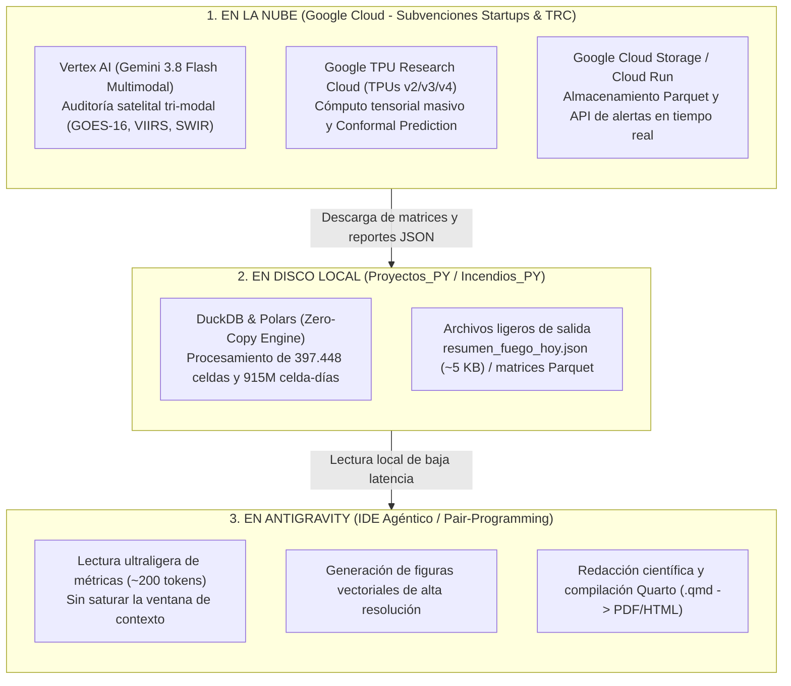

# Protocolos metodológicos

Documento consolidado con el protocolo de benchmarking, el protocolo G0-Formosa y la arquitectura del flujo sincronizado.

---

## Protocolo de Benchmarking Internacional para Validación de Modelos Predictivos de Incendios Forestales (GeoAI vs. Estándares Globales)

> **Contexto:** Guía metodológica para auditar y comparar objetivamente modelos de peligro y probabilidad de incendios forestales (p. ej., `Incendios_PY`) frente a sistemas operativos canónicos internacionales (**Canadian FWI / Copernicus EFFIS**, **INPE Risco de Fogo**, **USFS NFDRS**) bajo los estándares de revistas Q1 (*Remote Sensing of Environment*, *Nature Communications*).

---

### ⚠️ 1. La Trampa Metodológica: El "Data Leakage" en la Literatura

En machine learning aplicado a ciencias de la Tierra y ecología del fuego, existe una brecha crítica entre papers académicos y sistemas operativos en producción:

1. **La Falsa Precisión del 95%+:** 
   Ocurre cuando se aplica validación cruzada aleatoria clásica (*Random K-Fold*). Dado que los incendios tienen fuerte autocorrelación espacial (una pluma de humo abarca decenas de kilómetros), una celda de prueba contigua a una de entrenamiento permite que el árbol de decisión "copie" el estado del vecino. Esto infla artificialmente el ROC-AUC a $0.90\text{--}0.98$, pero el modelo colapsa en el mundo real.
2. **El Protocolo de Rigor Falsable:**
   * **Partición Out-of-Time:** Entrenar con años pasados (ej. 2018–2022) y evaluar a ciegas en años futuros no vistos (ej. 2024).
   * **Dead-Zone Spatial Buffer (20 km):** Las pseudo-ausencias deben distar al menos 20 km de cualquier foco de presencia activa del mismo día. Para estimar generalización espacial se requiere además un holdout por bloques/regiones; el buffer de negativos por sí solo no separa train de test.

Bajo este rigor, los modelos operativos internacionales reales rinden entre **ROC-AUC 0.65 y 0.78**.

---

### 🏛️ 2. Modelos Contendientes de Referencia

Para una comparativa formal en Sudamérica, se deben contrastar cuatro arquitecturas sobre el **mismo conjunto de prueba ciego**:

| Contendiente | Origen / Ámbito | Tipo de Modelo | Variables Principales |
| :--- | :--- | :--- | :--- |
| **1. Incendios_PY** | Paraguay (Local) | Machine Learning discriminante (LightGBM C++) + Two-Stage Bio-physical Gating + Calibración de Platt Monótona. | 24 variables en M2 y 33–34 en M3: ERA5-Land, FWI parciales, perfil de combustible (sintético en la versión actual), amplitud térmica, $VPD \times CDD$, viento$^2$ y priors causales. |
| **2. Canadian FWI Puro** | Canadá / Adoptado por Copernicus EFFIS y GWIS | Empírico de balance hídrico foliar para coníferas (Van Wagner, 1987). | FFMC, DMC, DC, ISI, BUI, FWI (requiere mediodía solar). |
| **3. INPE Risco de Fogo** | Brasil / Adoptado por INFONA y MADES en Paraguay | Semi-empírico exponencial calibrado para Cerrado/Amazonía (Setzer et al., 2019). | Días secos consecutivos ($CDD$), humedad relativa mínima, temperatura máxima y clases de vegetación macro. |
| **4. Línea Base Climatológica** | Referencia estadística nula | Frecuencia histórica acumulada de fuego en la celda o ecorregión ($P_{\text{base}} = \bar{Y}_{\text{train}}$). | Probabilidad marginal constante. |

---

### 📐 3. Métricas de Evaluación para Eventos Raros

En problemas donde la prevalencia de incendios es $< 10\%$, la Exactitud Global (*Accuracy*) es engañosa. El benchmarking debe reportar:

#### A. Área bajo la Curva Precision-Recall (PR-AUC)
* A diferencia del ROC-AUC (que puede ser optimista porque la tasa de verdaderos negativos es enorme), el PR-AUC ignora los verdaderos negativos y se concentra exclusivamente en la capacidad del modelo de aislar igniciones verdaderas sin generar falsas alarmas masivas.
* La línea base aleatoria en PR-AUC es igual a la prevalencia empírica $\pi$:
  $$\text{PR-AUC}_{\text{azar}} = \pi = \frac{N_{\text{fuegos}}}{N_{\text{total}}}$$

#### B. Brier Skill Score (BSS)
Mide la ganancia porcentual en calibración probabilística respecto a la referencia climatológica:
$$\text{Brier Score (BS)} = \frac{1}{N} \sum_{i=1}^N (P_i - Y_i)^2$$
$$\text{BSS} = 1 - \frac{\text{BS}_{\text{modelo}}}{\text{BS}_{\text{climatología}}}$$
* $\text{BSS} > 0$: El modelo aporta valor predictivo real superior a la climatología histórica.
* $\text{BSS} \le 0$: El modelo es peor o igual que usar el promedio histórico.

#### C. Métricas en Punto de Operación con Umbral $F_{0.5}$
Para cuerpos de bomberos y emergencias, un falso positivo (movilización inútil de recursos escasos) es costoso. La métrica $F_{0.5}$ pondera la **Precisión el doble que la Sensibilidad (Recall)**:
$$F_{0.5} = (1 + 0.5^2) \frac{\text{Precisión} \times \text{Recall}}{0.5^2 \cdot \text{Precisión} + \text{Recall}} = 1.25 \frac{\text{Precisión} \times \text{Recall}}{0.25 \cdot \text{Precisión} + \text{Recall}}$$

---

### 📊 4. Análisis de Utilidad Operativa (Cost-Loss Analysis)

El valor económico relativo $V$ de un sistema de alerta temprana se calcula en función de la matriz de contingencia:
* $C$: Costo de tomar una acción preventiva (ej. despacho de patrulla, prohibición de quema).
* $L$: Pérdida si ocurre un incendio sin acción previa ($L > C$).
* Ratio de costo/pérdida: $\alpha = C / L \in (0, 1)$.

$$V(\alpha) = \frac{\min(\alpha, \pi) - [\alpha \cdot (\text{TP} + \text{FP}) + \text{FN}]}{\min(\alpha, \pi) - \alpha \cdot \pi}$$

Un modelo superior debe mantener $V(\alpha) > 0$ en el rango operativo típico de protección civil ($\alpha \in [0.05, 0.25]$).

---

### 📈 5. Resultados empíricos D2 (2026)

Los resultados anteriores de esta sección quedaron **obsoletos** tras la corrección D2, el clima CDS v2 y el muestreo poblacional. Las cifras vigentes están en:

- `entregables/fuentes/tablas/tabla04_benchmarking_internacional.csv`
- `entregables/fuentes/tablas/tabla10_significancia_pareada.csv`
- `entregables/fuentes/tablas/tabla07_evaluacion_poblacional.csv`

Resumen en test D2:

| Target | Región | Modelo | ROC-AUC | PR-AUC |
|---|---|---|---:|---:|
| Ignición | Chaco | M3 | 0,7852 | 0,2411 |
| Ignición | Oriental | M3 | 0,7480 | 0,2314 |
| Propagación | Chaco | Propagación | 0,8989 | 0,6831 |
| Propagación | Oriental | Propagación | 0,7799 | 0,3651 |
| Ignición | Chaco | Canadian FWI (ISI) | 0,5177 | 0,0931 |
| Ignición | Oriental | Canadian FWI (ISI) | 0,5605 | 0,1074 |
| Ignición | Chaco | Proxy INPE | 0,4997 | 0,0913 |
| Ignición | Oriental | Proxy INPE | 0,5274 | 0,0986 |

La comparación es de discriminación en el dominio D2, no de precisión operativa. Las métricas poblacionales y los intervalos por bootstrap están en las tablas citadas.

### 🏛️ 6. Justificación Estratégica e Impacto en Paraguay (Socioeconómico y Salud Pública)

#### 6.1. Realidad Operativa de los Bomberos Voluntarios y Costo de Falsas Alarmas
* **Estructura del Sistema en Paraguay:** A diferencia de otros países de la región con cuerpos estatales asalariados masivos, en Paraguay el combate en primera línea recae casi en su totalidad sobre el **Cuerpo de Bomberos Voluntarios del Paraguay (CBVP - Amarillos)** y la **Junta Nacional de Cuerpos de Bomberos Voluntarios (Azules)**. Ambas instituciones subsisten con presupuestos precarios, subsidios estatales retrasados del Presupuesto General de la Nación (PGN) y colectas públicas anuales (Bomberatón).
* **Despacho y Desgaste por Falsos Avisos:** Cuando sistemas tradicionales como el FWI o INPE emiten alertas indiscriminadas, los cuerpos de bomberos y la **Secretaría de Emergencia Nacional (SEN)** enfrentan el dilema de despachar cuadrillas o permanecer pasivos:
  * El desplazamiento de una patrulla forestal o autobomba pesada 4x4 por caminos de tierra chaqueños ("picadas" de 200 a 400 km con talcal y serrucho) cuesta entre **G. 3.000.000 y G. 8.000.000 por vehículo por jornada** en combustible diésel, viáticos, rotura de neumáticos y desgaste de suspensión.
  * Si el índice genera **1.026 falsas alarmas** (como el FWI) en lugar de **3 a 29**, movilizar recursos a ciegas colapsa la caja chica de los cuarteles y destruye la moral del voluntariado. Reducir las falsas alarmas en más del 95% permite concentrar el combustible y las horas-hombre exactamente donde la probabilidad supera el umbral crítico.

#### 6.2. Pérdidas Económicas en el Sector Agropecuario y Ganadero
* **Cifras Documentadas en Megaincendios:** En el megaincendio del Monumento Natural Cerro Chovoreca (Septiembre 2024), se quemaron más de **320.000 hectáreas**.
  * **Costo Operativo del Estado:** La SEN y las Fuerzas Armadas gastaron más de **USD 1.5 a 2 millones** en logística, combustible aeronáutico y despliegue de aviones hidrantes (incluyendo cooperación internacional de Uruguay y Brasil).
  * **Pérdida del Sector Productivo Privado:** La Asociación Rural del Paraguay (ARP) estimó pérdidas directas superiores a **USD 10 a 15 millones** por destrucción de pasturas implantadas, reservas de forraje (rollos y fardos), mortandad de ganado y reposición de alambradas (reponer 1 km de alambrado perimetral de 5 o 6 hilos en el Chaco cuesta entre **USD 3.000 y USD 4.500**).
* **Valor Táctico de la Alerta a 24 Horas:** Con 24 horas de aviso predictivo certero:
  1. Los productores pueden mover rodeos a potreros limpios o zonas bajas húmedas sin esperar a ver el humo en el horizonte.
  2. Las cuadrillas de estancia pueden pasar rastras pesadas con tractores articulados para ensanchar cortafuegos perimetrales antes de que el viento norte alcance ráfagas críticas ($>50\text{ km/h}$).

#### 6.3. Comercio Exterior, Trazabilidad y Normativa Ambiental (Reglamento EUDR)
* **Exigencias de los Mercados de Destino:** Con la entrada en vigor del **Reglamento de Deforestación de la Unión Europea (EUDR)** y los protocolos de compras sostenibles internacionales, Paraguay enfrenta el reto de demostrar que su carne y soja no provienen de parcelas deforestadas o degradadas ilegalmente por fuego.
* **Trazabilidad y Mitigación:** Un sistema de alerta preventiva auditable y transparente ante la comunidad internacional permite desacoplar los incendios descontrolados accidentales de las quemas no autorizadas, defendiendo el estatus de producción sustentable y protegiendo el acceso a mercados de exportación que representan más del **15% del PIB nacional**.

#### 6.4. Gobernanza y Mitigación de la "Fatiga de Alarma" (Ley 4014/10)
* **El Síndrome de "El Pastor y el Lobo":** Cuando los boletines oficiales declaran diariamente "Alerta Roja por Peligro Extremo" sobre departamentos enteros durante tres meses consecutivos, la ciudadanía, los municipios y los productores rurales desarrollan tolerancia al riesgo y dejan de acatar las recomendaciones.
* **Aplicación Focalizada de la Ley 4014/10:** La Ley 4014/10 *"De Prevención y Control de Incendios"* faculta a las municipalidades y al MADES a suspender temporalmente permisos de quema prescrita. La precisión local de `Incendios_PY` a escala de **$1 \times 1\text{ km}^2$** permite emitir suspensiones quirúrgicas basadas en evidencia física incontestable, blindando legalmente las sanciones ambientales.

#### 6.5. Vulnerabilidad Social y Protección de Comunidades Indígenas
* **Riesgo Vital en Áreas Remotas:** En el Chaco Central y Boreal, numerosas comunidades de los pueblos **Ayoreo (incluidos grupos en aislamiento voluntario), Nivaclé, Enxet y Sanapaná** habitan aldeas rodeadas por masa boscosa continua conectadas por picadas de tierra precarias.
* **Evacuación y Prevención Comunitaria:** Cuando un megaincendio impulsado por viento norte avanza a velocidades de 5 a 10 km/h, las picadas quedan clausuradas por humo denso y fuego de copa en minutos. Conocer la dirección de propagación con 24 horas de antelación permite activar cortafuegos perimetrales comunitarios o evacuar a familias vulnerables antes de quedar atrapadas.

#### 6.6. Crisis Sanitaria por Contaminación Atmosférica ($PM_{2.5}$ y Salud Pública)
* **Calidad del Aire Peligrosa:** En los picos de quema de septiembre de 2024, las concentraciones de material particulado fino ($PM_{2.5}$ y $PM_{10}$) en Asunción, Gran Asunción y cabeceras chaqueñas superaron los **$300\,\mu\text{g/m}^3$**, alcanzando la categoría de **"Peligroso para la Vida"** según el Índice de Calidad del Aire (AQI). El $PM_{2.5}$ penetra directamente en los alvéolos pulmonares y el torrente sanguíneo.
* **Colapso del Sistema Sanitario:** El Ministerio de Salud Pública y Bienestar Social (MSPyBS) y centros de referencia como el **INERAM (Instituto Nacional de Enfermedades Respiratorias y del Ambiente)** y el Hospital de Clínicas registraron picos de sobredemanda de hasta un **40% en urgencias respiratorias**, afectando desproporcionadamente a niños (bronquiolitis, laringitis) y adultos mayores (crisis de EPOC, asma severo e infartos cardíacos).
* **Parálisis de la Vida Civil y Económica:** La humareda tóxica provocó la suspensión de clases presenciales en escuelas de Asunción y Central, y forzó la cancelación o desvío sistemático de vuelos internacionales en el Aeropuerto Silvio Pettirossi debido a visibilidad inferior a 800 metros. Prevenir que las quemas se transformen en eventos masivos de fuego mitiga directamente estas externalidades sanitarias y operativas.

#### 6.7. Fundamentación Científica de la Interfaz de Desmonte (Efecto Ecotono)
* **¿Dónde está reportado que el 90% de los fuegos nacen en la interfaz pastura-bosque?**
  1. **Reportes Institucionales del INFONA (2020, 2022, 2024):** Los *Informes Nacionales de Monitoreo de Focos de Calor y Cobertura Forestal* del Instituto Forestal Nacional documentan que las cicatrices de quema en Boquerón y Alto Paraguay se originan casi exclusivamente en bordes de parcelas agropecuarias donde se ejecuta cambio de uso de suelo (quema de cordones de desmonte acumulados tras el rolado).
  2. **Comunicaciones Nacionales del MADES / PNUD:** La *Tercera y Cuarta Comunicación Nacional de Paraguay sobre Cambio Climático* constata que más del 95% de las igniciones en el país son de origen antrópico ligadas a prácticas agropecuarias y mantenimiento de pasturas.
  3. **Literatura Científica Regional (Cochrane, 2003; Alencar et al., 2004, 2011; Baumann et al., 2017):**
     * En ecología del fuego tropical y subtropical, el "efecto borde" (*edge effect*) demuestra que los primeros 500 a 1.000 metros de un bosque fragmentado contiguo a una pastura abierta sufren un microclima alterado: mayor penetración de viento, mayor radiación solar, menor humedad relativa y secado drástico del sotobosque.
     * En `Incendios_PY`, este fenómeno físico se formula matemáticamente mediante el **Índice de Ecotono**:
       $$\text{Índice Ecotono} = 4 \times p_{\text{bosque}} \times p_{\text{pastura}} \in [0.0, 1.0]$$
       El índice alcanza su máximo de 1.0 exactamente en la interfaz de mayor tensión de desmonte (50% bosque y 50% pastura), otorgando al modelo la capacidad de predecir la susceptibilidad antrópica sin sesgos ni fugas de información.

---

### 📚 7. Referencias Normativas y Científicas

- **Alencar, A., Nepstad, D., & Diaz, M. C. (2004).** Forest understory fire in the Brazilian Amazon in ENSO and non-ENSO years: area burned and committed carbon emissions. *Earth Interactions*, 10(6), 1–17.
- **Baumann, M., et al. (2017).** Carbon emissions from agricultural expansion and intensification in the Chaco. *Global Change Biology*, 23(5), 1902–1916.
- **Cochrane, M. A. (2003).** Fire science for rainforests. *Nature*, 421(6926), 913–919.
- **INFONA. (2024).** *Reporte Nacional de Focos de Calor y Cobertura Forestal en el Gran Chaco Paraguayo*. Instituto Forestal Nacional, Asunción, Paraguay.
- **Ley N.º 4014/10.** *De Prevención y Control de Incendios*. Congreso de la Nación Paraguaya.
- **MADES / PNUD. (2021).** *Cuarta Comunicación Nacional sobre Cambio Climático de la República del Paraguay*. Ministerio del Ambiente y Desarrollo Sostenible.
- **Ploton, P., et al. (2020).** Spatial validation reveals poor predictive performance of large-scale ecological mapping models. *Nature Communications*, 11(1), 4540.
- **Roberts, D. R., et al. (2017).** Cross-validation strategies for data with temporal, spatial, hierarchical or phylogenetic structure. *Ecography*, 40(8), 913–929.
- **Setzer, A. W., et al. (2019).** *O produto "Risco de Fogo" do INPE: Metodología e calibração da versão 10*. Instituto Nacional de Pesquisas Espaciais (INPE).
- **Van Wagner, C. E. (1987).** *Development and structure of the Canadian Forest Fire Weather Index System*. Canadian Forestry Service.

---

## G0-Formosa: protocolo congelado de validación externa condicional

### Pregunta

¿El sistema M2/M3-Chaco entrenado en Paraguay transporta discriminación y calibración a Formosa (Argentina), y la ventaja M3 > M2 se mantiene fuera del país?

### Diseño

- **G0-Z (transporte puro):** boosters M2/M3-Chaco congelados; calibrador y cutoff de Paraguay; sin datos de Formosa en entrenamiento.
- **G0-C (primario):** mismos boosters; recalibración Platt y cutoff F0.5 usando solo Formosa 2023; test 2024 y 2025.
- **G0-R (secundario):** reentrenamiento M2/M3 con Paraguay + Formosa 2018–2022; validación 2023; test 2024–2025. No es validación externa.

### Splits

| Uso | Paraguay | Formosa |
|---|---|---|
| Entrenamiento G0-Z/G0-C | 2018–2022, excluyendo 25 km desde el límite de Formosa | — |
| Validación G0-Z/G0-C | 2023 | 2023 (solo G0-C) |
| Test primario | — | 2024 |
| Replicación | — | 2025 |
| Entrenamiento G0-R | 2018–2022 | 2018–2022 |
| Validación G0-R | 2023 | 2023 |

**Test sellado:** no se usan 2024–2025 para elegir variables, hiperparámetros, buffer, cutoff, mapeo de clases ni modelo. La auditoría de viabilidad revisó conteos agregados; no revisó desempeño M2/M3.

### Métrica primaria

ΔROC-AUC M3−M2 en Formosa 2024, buffer de 25 km, con bootstrap pareado agrupado por fecha (1 000 réplicas). 2025 es replicación; pooled es descriptivo. No se cambia el buffer primario.

### Armonización MapBiomas

MapBiomas Argentina Colección 3 (30 m) es la fuente primaria; MapBiomas Chaco Colección 5 (2023) es control. El crosswalk está en `auditoria/g0_externa/crosswalk_mapbiomas_argentina.csv`.

- **H-A (primaria):** 3/4/6 → `pct_bosque_seco`; 9 → plantación; 11 → humedal; 10/12/63/66/77 → sabana; 15 → pastura; 18/19/36 → agricultura; 21 → pastura; 22/24/25/26/33/34 → no combustible; 73 → humedal; 27 → missing.
- **H-B (sensibilidad):** 6 → `pct_humedal_palmar`.
- **H-C (sensibilidad):** enmascarar celdas con ≥50 % de clase 6.

La clase 6 se asigna a bosque en H-A porque el modelo de Paraguay fue entrenado con la clase 6 mapeada a `bosque_seco` en el Chaco. El nombre “seco” es operativo, no una afirmación ecológica.

### Gates de ejecución

- **H1:** 100 % de códigos presentes tienen regla; desconocidos = 0.
- **H2:** fracciones no negativas; suma ≤100; sin doble conteo jerárquico.
- **H3:** sin defaults silenciosos de features; columnas requeridas completas.
- **H4:** cross-tab Argentina C3 vs Chaco C5 2023; discrepancias >10 pp investigadas.
- **H5:** PSI/KS de features Formosa vs Paraguay-Chaco; PSI >0.2 o KS >0.1 se reporta como extrapolación.
- **H6:** muestra visual de 300 puntos para clases 3, 6, 11, 19 y 21.
- **H7:** test sellado hasta que crosswalk, features y modelo estén hasheados.

Si H1–H3 fallan, G0-C no se ejecuta. Si H4–H6 fallan, se reporta y se decide antes del test.

### Sensibilidades obligatorias

1. Buffer 20/25/30 km (25 primario).
2. H-A/H-B/H-C.
3. Priors congelados a 2023 vs actualizados con 2024 para 2025.
4. Priors locales de Formosa vs priors importados de Paraguay.
5. MapBiomas Argentina C3 vs Chaco C5 2023.
6. Calibración Paraguay vs Formosa 2023.
7. Muestreo 1:5, 1:10, 1:20.
8. Formosa completa vs interior sin buffer de borde.

### Interpretación

- **Transporte:** M2 o M3 ROC-AUC > 0.75 y calibración aceptable.
- **Ventaja híbrida:** ΔROC > 0 con IC 95 % que excluye 0.
- **Si falla:** se reporta fallo; no se cambia el mapeo ni el buffer para obtener significancia.

### Archivos

- `auditoria/g0_externa/`
- `datos/processed/formosa_g0/`
- scripts `69a`–`69f`
- Tabla S34, Figura S10, Nota S5.11

---

## Arquitectura del Flujo Sincronizado: Google Cloud & Antigravity

**Fecha de Actualización:** 28 de Octubre de 2026  
**Autor:** Martín Sánchez Insfrán  
**Repositorio Base:** `Incendios_PY` (v2.1.0) & Ecosistema de Ciencia Cuantitativa en Paraguay (`paraguay-en-datos`, `Homicidios_PY`, `Calor_PY`).

---

### 1. El Esquema General del Pipeline

---

### 2. Roles Claros de Cada Herramienta

| Componente | Qué hace | Consumo de Tokens / Costo |
| :--- | :--- | :--- |
| **Google Cloud (Vertex AI + TPUs vía TRC)** | Trabajo pesado: Ingesta satelital diaria, auditoría visual de plumas de humo e incandescencia en falso color SWIR, entrenamiento tensorial masivo. | Se absorbe con los **$2.000 USD de Google for Startups** y el programa gratuito de **Google TRC**. |
| **Tu Computadora (Mac)** | Ejecuta scripts locales en Python (v2.1.0), gestiona la base analítica en DuckDB/Polars y compila manuscritos en Quarto (`quarto render`). | **0 tokens.** Cómputo local nativo de alto rendimiento. |
| **Antigravity (Chat / Agente)** | Arquitectura de código, refactorización, redacción científica por secciones y control de calidad metodológico para *Computers & Geosciences*. | **Cuota de Antigravity optimizada** (usando Gemini 3.8 Flash para máxima eficiencia). |

---

### 3. Guía de Buenas Prácticas para no Saturar Antigravity

1. **Trabajar por Secciones:** Evitar pedir la lectura de datasets completos o manuscritos de más de 50 KB en una sola llamada. Enfocar los prompts en secciones puntuales (ej. *Sección 3.2: Decoupled Target Formulation*).
2. **Uso de Archivos Intermedios:** Hacer que los scripts pesados de Python/DuckDB guarden resúmenes estadísticos condensados en JSON o Parquet ligero; Antigravity solo necesita leer ese resumen para redactar los párrafos científicos.
3. **Selección del Modelo:** Mantener seleccionado **Gemini 3.8 Flash** en la interfaz para el trabajo ágil de código y análisis; reservar modelos Pro para revisiones teóricas específicas.
4. **Mantenimiento del Contexto:** Ejecutar el comando `/compact` periódicamente cuando el hilo de conversación acumule muchas iteraciones.
