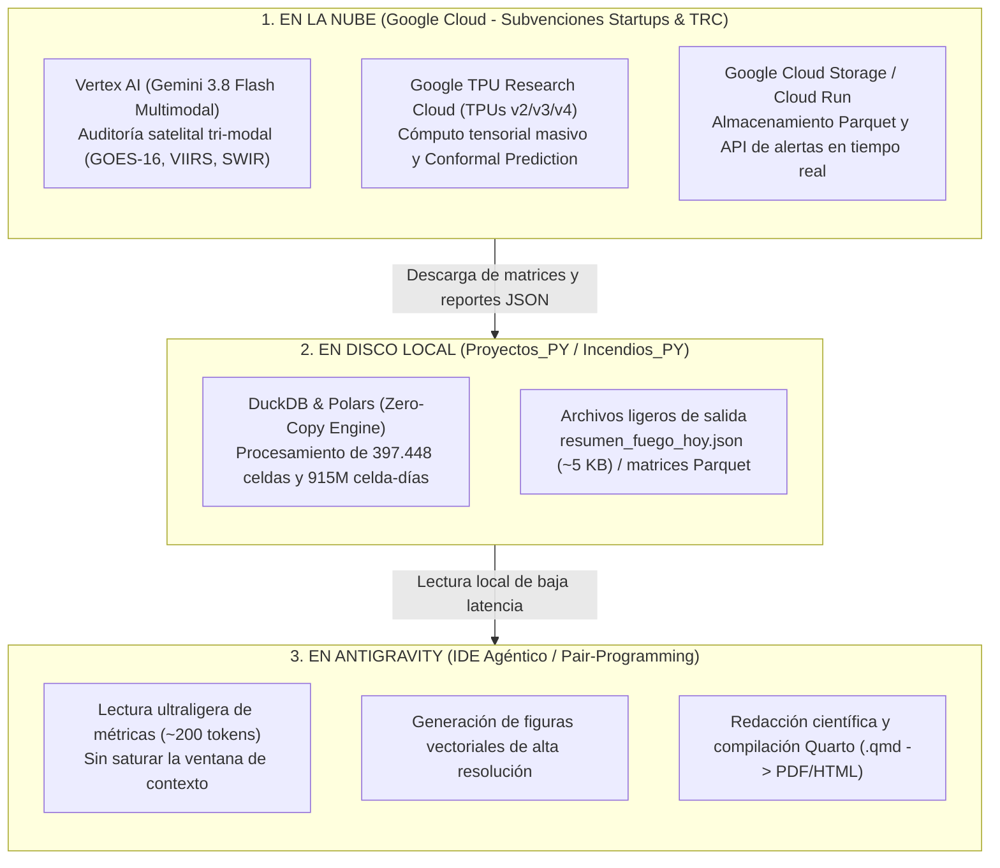

# Arquitectura del Flujo Sincronizado: Google Cloud & Antigravity

**Fecha de Actualización:** 28 de Octubre de 2026  
**Autor:** Martín Sánchez Insfrán  
**Repositorio Base:** `Incendios_PY` (v2.1.0) & Ecosistema de Ciencia Cuantitativa en Paraguay (`paraguay-en-datos`, `Homicidios_PY`, `Calor_PY`).

---

## 1. El Esquema General del Pipeline

---

## 2. Roles Claros de Cada Herramienta

| Componente | Qué hace | Consumo de Tokens / Costo |
| :--- | :--- | :--- |
| **Google Cloud (Vertex AI + TPUs vía TRC)** | Trabajo pesado: Ingesta satelital diaria, auditoría visual de plumas de humo e incandescencia en falso color SWIR, entrenamiento tensorial masivo. | Se absorbe con los **$2.000 USD de Google for Startups** y el programa gratuito de **Google TRC**. |
| **Tu Computadora (Mac)** | Ejecuta scripts locales en Python (v2.1.0), gestiona la base analítica en DuckDB/Polars y compila manuscritos en Quarto (`quarto render`). | **0 tokens.** Cómputo local nativo de alto rendimiento. |
| **Antigravity (Chat / Agente)** | Arquitectura de código, refactorización, redacción científica por secciones y control de calidad metodológico para *Computers & Geosciences*. | **Cuota de Antigravity optimizada** (usando Gemini 3.8 Flash para máxima eficiencia). |

---

## 3. Guía de Buenas Prácticas para no Saturar Antigravity

1. **Trabajar por Secciones:** Evitar pedir la lectura de datasets completos o manuscritos de más de 50 KB en una sola llamada. Enfocar los prompts en secciones puntuales (ej. *Sección 3.2: Decoupled Target Formulation*).
2. **Uso de Archivos Intermedios:** Hacer que los scripts pesados de Python/DuckDB guarden resúmenes estadísticos condensados en JSON o Parquet ligero; Antigravity solo necesita leer ese resumen para redactar los párrafos científicos.
3. **Selección del Modelo:** Mantener seleccionado **Gemini 3.8 Flash** en la interfaz para el trabajo ágil de código y análisis; reservar modelos Pro para revisiones teóricas específicas.
4. **Mantenimiento del Contexto:** Ejecutar el comando `/compact` periódicamente cuando el hilo de conversación acumule muchas iteraciones.
