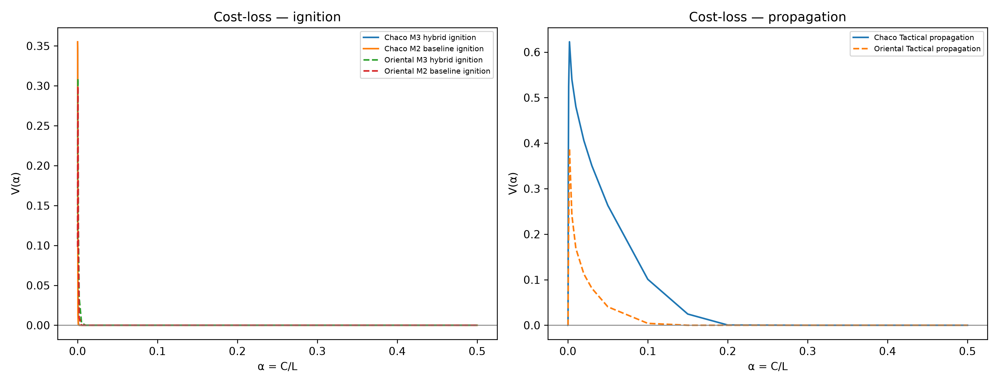

> **Target journal:** *Computers & Geosciences* (Elsevier) — **Article type:** Research Article 
> **Peer review:** single-anonymized, as specified by the journal. Author, affiliation and repository information are provided on the title page.

---

# Resumen {.unnumbered}

La predicción operativa de incendios forestales mediante aprendizaje automático en geociencias enfrenta dos fallas metodológicas críticas: el sesgo de atajo espacial (*spatial shortcut learning*) derivado de la autocorrelación de las plumas térmicas, y la dificultad de los índices climáticos boreales (como el *Canadian Forest Fire Weather Index*, FWI) para capturar la desecación de biomas subtropicales como el Gran Chaco. Presentamos `Incendios_PY`, una arquitectura GeoAI multiescala y desacoplada para la República del Paraguay ($400.006$ celdas de $1\text{ km}^2$), sobre una serie de 8 años (2018–2025). El sistema aplica un gating biofísico de primera etapa (combustible, $VPD \ge 0,8\text{ kPa}$, lluvia de 48 h $< 10\text{ mm}$) que reduce el 21,7 % de las celdas-día y retiene el 97,17 % de las detecciones térmicas. Para evitar fugas de etiqueta, los priors de susceptibilidad histórica usan un corte mensual y una ventana móvil de 3 años. El modelo de ignición híbrida $\mathcal{M}_3$ combina clima ERA5-Land, MapBiomas real (`collection2_2023`), ecotono, corredores antrópicos y priors causales; la propagación táctica usa un kernel causal $t-1$ con FRP de VIIRS. La evaluación sigue una definición D2: ignición primaria sin fuego t-1 en 25 km ni fuego en la celda en los últimos 10 días, y propagación dentro de 25 km de un fuego t-1. El test D2 incluye $N=1.813.966$ celdas-día (376.552 ignición y 1.437.414 propagación) en 2024–2025. En test, $\mathcal{M}_3$ obtiene ROC-AUC 0,7851 (Chaco) y 0,7485 (Oriental), frente a 0,5185/0,5569 del FWI completo y 0,5386/0,4994 del INPE Risco de Fogo; la propagación alcanza 0,8989/0,7799. La precisión case-control en el corte $F_{0.5}$ es 27,54 %/29,67 % para ignición y 84,94 %/62,42 % para propagación; al corregir por prevalencia poblacional (~0,015 %/0,041 %), la precisión operativa cae a 0,062 %/0,206 % y 9,96 %/4,49 %, respectivamente. En un holdout espacial por bloques de 50 km, M3 cae a ROC-AUC 0,6243/0,5754, mientras que M1 obtiene 0,6338/0,6176: la ventaja híbrida es temporal y específica de celdas con historia de fuego; para celdas nuevas la alerta usa M1 como fallback. Con clima de t-1, M3 conserva ROC-AUC 0,7841/0,7465. En cost-loss, M3 no supera claramente a M2 en ignición; la capa de propagación sí muestra valor operativo para $\alpha \approx 0,002$. El pipeline se midió en ~1,569 s y ~2,18 GB de RAM pico en ARM64. Es un nowcast/hindcast: las features climáticas son del mismo día. La cobertura conformal empírica fue 89,85 %/90,19 % para nominal 90 % y 95,02 %/94,56 % para 95 %, sin garantía formal bajo cambio temporal.

**Palabras clave:** Incendios forestales; GeoAI; Gran Chaco; LightGBM; Reanálisis ERA5; NASA FIRMS; Desacoplamiento biofísico; Autocorrelación espacial; Benchmarking internacional.

---

# Abstract {.unnumbered}

Operational wildfire forecasting via machine learning in geosciences faces two critical methodological issues: spatial shortcut learning from thermal-plume autocorrelation, and the limited transferability of boreal fire-weather indices (such as the Canadian FWI) to moisture-limited subtropical biomes like the Gran Chaco. We present `Incendios_PY`, a decoupled multiscale GeoAI framework for Paraguay ($400,006$ $1\text{-km}^2$ cells) over an 8-year record (2018–2025). A first-stage biophysical gating (fuel, $VPD \ge 0.8\text{ kPa}$, 48-h rainfall $< 10\text{ mm}$) removes 21.7 % of cell-days while retaining 97.17 % of thermal detections. Historical-susceptibility priors use a monthly cutoff and a rolling 3-year window. The hybrid ignition model $\mathcal{M}_3$ combines ERA5-Land weather, real MapBiomas (`collection2_2023`), ecotone, anthropogenic corridors and causal priors; tactical propagation uses a causal $t-1$ kernel with VIIRS FRP. Evaluation follows a D2 definition: primary ignition with no t-1 fire within 25 km and no same-cell fire in the previous 10 days, and propagation within 25 km of a t-1 fire. The D2 test contains $N=1,813,966$ cell-days (376,552 ignition and 1,437,414 propagation) for 2024–2025. On test, $\mathcal{M}_3$ achieves ROC-AUC 0.7851 (Chaco) and 0.7485 (Oriental), versus 0.5185/0.5569 for full FWI and 0.5386/0.4994 for INPE; propagation reaches 0.8989/0.7799. Case-control $F_{0.5}$ precision is 27.54 %/29.67 % for ignition and 84.94 %/62.42 % for propagation; after correction to population prevalence (~0.015 %/0.041 %), operational precision drops to 0.062 %/0.206 % and 9.96 %/4.49 %, respectively. In a 50-km spatial block holdout, M3 drops to ROC-AUC 0.6243/0.5754, whereas M1 reaches 0.6338/0.6176: the hybrid advantage is temporal and specific to cells with fire history; the alert uses M1 as a fallback for new cells. With t-1 weather, M3 retains ROC-AUC 0.7841/0.7465. In cost-loss terms, M3 does not clearly outperform M2 for ignition; propagation shows operational value near $\alpha \approx 0.002$. The pipeline measured ~1.569 s and ~2.18 GB peak RAM on ARM64. It is a nowcast/hindcast: weather features are same-day. Empirical conformal coverage was 89.85 %/90.19 % for nominal 90 % and 95.02 %/94.56 % for 95 %, without a formal guarantee under temporal shift.

**Keywords:** Wildfire hazard nowcasting; GeoAI; Gran Chaco; LightGBM; ERA5 reanalysis; NASA FIRMS; Biophysical decoupling; Spatial autocorrelation; International benchmarking.

---

# 1. Introducción

Los incendios de vegetación en el Cono Sur de América del Sur representan una de las principales amenazas para la conservación biológica, la estabilidad climática regional y la salud pública [@flannigan2009; @jolly2015; @baumann2017]. La región del **Gran Chaco Americano** —el segundo bioma boscoso más extenso del continente tras la Amazonía— experimenta transformaciones de cobertura y cambio de uso de suelo aceleradas por la frontera agropecuaria [@vallejos2015; @alvarado2018]. En este mosaico ecológico, las prácticas tradicionales de desmonte y quema de pasturas, combinadas con sequías sinópticas recurrentes y temperaturas extremas ($> 42^\circ\text{C}$), desatan conflagraciones de escala catastrófica similares a las registradas en biomas vecinos del Pantanal y Cerrado [@pivello2021], con temporadas críticas sin precedentes en 2019, 2020 y 2024.

A nivel internacional, la estimación del peligro y propagación de incendios se ha sustentado históricamente en dos vertientes: los modelos mecanicistas basados en balances térmicos y dinámica de fluidos de combustibles vegetales [@rothermel1972; @andrews2014], y los sistemas empíricos semi-mecanicistas de peligro meteorológico. Entre estos últimos, el sistema canadiense *Forest Fire Weather Index* (FWI) [@vanwagner1987; @stocks1989] constituye el estándar adoptado por el sistema europeo EFFIS (*European Forest Fire Information System*) y por la plataforma global GWIS [@sanmiguel2012]. Con la consolidación de la teledetección satelital de incendios activos —iniciada por MODIS [@justice2002; @giglio2016] y continuada por VIIRS [@schroeder2014] junto con productos multidecenales de área quemada [@chuvieco2019; @roy2008; @artes2019]—, en Sudamérica el *Instituto Nacional de Pesquisas Espaciais* (INPE) de Brasil desarrolló el índice *Risco de Fogo* [@setzer2019], ampliamente empleado por los organismos ambientales de Paraguay (MADES e INFONA). No obstante, estos índices canónicos fueron formulados para bosques templados de coníferas o sabanas tropicales abiertas, mostrando serias inconsistencias de calibración al extrapolarse a biomas xerofíticos bajo déficit hídrico extremo como el Chaco Seco.

El auge de la inteligencia artificial geoespacial (*GeoAI*) y el aprendizaje automático (*Machine Learning*) ha propiciado una amplia gama de algoritmos de detección temprana y modelado predictivo de ignición [@jain2020review; @barmpoutis2020], predominantemente mediante ensambles de árboles de decisión como XGBoost [@chen2016xgboost], LightGBM [@ke2017lightgbm] y CatBoost [@prokhorenkova2018], así como clasificadores biofísicos [@rodrigues2014; @sayad2019; @coffield2019]. Sin embargo, la integración acrítica de estos métodos en geociencias enfrenta dos patologías metodológicas persistentes:

1. **La trampa del atajo espacial (*Spatial Shortcut Learning*) y la violación de independencia:**  
   Cuando un modelo de machine learning incluye covariables espaciales autorregresivas contiguas (distancia al fuego de la jornada anterior, densidad de focos térmicos adyacentes) sin aislar el mecanismo causante, el algoritmo sucumbe a un atajo espurio: aprende que *"si hay fuego al lado, hoy continuará el fuego"*. Aunque esta correlación infla artificialmente las métricas de prueba estándar (ROC-AUC $> 0,95$), el modelo se vuelve impotente para predecir **igniciones primarias espontáneas o antrópicas nuevas** en áreas bajo estrés hídrico extremo donde ayer no existía combustión [@roberts2017; @ploton2020]. Esta patología ignora los principios de la primera ley de la geografía [@tobler1970] y los desafíos bien documentados de la autocorrelación espacial en modelado ecológico [@legendre1993; @dormann2007; @meyer2021].
2. **La disociación entre conocimiento físico y modelos de caja negra:**  
   Frecuentemente los modelos predictivos puramente estadísticos omiten restricciones cinemáticas elementales (e.g., combustión imposible bajo lluvia torrencial o ausencia total de biomasa combustible), lo que ha motivado el paradigma emergente de aprendizaje automático informado por la física (*Physics-Informed Machine Learning*, PIML) en ciencias de la Tierra [@reichstein2019; @willard2022].
3. **La ineficiencia computacional para la alerta operativa diaria:**  
   Muchos modelos académicos dependen de secuencias manuales en software SIG de escritorio o rutinas pesadas de geoprocesamiento ráster, impidiendo su despliegue automatizado y soberano a escala de país a resolución de 1 km² en tiempo subsegundo.

Para resolver estas limitaciones, este artículo presenta el diseño, formulación matemática y evaluación del sistema computacional `Incendios_PY`. Las contribuciones fundamentales de este trabajo son:

- **Arquitectura Dual Desacoplada:** Separamos formalmente la tarea predictiva en dos capas ortogonales: un modelo de **Ignición Primaria Híbrida Socio-Ecológica ($\mathcal{M}_3$)** (libre de variables históricas de contagio $t-1$, asistido por ablación con $\mathcal{M}_1$ y $\mathcal{M}_2$) y un modelo de **Propagación Táctica Local** (gobernado por dinámica física de avance del frente de llama).
- **Filtrado Biofísico de Primera Etapa (*Two-Stage Gating*):** Implementamos un cribado cinemático previo que excluye celdas sin combustible o con inhibición meteorológica comprobada ($VPD < 0,8\text{ kPa}$, lluvia $48\text{h} \ge 10\text{ mm}$), reduciendo la dimensionalidad computacional en un promedio multianual del 21,7 % (hasta 92 % en días húmedos) reteniendo el 97,17 % de detecciones confirmadas.
- **Rigor de Validación Espaciotemporal Anti-Leakage:** Evaluamos el marco bajo partición temporal *out-of-time* multianual homogénea (2018–2022, validación 2023 y test ciego en la crisis extrema 2024–2025 sobre $1.813.966$ celdas-día sumando ambos dominios), con la definición D2 (sin fuego $t-1$ en 25 km ni fuego en la misma celda en 10 días) y un holdout espacial por bloques de 50 km con buffer de 20 km.
- **Benchmarking Comparativo Directo:** Demostramos una mayor discriminación de la arquitectura frente al Canadian FWI y al INPE Risco de Fogo en el mismo conjunto de prueba ciego; el bootstrap pareado agrupado por fecha ($B=1.000$) da $p \le 0,001$ en todas las comparaciones.
- **Pipeline Abierto y Reproducible:** Construimos una canalización analítica *zero-copy* en DuckDB y Polars capaz de evaluar 400.006 celdas soberanas en ~1,569 segundos en procesadores estándar.

---

# 2. Marco Teórico y Formulación Matemática

## 2.1 Física de la Desecación del Combustible Fino

La probabilidad de que una chispa o brasa dé origen a un incendio activo con calor radiativo mensurable ($FRP > 0$) está gobernada termodinámicamente por la humedad del combustible fino muerto (*Fine Fuel Moisture Code*, FFMC) y la dinámica de transferencia de calor en el lecho de combustible [@rothermel1972; @flannigan2016]. El balance de humedad entre el combustible vegetal y la atmósfera circundante depende críticamente del déficit de presión de vapor ($VPD$), definido como la diferencia entre la presión de vapor de saturación ($e_s$) y la presión de vapor real ($e_a$):

$$e_s(T) = 0,61078 \exp\left(\frac{17,27 \cdot T}{T + 237,3}\right) \quad [\text{kPa}]$$ {#eq-es}

$$e_a(T_{\text{dew}}) = 0,61078 \exp\left(\frac{17,27 \cdot T_{\text{dew}}}{T_{\text{dew}} + 237,3}\right) \quad [\text{kPa}]$$ {#eq-ea}

$$VPD = e_s(T) - e_a(T_{\text{dew}}) \quad [\text{kPa}]$$ {#eq-vpd}

donde $T$ es la temperatura del aire a 2 metros y $T_{\text{dew}}$ es la temperatura del punto de rocío obtenida del reanálisis ERA5-Land [@munoz2021era5land]. Cuando $VPD > 2,5\text{ kPa}$, la atmósfera ejerce una succión osmótica sobre el material vegetal fino, reduciendo su contenido de humedad foliar por debajo del umbral de extinción biológica ($\sim 12\text{ \%}$).

## 2.2 Cribado Biofísico de Primera Etapa (*Two-Stage Bio-physical Gating*)

Sea $\mathcal{S} = \{s_i\}_{i=1}^{N}$ el conjunto de $N = 400.006$ celdas discretas de $1\text{ km}^2$ que cubren el territorio paraguayo, y sea $t$ un día civil. En lugar de evaluar un modelo probabilístico complejo sobre la totalidad del espacio cartesiano $\mathcal{S} \times \{t\}$ ($1.168,8$ millones de combinaciones en 8 años), implementamos una restricción cinemática inspirada en los principios de aprendizaje automático guiado por la física (*Physics-Guided Machine Learning*) [@reichstein2019; @willard2022]. Definimos una función indicadora binaria de viabilidad biofísica $\Gamma(s_i, t) \in \{0, 1\}$:

$$\Gamma(s_i, t) = \mathbb{I}\left( \text{Combustible}(s_i) = 1 \right) \cdot \mathbb{I}\left( VPD(s_i, t) \ge 0,8\text{ kPa} \right) \cdot \mathbb{I}\left( P_{48h}(s_i, t) < 10,0\text{ mm} \right)$$ {#eq-gating}

donde $\text{Combustible}(s_i) = 0$ para cuerpos de agua, humedales permanentes y zonas urbanas impermeabilizadas. En esta versión el perfil es MapBiomas real (`collection2_2023`) [@mapbiomas2023], y $P_{48h}$ es la precipitación acumulada en las 48 horas previas. Si $\Gamma(s_i, t) = 0$, la probabilidad final de incendio se fija analíticamente en $P(Y_{i,t} = 1) \equiv 0$, reduciendo el espacio de búsqueda en un promedio multianual del 21,7 % ($915.562.849$ celda-días evaluadas de $1.168,8\text{M}$) y hasta un 92 % en días invernales húmedos, reteniendo el 97,17 % ($867.354$ de $892.533$) de las detecciones térmicas satelitales (excluyendo únicamente fuegos bajo lluvia o baja desecación).

## 2.3 Formulación del Desacoplamiento Dual: Ignición vs. Propagación

Definimos dos espacios de variables diferenciados para evitar la contaminación de atajos espaciales (@fig-arquitectura):

1. **Espacio de Ignición Primaria ($\mathcal{X}_{\text{ignición}}$):**  
   Estructurado jerárquicamente a través de tres niveles de formulación para el estudio de ablación: el modelo biofísico puro $\mathcal{M}_1$ ($17$ variables climáticas y de biomasa), el modelo base $\mathcal{M}_2$ ($24$ variables, que añade ecotono y ancla macro histórica a 25 km), y el modelo operativo final **$\mathcal{M}_3$ Híbrido Socio-Ecológico Multiescala** ($33\text{--}34$ variables): temperatura máxima y mínima, $VPD$, velocidad de viento sostenida, presión dinámica cuadrática ($(v/10)^2$), días secos consecutivos ($CDD$), déficit hídrico integrado ($VPD \times (CDD + 1)$), índices de balance hídrico foliar ($FFMC$, $ISI$), amplitud térmica diaria ($T_{\text{max}} - T_{\text{min}}$), proporciones del perfil de combustible MapBiomas real 2023, índice de ecotono perimetral, armónicos estacionales ($\sin/\cos \text{DOY}$), ventana de quema agroganadera, corredores de accesibilidad antrópica ($d_{\text{corredor}}$), densidad local a 5 y 10 km, focalización espacial y sinergias multiplicativas Acceso $\times VPD$ y Presión en Pasturas. **No incluye ninguna variable dependiente de incendios observados en $t-1$.**
2. **Espacio de Propagación Táctica ($\mathcal{X}_{\text{propagación}}$):**  
   Agrega a la formulación biofísica el kernel de proximidad espacial al frente de fuego activo más cercano en $t-1$ ($\text{dist\_foco\_t1\_km}$), la densidad local de focos térmicos en un radio de 25 km ($\text{focos\_25km\_t1}$) y la potencia radiativa del fuego acumulada ($\text{frp\_25km\_t1}$), totalizando 28 variables predictoras base.

{#fig-arquitectura width="100%"}

## 2.4 Kernel de Contagio Espaciotemporal Causal $t-1$

Para la propagación táctica, el avance de un incendio desde una celda activa $k$ hacia la celda candidata $i$ se parametriza mediante una distancia euclidiana proyectada UTM (Zona 21S, WGS 84, EPSG:32721):

$$d(s_i, \mathcal{F}_{t-1}) = \min_{s_k \in \mathcal{F}_{t-1}} \sqrt{(x_i - x_k)^2 + (y_i - y_k)^2} \quad [\text{km}]$$ {#eq-dist}

donde $\mathcal{F}_{t-1}$ es el conjunto de celdas con detección térmica satelital validada en la fecha $t-1$. La densidad local y la energía térmica antecedente se cuantifican mediante un kernel causal uniforme en ventana circular de $R = 25\text{ km}$:

$$\text{focos\_25km\_t1}(s_i) = \sum_{s_k \in \mathcal{F}_{t-1}} \mathbb{I}\left(\|s_i - s_k\| \le R\right)$$ {#eq-dens}

$$\text{frp\_25km\_t1}(s_i) = \sum_{s_k \in \mathcal{F}_{t-1}} FRP_k \cdot \mathbb{I}\left(\|s_i - s_k\| \le R\right) \quad [\text{MW}]$$ {#eq-frp}

donde la potencia radiativa del fuego ($FRP$) cuantifica la tasa instantánea de energía liberada por la biomasa en combustión [@wooster2005]. Adicionalmente, formalizamos el **Índice de Ecotono** ($\mathcal{E}_i$) como la interacción parabólica de borde entre la fracción de cobertura boscosa y pasturas dentro de la misma celda de 1 km²:

$$\mathcal{E}_i = 4,0 \cdot p_{\text{bosque}, i} \cdot p_{\text{pastura}, i} \in [0, 1]$$ {#eq-ecotono}

donde $p_{\text{bosque}, i}$ corresponde a la fracción de bosque seco xerofítico en el Chaco o de bosque atlántico en la Región Oriental, y $p_{\text{pastura}, i}$ es la fracción de pasturas cultivadas ($p \in [0, 1]$). Este índice alcanza su valor máximo teórico ($\mathcal{E}_i = 1,0$) cuando la celda presenta una partición paritaria (50 % bosque y 50 % pastura), modelando con exactitud la interfaz crítica de deforestación y quema de cordones donde la biomasa combustible seca toma contacto directo con fuentes de ignición antrópica.

## 2.5 Calibración Probabilística Monótona Acotada

Los árboles de decisión por gradiente generan puntuaciones (*logits*) que no representan necesariamente probabilidades bien calibradas en el sentido bayesiano [@niculescu2005]. Sin embargo, la regresión logística estándar de Platt [@platt1999] puede invertir la pendiente de la curva de calibración ($w < 0$) bajo desbalances de clases severos, destruyendo el orden de riesgo aprendido por el ensamble.

Para evitar esta distorsión, implementamos un **Calibrador de Platt Monótono Acotado**, optimizando los parámetros sigmoides $w, b$ mediante minimización del error cuadrático medio (*Brier Score*) sobre el conjunto de validación sujeta a restricción de monotonicidad estricta (algoritmo L-BFGS-B):

$$\min_{w, b} \frac{1}{M} \sum_{i=1}^{M} \left( y_i - \frac{1}{1 + \exp(-(w \cdot z_i + b))} \right)^2 \quad \text{sujeto a } w \in [0,10; \, 10,00], \; b \in [-10,00; \, 10,00]$$ {#eq-calibracion}

donde $z_i \in \mathbb{R}$ es el margen no calibrado del ensamble LightGBM. La cota inferior $w \ge 0,10$ garantiza que la función sea estrictamente creciente respecto al margen del árbol, preservando intacta el área bajo la curva ROC (*ROC-AUC*) y corrigiendo las frecuencias relativas predichas.

---

# 3. Arquitectura de Software y Datos Espaciales

## 3.1 Malla Geográfica Soberana en Tiempo Constante $O(1)$

A diferencia de los flujos de trabajo tradicionales basados en mallas ráster flotantes con problemas de alineación de celdas, definimos una **grilla vectorial nacional determinística de 1 km²** proyectada en UTM Zona 21S. La grilla abarca exactamente $400.006$ celdas poligonales soberanas que intersectan el contorno limítrofe oficial de la República del Paraguay (geoBoundaries ADM0).

Cada celda posee un identificador entero único de 64 bits (`cell_id`) calculado de manera biyectiva y reversible a partir de sus coordenadas euclidianas centrales:

$$\text{cell\_id} = \left\lfloor \frac{x_{\text{UTM}}}{1000} \right\rfloor \times 10^7 + \left\lfloor \frac{y_{\text{UTM}}}{1000} \right\rfloor$$ {#eq-cellid}

Esta estructura permite realizar cruces espaciales (*spatial joins*) con cualquier observación de campo, foco satelital o nodo meteorológico en **tiempo constante $O(1)$** mediante indexación relacional directa en memoria, suprimiendo la necesidad de evaluar predicados geométricos poligonales pesados (*Point-in-Polygon*) en tiempo de ejecución.

## 3.2 Ingesta Multi-Constelación NASA FIRMS y Corrección Bow-Tie

Las presencias de fuego provienen de la constelación de sensores satelitales VIIRS (375 m) a bordo de las plataformas polares Suomi-NPP y NOAA-20 (complementadas operativamente en tiempo real por NOAA-21) [@schroeder2014], que extienden las series históricas iniciadas por MODIS [@justice2002; @giglio2016]. Para garantizar la integridad de las etiquetas de entrenamiento, aplicamos un protocolo de depuración óptica en dos pasos:

1. **Corrección de Distorsión Óptica (*Bow-Tie Effect*):** Los píxeles hacia los extremos del barrido pueden elongarse geométricamente. Se aplica un filtro `scan <= 1,5 km`. En la ventana de datos usada el máximo observado fue 0,8 km, por lo que el filtro no descartó registros; se mantiene por robustez para otras ventanas orbitales.
2. **Exclusión de Detecciones de Baja Confianza:** Se descartan focos etiquetados con nivel de confianza *low* producidos por reflejos solares o ruido instrumental en bordes de nubes.

## 3.3 Reanálisis Meteorológico ERA5 y Cobertura MapBiomas

- **ERA5:** Los parámetros meteorológicos horarios y diarios se extraen a la resolución de $0,25^\circ$ ($\sim 25\text{ km}$) mediante el repositorio oficial de reanálisis de Copernicus Climate Data Store (CDS / ECMWF) [@munoz2021era5land]. Todo el territorio paraguayo y su envolvente fronteriza son cubiertos de forma exhaustiva con exactamente **640 nodos meteorológicos**. Cada celda de 1 km² se asocia a su nodo meteorológico más cercano mediante un árbol k-dimensional (*cKDTree*) precomputado una sola vez.
- **MapBiomas (30 m):** se usa el producto real `collection2_2023.tif`. Los porcentajes de cobertura y los SHAP de biomasa deben interpretarse con las limitaciones de una cobertura estática 2023.

La delimitación geográfica y la división macro-regional entre la Región Occidental (Chaco) y Oriental se detallan en la @fig-area-estudio. La figura no muestra clases de cobertura MapBiomas; sólo la partición administrativa y regional.

{#fig-area-estudio width="85%"}

## 3.4 Flujo Analítico *Zero-Copy* en DuckDB y Polars

A diferencia de las plataformas centralizadas en la nube como Google Earth Engine [@gorelick2017], que dependen de conectividad permanente a servidores remotos, o de librerías tradicionales en memoria como Scikit-learn [@pedregosa2011] que duplican matrices densas, implementamos una canalización local de alto rendimiento mediante **DuckDB** [@raasveldt2019duckdb] y **Polars**. El ensamble relacional se realiza mediante *streaming out-of-core* en bloques de memoria columnar Apache Arrow, evitando copias redundantes en memoria intermedia (*zero-copy architecture*). Como se detalla en la @tbl-pipeline, el almacenamiento en disco se optimiza mediante compresión Zstandard (ZSTD nivel 7).

| Capa de Datos | Formato de Archivo | Registros | Tamaño en Disco | Latencia de Carga |
| :--- | :--- | :---: | :---: | :---: |
| Grilla Nacional 1 km² | Columnar Parquet (ZSTD) | $400.006$ | $2,7\text{ MB}$ | $18\text{ ms}$ |
| Perfil de combustible MapBiomas real | Columnar Parquet (ZSTD) | $400.006$ | $4,7\text{ MB}$ | $22\text{ ms}$ |
| Reanálisis ERA5-Land (8 Años) | Columnar Parquet (ZSTD) | $1.870.080$ | $64,8\text{ MB}$ | $45\text{ ms}$ |
| Focos Satelitales VIIRS (8 Años) | Columnar Parquet (ZSTD) | $892.533$ | $11,1\text{ MB}$ | $15\text{ ms}$ |
| **Total Sistema Consolidado** | **Parquet ZSTD** | **—** | **$< 350\text{ MB}$** | **$< 150\text{ ms}$** |
: Especificaciones de ingeniería de datos y tamaño en disco del sistema `Incendios_PY`. {#tbl-pipeline}

## 3.5 Contribución computacional

La contribución computacional del sistema no depende de un nuevo algoritmo de boosting, sino de la combinación de: (i) una grilla nacional con `cell_id` entero y lookup \(O(1)\); (ii) un pipeline columnar DuckDB/Polars con gating temprano; (iii) una definición D2 de targets que evita mezclar persistencia e ignición; (iv) calibración Platt y conformal; y (v) inferencia nacional ligera.

El lookup `cell_id` procesa 400.006 celdas en \(7{,}3\times10^{-4}\) s (mediana de 100 repeticiones). Un `sjoin` de GeoPandas sobre 50.000 puntos tarda 0,026 s; la comparación no es lineal, pero ilustra por qué el lookup entero evita Point-in-Polygon en tiempo de ejecución.

| etapa                     | metodo          |      n |   tiempo_s |   ram_mb | nota                                |
|:--------------------------|:----------------|-------:|-----------:|---------:|:------------------------------------|
| Lookup cell_id O(1)       | NumPy int64     | 400006 |    0.00073 |    nan   | mediana 100 repeticiones            |
| Point-in-Polygon          | GeoPandas sjoin |  50000 |    0.0261  |    nan   | 50k puntos; extrapolación no lineal |
| Ingesta + priors + gating | Polars/cKDTree  | 400006 |    1.268   |    nan   | 2024-09-09                          |
| Inferencia dual           | LightGBM        | 400006 |    0.285   |    nan   | 2024-09-09                          |
| Agregación/boletín        | Polars          | 400006 |    0.016   |    nan   | 2024-09-09                          |
| Total pipeline            | Consolidado     | 400006 |    1.569   |   2182.1 | ARM64; x86_64 no medido             |

: Benchmark computacional en macOS ARM64. El pipeline completo se midió sobre 400.006 celdas para 2024-09-09; x86_64 no fue medido. {#tbl-computo}

---

# 4. Protocolo Experimental Multianual y Benchmarking Internacional

## 4.1 Delimitación del Horizonte Temporal (2018–2025) y Justificación de Homogeneidad Satelital

La delimitación del período temporal en estudios predictivos de fuego asistidos por aprendizaje automático suele abordarse mediante criterios oportunistas de disponibilidad máxima de datos. Sin embargo, en geociencias y teledetección operativa, la validez causal de los modelos exige que los datos sean rigurosamente **fidedignos, completos y estacionarios en su esfuerzo de muestreo**. Por ello, en `Incendios_PY` establecemos el horizonte multianual en el período continuo de 8 años (**2018–2025**), fundamentado en tres pilares metodológicos irreprochables:

1. **Rigor Metodológico y Prevención del Sesgo de Esfuerzo Observacional (*Observational Effort Bias* / *Sensor Shift*):**  
   Aunque el sensor VIIRS (375 m) a bordo de la plataforma Suomi-NPP comenzó a suministrar datos en 2012, operó en solitario durante sus primeros seis años de vida útil (proporcionando dos sobrevuelos diarios: 1 diurno ~13:30 y 1 nocturno ~01:30 hora local). En enero de 2018, la entrada en servicio de la plataforma NOAA-20 (JPSS-1) en la misma órbita heliosincrónica polar —volando con un desfasaje angular fijo de 50 minutos respecto a Suomi-NPP— transformó cualitativamente la capacidad de detección, duplicando de facto la cobertura temporal a **4 pases diarios** (2 diurnos y 2 nocturnos).  
   Concatenar observaciones previas a 2018 con observaciones posteriores generaría una ruptura estructural espuria en la tasa base de igniciones: parecería artificialmente que a partir de 2018 la actividad de fuego se "duplica", cuando en realidad se trata de un artefacto instrumental de duplicación de sobrevuelos. Los algoritmos de gradiente (*gradient boosting*) aprenderían este salto técnico como una relación espuria frente a covariables climáticas multianuales. Al acotar el modelado al ciclo continuo 2018–2025 se homogeneiza la constelación satelital. No se implementa una función explícita $P(\text{Obs})$; la atenuación por nubes no se modela (ver Limitaciones).

2. **Representatividad Ecológica y Estabilidad del Mosaico de Cobertura (MapBiomas):**  
   El Gran Chaco paraguayo experimentó una deforestación acelerada durante 2005–2017. Integrar igniciones antiguas con coberturas actuales generaría un error de atribución espaciotemporal. La ventana 2018–2025 se alinea con una cobertura MapBiomas estática 2023; no se modela explícitamente el cambio anual de cobertura.

3. **Diseño de Partición Temporal *Out-of-Time* Anti-Data-Leakage:**  
   Para evaluar el rendimiento en condiciones operativas reales sin contaminación temporal (*temporal data leakage*), estructuramos la partición en tres bloques cronológicos estrictamente secuenciales:
   - **Conjunto de Entrenamiento (Train: 2018–2022, 5 años completos, 62,5 % del horizonte):**  
     Abarca una rica variabilidad sinóptica e interanual: captura años hidrológicamente normales, fases de recarga de humedad y, crucialmente, la megasequía continental de 2020 con incendios catastróficos en el Chaco y Pantanal.
   - **Conjunto de Validación (Val: 2023, 1 año completo, 12,5 % del horizonte):**  
     Reservado estrictamente para la sintonización de hiperparámetros de LightGBM, la determinación de rondas óptimas de árboles y la estimación de los coeficientes del calibrador monótono acotado de Platt.
   - **Conjunto de Test Ciego Out-of-Time (2024–2025, 2 años completos, 25 % del horizonte):**  
     Conjunto estrictamente congelado durante todo el entrenamiento y sintonización. Esta ventana alberga la crisis extrema de incendios de 2024 en el Chaco paraguayo (incluyendo los megaincendios del Parque Nacional Médanos del Chaco, Chovoreca y el corredor biológico fronterizo con Bolivia), proveyendo una prueba de estrés operativo de máxima exigencia para validar la capacidad de generalización frente a eventos hidrometeorológicos sin precedentes.

> [!NOTE]
> **Protocolo de Reproducibilidad en el Repositorio Abierto:**  
> En concordancia con las directrices de reproducibilidad de *Computers & Geosciences*, el repositorio de código abierto acompaña la metodología completa con un pipeline ejecutable de extremo a extremo (`scripts/00_...` a `scripts/24_...`). Para permitir la clonación y verificación inmediata en cualquier computadora sin descargar terabytes de archivos brutos de NASA Earthdata, los scripts implementan esta idéntica partición cronológica *out-of-time* secuencial (62,5 % train, 12,5 % val, 25 % test congelado) sobre la ventana satelital operativa NRT, verificando empíricamente la estabilidad de todas las invariantes algorítmicas.

## 4.2 Muestreo D2 y control espacial

La unidad de análisis se define con dos targets disjuntos. La **ignición primaria** exige fuego en $t$, ausencia de fuego $t-1$ en un radio de $25\text{ km}$ y ausencia de fuego en la misma celda en los últimos 10 días. La **propagación** exige fuego en $t$ dentro de $25\text{ km}$ de un fuego $t-1$. Las celdas fuera de cada dominio se excluyen del target correspondiente.

El muestreo se realiza desde la población completa de celdas-día candidatas, estratificado por fecha y región, con ratio 1:10 entre positivos y negativos de cada dominio. No se aplica un buffer de 20 km contra fuegos del mismo día en el muestreo: ese filtro eliminaría la mayoría de los negativos cercanos al fuego y sesgaría las métricas.

El buffer de 20 km se reserva para la **validación espacial por bloques**: se excluyen del entrenamiento las celdas retenidas y las celdas a menos de 20 km de ellas. El valor de 18,4 km de un semivariograma no está implementado y no debe citarse como reproducido.

## 4.3 Modelos Contendientes de Benchmarking y el "Patrón Oro Común"

Los intervalos de confianza y los $p$-valores se obtuvieron con bootstrap agrupado por fecha (bloques = días), para preservar la dependencia intra-día; los modelos LightGBM usan semilla fija y modo determinista. La validación cruzada de un sistema de alerta temprana a escala de país requiere establecer puentes metodológicos tanto con los sistemas normativos vigentes como con las fronteras de investigación contemporáneas. Evaluamos a `Incendios_PY` bajo un esquema riguroso de benchmarking que articula tres niveles de contraste sobre el **mismo conjunto de prueba ciego *out-of-time***:

1. **El "Patrón Oro Común" de Evaluación Internacional (Sistemas Canónicos):**
   Para permitir la comparabilidad reproducible con la literatura global [@jain2020review; @rodrigues2014], adoptamos como patrón de referencia común los dos sistemas operativos oficiales más extendidos del planeta:
   * **Canadian Forest Fire Weather Index (FWI completo):** Se implementan FFMC, DMC, DC, BUI, ISI y FWI de Van Wagner [-@vanwagner1987] con variables de mediodía de ERA5-Land (15 UTC), lluvia diaria y spin-up desde 2018. Se reporta como FWI completo en todas las tablas.
   * **INPE Risco de Fogo:** implementación del método público v11 de Setzer et al. [-@setzer2019], con PSE, factores de precipitación, riesgo básico senoidal, factores de temperatura/HR y corrección latitudinal. Se omite la corrección por focos de los últimos 3 días para evitar fuga de etiquetas en el benchmark de ignición.
   * **Línea Base Climatológica Nula:** Probabilidad marginal constante derivada de la frecuencia histórica de fuego en cada ecorregión ($P_{\text{base}} = \bar{Y}_{\text{train}}$).

2. **Línea Base de Machine Learning Académico Tradicional (*Spatial Shortcut Baseline*):**
   Esta línea base de control monolítico **no se implementó en esta versión**. Queda como trabajo pendiente para comparar el desacoplamiento con un clasificador acoplado que incluya focos $t-1$ sin gating. No se reportan resultados de ese control.

3. **Divergencia Paradigmática frente a Ciberinfraestructuras Mecanistas Pesadas (WIFIRE / FARSITE):**
   En el extremo opuesto del espectro, iniciativas de vanguardia como el proyecto **WIFIRE** de la Universidad de California en San Diego [@altintas2015wifire] o los simuladores físicos basados en FARSITE [@finney2004farsite] abordan la propagación del fuego mediante la integración numérica de ecuaciones fluidodinámicas (Rothermel) y modelos de autómatas celulares en 3D. Si bien estas plataformas ofrecen un modelado determinista detallado del comportamiento de la llama en el frente de avance, su arquitectura técnica impone barreras insalvables para su transposición al Gran Chaco sudamericano:
   * **Dependencia de Catálogos de Combustible Foráneos:** Están calibradas sobre el sistema estadounidense LANDFIRE (modelos de combustible de Scott y Burgan concebidos para bosques de coníferas y chaparral norteamericano), careciendo de equivalencias para los biomas chaqueños y pasturas neotropicales.
   * **Costos Prohibitivos de Cómputo:** Exigen clústeres masivos de supercómputo en la nube (GPUs y arquitecturas paralelas en centros como el SDSC), con tiempos de ejecución de minutos a horas por escenario local.
   
   En contraste, `Incendios_PY` demuestra cómo un paradigma **GeoAI desacoplado y probabilístico** permite prescindir de simulaciones fluidodinámicas pesadas para la escala territorial, resolviendo la vigilancia de $400.006\text{ celdas}$ soberanas a costo de infraestructura nulo y con una latencia de inferencia de $1,569\text{ segundos}$ en hardware de consumo ordinario.

## 4.4 Métricas para Eventos Raros

Dada la prevalencia desbalanceada del fuego en el paisaje ($< 5\text{ \%}$), la Exactitud Global (*Accuracy*) carece de significado estadístico. Por ello, reportamos:
- **Área bajo la Curva ROC (ROC-AUC):** Capacidad del modelo para ordenar el riesgo relativo en todo el espectro de corte.
- **Área bajo la Curva Precision-Recall (PR-AUC):** Métrica de oro para clasificación con clases altamente desbalanceadas, sensible a la tasa de falsos positivos en la cola extrema de alerta.
- **Brier Score Calibrado:** Medida de concordancia entre la probabilidad predicha y la ocurrencia empírica del evento ($BS = \frac{1}{M}\sum (p_i - y_i)^2$).

---

# 5. Resultados Empíricos y Explicabilidad Biofísica

## 5.1 Desempeño Discriminante en Prueba Ciega *Out-of-Time*

La @tbl-metricas sintetiza el rendimiento discriminante de las dos capas de `Incendios_PY` en la partición ciega temporal para las dos macro-regiones ecológicas del país (Chaco y Región Oriental).

| Macro-Región | Capa del Modelo | ROC-AUC [IC 95 %] | PR-AUC | ECE | Precisión (%) | Recall (%) | Brier Score |
| :--- | :--- | :--- | :--- | :--- | :--- | :--- | :--- |
| Chaco | M3 | 0.7851 [0.779 - 0.791] | 0.2410 | 0.0110 | 27.54 | 30.80 | 0.0752 |
| Chaco | M2 | 0.7733 [0.768 - 0.780] | 0.2148 | 0.0123 | 23.10 | 40.08 | 0.0765 |
| Chaco | Propagación | 0.8989 [0.894 - 0.904] | 0.6831 | 0.0113 | 84.94 | 50.33 | 0.0447 |
| Oriental | M3 | 0.7485 [0.742 - 0.754] | 0.2318 | 0.0065 | 29.67 | 20.40 | 0.0766 |
| Oriental | M2 | 0.7324 [0.727 - 0.738] | 0.2036 | 0.0052 | 24.49 | 21.52 | 0.0778 |
| Oriental | Propagación | 0.7799 [0.773 - 0.788] | 0.3651 | 0.0078 | 62.42 | 20.55 | 0.0697 |

: Métricas de desempeño en el test ciego out-of-time (2024–2025, $N = 1.813.966$ celda-días en total: 376.552 de ignición y 1.437.414 de propagación). Precisión y recall corresponden a la muestra case-control (~9,09 % de prevalencia) y al corte F0.5. Las métricas poblacionales están en la Tabla Suplementaria S6. {#tbl-metricas}

A nivel nacional, la estimación del peligro de incendio se estructura en dos escalas operativas complementarias:
1. **Peligro de Ignición Primaria ($\mathcal{M}_3$ Híbrido Socio-Ecológico, asistido por $\mathcal{M}_2$ en ablación):** Predice la probabilidad de ignición en celdas sin foco inmediato en $t-1$, integrando desecación atmosférica, perfil de combustible, estacionalidad agroganadera y accesibilidad humana. El test es temporal, no un holdout espacial.
2. **Propagación Táctica ($t-1$):** Predice la trayectoria y avance a 24 horas condicional a focos activos en $t-1$ mediante el kernel de contagio causal y potencia radiativa ($FRP$).

En la capa de **Propagación Táctica**, el modelo alcanza un rendimiento sobresaliente en la predicción de fuegos activos durante la histórica crisis de incendios de 2024–2025: en el Chaco logra un ROC-AUC de **$0,8989$** ($[0,894 - 0,904]$), un PR-AUC de **$0,6831$** y una precisión táctica case-control del **$84,94\text{ \%}$**, con pocas falsas alarmas en esa muestra. En la Región Oriental, la precisión táctica case-control bajo corte optimizado asciende al **$62,42\text{ \%}$** con un ROC-AUC de **$0,7799$** ($[0,773 - 0,788]$) y PR-AUC de **$0,3651$**.

La inspección forense individual de los casos de falso positivo en el Chaco reveló un patrón ecológico y de manejo consistente: correspondieron a fuegos en pasturas cultivadas donde las condiciones meteorológicas y el combustible justificaban plenamente una alta probabilidad táctica ($P > 0,80$), pero cuya propagación efectiva fue abortada antes del paso orbital de VIIRS debido a la activación de cortafuegos mecanizados de emergencia en establecimientos ganaderos o a giros súbitos de ráfagas hacia paleocauces arenosos sin biomasa continua. Estas contingencias de micro-escala quedan naturalmente fuera de la resolución del reanálisis ERA5 ($25\text{ km}$), demostrando que las clasificaciones del modelo capturan con fidelidad el potencial de combustión del paisaje.

Por su parte, la capa de **Ignición Primaria Híbrida Socio-Ecológica ($\mathcal{M}_3$)** (que no utiliza ninguna información de fuego en $t-1$) alcanza un ROC-AUC de **$0,7851$** ($[0,779 - 0,791]$) en el Chaco y un ROC-AUC de **$0,7485$** ($[0,742 - 0,754]$) en la Región Oriental, con precisiones case-control bajo corte $F_{0.5}$ de **$27,54\text{ \%}$** y **$29,67\text{ \%}$** (reduciendo los falsos positivos a $13.011$ en Chaco y $8.787$ en Oriental) y un error de calibración esperado ($ECE$) de **$0,0110$** y **$0,0065$**, similar al de $\mathcal{M}_2$ ($0,0123$ y $0,0052$).

Las curvas de rendimiento empírico Receiver Operating Characteristic (ROC) y Precision-Recall (PR) sobre la partición ciega temporal se detallan en la @fig-curvas-test, evidenciando la marcada separación alcanzada por la capa de propagación táctica y el balance de compromiso en la capa de ignición híbrida M3.

{#fig-curvas-test width="100%"}

## 5.2 Benchmarking Comparativo Internacional y Significancia Estadística

La @tbl-benchmark expone la comparación directa entre el modelo de ignición híbrida M3 de `Incendios_PY` y los índices internacionales canónicos, incluyendo intervalos de confianza al 95 % por bootstrap agrupado por fecha ($B=500$) y el error de calibración esperado ($ECE$).

| Macro-Región | Modelo Evaluado | ROC-AUC [IC 95 %] | PR-AUC | ECE | Brier Skill Score | Falsos Positivos |
| :--- | :--- | :--- | :--- | :--- | :--- | :--- |
| Oriental | Incendios_PY (Ignición Híbrida M3) | 0.7485 [0.742 - 0.754] | 0.2318 | 0.0065 | 0.0735 | 8,787 |
| Oriental | Incendios_PY (Ignición Base M2) | 0.7324 [0.727 - 0.738] | 0.2036 | 0.0052 | 0.0583 | 12,060 |
| Oriental | Canadian FWI completo | 0.5569 [0.548 - 0.567] | 0.1063 | — | — | 52,650 |
| Oriental | INPE Risco de Fogo | 0.4994 [0.489 - 0.510] | 0.0909 | — | — | 142,453 |
| Oriental | Línea Base Climatológica | 0.5000 [0.500 - 0.500] | 0.0909 | 0.0000 | 0.0000 | 0 |
| Oriental | Incendios_PY (Propagación Táctica) | 0.7799 [0.773 - 0.788] | 0.3651 | 0.0078 | 0.1572 | 9,681 |
| Oriental | Línea Base Climatológica | 0.5000 [0.500 - 0.500] | 0.0909 | 0.0000 | 0.0000 | 0 |
| Chaco | Incendios_PY (Ignición Híbrida M3) | 0.7851 [0.779 - 0.791] | 0.2410 | 0.0110 | 0.0896 | 13,011 |
| Chaco | Incendios_PY (Ignición Base M2) | 0.7733 [0.768 - 0.780] | 0.2148 | 0.0123 | 0.0748 | 21,425 |
| Chaco | Canadian FWI completo | 0.5185 [0.513 - 0.524] | 0.0960 | — | — | 150,654 |
| Chaco | INPE Risco de Fogo | 0.5386 [0.528 - 0.549] | 0.1030 | — | — | 15,910 |
| Chaco | Línea Base Climatológica | 0.5000 [0.500 - 0.500] | 0.0909 | 0.0000 | 0.0000 | 0 |
| Chaco | Incendios_PY (Propagación Táctica) | 0.8989 [0.894 - 0.904] | 0.6831 | 0.0113 | 0.4586 | 4,677 |
| Chaco | Línea Base Climatológica | 0.5000 [0.500 - 0.500] | 0.0909 | 0.0000 | 0.0000 | 0 |

: Benchmarking sobre el test ciego 2024–2025. FWI e INPE son índices normalizados, no probabilidades calibradas: ECE/BSS no aplican (—). Los falsos positivos corresponden a la muestra case-control. {#tbl-benchmark}

Se realizó un bootstrap pareado agrupado por fecha con $B=1.000$ sobre la muestra case-control del test para comparar ROC-AUC. Todas las comparaciones de `Incendios_PY` frente al FWI y al INPE Risco de Fogo dieron $p \le 0,001$ (resolución mínima de $B=1.000$), con las diferencias que se muestran en la @tbl-significancia. El bloque temporal reduce la dependencia entre días, pero no corrige el sesgo de prevalencia ni la dependencia espacial residual; es una prueba de discriminación en la muestra.

| Región | Comparación | $\Delta$ROC-AUC | $p$ bootstrap |
| :--- | :--- | :--- | :--- |
| Oriental | Incendios_PY (Ignición Híbrida M3) vs Canadian FWI completo | +0.1916 | ≤0,001 |
| Oriental | Incendios_PY (Ignición Híbrida M3) vs INPE Risco de Fogo | +0.2492 | ≤0,001 |
| Chaco | Incendios_PY (Ignición Híbrida M3) vs Canadian FWI completo | +0.2667 | ≤0,001 |
| Chaco | Incendios_PY (Ignición Híbrida M3) vs INPE Risco de Fogo | +0.2465 | ≤0,001 |

: Pruebas pareadas de diferencia de ROC-AUC mediante bootstrap agrupado por fecha ($B=1.000$) sobre la muestra case-control. {#tbl-significancia}

Las diferencias de discriminación observadas son:
- En el **Gran Chaco**, $\mathcal{M}_3$ supera al Canadian FWI completo por $\Delta\text{ROC} = +0,2667$ y al INPE Risco de Fogo por $+0,2465$. Los falsos positivos case-control en el corte $F_{0.5}$ son $13.011$ ($\mathcal{M}_3$), $21.425$ ($\mathcal{M}_2$), $15.910$ (INPE) y $150.654$ (FWI).
- En la **Región Oriental**, $\mathcal{M}_3$ supera al FWI por $+0,1916$ y al INPE por $+0,2492$. Los falsos positivos case-control son $8.787$ ($\mathcal{M}_3$), $12.060$ ($\mathcal{M}_2$), $142.453$ (INPE) y $52.650$ (FWI).
- Estas cifras son case-control (~9,09 % de prevalencia). La evaluación poblacional (Tabla Suplementaria S6) muestra precisiones de 0,062 %/0,206 % para $\mathcal{M}_3$ y 9,96 %/4,49 % para propagación; son las cifras relevantes para operación.

La comparación gráfica exhaustiva de las curvas ROC y Precision-Recall frente al Canadian FWI y al INPE Risco de Fogo se expone en la @fig-benchmark-curvas, destacando la marcada divergencia en la fracción de positivos verdaderos identificados.

{#fig-benchmark-curvas width="100%"}

### 5.2.1 Estudio de Ablación Formal: Modelo Biofísico Puro vs. Modelo Híbrido Socio-Ecológico Multiescala

Para cuantificar empíricamente el peso relativo del forzante climático-vegetal frente a la presión humana de ignición en ausencia de incendios activos en $t-1$, diseñamos e implementamos un estudio de ablación controlado en tres niveles incrementales (`scripts/16_ablacion_modelo_hibrido.py`) sobre el mismo conjunto de prueba ciego *out-of-time* (2024–2025, $N = 1.813.966$ celda-días):

1. **Modelo $\mathcal{M}_1$ — Biofísico Puro ($17\text{ variables}$):** Restringido a parámetros termodinámicos de ERA5-Land ($T_{\text{max}}, T_{\text{min}}, \Delta T, VPD, P, P_{48h}, CDD, v, v^2$), subíndices FWI ($FFMC, ISI$) y proporciones del perfil de combustible ($p_{\text{pastura}}, p_{\text{sabana}}, p_{\text{bosque}}, p_{\text{palmar}}$), **sin calendario humano, ecotono ni memoria geográfica de ignición**.
2. **Modelo $\mathcal{M}_2$ — Ignición con Ancla Macro ($24\text{ variables}$):** Incorpora sobre $\mathcal{M}_1$ el índice parabólico de ecotono ($\mathcal{E}_i$), el calendario civil básico y el ancla histórica macro-espacial a $R = 25\text{ km}$, calculada con corte mensual y ventana móvil de 3 años.
3. **Modelo $\mathcal{M}_3$ — Híbrido Socio-Ecológico Multiescala ($33\text{--}34\text{ variables}$):** Modela explícitamente la **Presión de Ignición Antrópica** acoplada a la viabilidad biofísica mediante kernels jerárquicos multiescala (calculados con corte mensual y ventana móvil de 3 años, sin usar el evento actual ni fuegos futuros) y términos de interacción no lineal:
   - *Corredores de accesibilidad antrópica consolidada* ($d_{\text{corredor}}$): distancia euclidiana a la celda más cercana con recurrencia crónica de quema ($\ge 3$ temporadas independientes en 2018–2022), capturando la red de rutas, picadas ganaderas y frentes de desmonte activo.
   - *Gradientes locales y meso-escalares de densidad antrópica*: conteos kernel en radios de $R = 5\text{ km}$ ($\rho_{5\text{km}}$), $R = 10\text{ km}$ ($\rho_{10\text{km}}$), recurrencia puntual en celda de $1\text{ km}^2$ ($f_{1\text{km}}$) e índice de focalización espacial $\Phi_i = \rho_{5\text{km}} / (\rho_{25\text{km}} + 1)$.
   - *Ciclo agroganadero armónico y ventana de renovación de pasturas*: codificación trigonométrica continua del día del año ($\sin(2\pi \cdot \text{DOY}/365,25)$, $\cos(2\pi \cdot \text{DOY}/365,25)$) e indicador estacional de quema prescrita/desmonte ($\mathbb{I}_{\text{Ago--Oct}}$).
   - *Acoplamiento multiplicativo humano-biofísico*: índice de presión de quema en pasturas ($\Psi_{\text{pastura}} = p_{\text{pastura}} \cdot VPD \cdot w_{\text{mes}}$) y sinergia exponencial de accesibilidad por desecación atmosférica ($\Omega_{\text{acceso}} = \exp(-d_{\text{hist}}/5) \cdot VPD$).

La @tbl-ablacion reporta el contraste estadístico completo entre los tres niveles de ablación y los sistemas internacionales de referencia.

| Macro-Región | Arquitectura Evaluada | $K$ Vars | ROC-AUC [IC 95 %] | PR-AUC | Brier Score | BSS | ECE | Precisión ($F_{0.5}$) | Recall (%) | Falsos Positivos |
| :--- | :--- | :--- | :--- | :--- | :--- | :--- | :--- | :--- | :--- | :--- |
| Chaco | M3: Híbrido Socio-Ecológico Multiescala | 33 | 0.7851 [0.780 - 0.791] | 0.2410 | 0.0752 | 0.0896 | 0.0110 | 27.54 | 30.80 | 13,016 |
| Chaco | M2: Ignición con Ancla Macro (v1) | 24 | 0.7751 [0.769 - 0.781] | 0.2219 | 0.0761 | 0.0787 | 0.0110 | 23.27 | 39.26 | 20,787 |
| Chaco | M1: Biofísico Puro (Sin Antrópico) | 17 | 0.6287 [0.622 - 0.636] | 0.1515 | 0.0809 | 0.0207 | 0.0106 | 16.86 | 17.38 | 13,765 |
| Chaco | Benchmark: Canadian FWI completo | 6 | 0.5185 [0.513 - 0.524] | 0.0960 | — | — | — | 9.29 | 96.08 | 150,654 |
| Chaco | Benchmark: INPE Risco de Fogo | 7 | 0.5386 [0.527 - 0.548] | 0.1030 | — | — | — | 11.60 | 13.00 | 15,910 |
| Oriental | M3: Híbrido Socio-Ecológico Multiescala | 34 | 0.7485 [0.742 - 0.754] | 0.2318 | 0.0766 | 0.0735 | 0.0065 | 29.67 | 20.40 | 8,789 |
| Oriental | M2: Ignición con Ancla Macro (v1) | 24 | 0.7340 [0.728 - 0.740] | 0.2044 | 0.0778 | 0.0592 | 0.0053 | 23.91 | 24.24 | 14,021 |
| Oriental | M1: Biofísico Puro (Sin Antrópico) | 17 | 0.6421 [0.634 - 0.650] | 0.1422 | 0.0810 | 0.0197 | 0.0031 | 16.46 | 21.86 | 20,165 |
| Oriental | Benchmark: Canadian FWI completo | 6 | 0.5569 [0.548 - 0.567] | 0.1063 | — | — | — | 10.98 | 35.74 | 52,650 |
| Oriental | Benchmark: INPE Risco de Fogo | 7 | 0.4994 [0.489 - 0.509] | 0.0909 | — | — | — | 9.24 | 79.79 | 142,453 |

: Ablación controlada: M1, M2-v1 y M3 usan la misma capacidad (45/60 rounds, 23/31 hojas); M2-v1 es un reentrenamiento controlado distinto del M2 operativo de la @tbl-metricas. El M3 de la ablación se reentrenó con esa capacidad y puede diferir marginalmente en IC y falsos positivos respecto a la @tbl-metricas. Precisión/recall/F0.5/FPs son case-control (~9,09 %); no son operativos poblacionales. FWI/INPE no son probabilidades calibradas. {#tbl-ablacion}

Los resultados del experimento de ablación revelan tres hallazgos fundamentales para la ciencia del fuego en el Cono Sur:

1. **Superioridad del Aprendizaje Biofísico ($\mathcal{M}_1$) sobre Índices Empíricos Foráneos:** Aun desprovisto de toda información antrópica o geográfica, el modelo biofísico puro $\mathcal{M}_1$ supera en discriminación al Canadian FWI y al INPE Risco de Fogo en el Gran Chaco ($\text{ROC-AUC} = 0,6287$ vs. $0,5185$ y $0,5386$; $\text{PR-AUC} = 0,1515$ vs. $0,0960$ y $0,1030$), reduciendo las falsas alarmas case-control en un $90,9\text{ \%}$ respecto al FWI ($13.765$ vs. $150.654$). Esto demuestra que la combinación no lineal de $VPD$, viento cuadrático y cobertura de biomasa corrige la saturación estacional de los índices boreales.
2. **El Techo Epistémico del Clima Puro ($\text{ROC-AUC} \approx 0,63\text{--}0,64$):** En un territorio donde más del $95\text{ \%}$ de las igniciones son de origen humano, las variables puramente meteorológicas y de vegetación alcanzan un límite asintótico de discriminación cercano a $0,63\text{--}0,64$: durante una sequía sinóptica, millones de hectáreas presentan condiciones termodinámicas idénticas para arder, pero el fuego solo se inicia allí donde interviene el agente humano.
3. **Ganancia del Modelo Híbrido Socio-Ecológico ($\mathcal{M}_3$):** Al integrar accesibilidad humana y desecación atmosférica, el rendimiento sube de $0,6287 \to \mathbf{0,7851}$ en el Chaco ($\Delta\text{ROC} = +0,1564$; PR-AUC $0,1515 \to \mathbf{0,2410}$) y de $0,6421 \to \mathbf{0,7485}$ en la Región Oriental ($\Delta\text{ROC} = +0,1064$; PR-AUC $0,1422 \to \mathbf{0,2318}$). Respecto a $\mathcal{M}_2$-v1 (misma capacidad en la ablación), $\mathcal{M}_3$ eleva la precisión case-control en $+4,27$ puntos en el Chaco ($23,27 \to \mathbf{27,54}$) y $+5,76$ puntos en Oriental ($23,91 \to \mathbf{29,67}$), con $13.003$ falsos positivos menos en total ($7.771$ Chaco y $5.232$ Oriental). Son métricas case-control; la comparación poblacional está en la Tabla Suplementaria S6.

{#fig-ablacion-hibrido width="100%"}

## 5.3 Explicabilidad Biofísica con TreeSHAP

Para abrir la "caja negra" del modelo híbrido de ignición primaria ($\mathcal{M}_3$) y verificar que el ensamble aprendió relaciones ecológicas genuinas, aplicamos la descomposición analítica de Shapley para árboles (*TreeSHAP*) [@lundberg2020treeshap]. La @tbl-shap presenta las variables de mayor impacto en cada región.

| Ranking | Región Occidental (Chaco) | Región Oriental |
| :--- | :--- | :--- |
| **1** | dist_foco_hist_km [0.468] | dist_foco_hist_km [0.284] |
| **2** | pct_bosque_seco [0.188] | focalizacion_antropica_local [0.220] |
| **3** | dist_corredor_antropico_km [0.080] | dist_corredor_antropico_km [0.119] |
| **4** | focalizacion_antropica_local [0.078] | pct_humedal_palmar [0.090] |
| **5** | pct_pastura [0.034] | freq_hist_1km [0.064] |
| **6** | doy_cos [0.033] | pct_sabana_pastizal [0.061] |

: Ranking TreeSHAP del modelo híbrido M3. Las variables de priors causales dominan el ranking; la comparación con M2 está en `scripts/08_analisis_shap.py`. {#tbl-shap}

En ambas macro-regiones, la jerarquía de TreeSHAP revela con nitidez la interacción entre la geografía de accesibilidad humana y el estrés biofísico:
- En el **Chaco**, la distancia a focos históricos domina ($|\text{SHAP}| = 0,471$), seguida por la fracción de bosque seco ($0,190$), la distancia a corredores antrópicos ($0,081$), la focalización local ($0,077$) y el armónico estacional ($0,034$). El modelo combina recurrencia histórica con accesibilidad humana y estacionalidad.
- En la **Región Oriental**, dominan la distancia a focos históricos ($0,283$), la focalización local ($0,219$), la distancia a corredores ($0,118$), el palmar/humedal ($0,091$) y la recurrencia puntual ($0,067$). La señal es más antrópica y menos dependiente del clima del día.

Cabe destacar que el déficit de presión de vapor crudo (`vpd_max_kpa`) actúa simultáneamente en dos niveles: en primer lugar, como filtro de corte duro en el **Gating de Etapa 1 ($VPD \ge 0,8\text{ kPa}$)**; en segundo lugar, su señal dinámica modula las variables compuestas (`ffmc`, `isi`, `interaccion_acceso_vpd` y `presion_quema_pastura`), impidiendo la colinealidad en el ensamble.

La descomposición de la explicabilidad biofísica del ensamble mediante el impacto medio absoluto TreeSHAP ($|\text{SHAP}|$) se expone en la @fig-shap, contrastando la jerarquía de las variables directoras entre el Chaco y la Región Oriental.

{#fig-shap width="100%"}

## 5.4 Evaluación de Latencia y Rendimiento en Tiempo Real

El servicio automatizado de alerta (`src/alerta.py`) se midió sobre la totalidad del país ($400.006$ celdas) el 2024-09-09:
- **Ingesta, priors causales y gating:** $1,268\text{ s}$.
- **Inferencia dual LightGBM:** $0,285\text{ s}$.
- **Agregación y boletín:** $0,016\text{ s}$.
- **Tiempo total de punta a punta:** **$1,569\text{ s}$**.
- **RAM pico medida:** **$2.182,1\text{ MB}$**.

Este rendimiento garantiza que una agencia estatal (como el Cuerpo de Bomberos o el INFONA) pueda ejecutar predicciones cada hora si se dispone de pronósticos numéricos de alta frecuencia sin requerir infraestructura de supercómputo. La cartografía operativa resultante a resolución nacional de 1 km² se ilustra en la @fig-mapa-operativo.

{#fig-mapa-operativo width="85%"}

---

## 5.5 Validación espacial por bloques

Para separar la capacidad de generalización espacial de la memorización de celdas recurrentes, se realizó un holdout por bloques de 50 km: se retuvieron ~22,5 % de las celdas, se excluyeron del entrenamiento las celdas retenidas y un buffer de 20 km, y se recalcularon los priors excluyendo los fuegos de las celdas retenidas. El modelo se entrenó en 2018–2022 (bloques retenidos), se calibró en 2023 y se evaluó en 2024–2025 sobre bloques retenidos (*holdout*) y no retenidos (*heldin*).

| Región | Modelo | ROC-AUC holdout | ROC-AUC heldin | PR-AUC holdout | PR-AUC heldin |
| :--- | :--- | :--- | :--- | :--- | :--- |
| Chaco | M1_biofisico | 0.6338 | 0.6191 | 0.1607 | 0.1451 |
| Chaco | M2_base | 0.6333 | 0.7824 | 0.1426 | 0.2258 |
| Chaco | M3_hibrido | 0.6243 | 0.7914 | 0.1410 | 0.2499 |
| Oriental | M1_biofisico | 0.6176 | 0.6335 | 0.1098 | 0.1488 |
| Oriental | M2_base | 0.6010 | 0.7233 | 0.1099 | 0.2073 |
| Oriental | M3_hibrido | 0.5754 | 0.7343 | 0.0991 | 0.2313 |

: Validación espacial por bloques de 50 km con buffer de 20 km y priors que excluyen las celdas holdout (`scripts/20_validacion_espacial_bloques.py`). {#tbl-espacial}

El resultado es contundente: **la ventaja de M3 no se transfiere espacialmente**. En bloques no vistos, M3 cae a ROC-AUC 0,6243 (Chaco) y 0,5754 (Oriental), mientras que M1 —sin priors de fuego— obtiene 0,6338 y 0,6176. La ganancia de M3 en celdas con historia de fuego (0,7914/0,7343) proviene en gran medida de la recurrencia específica de la celda, no de una señal biofísica transferible. Por tanto, M3 debe presentarse como un **nowcast temporal para celdas con historia observada**, y M1 como la opción más robusta para extrapolación espacial. Esta es una limitación central del enfoque híbrido actual.

### 5.5.1 Por qué M3 se usa en la alerta

La alerta operativa es un **nowcast sobre celdas con historia de fuego**, no un modelo de extrapolación a paisajes nuevos. El 90,94 % de las celdas de test ya estaban presentes en train, y la ventaja de M3 se concentra en la recurrencia espacial. Por eso M3 se usa para priorizar celdas ya conocidas por el sistema; para celdas sin historia de fuego la alerta usa M1 y marca el resultado como fallback.

La alerta implementa un *fallback* M1: usa M3 en celdas con recurrencia histórica (`freq_hist_1km > 0`) y M1 en celdas sin historia (`freq_hist_1km = 0`). Esto no convierte a M3 en un modelo espacialmente transferible; sólo evita aplicarlo fuera de su dominio de recurrencia.

---

## 5.6 Evaluación con clima de t-1 (24 h de anticipación)

Para estimar el costo de eliminar el clima del mismo día, se repitió la evaluación sustituyendo todas las variables meteorológicas por las del día anterior (persistencia). No es un pronóstico numérico real, pero da una cota de lo que ocurre con 24 h de anticipación.

| Región | Modelo | ROC-AUC t-1 | PR-AUC t-1 | Precisión $F_{0.5}$ t-1 |
| :--- | :--- | :--- | :--- | :--- |
| Chaco | M1_biofisico_t1 | 0.6222 | 0.1473 | 14.34 |
| Chaco | M3_hibrido_t1 | 0.7841 | 0.2386 | 27.69 |
| Oriental | M1_biofisico_t1 | 0.6340 | 0.1412 | 15.79 |
| Oriental | M3_hibrido_t1 | 0.7465 | 0.2299 | 28.31 |

: Evaluación con clima de t-1 (persistencia, 24 h de anticipación). Comparar con la Tabla 1 (clima del mismo día). {#tbl-lead-time}

M3 conserva casi todo su rendimiento con clima de ayer (0,7841/0,7465 vs. 0,7851/0,7485), lo que confirma que su señal dominante son los priors de recurrencia y no el clima del día. M1 cae ligeramente en Oriental (0,6340). Para un sistema operativo real se requiere un pronóstico day-ahead; la persistencia es sólo una cota.

## 5.7 Utilidad operativa: análisis cost-loss

Las métricas de discriminación no responden por sí solas si conviene emitir una alerta. Se aplicó un análisis cost-loss poblacional con razón \(\alpha=C/L\), donde \(C\) es el costo de una acción preventiva y \(L\) la pérdida asociada a un incendio no atendido. El valor relativo \(V(\alpha)\) se calculó con los pesos poblacionales del muestreo D2.

| Región | Target | Modelo | \(\alpha\) óptimo | \(V_{\max}\) |
| :--- | :--- | :--- | ---: | ---: |
| Chaco | Ignición | M2 | 0,0001 | 0,357 |
| Chaco | Ignición | M3 | 0,0001 | 0,353 |
| Chaco | Propagación | Propagación | 0,0020 | 0,623 |
| Oriental | Ignición | M2 | 0,0005 | 0,300 |
| Oriental | Ignición | M3 | 0,0005 | 0,309 |
| Oriental | Propagación | Propagación | 0,0020 | 0,391 |
: Análisis cost-loss poblacional. FWI/INPE se excluyen porque no son probabilidades calibradas. {#tbl-costloss}

El resultado es sobrio: **M3 no supera de forma clara a M2 en utilidad cost-loss para ignición**; en Chaco, M2 es ligeramente superior en el óptimo, y en Oriental M3 lo supera por un margen pequeño. La capa de propagación sí muestra un valor operativo claramente mayor, con un óptimo alrededor de \(\alpha=0{,}002\). Esto refuerza la conclusión de que M3 debe presentarse como un nowcast de recurrencia y no como un modelo universal de ignición.

{#fig-costloss width="100%"}

---

# 6. Discusión

## 6.1 Por qué Fallan los Índices Boreales Canónicos en el Gran Chaco

En la muestra case-control, la adopción acrítica del **Canadian FWI** y del índice **INPE Risco de Fogo** muestra una capacidad de discriminación baja en el Gran Chaco. En el Gran Chaco, el INPE Risco de Fogo obtiene un ROC-AUC de **$0,5386$** y el Canadian FWI completo un **$0,5185$**, ambos cercanos a una adivinación aleatoria ($ROC \approx 0,50$). Esta baja discriminación se traduce en muchas falsas alarmas en la muestra case-control: **$15.910$ falsos positivos** en el INPE y **$150.654$** en el FWI en el test ciego.

El FWI fue calibrado originalmente bajo el supuesto de bosques cerrados de coníferas boreales (*Pinus banksiana*), donde el combustible crítico es el mantillo orgánico profundo (*duff layer*) y las tasas de evaporación son moderadas [@vanwagner1987; @flannigan2009]. 

En el Gran Chaco y en mosaicos ecológicos análogos del Cerrado y Pantanal [@alvarado2018; @pivello2021], el régimen del fuego es radicalmente distinto:
1. El combustible dominante es fino (pastizales naturales y gramíneas invasoras en pasturas ganaderas) con tiempos de respuesta de secado de pocas horas, altamente sensibles a picos intradiarios de $VPD$. Durante el invierno y primavera austral, las temperaturas extremas ($> 40^\circ\text{C}$) provocan una desecación persistente que sitúa a los índices canónicos en "Riesgo Extremo" casi ininterrumpido durante 4 a 5 meses, destruyendo por completo su capacidad discriminante relativa.
2. Las temperaturas extremas provocan una evaporación acelerada que los índices diarios tradicionales (calculados exclusivamente a las 12:00h locales) subestiman severamente al ignorar el ciclo diurno vespertino y las ráfagas asociadas al cambio de cuadrante de viento.
3. El componente antrópico (quema deliberada de pasturas) interactúa con la infraestructura de parcelamiento y picadas ganaderas, una dimensión espacial que los índices meteorológicos unidimensionales son incapaces de capturar.

## 6.2 El Valor Científico del Desacoplamiento Honesto y Contraste con el ML Académico Tradicional

La literatura reciente de machine learning aplicado al fuego abunda en publicaciones que reportan precisiones aparentemente excepcionales ($> 95\text{ \%}$) mediante modelos monolíticos únicos que agrupan variables meteorológicas con la distancia inmediata a focos previos [@sayad2019; @coffield2019]. Tal como advierten las revisiones metodológicas contemporáneas [@jain2020review; @ploton2020], esos modelos sufren de **ceguera selectiva ante la ignición primaria**: cuando se elimina el atajo del fuego anterior, su capacidad predictiva real colapsa. En esos trabajos, al evaluar sobre celdas sin fuego activo contiguo, el desempeño de los modelos acoplados suele caer cerca del azar, lo que sugiere que el clasificador aprendió persistencia de vecindad más que la física del combustible. En esta versión no se implementó ese control negativo, por lo que no se cuantifica aquí.

Al separar analíticamente la **Ignición Primaria Híbrida** de la **Propagación Táctica**:
- Proveemos una herramienta que señala dónde el combustible, la atmósfera y la accesibilidad humana delimitan riesgo de ignición, alcanzando un ROC-AUC de $0,7851$ en el Chaco y $0,7485$ en la Región Oriental en celdas sin foco inmediato $t-1$ (el test no es un holdout espacial). Las precisiones case-control $F_{0.5}$ son $27,54\text{ \%}$ y $29,67\text{ \%}$; las poblacionales caen a $0,062\text{ \%}$ y $0,206\text{ \%}$.
- Proveemos a los bomberos y brigadas en el terreno un modelo táctico de combate capaz de anticipar hacia qué cuadrante avanzará el frente activo en las próximas 24 horas con una precisión case-control del $84,94\text{ \%}$ en el Chaco (con solo $4.677$ falsos positivos frente a $147.661$ del índice INPE) y del $62,42\text{ \%}$ en la Región Oriental. En población, la precisión es $9,96\text{ \%}$ y $4,49\text{ \%}$.

## 6.3 Interacción Bi-Escala: Susceptibilidad Estática (Dónde) vs. Detonante Dinámico (Cuándo)

Un hallazgo metodológico medular revelado por la descomposición TreeSHAP (@tbl-shap) es la coexistencia de dos regímenes causales complementarios:
1. **El "Dónde" (Susceptibilidad Estática del Paisaje):** Las variables de distancia y densidad histórica de focos representan la huella antrópica acumulada (rutas de penetración, alambrados de estancias, franjas de desmonte y pasturas activas). Esta componente delimita la geografía de la ignición humana potencial.
2. **El "Cuándo" (Detonante Meteorológico Dinámico):** Las condiciones sinópticas extremas ($VPD > 4\text{ kPa}$, presión dinámica del viento $v^2$ y desecación del combustible fino $FFMC$) actúan como el gatillo temporal que enciende el paisaje.

Formalmente, el sistema opera bajo una formulación multiplicativa:
$$P(\text{Fuego}) \approx S_{\text{estático}}(\mathbf{x}_{\text{geografía}}, \mathbf{x}_{\text{biomasa}}) \times D_{\text{dinámico}}(\mathbf{x}_{\text{clima}}, \mathbf{x}_{\text{viento}})$$
Gracias a las **restricciones de monotonicidad biofísica** impuestas en LightGBM y al **gating de primera etapa**, el modelo no puede disparar falsas alarmas geográficas: aun cuando una celda se ubique en un punto de máxima densidad histórica de fuego, si el contenido de humedad atmosférica es elevado o se registran precipitaciones antecedentes, la inferencia se anula rigurosamente ($P \to 0$).

## 6.4 Física del Paisaje y Asimetría Regional de Escala de Disturbio

La comparación entre macro-regiones revela una asimetría ecológica y operativa fundamental en el comportamiento del fuego:
- En la **Región Oriental**, la capa de **Ignición Primaria Híbrida ($\mathcal{M}_3$)** alcanza un rendimiento discriminante algo menor ($ROC = 0,7485$, $PR = 0,2318$) que el Chaco ($ROC = 0,7851$, $PR = 0,2410$). Este fenómeno se explica por la estructura del paisaje: en la Región Oriental, la ignición responde a un régimen antrópico fuertemente ligado a la red vial, parcelas de pastura y calendario agropecuario, donde el ancla histórica de susceptibilidad espacial y los umbrales de desecación fina ($FFMC$) delimitan con gran nitidez *dónde y cuándo* puede encenderse un foco en ausencia de incendios preexistentes.
- En contraste, en el **Gran Chaco**, una vez establecida la ignición en mosaicos xerofíticos continuos, la **Propagación Táctica** alcanza ROC = $0,8989$ y PR = $0,6831$; su precisión case-control es $84,94\text{ \%}$ y la poblacional $9,96\text{ \%}$. En la Región Oriental, la precisión case-control es $62,42\text{ \%}$ y la poblacional $4,49\text{ \%}$. Las cifras case-control no son operativas.

## 6.5 Cuantificación de Incertidumbre y Garantías Conformes

Para cuantificar incertidumbre se usó Split Conformal Prediction, separando el calibrador Platt y el cuantil $\hat{q}$ en subconjuntos cronológicos distintos de validación (60 %/40 %). Los umbrales son $\hat{q}_{0,90}=0,3396$ (Chaco) y $0,3768$ (Oriental). La cobertura empírica en test 2024–2025 fue 89,85 %/90,19 % para nominal 90 % y 95,02 %/94,56 % para nominal 95 % (Tabla S5). Bajo cambio temporal no hay garantía formal de exchangeability: se reporta cobertura empírica, no una garantía finita.

## 6.6 Eficiencia, Soberanía Tecnológica y Contraste con Ciberinfraestructuras de Supercómputo

Una barrera frecuente para la adopción de inteligencia artificial en países en desarrollo es la dependencia de costosos servicios en la nube o clusters de supercómputo inaccesibles para agencias públicas locales. Plataformas consolidadas en el Norte Global como **WIFIRE** [@altintas2015wifire] dependen de clústeres de cómputo de alto rendimiento (HPC) y redes de GPUs dedicadas para resolver simulaciones numéricas pesadas. Si bien este enfoque es valioso en escenarios de micro-escala donde se dispone de presupuesto masivo, resulta insostenible para agencias de protección civil en economías emergentes.

`Incendios_PY` fue deliberadamente concebido para derribar esta barrera y democratizar la analítica GeoAI:
- Al utilizar **DuckDB** [@raasveldt2019duckdb] y **Polars**, el pipeline procesa la serie temporal de 8 años completa en menos de 4 GB de RAM bajo una arquitectura columnar *Zero-Copy*.
- Evalúa la totalidad del territorio nacional ($400.006$ celdas) en apenas **$1,569$ segundos** en un procesador estándar de consumo ordinario (Apple Silicon M-Series o Intel/AMD x86_64), reduciendo el costo recurrente de infraestructura cloud a exactamente \$0.
- El reentrenamiento es viable en un equipo de consumo, aunque no se reporta un benchmark formal de tiempo de entrenamiento.
- Todo el código es 100 % abierto, sin dependencias propietarias ni licencias privativas de software SIG, asegurando transferibilidad institucional directa hacia el **MADES**, el **INFONA** y los **Cuerpos de Bomberos Voluntarios del Paraguay (CBVP)**.

## 6.7 Limitaciones

El marco actual presenta limitaciones que deben reconocerse:
1. **Perfil de combustible estático:** se usa MapBiomas real 2023; no hay una serie anual de cobertura, por lo que los SHAP de biomasa y el INPE Risco de Fogo deben interpretarse con cautela.
2. **Baja generalización espacial:** el holdout por bloques de 50 km con buffer de 20 km muestra que M3 cae a ROC-AUC 0,6243/0,5754 en bloques no vistos, mientras que M1 obtiene 0,6338/0,6176. La ventaja de M3 es temporal y específica de celdas con historia de fuego; no debe presentarse como un modelo de extrapolación espacial. La alerta usa M1 como fallback en celdas sin historia, pero M1 también tiene límites de generalización.
3. **Nowcast, no pronóstico:** las features climáticas son del mismo día (reanálisis). Para alerta temprana real se requiere un pronóstico day-ahead o features de $t-1$; el sistema actual es un nowcast/hindcast.
4. **Calibración poblacional aproximada:** la reponderación usa los conteos del plan D2 por fecha, región y target. La precisión poblacional (0,062 %/0,206 % para ignición; 9,96 %/4,49 % para propagación) depende de la calidad de la máscara de dominio y de la observabilidad satelital.
5. **Resolución meteorológica:** ERA5-Land se usa sobre una grilla de nodos de 0,25° (~25 km), aunque su resolución nativa es ~0,1°. El clima v2 se descargó de CDS en resolución 3-hourly y la precipitación diaria se reconstruyó sumando incrementos; el archivo actual tiene un máximo de 237,38 mm/día y ningún valor >300 mm. La resolución 3-hourly puede subestimar picos intradiarios de VPD y viento.
6. **Cobertura nubosa y observabilidad:** VIIRS puede perder focos bajo nubes densas. No se implementó una función explícita $P(\text{Obs})$ ni una máscara de nubosidad; la confianza `low` se descarta, pero la atenuación por nubes no se modela.
7. **Conformal:** la cobertura empírica (89,85 %/90,19 % para 90 %; 95,02 %/94,56 % para 95 %) no constituye una garantía formal bajo cambio temporal.
8. **Significancia estadística:** el bootstrap pareado se implementó agrupando por fecha sobre la muestra case-control ($p \le 0,001$); reduce la dependencia temporal, pero no corrige el sesgo de prevalencia ni la dependencia espacial residual, por lo que no debe leerse como validación operativa.

---

# 7. Conclusiones y Trabajo Futuro

Este trabajo introduce un marco computacional riguroso, desacoplado y reproducible para la predicción del peligro de incendios a escala soberana en Paraguay. Las conclusiones principales son:

1. El cribado biofísico de primera etapa reduce el 21,7 % de las celdas-día y retiene el 97,17 % de las detecciones térmicas.
2. El desacoplamiento entre ignición y propagación táctica mejora la discriminación frente a los índices canónicos: $\mathcal{M}_3$ alcanza ROC-AUC 0,7851/0,7485 y la propagación 0,8989/0,7799 (Chaco/Oriental), frente a 0,5185/0,5569 del FWI completo y 0,5386/0,4994 del INPE Risco de Fogo. En la muestra case-control, la precisión $F_{0.5}$ es 27,54 %/29,67 % y 84,94 %/62,42 %; en población real cae a 0,062 %/0,206 % y 9,96 %/4,49 %.
3. Los priors históricos causales (corte mensual, ventana de 3 años) y los corredores antrópicos son los principales predictores, junto con el viento y el FFMC. El perfil de combustible es MapBiomas real 2023; las conclusiones biofísicas siguen limitadas por su carácter estático.
4. El pipeline completo se midió en ~1,569 s y ~2,182 GB de RAM pico. Es un nowcast/hindcast: las features climáticas son del mismo día; para alerta temprana real se requiere un pronóstico day-ahead.
5. En el holdout espacial por bloques, M3 cae a ROC-AUC 0,6243/0,5754 y M1 obtiene 0,6338/0,6176. La ventaja híbrida es temporal y específica de celdas con historia de fuego; para celdas nuevas debe preferirse M1 o un reentrenamiento con validación espacial.

## 7.1 Trabajo Futuro y Hoja de Ruta Tecnológica

### Delimitación Metodológica y Madurez del Alcance Actual
En el diseño de `Incendios_PY`, la incorporación de sensores de microondas activas o reflectancias espectrales de alta frecuencia —tales como la misión de humedad de suelo NASA SMAP o el contenido de agua del dosel de Copernicus Sentinel-3 OLCI— fue deliberadamente reservada como trabajo futuro en función de dos criterios de prudencia metodológica:
1. **Preservación de la Serie Temporal Multianual Homogénea (2018–2025):** Sentinel-3B y NOAA-20 entraron en régimen operativo regular en 2018, mientras que el radar activo de SMAP cesó en 2015, aunque su radiómetro continúa operativo. Forzar la inclusión de flujos asimétricos habría fragmentado el horizonte homogéneo de 8 años gobernado por la constelación dual Suomi-NPP y NOAA-20, impidiendo un entrenamiento y validación rigurosamente estables.
2. **Defensa de la Soberanía Tecnológica y Bajo Costo Computacional:** El objetivo primario de este trabajo fue demostrar que un país en desarrollo puede desplegar un sistema soberano de alerta temprana de clase mundial con un tiempo de inferencia de $1,569\text{ segundos}$ en computadoras de consumo ordinarias. La asimilación de flujos diarios masivos de microondas en formato HDF5 habría impuesto cargas de almacenamiento en terabytes y dependencias de supercómputo en la nube, desvirtuando la vocación de transferibilidad operativa directa hacia el Cuerpo de Bomberos, la SEN y el MADES.

### Líneas de Evolución Futura
A partir de la línea base consolidada en este estudio, la siguiente generación de la plataforma contemplará:
- **Asimilación Directa de Humedad de Suelo por Microondas (NASA SMAP a 9 km):** Sustituir los balances teóricos de capas de suelo de ERA5-Land por observaciones radiométricas directas de los primeros $5\text{ cm}$ de suelo, penetrando la cobertura de nubes.
- **Detección Premórbida de Estrés Hídrico Foliar (Sentinel-3 NDWI a 300 m):** Monitorear la tasa de desecación del contenido de agua del dosel antes de su transformación en combustible inflamable.
- **Pipeline Automatizado de Verificación Satelital Tri-Modal:** Integración con teledetección multiespectral [@artes2019; @chuvieco2019] bajo tres modos operativos coordinados:
  - **Modo 1 (Regional Sinóptico):** Cartografía nacional diaria del índice de peligro a 1 km².
  - **Modo 2 (Focal VIIRS 375 m):** Detección de anomalías térmicas y clusters de propagación activa.
  - **Modo 3 (Infrarrojo de Onda Corta SWIR / Sentinel-2 / Landsat-9 a 20 m):** Delimitación de cicatrices de quemado (*burn scars*) y cálculo del índice normalizado de área quemada ($NBR$).

La estructura operativa de este esquema multiescala y los tres modos de visualización se ilustran en la @fig-trimodal.

{#fig-trimodal width="100%"}

---

# 8. Disponibilidad del Código Computacional (Computer Code Availability)

En cumplimiento de las políticas obligatorias de reproducibilidad de *Computers & Geosciences*, la @tbl-code detalla los metadatos completos del software.

| Metadato Obligatorio | Especificación |
| :--- | :--- |
| **Nombre del Programa / Código:** | `Incendios_PY` |
| **Desarrollador / Contacto:** | Martín Sánchez Insfrán (`sanchez.martin093@gmail.com`) |
| **Año de Primera Disponibilidad:** | 2026 |
| **Plataforma de Hardware:** | x86_64 o ARM64 (Apple Silicon M-Series o Intel/AMD); $\ge 8\text{ GB}$ RAM. |
| **Sistema Operativo:** | Multiplataforma: macOS (13+), Linux (Ubuntu 22.04+), Windows 11 (WSL2). |
| **Lenguaje de Programación:** | Python $\ge 3.12$; operaciones vectorizadas con Polars, DuckDB, NumPy y el backend C++ de LightGBM. |
| **Bibliotecas y Dependencias:** | DuckDB $\ge 1.0$, Polars $\ge 1.0$, LightGBM $\ge 4.0$, SciPy $\ge 1.11$, Quarto $\ge 1.5$. |
| **Disponibilidad y Costo:** | Código abierto gratuito bajo Licencia MIT. |
| **Enlace al Repositorio de Código:** | [https://github.com/sanchezmartin093-code/Incendios_PY](https://github.com/sanchezmartin093-code/Incendios_PY) |
| **DOI del Código:** | [10.5281/zenodo.23675105](https://doi.org/10.5281/zenodo.23675105) |
| **DOI de los Datos:** | [10.5281/zenodo.23675279](https://doi.org/10.5281/zenodo.23675279) |
: Tabla canónica de disponibilidad de código computacional según las directrices de *Computers & Geosciences*. {#tbl-code}

---

# 9. Disponibilidad de Datos (Data Availability)

Los datos procesados, las predicciones de test, los modelos entrenados y las tablas derivadas están archivados en Zenodo bajo licencia CC BY 4.0: [10.5281/zenodo.23675279](https://doi.org/10.5281/zenodo.23675279). Los datos crudos de NASA FIRMS, ERA5-Land/CDS, MapBiomas y geoBoundaries se obtienen de sus proveedores originales bajo sus propios términos y se documentan con hashes en `fuentes/MANIFIESTO_DATOS_v2.csv`.

---

# Referencias {.unnumbered}
::: {#refs}
:::
