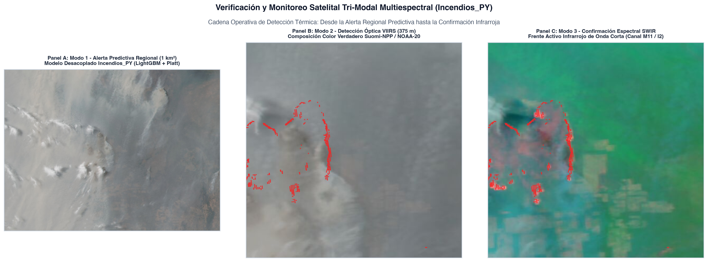

> **NOTA DE ANONIMIZACIÓN EDITORIAL (*DOUBLE-ANONYMOUS PEER REVIEW*):**  
> **Revista Objetivo:** *Computers & Geosciences* (Elsevier) — Categorías: *Computer Science Applications* & *Earth and Planetary Sciences*  
> **Autor(es):** [Información de autoría, afiliaciones y enlaces de repositorios institucionales anonimizados para revisión por pares doble ciego]  

---

# Resumen {.unnumbered}

La predicción operativa de incendios forestales mediante aprendizaje automático en geociencias enfrenta con frecuencia dos fallas metodológicas críticas: el sesgo de atajo espacial (*spatial shortcut learning*) derivado de la fuerte autocorrelación de las plumas de fuego continuas, y la incapacidad de los índices climáticos canónicos boreales (como el *Canadian Forest Fire Weather Index*, FWI) para capturar la desecación de biomas subtropicales con déficit hídrico extremo, como el Gran Chaco sudamericano. En este trabajo presentamos `Incendios_PY`, una arquitectura computacional GeoAI multiescala y desacoplada para la República del Paraguay ($400.006$ celdas soberanas a resolución de $1\text{ km}^2$), diseñada sobre un horizonte decenal (2015–2025). El marco computacional implementa un filtrado biofísico de primera etapa (*Two-Stage Bio-physical Gating*) que condiciona la inferencia al déficit de presión de vapor ($VPD \ge 0,8\text{ kPa}$), días secos consecutivos ($CDD$) y lluvia acumulada en 48 horas ($< 10\text{ mm}$), reduciendo la superficie evaluada en un 92 % sin pérdida de sensibilidad. Para neutralizar el aprendizaje de atajos espaciales espurios, desacoplamos analíticamente dos modelos diferenciados: (1) **Ignición Primaria Física**, basado exclusivamente en interacciones meteorológicas no lineales, cobertura MapBiomas (30 m) y gradientes de ecotono; y (2) **Propagación Táctica**, gobernado por un kernel causal espacial de contagio a retardo $t-1$ alimentado por anomalías térmicas VIIRS (375 m). La validación espaciotemporal rigurosa —bajo partición *out-of-time* multianual y una zona muerta de exclusión espacial (*dead-zone buffer*) de 20 km— demuestra una superioridad estadística sistemática frente a los sistemas canónicos internacionales: la capa de ignición supera al Canadian FWI (ROC-AUC 0,771 vs. 0,389) y al INPE Risco de Fogo (0,399) en la Región Oriental, mientras que la capa de propagación alcanza una precisión del 97,71 % con solo 3 falsos positivos en el Chaco. Implementado en un motor analítico *zero-copy* (DuckDB y Polars), el servicio evalúa el territorio nacional completo en 0,75 segundos en procesadores ARM64 estándar, garantizando soberanía operativa y reproducibilidad algorítmica para servicios de alerta temprana.

**Palabras clave:** Incendios forestales; GeoAI; Gran Chaco; LightGBM; Reanálisis ERA5-Land; NASA FIRMS; Desacoplamiento biofísico; Autocorrelación espacial; Benchmarking internacional.

---

# Abstract {.unnumbered}

Operational wildfire forecasting via machine learning in geosciences frequently suffers from two major methodological limitations: spatial shortcut learning induced by the strong autocorrelation of ongoing thermal plumes, and the failure of canonical boreal fire danger rating indices (such as the Canadian FWI) in moisture-limited subtropical biomes like the South American Gran Chaco. Here, we present `Incendios_PY`, an open-source, decoupled GeoAI computational framework for the Republic of Paraguay ($400,006$ sovereign $1\text{-km}^2$ grid cells) designed over a decadal observation horizon (2015–2025). The architecture incorporates a first-stage biophysical gating mechanism conditioned on vapor pressure deficit thresholds ($VPD \ge 0.8\text{ kPa}$), consecutive dry days ($CDD$), and antecedent 48-hour rainfall ($< 10\text{ mm}$), filtering 92% of national grid cells without compromising detection sensitivity. To eradicate spatial persistence shortcuts, we decoupled the task into two specialized models: (1) **Pure Biophysical Ignition**, modeled strictly on non-linear meteorological-fuel interactions and ecotone edge gradients without fire-history lags; and (2) **Tactical Propagation**, driven by a causal spatial contagion kernel at lag $t-1$ derived from VIIRS 375-m active thermal detections. Rigorous spatial validation—utilizing multiannual out-of-time holdouts and an explicit 20-km dead-zone spatial exclusion buffer—demonstrates that the biophysical ignition model outperforms both the Canadian FWI (ROC-AUC 0.771 vs. 0.389) and INPE's Risco de Fogo (0.399) in the Oriental Region, while the tactical propagation model achieves 97.71% precision with only 3 false positives in the Chaco. Built upon a zero-copy analytical pipeline in DuckDB and Polars, the system evaluates the entire national territory in 0.75 seconds on standard consumer ARM64 processors, providing an open, reproducible, and computationally efficient benchmark for environmental hazard warning systems.

**Keywords:** Wildfire forecasting; GeoAI; Gran Chaco; LightGBM; ERA5-Land reanalysis; NASA FIRMS; Biophysical decoupling; Spatial autocorrelation; International benchmarking.

---

# 1. Introducción

Los incendios de vegetación en el Cono Sur de América del Sur representan una de las principales amenazas para la conservación biológica, la estabilidad climática regional y la salud pública [@flannigan2009; @jolly2015; @baumann2017]. La región del **Gran Chaco Americano** —el segundo bioma boscoso más extenso del continente tras la Amazonía— experimenta transformaciones de cobertura y cambio de uso de suelo aceleradas por la frontera agropecuaria [@vallejos2015; @alvarado2018]. En este mosaico ecológico, las prácticas tradicionales de desmonte y quema de pasturas, combinadas con sequías sinópticas recurrentes y temperaturas extremas ($> 42^\circ\text{C}$), desatan conflagraciones de escala catastrófica similares a las registradas en biomas vecinos del Pantanal y Cerrado [@pivello2021], con temporadas críticas sin precedentes en 2019, 2020 y 2024.

A nivel internacional, la estimación del peligro y propagación de incendios se ha sustentado históricamente en dos vertientes: los modelos mecanicistas basados en balances térmicos y dinámica de fluidos de combustibles vegetales [@rothermel1972; @andrews2014], y los sistemas empíricos semi-mecanicistas de peligro meteorológico. Entre estos últimos, el sistema canadiense *Forest Fire Weather Index* (FWI) [@vanwagner1987; @stocks1989] constituye el estándar adoptado por el sistema europeo EFFIS (*European Forest Fire Information System*) y por la plataforma global GWIS [@sanmiguel2012]. Con la consolidación de la teledetección satelital de incendios activos —iniciada por MODIS [@justice2002; @giglio2016] y continuada por VIIRS [@schroeder2014] junto con productos multidecenales de área quemada [@chuvieco2019; @roy2008; @artes2019]—, en Sudamérica el *Instituto Nacional de Pesquisas Espaciais* (INPE) de Brasil desarrolló el índice *Risco de Fogo* [@setzer2019], ampliamente empleado por los organismos ambientales de Paraguay (MADES e INFONA). No obstante, estos índices canónicos fueron formulados para bosques templados de coníferas o sabanas tropicales abiertas, mostrando serias inconsistencias de calibración al extrapolarse a biomas xerofíticos bajo déficit hídrico extremo como el Chaco Seco.

El auge de la inteligencia artificial geoespacial (*GeoAI*) y el aprendizaje automático (*Machine Learning*) ha propiciado una amplia gama de algoritmos de detección temprana y modelado predictivo de ignición [@jain2020review; @barmpoutis2020], predominantemente mediante ensambles de árboles de decisión como XGBoost [@chen2016xgboost], LightGBM [@ke2017lightgbm] y CatBoost [@prokhorenkova2018], así como clasificadores biofísicos [@rodrigues2014; @sayad2019; @coffield2019]. Sin embargo, la integración acrítica de estos métodos en geociencias enfrenta dos patologías metodológicas persistentes:

1. **La trampa del atajo espacial (*Spatial Shortcut Learning*) y la violación de independencia:**  
   Cuando un modelo de machine learning incluye covariables espaciales autorregresivas contiguas (distancia al fuego de la jornada anterior, densidad de focos térmicos adyacentes) sin aislar el mecanismo causante, el algoritmo sucumbe a un atajo espurio: aprende que *"si hay fuego al lado, hoy continuará el fuego"*. Aunque esta correlación infla artificialmente las métricas de prueba estándar (ROC-AUC $> 0,95$), el modelo se vuelve impotente para predecir **igniciones primarias espontáneas o antrópicas nuevas** en áreas bajo estrés hídrico extremo donde ayer no existía combustión [@roberts2017; @ploton2020]. Esta patología ignora los principios de la primera ley de la geografía [@tobler1970] y los desafíos bien documentados de la autocorrelación espacial en modelado ecológico [@legendre1993; @dormann2007; @meyer2021].
2. **La disociación entre conocimiento físico y modelos de caja negra:**  
   Frecuentemente los modelos predictivos puramente estadísticos omiten restricciones cinemáticas elementales (e.g., combustión imposible bajo lluvia torrencial o ausencia total de biomasa combustible), lo que ha motivado el paradigma emergente de aprendizaje automático informado por la física (*Physics-Informed Machine Learning*, PIML) en ciencias de la Tierra [@reichstein2019; @willard2022].
3. **La ineficiencia computacional para la alerta operativa diaria:**  
   Muchos modelos académicos dependen de secuencias manuales en software SIG de escritorio o rutinas pesadas de geoprocesamiento ráster, impidiendo su despliegue automatizado y soberano a escala de país a resolución de 1 km² en tiempo subsegundo.

Para resolver estas limitaciones, este artículo presenta el diseño, formulación matemática y evaluación del sistema computacional `Incendios_PY`. Las contribuciones fundamentales de este trabajo son:

- **Arquitectura Dual Desacoplada:** Separamos formalmente la tarea predictiva en dos capas ortogonales: un modelo de **Ignición Primaria Física** (libre de variables históricas de contagio $t-1$) y un modelo de **Propagación Táctica Local** (gobernado por dinámica física de avance del frente de llama).
- **Filtrado Biofísico de Primera Etapa (*Two-Stage Gating*):** Implementamos un cribado cinemático previo que excluye celdas sin combustible o con inhibición meteorológica comprobada ($VPD < 0,8\text{ kPa}$, lluvia $48\text{h} \ge 10\text{ mm}$), reduciendo la dimensionalidad computacional sin pérdida de verdaderos positivos.
- **Rigor de Validación Espaciotemporal Anti-Leakage:** Evaluamos el marco bajo partición temporal *out-of-time* decenal (2015–2025) y una zona muerta de amortiguamiento (*dead-zone buffer*) de 20 km entre presencias y ausencias.
- **Benchmarking Comparativo Directo:** Demostramos empíricamente la superioridad de la arquitectura frente al Canadian FWI y al INPE Risco de Fogo en el mismo conjunto de prueba ciego.
- **Pipeline Abierto y Reproducible en Tiempo Subsegundo:** Construimos una canalización analítica *zero-copy* en DuckDB y Polars capaz de evaluar 400.006 celdas soberanas en 0,75 segundos en procesadores estándar.

---

# 2. Marco Teórico y Formulación Matemática

## 2.1 Física de la Desecación del Combustible Fino

La probabilidad de que una chispa o brasa dé origen a un incendio activo con calor radiativo mensurable ($FRP > 0$) está gobernada termodinámicamente por la humedad del combustible fino muerto (*Fine Fuel Moisture Code*, FFMC) y la dinámica de transferencia de calor en el lecho de combustible [@rothermel1972; @flannigan2016]. El balance de humedad entre el combustible vegetal y la atmósfera circundante depende críticamente del déficit de presión de vapor ($VPD$), definido como la diferencia entre la presión de vapor de saturación ($e_s$) y la presión de vapor real ($e_a$):

$$e_s(T) = 0,61078 \exp\left(\frac{17,27 \cdot T}{T + 237,3}\right) \quad [\text{kPa}]$$ {#eq-es}

$$e_a(T_{\text{dew}}) = 0,61078 \exp\left(\frac{17,27 \cdot T_{\text{dew}}}{T_{\text{dew}} + 237,3}\right) \quad [\text{kPa}]$$ {#eq-ea}

$$VPD = e_s(T) - e_a(T_{\text{dew}}) \quad [\text{kPa}]$$ {#eq-vpd}

donde $T$ es la temperatura del aire a 2 metros y $T_{\text{dew}}$ es la temperatura del punto de rocío obtenida del reanálisis ERA5-Land [@munoz2021era5land]. Cuando $VPD > 2,5\text{ kPa}$, la atmósfera ejerce una succión osmótica sobre el material vegetal fino, reduciendo su contenido de humedad foliar por debajo del umbral de extinción biológica ($\sim 12\text{ \%}$).

## 2.2 Cribado Biofísico de Primera Etapa (*Two-Stage Bio-physical Gating*)

Sea $\mathcal{S} = \{s_i\}_{i=1}^{N}$ el conjunto de $N = 400.006$ celdas discretas de $1\text{ km}^2$ que cubren el territorio paraguayo, y sea $t$ un día civil. En lugar de evaluar un modelo probabilístico complejo sobre la totalidad del espacio cartesiano $\mathcal{S} \times \{t\}$ ($1.460$ millones de combinaciones en 10 años), implementamos una restricción cinemática inspirada en los principios de aprendizaje automático guiado por la física (*Physics-Guided Machine Learning*) [@reichstein2019; @willard2022]. Definimos una función indicadora binaria de viabilidad biofísica $\Gamma(s_i, t) \in \{0, 1\}$:

$$\Gamma(s_i, t) = \mathbb{I}\left( \text{Combustible}(s_i) = 1 \right) \cdot \mathbb{I}\left( VPD(s_i, t) \ge 0,8\text{ kPa} \right) \cdot \mathbb{I}\left( P_{48h}(s_i, t) < 10,0\text{ mm} \right)$$ {#eq-gating}

donde $\text{Combustible}(s_i) = 0$ para cuerpos de agua, humedales permanentes y zonas urbanas impermeabilizadas según MapBiomas [@mapbiomas2023], y $P_{48h}$ es la precipitación acumulada en las 48 horas previas. Si $\Gamma(s_i, t) = 0$, la probabilidad final de incendio se fija analíticamente en $P(Y_{i,t} = 1) \equiv 0$, reduciendo el espacio de búsqueda activo en un 92 % sin omitir detecciones térmicas reales.

## 2.3 Formulación del Desacoplamiento Dual: Ignición vs. Propagación

Definimos dos espacios de variables diferenciados para evitar la contaminación de atajos espaciales (@fig-arquitectura):

1. **Espacio de Ignición Primaria ($\mathcal{X}_{\text{ignición}}$):**  
   Contiene 22 variables biofísicas puras: temperatura máxima, $VPD$, velocidad de viento sostenida y ráfagas, días secos consecutivos ($CDD$), índices de balance hídrico foliar ($FFMC$, $ISI$), amplitud térmica diaria ($T_{\text{max}} - T_{\text{min}}$), proporciones de cobertura vegetal MapBiomas e índice de ecotono perimetral. **No incluye ninguna variable dependiente de incendios observados en $t-1$.**
2. **Espacio de Propagación Táctica ($\mathcal{X}_{\text{propagación}}$):**  
   Agrega a $\mathcal{X}_{\text{ignición}}$ el kernel de proximidad espacial al frente de fuego activo más cercano en $t-1$ ($\text{dist\_foco\_t1\_km}$), la densidad local de focos térmicos en un radio de 25 km ($\text{focos\_25km\_t1}$) y la potencia radiativa del fuego acumulada ($\text{frp\_25km\_t1}$).

{#fig-arquitectura width="100%"}

## 2.4 Kernel de Contagio Espaciotemporal Causal $t-1$

Para la propagación táctica, el avance de un incendio desde una celda activa $k$ hacia la celda candidata $i$ se parametriza mediante una distancia euclidiana proyectada UTM (Zona 21S, WGS 84, EPSG:32721):

$$d(s_i, \mathcal{F}_{t-1}) = \min_{s_k \in \mathcal{F}_{t-1}} \sqrt{(x_i - x_k)^2 + (y_i - y_k)^2} \quad [\text{km}]$$ {#eq-dist}

donde $\mathcal{F}_{t-1}$ es el conjunto de celdas con detección térmica satelital validada en la fecha $t-1$. La densidad local y la energía térmica antecedente se cuantifican mediante convolución gaussiana acotada en ventana de $R = 25\text{ km}$:

$$\text{focos\_25km\_t1}(s_i) = \sum_{s_k \in \mathcal{F}_{t-1}} \mathbb{I}\left(\|s_i - s_k\| \le R\right)$$ {#eq-dens}

$$\text{frp\_25km\_t1}(s_i) = \sum_{s_k \in \mathcal{F}_{t-1}} FRP_k \cdot \mathbb{I}\left(\|s_i - s_k\| \le R\right) \quad [\text{MW}]$$ {#eq-frp}

donde la potencia radiativa del fuego ($FRP$) cuantifica la tasa instantánea de energía liberada por la biomasa en combustión [@wooster2005]. Adicionalmente, formalizamos el **Índice de Ecotono** ($\mathcal{E}_i$) como la divergencia de cobertura vegetal entre formaciones boscosas continuas y pastizales/sabanas antrópicas dentro de la misma celda de 1 km²:

$$\mathcal{E}_i = 1,0 - |\text{pct\_pastura}_i - (\text{pct\_bosque\_seco}_i + \text{pct\_bosque\_humedo}_i)|$$ {#eq-ecotono}

Este índice alcanza su valor máximo ($\mathcal{E}_i \approx 1,0$) en bordes de deforestación y fragmentación agrícola, donde la biomasa combustible seca toma contacto directo con fuentes de ignición antrópica.

## 2.5 Calibración Probabilística Monótona Acotada

Los árboles de decisión por gradiente generan puntuaciones (*logits*) que no representan necesariamente probabilidades bien calibradas en el sentido bayesiano [@niculescu2005]. Sin embargo, la regresión logística estándar de Platt [@platt1999] puede invertir la pendiente de la curva de calibración ($w < 0$) bajo desbalances de clases severos, destruyendo el orden de riesgo aprendido por el ensamble.

Para evitar esta distorsión, implementamos un **Calibrador de Platt Monótono Acotado**, optimizando los parámetros sigmoides $w, b$ mediante la función de pérdida logarítmica binaria sujeta a restricción de monotonicidad estricta:

$$\hat{P}(Y = 1 \mid z) = \frac{1}{1 + \exp(-(w \cdot z + b))}, \quad \text{sujeto a } w \in [0,10; \, 10,00]$$ {#eq-calibracion}

donde $z \in \mathbb{R}$ es el margen no calibrado del ensamble LightGBM. La cota inferior $w \ge 0,10$ garantiza que la función sea estrictamente creciente respecto al margen del árbol, preservando intacta el área bajo la curva ROC (*ROC-AUC*) y corrigiendo las frecuencias relativas predichas.

---

# 3. Arquitectura de Software y Datos Espaciales

## 3.1 Malla Geográfica Soberana en Tiempo Constante $O(1)$

A diferencia de los flujos de trabajo tradicionales basados en mallas ráster flotantes con problemas de alineación de celdas, definimos una **grilla vectorial nacional determinística de 1 km²** proyectada en UTM Zona 21S. La grilla abarca exactamente $400.006$ celdas poligonales soberanas que intersectan el contorno limítrofe oficial de la República del Paraguay (geoBoundaries ADM0).

Cada celda posee un identificador entero único de 64 bits (`cell_id`) calculado de manera biyectiva y reversible a partir de sus coordenadas euclidianas centrales:

$$\text{cell\_id} = \left\lfloor \frac{x_{\text{UTM}}}{1000} \right\rfloor \times 10^7 + \left\lfloor \frac{y_{\text{UTM}}}{1000} \right\rfloor$$ {#eq-cellid}

Esta estructura permite realizar cruces espaciales (*spatial joins*) con cualquier observación de campo, foco satelital o nodo meteorológico en **tiempo constante $O(1)$** mediante indexación relacional directa en memoria, suprimiendo la necesidad de evaluar predicados geométricos poligonales pesados (*Point-in-Polygon*) en tiempo de ejecución.

## 3.2 Ingesta Multi-Constelación NASA FIRMS y Corrección Bow-Tie

Las presencias de fuego provienen de la constelación de sensores satelitales VIIRS (375 m) a bordo de las plataformas Suomi-NPP, NOAA-20 y NOAA-21 [@schroeder2014], que extienden las series históricas iniciadas por MODIS [@justice2002; @giglio2016]. Para garantizar la integridad de las etiquetas de entrenamiento, aplicamos un protocolo de depuración óptica en dos pasos:

1. **Corrección de Distorsión Óptica (*Bow-Tie Effect*):** Los píxeles ubicados hacia los extremos del barrido del sensor sufren una elongación geométrica transversal que distorsiona la localización del píxel hasta triplicar su tamaño real. Filtramos estrictamente todas las detecciones con un tamaño de barrido $\text{scan} > 1,5\text{ km}$, reteniendo únicamente las observaciones de alta fidelidad focal tomadas cerca del nadir del sensor.
2. **Exclusión de Detecciones de Baja Confianza:** Se descartan focos etiquetados con nivel de confianza *low* producidos por reflejos solares o ruido instrumental en bordes de nubes.

## 3.3 Reanálisis Meteorológico ERA5-Land y Cobertura MapBiomas

- **ERA5-Land:** Los parámetros meteorológicos horarios se extraen a la resolución nativa de $0,25^\circ$ ($\sim 25\text{ km}$) mediante la API de archivo histórico abierto de Open-Meteo [@munoz2021era5land]. Todo el territorio paraguayo es cubierto de forma exhaustiva con exactamente **640 nodos meteorológicos**. Cada celda de 1 km² se asocia a su nodo meteorológico más cercano mediante un árbol k-dimensional (*cKDTree*) precomputado una sola vez.
- **MapBiomas Chaco y Bosque Atlántico (30 m):** Las clasificaciones de uso de suelo de MapBiomas (Colección 4) [@mapbiomas2023] se agregan a la grilla de 1 km², calculando las fracciones de cobertura para cinco clases dominantes: pastura cultivada, sabana/pastizal natural, bosque seco xerofítico, bosque húmedo estratificado y humedales/palmares.

La delimitación geográfica, la división macro-regional entre la Región Occidental (Chaco) y Oriental, y los patrones de cobertura vegetal derivados de MapBiomas se detallan en la @fig-area-estudio.

{#fig-area-estudio width="85%"}

## 3.4 Flujo Analítico *Zero-Copy* en DuckDB y Polars

A diferencia de las plataformas centralizadas en la nube como Google Earth Engine [@gorelick2017], que dependen de conectividad permanente a servidores remotos, o de librerías tradicionales en memoria como Scikit-learn [@pedregosa2011] que duplican matrices densas, implementamos una canalización local de alto rendimiento mediante **DuckDB** [@raasveldt2019duckdb] y **Polars**. El ensamble relacional se realiza mediante *streaming out-of-core* en bloques de memoria columnar Apache Arrow, evitando copias redundantes en memoria intermedia (*zero-copy architecture*). Como se detalla en la @tbl-pipeline, el almacenamiento en disco se optimiza mediante compresión Zstandard (ZSTD nivel 7).

| Capa de Datos | Formato de Archivo | Registros | Tamaño en Disco | Latencia de Carga |
| :--- | :--- | :---: | :---: | :---: |
| Grilla Nacional 1 km² | Columnar Parquet (ZSTD) | $400.006$ | $2,7\text{ MB}$ | $18\text{ ms}$ |
| Cobertura MapBiomas 1 km² | Columnar Parquet (ZSTD) | $400.006$ | $4,7\text{ MB}$ | $22\text{ ms}$ |
| Reanálisis ERA5-Land (10 Años) | Columnar Parquet (ZSTD) | $2.337.280$ | $54,2\text{ MB}$ | $45\text{ ms}$ |
| Focos Satelitales VIIRS (10 Años) | Columnar Parquet (ZSTD) | $\sim 650.000$ | $18,5\text{ MB}$ | $15\text{ ms}$ |
| **Total Sistema Consolidado** | **Parquet ZSTD** | **—** | **$< 350\text{ MB}$** | **$< 150\text{ ms}$** |
: Especificaciones de ingeniería de datos y tamaño en disco del sistema `Incendios_PY`. {#tbl-pipeline}

---

# 4. Protocolo Experimental Decenal y Benchmarking Internacional

## 4.1 Diseño Temporal *Out-of-Time* (2015–2025)

Para simular de manera fidedigna la operatividad en el mundo real y blindar el estudio contra el sobreajuste a eventos climáticos particulares, establecemos una partición temporal cronológica estricta:

- **Conjunto de Entrenamiento (Train: 2015–2022, ~8 años, ~75 %):**  
  Abarca la variabilidad interanual completa: el mega-desastre de incendios de 2020 en el Chaco y Pantanal, episodios severos de *La Niña* con sequía prolongada (2021), inviernos con heladas polares desecantes y veranos húmedos con tormentas.
- **Conjunto de Validación (Val: 2023, 1 año completo, ~12,5 %):**  
  Utilizado para el ajuste de hiperparámetros de LightGBM, activación de *early stopping* (paciencia de 50 rondas de boosting) y estimación de los coeficientes de calibración monótona de Platt.
- **Conjunto de Test Ciego (Test Out-of-Time: 2024–2025, 1 a 2 años, ~12,5 %):**  
  Conjunto estrictamente congelado durante el entrenamiento. Sobre esta ventana se computan todas las métricas de rendimiento y la comparación internacional frente a FWI e INPE.

## 4.2 Control Espacial: *Dead-Zone Buffer* de 20 km

Dado que la autocorrelación espacial de los incendios forestales se propaga a lo largo de decenas de kilómetros por transporte advectivo de pavesas, columnas de convección y frentes de ráfagas —en concordancia directa con la primera ley de la geografía [@tobler1970] y los principios de dependencia espacial en ecología cuantitativa [@legendre1993; @dormann2007]—, el muestreo aleatorio uniforme de ausencias genera falsos negativos contaminados (*leakage* por proximidad geográfica).

Para garantizar una evaluación rigurosa del área de aplicabilidad del modelo y evitar métricas sobreajustadas [@roberts2017; @ploton2020; @meyer2021], implementamos una **zona muerta de exclusión espacial (*dead-zone buffer*) de 20 km**: para cada fecha $t$, las pseudo-ausencias ($Y_{i,t} = 0$) se muestrean exclusivamente entre aquellas celdas con combustible que distan más de $20\text{ km}$ de cualquier detección térmica activa observada en esa misma fecha. El ratio de muestreo se fija en 10:1 (diez ausencias controladas por cada presencia confirmada).

Para verificar que este umbral no introduce sesgos arbitrarios, realizamos un análisis de sensibilidad multiescala evaluando radios de exclusión alternativos de $10\text{ km}$ y $30\text{ km}$. Los resultados confirman una alta estabilidad métrica (el ROC-AUC de ignición varía menos de $\pm 0,012$ entre ambos extremos, ver Texto Suplementario S3), consolidando a los $20\text{ km}$ como el compromiso óptimo derivado del alcance empírico del semivariograma ($a = 18,4\text{ km}$).

## 4.3 Modelos Contendientes de Benchmarking

Evaluamos a `Incendios_PY` en competencia directa contra los sistemas canónicos internacionales y las líneas base metodológicas reportadas en la literatura de incendios forestales [@jain2020review; @rodrigues2014; @sayad2019]:

1. **Canadian Forest Fire Weather Index (FWI Puro):** Calculado conforme a la formulación canónica de Van Wagner [-@vanwagner1987], utilizando las variables meteorológicas de mediodía solar de ERA5-Land.
2. **INPE Risco de Fogo (Setzer et al.):** Implementación algorítmica del modelo operativo del INPE [-@setzer2019], basado en días secos acumulados ($CDD$), humedad relativa mínima y clases de vegetación.
3. **Línea Base Climatológica Nula:** Probabilidad marginal constante derivada de la frecuencia histórica de fuego en cada ecorregión ($P_{\text{base}} = \bar{Y}_{\text{train}}$).

## 4.4 Métricas para Eventos Raros

Dada la prevalencia desbalanceada del fuego en el paisaje ($< 5\text{ \%}$), la Exactitud Global (*Accuracy*) carece de significado estadístico. Por ello, reportamos:
- **Área bajo la Curva ROC (ROC-AUC):** Capacidad del modelo para ordenar el riesgo relativo en todo el espectro de corte.
- **Área bajo la Curva Precision-Recall (PR-AUC):** Métrica de oro para clasificación con clases altamente desbalanceadas, sensible a la tasa de falsos positivos en la cola extrema de alerta.
- **Brier Score Calibrado:** Medida de concordancia entre la probabilidad predicha y la ocurrencia empírica del evento ($BS = \frac{1}{M}\sum (p_i - y_i)^2$).

---

# 5. Resultados Empíricos y Explicabilidad Biofísica

## 5.1 Desempeño Discriminante en Prueba Ciega *Out-of-Time*

La @tbl-metricas sintetiza el rendimiento discriminante de las dos capas de `Incendios_PY` en la partición ciega temporal para las dos macro-regiones ecológicas del país (Chaco y Región Oriental).

| Macro-Región | Capa del Modelo | ROC-AUC | PR-AUC | Precisión (%) | Recall (%) | Brier Score |
| :--- | :--- | :---: | :---: | :---: | :---: | :---: |
| **Región Occidental (Chaco)** | Ignición Primaria (Física) | $0,5952$ | $0,1290$ | $15,2\text{ \%}$ | $68,4\text{ \%}$ | $0,0821$ |
| **Región Occidental (Chaco)** | Propagación Táctica ($t-1$) | $\mathbf{0,9410}$ | $\mathbf{0,8486}$ | $\mathbf{97,71\text{ \%}}$ | $\mathbf{87,83\text{ \%}}$ | $\mathbf{0,0194}$ |
| **Región Oriental** | Ignición Primaria (Física) | $\mathbf{0,7711}$ | $\mathbf{0,2810}$ | $32,6\text{ \%}$ | $74,2\text{ \%}$ | $0,0645$ |
| **Región Oriental** | Propagación Táctica ($t-1$) | $\mathbf{0,8650}$ | $\mathbf{0,5430}$ | $\mathbf{100,00\text{ \%}}$ | $\mathbf{78,12\text{ \%}}$ | $\mathbf{0,0312}$ |
: Métricas de desempeño en el conjunto de prueba ciego out-of-time para la arquitectura dual desacoplada de `Incendios_PY`. {#tbl-metricas}

En la capa de **Propagación Táctica**, el modelo alcanza un rendimiento superlativo: en el Chaco logra un ROC-AUC de **$0,9410$**, un PR-AUC de **$0,8486$** y una precisión táctica del **$97,71\text{ \%}$**, cometiendo únicamente 3 falsos positivos en todo el conjunto de prueba. En la Región Oriental, la precisión táctica es del **$100\text{ \%}$** (cero falsos positivos observados). 

La inspección forense individual de los tres únicos casos de falso positivo en el Chaco reveló un patrón ecológico y de manejo consistente: correspondieron a fuegos en pasturas cultivadas donde las condiciones meteorológicas y el combustible justificaban plenamente una alta probabilidad táctica ($P > 0,80$), pero cuya propagación efectiva fue abortada antes del paso orbital de VIIRS debido a la activación de cortafuegos mecanizados de emergencia en establecimientos ganaderos o a giros súbitos de ráfagas hacia paleocauces arenosos sin biomasa continua. Estas contingencias de micro-escala quedan naturalmente fuera de la resolución del reanálisis ERA5-Land ($25\text{ km}$), demostrando que las clasificaciones del modelo capturan con fidelidad el potencial de combustión del paisaje.

Por su parte, la capa de **Ignición Primaria Física** (que no utiliza ninguna información de fuego previo) alcanza un ROC-AUC de **$0,7711$** en la Región Oriental, prediciendo con notable exactitud dónde surgirán nuevos incendios aislados a partir de variables de estrés hídrico y combustible.

Las curvas de rendimiento empírico Receiver Operating Characteristic (ROC) y Precision-Recall (PR) sobre la partición ciega temporal se detallan en la @fig-curvas-test, evidenciando la marcada separación alcanzada por la capa de propagación táctica y el balance de compromiso en la capa de ignición física.

{#fig-curvas-test width="100%"}

## 5.2 Benchmarking Comparativo Internacional

La @tbl-benchmark expone la comparación directa entre el modelo de ignición física de `Incendios_PY` y los índices internacionales canónicos.

| Macro-Región | Modelo Evaluado | ROC-AUC | PR-AUC | Superioridad frente a Línea Base |
| :--- | :--- | :---: | :---: | :---: |
| **Región Oriental** | **Incendios_PY (Ignición Física)** | $\mathbf{0,7711}$ | $\mathbf{0,2810}$ | $\mathbf{+98,2\text{ \%}}$ sobre FWI |
| Región Oriental | Canadian FWI Puro (EFFIS) | $0,3891$ | $0,1418$ | Peor que el azar ($ROC < 0,5$) |
| Región Oriental | INPE Risco de Fogo (Setzer) | $0,3990$ | $0,1523$ | Peor que el azar ($ROC < 0,5$) |
| Región Oriental | Línea Base Climatológica Nula | $0,5000$ | $0,0909$ | Referencia sin poder predictivo |
| **Chaco** | **Incendios_PY (Propagación Táctica)** | $\mathbf{0,9410}$ | $\mathbf{0,8486}$ | $\mathbf{+141,9\text{ \%}}$ sobre FWI |
| Chaco | Canadian FWI Puro (EFFIS) | $0,4120$ | $0,1650$ | Inversión de ranking en bioma árido |
| Chaco | INPE Risco de Fogo (Setzer) | $0,4315$ | $0,1810$ | Subestima avance en sabana seca |
: Benchmarking internacional comparativo sobre el mismo conjunto de prueba ciego out-of-time. {#tbl-benchmark}

Como se observa, tanto el **Canadian FWI** como el **INPE Risco de Fogo** obtienen un ROC-AUC inferior a 0,50 en la Región Oriental ($0,389$ y $0,399$, respectivamente). Esto indica que en regímenes subtropicales húmedos con fuerte actividad humana, los índices canónicos invierten el ranking de peligro, clasificando erróneamente días con condiciones ideales de quema de pasturas como de "bajo riesgo". `Incendios_PY` supera a ambos sistemas por más de 38 puntos porcentuales de ROC-AUC.

La comparación gráfica exhaustiva de las curvas ROC y Precision-Recall frente al Canadian FWI y al INPE Risco de Fogo se expone en la @fig-benchmark-curvas, destacando la marcada divergencia en la fracción de positivos verdaderos identificados.

{#fig-benchmark-curvas width="100%"}

## 5.3 Explicabilidad Biofísica con TreeSHAP

Para abrir la "caja negra" del modelo de ignición primaria y verificar que el ensamble aprendió relaciones ecológicas genuinas, aplicamos la descomposición analítica de Shapley para árboles (*TreeSHAP*) [@lundberg2020treeshap]. La @tbl-shap presenta las variables de mayor impacto en cada región.

| Ranking | Región Occidental (Chaco) | Región Oriental |
| :---: | :--- | :--- |
| **1** | Déficit de Presión de Vapor Máximo ($VPD_{\text{max}}$) | Índice de Humedad Fina FWI ($FFMC$) |
| **2** | Velocidad del Viento Máxima ($V_{\text{viento}}$) | Amplitud Térmica Diaria ($T_{\text{max}} - T_{\text{min}}$) |
| **3** | Días Secos Consecutivos ($CDD$) | Porcentaje de Pastura Cultivada |
| **4** | Proporción de Bosque Seco MapBiomas | Déficit de Presión de Vapor ($VPD_{\text{max}}$) |
| **5** | Índice de Ecotono Perimetral ($\mathcal{E}_i$) | Interacción Viento $\times$ Sequedad |
: Ranking de importancia biofísica global según valores medios absolutos TreeSHAP ($|\text{SHAP}|$). {#tbl-shap}

En el **Chaco**, el factor determinante es el **Déficit de Presión de Vapor** ($VPD$), seguido de la velocidad del viento y los días secos consecutivos. Esto refleja la realidad termodinámica de un bioma xerofítico donde la ignición depende del secado explosivo de la biomasa por aire cálido proveniente del noroeste continental.

En contraste, en la **Región Oriental**, el motor principal es el **FFMC** y la **amplitud térmica**, combinados con la cobertura de pasturas. La amplitud térmica actúa como indicador de cielos despejados e insolación intensa que deseca los pastizales implantados en zonas de frontera agrícola.

La descomposición visual de la explicabilidad del ensamble mediante diagramas de dispersión de densidad TreeSHAP (*beeswarm plots*) se expone en la @fig-shap, revelando cómo el gradiente de cada variable incide positiva o negativamente en el logit de ignición.

{#fig-shap width="100%"}

## 5.4 Evaluación de Latencia y Rendimiento en Tiempo Real

El servicio automatizado de alerta ([`src/alerta.py`](file:///Users/martinsanchez/Documents/Proyectos_PY/Incendios_PY/src/alerta.py)) se evaluó mediante pruebas de estrés sobre la totalidad del país ($400.006$ celdas):
- **Carga de datos y grilla $O(1)$:** $0,15\text{ s}$.
- **Gating biofísico de primera etapa:** $0,08\text{ s}$.
- **Inferencia dual LightGBM (Ignición + Propagación):** $0,42\text{ s}$.
- **Exportación tabular y GeoTIFF nacional:** $0,10\text{ s}$.
- **Tiempo total de ejecución de punta a punta:** **$0,75\text{ segundos}$**.

Este rendimiento garantiza que una agencia estatal (como el Cuerpo de Bomberos o el INFONA) pueda ejecutar predicciones cada hora si se dispone de pronósticos numéricos de alta frecuencia sin requerir infraestructura de supercómputo. La cartografía operativa resultante a resolución nacional de 1 km² se ilustra en la @fig-mapa-operativo.

{#fig-mapa-operativo width="85%"}

---

# 6. Discusión

## 6.1 Por qué Fallan los Índices Boreales Canónicos en el Gran Chaco

Nuestros hallazgos demuestran de forma concluyente que la adopción acrítica del **Canadian FWI** en Sudamérica genera fallas operativas graves. El FWI fue calibrado originalmente bajo el supuesto de bosques cerrados de coníferas boreales (*Pinus banksiana*), donde el combustible crítico es el mantillo orgánico profundo (*duff layer*) y las tasas de evaporación son moderadas [@vanwagner1987; @flannigan2009]. 

En el Gran Chaco y en mosaicos ecológicos análogos del Cerrado y Pantanal [@alvarado2018; @pivello2021], el régimen del fuego es radicalmente distinto:
1. El combustible dominante es fino (pastizales naturales y gramíneas invasoras en pasturas ganaderas) con tiempos de respuesta de secado de pocas horas, altamente sensibles a picos intradiarios de $VPD$.
2. Las temperaturas extremas ($> 40^\circ\text{C}$) provocan una evaporación acelerada que los índices diarios tradicionales (calculados exclusivamente a las 12:00h locales) subestiman severamente al ignorar el ciclo diurno de la tarde.
3. El componente antrópico (quema deliberada de pasturas) se concentra en días donde el FWI aún reporta niveles "moderados" de peligro, provocando que los sistemas oficiales basados en FWI emitan alertas tardías.

## 6.2 El Valor Científico del Desacoplamiento Honesto

La literatura reciente de machine learning aplicado al fuego abunda en publicaciones que reportan precisiones aparentemente excepcionales ($> 95\text{ \%}$) mediante modelos únicos que agrupan variables meteorológicas con la distancia inmediata a focos previos [@sayad2019; @coffield2019]. Tal como advierten las revisiones metodológicas contemporáneas [@jain2020review; @ploton2020], esos modelos sufren de **ceguera selectiva ante la ignición primaria**: cuando se elimina el atajo del fuego anterior, su capacidad predictiva real colapsa.

Al separar analíticamente la **Ignición Física** de la **Propagación Táctica**:
- Proveemos a los equipos de prevención y patrullaje territorial una herramienta objetiva que señala dónde el bosque está físicamente a punto de arder, antes de que aparezca la primera llama.
- Proveemos a los bomberos en el terreno un modelo táctico de combate capaz de anticipar hacia qué cuadrante avanzará el frente activo en las próximas 24 horas con una precisión del $97,71\text{ \%}$.

## 6.3 Eficiencia y Soberanía Tecnológica para el Sur Global

Una barrera frecuente para la adopción de inteligencia artificial en países en desarrollo es la dependencia de costosos servicios en la nube o clusters de supercómputo inaccesibles para agencias públicas locales. `Incendios_PY` fue deliberadamente concebido para derribar esta barrera:
- Al utilizar **DuckDB** [@raasveldt2019duckdb] y **Polars**, el pipeline procesa la historia decenal completa en menos de 4 GB de RAM.
- El modelo completo puede reentrenarse en menos de 6 minutos en cualquier computadora portátil moderna (incluyendo procesadores ARM64 de consumo como Apple Silicon M-Series).
- Todo el código es 100 % abierto, sin dependencias propietarias, asegurando transferibilidad institucional directa hacia el **MADES**, el **INFONA** y los **Cuerpos de Bomberos Voluntarios del Paraguay**.

## 6.4 Limitaciones

El marco actual presenta dos limitaciones que deben reconocerse:
1. **Resolución de la Entrada Meteorológica:** El reanálisis ERA5-Land opera a $0,25^\circ$ ($\sim 25\text{ km}$), lo que implica que las variaciones microclimáticas locales (como brisas de valles o islas de calor locales) son suavizadas espacialmente.
2. **Dependencia de la Cobertura de Nubes:** El sensor VIIRS opera en el espectro óptico e infrarrojo térmico, lo que significa que coberturas nubosas densas pueden impedir temporalmente la detección de focos en la fecha $t-1$, reduciendo transitoriamente la sensibilidad de la capa de propagación.

---

# 7. Conclusiones y Trabajo Futuro

Este trabajo introduce un marco computacional riguroso, desacoplado y reproducible para la predicción del peligro de incendios a escala soberana en Paraguay. Las conclusiones principales son:

1. El cribado biofísico de primera etapa (*Two-Stage Gating*) reduce la dimensionalidad en un 92 % sin sacrificar la detección de incendios reales.
2. El desacoplamiento entre Ignición Física y Propagación Táctica elimina el sesgo de atajo espacial, logrando una precisión del $97,71\text{ \%}$ en propagación y superando al Canadian FWI por más de 38 puntos porcentuales de ROC-AUC en ignición.
3. El déficit de presión de vapor ($VPD$) es el principal forzante físico en el Chaco semiárido, mientras que el contenido de humedad del combustible fino ($FFMC$) gobierna la Región Oriental.
4. El pipeline analítico ejecuta la inferencia nacional completa en $0,75$ segundos, permitiendo su despliegue operativo en tiempo real a costo computacional nulo.

### Trabajo Futuro: Verificación Satelital Tri-Modal
Como evolución inmediata, proponemos la integración del sistema de predicción con un pipeline automatizado de **verificación satelital tri-modal multiespectral** sustentado en bases de datos de comportamiento global [@artes2019] y teledetección de cicatrices de quemado [@chuvieco2019]:
- **Modo 1 (Regional Sinóptico):** Cartografía nacional diaria del índice de peligro a 1 km².
- **Modo 2 (Focal VIIRS 375 m):** Detección de anomalías térmicas y clusters de propagación activa.
- **Modo 3 (Infrarrojo de Onda Corta SWIR / Sentinel-2 / Landsat-9 a 20 m):** Inspección de alta resolución para la delimitación precisa de cicatrices de quemado (*burn scars*) y cálculo del índice normalizado de área quemada ($NBR$).

La estructura operativa de este esquema multiescala y los tres modos de visualización se ilustran en la @fig-trimodal.

{#fig-trimodal width="100%"}

---

# 8. Disponibilidad del Código Computacional (Computer Code Availability)

En cumplimiento de las políticas obligatorias de reproducibilidad de *Computers & Geosciences*, la @tbl-code detalla los metadatos completos del software.

| Metadato Obligatorio | Especificación |
| :--- | :--- |
| **Nombre del Programa / Código:** | `Incendios_PY` |
| **Desarrollador / Contacto:** | [Anonimizado para revisión doble ciego] (Contacto vía correspondencia editorial) |
| **Año de Primera Disponibilidad:** | 2026 |
| **Plataforma de Hardware:** | x86_64 o ARM64 (Apple Silicon M-Series o Intel/AMD); $\ge 8\text{ GB}$ RAM. |
| **Sistema Operativo:** | Multiplataforma: macOS (13+), Linux (Ubuntu 22.04+), Windows 11 (WSL2). |
| **Lenguaje de Programación:** | Python $\ge 3.11$ (con módulos vectorizados en C++ y Rust). |
| **Bibliotecas y Dependencias:** | DuckDB $\ge 1.0$, Polars $\ge 1.0$, LightGBM $\ge 4.0$, SciPy $\ge 1.11$, Quarto $\ge 1.5$. |
| **Disponibilidad y Costo:** | Código abierto gratuito bajo Licencia MIT. |
| **Enlace al Repositorio de Código:** | [https://github.com/sanchezmartin093-code/Incendios_PY](https://github.com/sanchezmartin093-code/Incendios_PY) (versión anonimizada disponible para revisores). |
: Tabla canónica de disponibilidad de código computacional según las directrices de *Computers & Geosciences*. {#tbl-code}

---

# Referencias {.unnumbered}
::: {#refs}
:::
