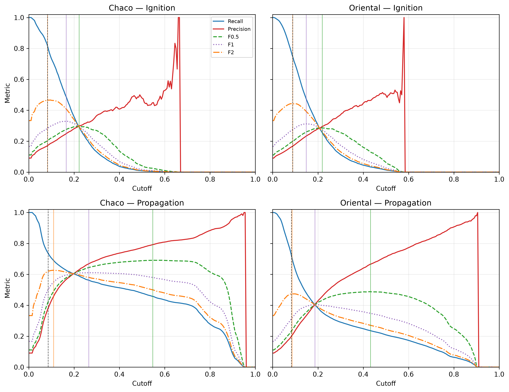

> **Target journal:** *Computers & Geosciences* (Elsevier). **Article type:** research article. **Peer review:** single-anonymized.  
> **Supplementary file:** `material_suplementario.docx` / `.html` — Notes S1–S4, Tables S1–S32 and Figures S1–S7 and S8.  
> **Code:** [github.com/sanchezmartin093-code/Incendios_PY](https://github.com/sanchezmartin093-code/Incendios_PY) (MIT License; code concept DOI [10.5281/zenodo.23675104](https://doi.org/10.5281/zenodo.23675104); GitHub release v2.0.1).  
> **Data:** processed data and test predictions are available in the v2.0.1 GitHub release under CC BY 4.0 and indexed by the data concept DOI [10.5281/zenodo.23675278](https://doi.org/10.5281/zenodo.23675278).

# Supplementary contents {.unnumbered}

• **Note S1:** Data, D2 target construction, quality control and sampling.

• **Note S2:** Bounded monotonic Platt calibration and hyperparameters.

• **Note S3:** Evaluation protocol and extended analyses.

• **Note S4:** Implementation of the FWI and INPE indices.

• **Tables S1–S32:** variable dictionary, hyperparameters, departmental results, computational profile, conformal coverage, population evaluation, paired significance, spatial blocks, lead time, sampling, full benchmark, ablation, M1 baseline, gated policy, confirmation holdout, coupled baseline, D2 sensitivity, SHAP, cost-loss, data audit, a weather-only baseline, an INPE A sensitivity, a train/test overlap sensitivity, a net-benefit decision table, a paired decision-value test, seed/capacity stability, a rolling-origin backtest, an adversarial validation, gate and label sensitivities, a sampling-ratio sensitivity and a negative control.

• **Figures S1–S7 and S8:** SHAP, ablation, cost-loss, net benefit, rolling-origin, threshold sensitivity, permutation importance and alert-budget precision.

---

# Supplementary Note S1. Data, D2 target construction, quality control and sampling

VIIRS active-fire detections from Suomi-NPP, NOAA-20 and NOAA-21 are acquired as 375-m cross-track swaths from NASA FIRMS [@nasa_firms]. At the swath edge the projected pixel can reach approximately 1.6 km along scan and 0.8 km along track, producing the geometric Bow-Tie effect: repeated detections of the same fire, dilution of fire radiative power (FRP) over a larger apparent area and incorrect assignment to the national 1-km² grid [@schroeder2014]. The implemented kinematic filter is

$$\mathcal{D}_{\text{filtered}} = \left\{ f \in \mathcal{D}_{\text{raw}} \mid \text{scan}(f) \le 1.5\ \text{km} \;\land\; \text{confidence}(f) \neq \text{'low'} \right\}.$$

The observed maximum scan in the study window was 0.8 km, so the rule removed no records but remains active for orbital windows with larger view angles. Duplicate overpasses on the same civil date are consolidated by 1-km² cell, retaining `num_focos_dia`, `max_frp_dia` and `sum_frp_dia`.

D2 separates primary ignition from tactical propagation. Let $F_t$ be the set of cells with a thermal detection on day $t$. D2 ignition at cell $i$ and day $t$ requires (i) $i \in F_t$, (ii) no cell in $F_{t-1}$ within 25 km and (iii) no detection in cell $i$ during the preceding 10 days. D2 propagation requires $i \in F_t$ and at least one cell in $F_{t-1}$ within 25 km. The two target sets are disjoint. The 25-km threshold defines the target domain and is not a negative-sampling buffer; no 20-km buffer is applied to the test set. The 20-km buffer is used only in the spatial block holdout.

The case-control sample is drawn at 1:10 per task and region. Training uses 2018–2022, validation uses 2023 and the test is the frozen 2024–2025 period. Population denominators are kept separately and are used for prior correction. The same test rows are used for every model, FWI and INPE, so comparisons are paired. Sampling counts and class ratios are in Table S10. The variable dictionary is in Table S1; the full audit log is in Table S15.

Data quality checks collapse duplicate VIIRS overpasses, remove `low`-confidence detections, reconstruct daily precipitation from sub-daily increments and reject impossible values above 300 mm/day. ERA5-Land nodes [@munoz2021era5land] are mapped to cells with a precomputed cKDTree. The processed data archive contains test targets, probabilities, benchmark layers, sampling plans and trained artifacts, so the result tables can be regenerated without the raw multi-terabyte archive.

# Supplementary Note S2. Bounded monotonic Platt calibration and hyperparameters

Let $z_i \in \mathbb{R}$ be the margin produced by the LightGBM ensemble [@ke2017lightgbm] for cell $i$, and let $y_i \in \{0,1\}$ be the binary fire label. Standard Platt scaling [@platt1999] estimates $w,b \in \mathbb{R}$ by minimizing binary cross-entropy:

$$\mathcal{L}(w,b) = -\sum_{i=1}^{M} \left[ y_i \log \sigma(w z_i + b) + (1-y_i)\log(1-\sigma(w z_i + b)) \right], \qquad \sigma(v)=\frac{1}{1+e^{-v}}.$$

If and only if $w>0$, the map $p(z)=\sigma(w z+b)$ is strictly increasing and preserves the ranking of the ensemble. Its derivative is

$$\frac{dp}{dz}=w\,\sigma(w z+b)\,[1-\sigma(w z+b)],$$

and the sigmoid factor is strictly positive, so $\operatorname{sign}(dp/dz)=\operatorname{sign}(w)$. A positive slope therefore leaves ROC-AUC unchanged. Unconstrained logistic regression can converge to $w<0$ under extreme imbalance or bimodal margins, inverting the ranking and turning a ROC-AUC of 0.77 into 0.23.

The implementation minimizes a bounded Brier loss with L-BFGS-B in `src/modelo.py`:

$$\min_{w,b}\frac{1}{M}\sum_{i=1}^{M}\left(y_i-\frac{1}{1+\exp(-(w z_i+b))}\right)^2,\qquad 0.10\le w\le 10.00,\quad -10.0\le b\le 10.0.$$

The lower bound guarantees strict monotonicity and prevents gradient collapse in asymptotic regions. Calibration is fitted on 2023 and frozen for 2024–2025. The same cutoff logic is used for M1, M2, M3 and propagation; cutoffs are selected on validation with an F0.5 criterion and applied after prior correction. Hyperparameters are in Table S2. The ablation uses a common capacity (45/60 rounds and 23/31 leaves) to isolate the feature effect.

# Supplementary Note S3. Evaluation protocol and extended analyses

The harness is fixed before the test is opened. It contains five components:

**(1)** A strictly temporal split: training 2018–2022, validation 2023 and test 2024–2025.

**(2)** A 50-km spatial block holdout with a 20-km buffer; priors are recomputed without held-out fires.

**(3)** A paired bootstrap grouped by date ($B=1\,000$) for confidence intervals and differences against FWI [@vanwagner1987] and INPE [@setzer2019].

**(4)** A lead-time analysis using t-1 weather to quantify the nowcast-to-forecast gap.

**(5)** Population-level, conformal and cost-loss analyses.

Bootstrap resampling is by date, not by row, because daily fire activity is strongly clustered. All cells from a sampled date are retained; this preserves within-day dependence. The spatial holdout removes an entire 50-km block plus a 20-km buffer, recomputes historical priors without the held-out fires and evaluates both held-in and held-out cells. The primary metrics are ROC-AUC and PR-AUC; Brier score, expected calibration error, precision, recall, F0.5 and false positives are also reported. AUC intervals use 500 grouped bootstrap replicates; paired differences use 1 000. The six confirmatory comparisons are corrected with Holm–Bonferroni and Benjamini–Hochberg; all remain significant at α = 0.05. The bootstrap resolution is 0.001, so adjusted values at the floor are upper bounds.

The full benchmark is in Table S11 and its continuation, paired significance in Table S7, the complete spatial block results in Table S8 and the lead-time results in Table S9. Seed/capacity stability, the rolling-origin backtest and adversarial validation are in Tables S25, S26 and S29 and Figure S5; threshold sensitivity is in Table S14 (continuation) and Figure S6. The controlled ablation is in Table S12 and Figure S2; SHAP is in Table S13 and Figure S1; population evaluation is in Table S6; conformal coverage is in Table S5; cost-loss is in Table S14 and Figure S3. The computational profile is in Table S4. All analyses use the frozen test rows archived with the code release.

# Supplementary Note S4. Implementation of the FWI and INPE indices

This note documents the two benchmark indices exactly as they are implemented. The full Canadian FWI is produced by `scripts/02d_calcular_fwi_completo.py` from `src/fwi.py`; the INPE Risco de Fogo by `scripts/02e_calcular_inpe.py` from `src/inpe.py`; the benchmark joins both to the 1-km grid by `nodo_clima_id` and `fecha` in `scripts/13_benchmarking_modelos.py`. Neither index was fitted to the fire labels.

## S4.1 Canadian Fire Weather Index

### Fuel codes

The standard six-code system is implemented without a custom fuel type:

- **FFMC (Fine Fuel Moisture Code):** moisture of surface litter and fine fuels (approximately the top 1–2 cm); scale 0–101.
- **DMC (Duff Moisture Code):** moisture of the loosely compacted organic layer; medium-term drying.
- **DC (Drought Code):** moisture of the deep, compacted organic layer; seasonal drought storage.
- **BUI (Buildup Index):** fuel available for combustion, derived from DMC and DC.
- **ISI (Initial Spread Index):** initial spread potential, derived from FFMC and wind.
- **FWI (Fire Weather Index):** frontal fire intensity, derived from ISI and BUI.

### Equations

Let $F_t$, $D_t$ and $Q_t$ be FFMC, DMC and DC on day $t$; let $T$ be the 15:00 UTC temperature (°C), $H$ the corresponding relative humidity (%), $W$ the 10-m wind speed (km h$^{-1}$) and $r$ the 00–24 h rainfall (mm). The recursion is applied per node in chronological order.

The fine-fuel moisture content is

$$m_{t-1}=\frac{147.2(101-F_{t-1})}{59.5+F_{t-1}}.$$

For $r>0.5$ mm, with $r_f=r-0.5$,

$$m_0=m_{t-1}+42.5\,r_f\,e^{-100/(251-m_{t-1})}\left(1-e^{-6.93/r_f}\right)+\epsilon,$$

where $\epsilon=0.0015(m_{t-1}-150)^2\sqrt{r_f}$ is the small correction term coded in `src/fwi.py`; $m_0$ is capped at 250. The equilibrium moisture contents are

$$E_d=0.942H^{0.679}+11e^{(H-100)/10}+0.18(21.1-T)(1-e^{-0.115H}),$$

$$E_w=0.614H^{0.753}+10e^{(H-100)/10}+0.18(21.1-T)(1-e^{-0.115H}).$$

The drying and wetting rates are

$$k_d=\left[0.424\left(1-\left(\frac{100-H}{100}\right)^{1.7}\right)+0.0694\sqrt{W}\left(1-\left(\frac{100-H}{100}\right)^8\right)\right]0.581e^{0.0365T},$$

$$k_w=\left[0.424\left(1-\left(\frac{H}{100}\right)^{1.7}\right)+0.0694\sqrt{W}\left(1-\left(\frac{H}{100}\right)^8\right)\right]0.581e^{0.0365T}.$$

The moisture content after one day is

$$m_t=\begin{cases}E_d+(m_0-E_d)10^{-k_d}, & m_0<E_d,\\E_w+(m_0-E_w)10^{-k_w}, & m_0>E_w,\\m_0, & \text{otherwise,}\end{cases}$$

and

$$F_t=\operatorname{clip}\left(\frac{59.5(250-m_t)}{147.2+m_t},\,0,\,101\right).$$

For DMC, when $r>1.5$ mm,

$$r_e=0.92r-1.5,\qquad m_0=20+e^{5.6348-D_{t-1}/43.43},$$

$$b=\begin{cases}100/(0.5+0.3D_{t-1}), & D_{t-1}\le33,\\14-1.3\ln D_{t-1}, & 33<D_{t-1}\le65,\\6.2\ln D_{t-1}-17.2, & D_{t-1}>65,\end{cases}$$

$$m_r=m_0+\frac{1000r_e}{48.77+br_e},\qquad D'=244.72-43.43\ln(m_r-20),$$

with $D'$ floored at zero; when $r\le1.5$ mm, $D'=D_{t-1}$. The daily update uses

$$T_+=\max(T,-1.1),\qquad H_c=\operatorname{clip}(H,1,100),$$

$$L_e=e^{2-0.2H_c/100},\qquad K=1.894(T_++1.1)(100-H_c)L_e10^{-6},\qquad D_t=D'10^{K}.$$

For DC, when $r>2.8$ mm,

$$r_d=0.83r-2.8,\qquad Q_0=800e^{-Q_{t-1}/400}+3.937r_d,$$

with $Q_0$ capped at 800 and $Q'=400\ln(800/Q_0)$; otherwise $Q'=Q_{t-1}$. Then

$$Q_t=Q'+0.5\max(T,-2.8).$$

BUI is

$$U_t=\begin{cases}0, & D_t\le0,\\\frac{0.8D_tQ_t}{D_t+0.4Q_t}, & D_t\le0.4Q_t,\\D_t-\left(1-\frac{0.8Q_t}{D_t+0.4Q_t}\right)\left[0.92+(0.0114D_t)^{1.7}\right], & \text{otherwise.}\end{cases}$$

ISI is

$$m=\frac{147.2(101-F_t)}{59.5+F_t},\qquad f_W=e^{0.05039W},$$

$$f_F=91.9e^{-0.1386m}\left(1+\frac{m^{5.31}}{4.93\times10^7}\right),\qquad R_t=0.208f_Wf_F.$$

Finally,

$$f_D=\begin{cases}0.626U_t^{0.809}+2, & U_t\le80,\\\frac{1000}{25+108.64e^{-0.023U_t}}, & U_t>80,\end{cases}\qquad B_t=0.1R_tf_D,$$

$$FWI_t=\begin{cases}e^{2.72(0.434\ln B_t)^{0.647}}, & B_t>1,\\B_t, & B_t\le1.\end{cases}$$

### Meteorology, timing and resolution

The 15:00 UTC fields (approximately local noon) are extracted from the ERA5-Land 3-hourly archive [@munoz2021era5land]: 2-m temperature, 2-m dew point, and the 10-m wind components $u_{10}$ and $v_{10}$. Relative humidity is derived from temperature and dew point with the Tetens saturation vapour pressure $e_s=0.61078e^{17.27T/(T+237.3)}$ and $H=100e_a/e_s$, clipped to 1–100 %. Wind speed is $W=3.6\sqrt{u_{10}^2+v_{10}^2}$ km h$^{-1}$. Rainfall is the 00–24 h total from the daily climate table.

The FWI uses **same-day** meteorology, not $t-1$: the codes for day $t$ are driven by the 15:00 UTC fields and the rainfall of day $t$. This is a nowcast configuration. The lagged $t-1$ experiment used to quantify the lead-time gap is a separate analysis (Note S3) and does not enter the benchmark.

The climate analysis uses a 0.25° node grid (640 nodes). Each node is matched to the nearest ERA5-Land pixel, and each 1-km² cell inherits one node through `nodo_clima_id`; the mapping is precomputed with a cKDTree. The full FWI series is stored in `fwi_completo_diario.parquet`. The `ffmc` and `isi` columns used as features by M1/M2/M3 are a separate daily approximation computed by `src/clima.py` from daily maximum temperature, VPD-derived relative humidity, daily maximum wind and daily rainfall; they are not the same series as the benchmark FWI.

### Initialization and warm-up

At the first day of each node series (1 January 2018) the codes are initialized as $F=85$, $D=6$ and $Q=15$. The recursion is then run continuously through 2025. No pre-2018 spin-up is available and no separate warm-up window is discarded: the 2018 calendar year is used only in the training split, so any initialization transient is confined to training. By the 2023 validation and the 2024–2025 test the codes have been iterated for at least five years, and the memory of the initial values is negligible.

## S4.2 INPE Risco de Fogo (2019)

The implementation follows the INPE 2019 version 11 formulation [@setzer2019]. The public product applies a correction for hotspots in the previous three days; that correction is deliberately omitted here because it would leak the ignition label. The benchmark therefore uses the weather-only formulation.

### Dryness index (PSE)

Let $r_j$ be daily rainfall and let

$$R_k(t)=\sum_{j=t-k+1}^{t}r_j$$

be the rainfall accumulated over the $k$ days ending on day $t$, with days before 1 January 2018 treated as zero. The PSE (período de secura; 0–105) is

$$PSE_t=105\prod_{j=1}^{11}\exp\left[-\lambda_j\left(R_{k_j}(t)-R_{k_{j-1}}(t)\right)\right],$$

with $R_0=0$, windows $k=(1,2,3,4,5,10,15,30,60,90,120)$ and coefficients

$$\lambda=(0.14,0.07,0.04,0.03,0.02,0.01,0.008,0.004,0.002,0.001,0.0007).$$

The 120-day window is left-truncated at the start of the 2018 series and is complete after 120 days. PSE is driven by same-day rainfall, not $t-1$.

### Flammability constant and basic risk

The primary specification uses a local, land-cover-weighted constant

$$A=\frac{6.0f_p+3.0f_s+1.72f_{ds}+1.72f_{dh}+1.5f_{pa}}{f_p+f_s+f_{ds}+f_{dh}+f_{pa}},$$

where $f_p$, $f_s$, $f_{ds}$, $f_{dh}$ and $f_{pa}$ are the MapBiomas percentages of pasture, savanna, dry forest, humid forest and palm [@mapbiomas2023]. If the denominator is zero, $A=0$. The basic risk is

$$R_b=0.8\frac{1+\sin\left(\frac{A\,PSE_t}{120}\frac{\pi}{2}-\frac{\pi}{2}\right)}{2}.$$

The local $A$ is the primary version; a fixed $A=3.0$ (the INPE open-savanna coefficient) is reported as a sensitivity in Table S22.

### Observed risk and timing

The observed risk is

$$RF_t=\operatorname{clip}\left(R_bF_{UR}F_TF_{lat}F_{alt},\,0,\,1\right),$$

with

$$F_{UR}=1.3-0.006H_{min},\qquad F_T=0.4+0.02T_{max},$$

$$F_{lat}=1+0.003|\phi|,\qquad F_{alt}=1+0.00003z,$$

where $H_{min}$ and $T_{max}$ are the same-day daily minimum relative humidity and maximum temperature, $\phi$ is latitude and $z$ is elevation (m). The 1-km grid table does not carry elevation, so $F_{alt}=1$ in the benchmark. The INPE series is stored in `inpe_diario.parquet`; it uses the same-day daily fields and the same 0.25° node-to-cell mapping as the FWI. No $t-1$ lag is applied.

## S4.3 Calibration and operating points

**No local calibration was applied to either index.** The FWI remains on the Canadian index scale and INPE on a 0–1 risk scale; neither is a calibrated probability. For ignition in each region, the operating cutoff was selected on 2023 validation by maximizing F0.5 and then frozen for 2024–2025 (Tables S11 and S22). The local $A$ weighting is a land-cover parameterization, not a calibration to fire observations.

---

The 1-km² grid is the modeling unit. Fuel fractions come from annual MapBiomas Collection 2 maps (2017–2023), joined to each row with the prior-year map; 2024 uses 2023 with lag 1 and 2025 reuses 2023 with lag 2 [@mapbiomas2023]. Historical priors use a causal three-year rolling window rather than the full 2018–2022 record. `rafaga_max_kmh` is a linear proxy and is not used as a feature. M3 contains 44 variables in the Chaco and 45 in the Oriental Region; M2 contains 35 and M1 contains 24.

**Table S1.** Variable dictionary and physical role of the predictors.

| Variable | Description | Source | Role |
|----------------------------|--------------------------------------|--------------|--------------------|
| temp_max_c | Daily maximum temperature at 2 m (°C) | ERA5-Land | Ignition and propagation |
| temp_min_c | Daily minimum temperature at 2 m (°C) | ERA5-Land | Ignition and propagation |
| rango_termico_diario | Intraday thermal range (Tmax − Tmin) | Derived | Ignition and propagation |
| vpd_max_kpa | Maximum vapor pressure deficit (kPa) | Derived | Gate, ignition and propagation |
| deficit_hidrico_acumulado | Integrated desiccation stress (VPD × (CDD + 1), kPa·d) | Derived | Ignition and propagation |
| precipitacion_mm | Daily rainfall (00–24 h, mm) | ERA5-Land | Ignition and propagation |
| precipitacion_48h_mm | Antecedent 48-h rainfall (mm) | Derived | Gate, ignition and propagation |
| dias_secos_consecutivos | Consecutive days with rainfall <1.0 mm (CDD) | Derived | Ignition and propagation |
| viento_max_kmh | Maximum 10-m wind speed (km/h) | ERA5-Land | Ignition and propagation |
| rafaga_max_kmh | Linear wind proxy (1.3 × wind); not an ERA5-Land gust | Proxy | Not used |
| potencial_viento_cuadratico | Dynamic wind pressure ((v/10)², dimensionless) | Derived | Ignition and propagation |
| interaccion_viento_vpd | Advective–desiccant coupling (wind × VPD) | Derived | Ignition and propagation |
| swvl1_m3m3 | Topsoil volumetric water content, 0–7 cm (m³/m³) | ERA5-Land | M1, M2, M3 and propagation |
| fdd_heladas_60d | Antecedent frost severity over 60 days (°C-days) | ERA5-Land; derived | M1, M2, M3 and propagation |
| deficit_hidro_60d | Antecedent water deficit over 60 days (mm) | ERA5-Land; derived | M1, M2, M3 and propagation |
| riesgo_estero_seco | Dry estero risk (wetland × 60-day deficit) | Derived | M1, M2, M3 and propagation |
| combustible_curado_helada | Frost-cured pasture and grassland fuel | Derived | M1, M2, M3 and propagation |
| ffmc | Fine Fuel Moisture Code | FWI derived | Ignition and propagation |
| isi | Initial Spread Index | FWI derived | Ignition and propagation |
| dia_semana | Civil weekday (0 = Monday … 6 = Sunday) | Calendar | Ignition and propagation |
| es_fin_de_semana | Weekend indicator (Saturday/Sunday) | Calendar | Ignition and propagation |
| mes | Month of year (1–12) | Calendar | Ignition and propagation |
| dia_del_anio | Ordinal day of year (1–366) | Calendar | Ignition and propagation |
| pct_pastura | Total pasture, annual agriculture and forest plantation (0–100 %) | Derived from MapBiomas C2 annual (Y-1) | INPE benchmark only; not a model feature |
| pct_pastura_ganadera | Cultivated pasture fraction (0–100 %) | MapBiomas C2 annual (Y-1) | M1, M2, M3 and propagation |
| pct_agricultura_anual | Annual agriculture fraction (0–100 %) | MapBiomas C2 annual (Y-1) | M1, M2, M3 and propagation |
| pct_plantacion_forestal | Forest plantation fraction (0–100 %) | MapBiomas C2 annual (Y-1) | M1, M2, M3 and propagation |
| pct_sabana_pastizal | Savanna and natural grassland fraction (0–100 %) | MapBiomas C2 annual (Y-1) | Ignition and propagation |
| pct_humedal_palmar | Wetland and palm swamp fraction (0–100 %) | MapBiomas C2 annual (Y-1) | Ignition and propagation |
| pct_bosque_seco | Dry Chaco forest fraction (0–100 %) | MapBiomas C2 annual (Y-1) | Ignition and propagation (Chaco) |
| pct_bosque_humedo | Atlantic humid forest fraction (0–100 %) | MapBiomas C2 annual (Y-1) | Ignition and propagation (Oriental) |
| indice_ecotono | Forest–pasture edge disruption index | Derived | Ignition and propagation |
| borde_bosque_agro_pct | Forest–agriculture edge fraction (0–100 %) | Derived from MapBiomas C2 annual (Y-1) | M2, M3 and propagation |
| pct_desmonte_t1 | Tree-cover loss in the prior year (0–100 %) | Hansen GFC-2025 v1.13 (Y-1) | M2, M3 and propagation |
| pct_desmonte_t2 | Tree-cover loss two years before (0–100 %) | Hansen GFC-2025 v1.13 (Y-2) | M2, M3 and propagation |
| presion_desmonte_vpd | Deforestation × VPD pressure | Derived (Hansen Y-1 × VPD) | M2, M3 and propagation |
| dist_foco_hist_km | Minimum distance to training fires (km) | FIRMS, causal 3-year window | Ignition and propagation |
| densidad_hist_25km | Cumulative historical fire density within 25 km | FIRMS, causal 3-year window | Ignition and propagation |
| dist_foco_t1_km | Minimum distance to an active t-1 fire (km) | Causal spatial kernel | Propagation only |
| focos_25km_t1 | Active t-1 fires within 25 km | Causal spatial kernel | Propagation only |
| frp_25km_t1 | Accumulated t-1 FRP within 25 km (MW) | Causal spatial kernel | Propagation only |
| dist_corredor_antropico_km | Distance to chronic-recurrence cells (≥3 events, 2018–2022) | Anthropogenic prior | M3 only |
| densidad_hist_5km | Kernel density of historical fires within 5 km | Anthropogenic prior | M3 only |
| densidad_hist_10km | Kernel density of historical fires within 10 km | Anthropogenic prior | M3 only |
| freq_hist_1km | Point recurrence in the 1-km² cell (2018–2022) | Anthropogenic prior | M3 Oriental and M2 fallback selector |
| temporada_quema_ganadera | Livestock burning season indicator (August–October) | Anthropogenic calendar | M3 only |
| doy_sin | Continuous seasonal sine harmonic | Derived | M3 only |
| doy_cos | Continuous seasonal cosine harmonic | Derived | M3 only |
| presion_quema_pastura | Pasture burning pressure (pasture × VPD × month weight) | Human–climate interaction | M3 only |
| focalizacion_antropica_local | Local-to-macro concentration ratio (5 km / 25 km) | Multiscale ratio | M3 only |
| interaccion_acceso_vpd | Accessibility–desiccation synergy (exp(−d_hist/5) × VPD) | Human–climate interaction | M3 only |
| es_combustible | Combustible biomass indicator | MapBiomas C2 annual (Y-1) | Biophysical gate |

The operational models were not selected through a fully registered search. The table reports the configuration of the boosters trained by `scripts/06_entrenar_modelos.py` and `scripts/16_ablacion_modelo_hibrido.py`.

**Table S2.** Operational and ablation hyperparameters.

| Hyperparameter | M2 Chaco | Propagation Chaco | M2 Oriental | Propagation Oriental | M3 Chaco | M3 Oriental |
|------------------|-----------:|-----------:|-----------:|-----------:|-----------:|-----------:|
| objective | binary | binary | binary | binary | binary | binary |
| learning_rate | 0.03 | 0.03 | 0.03 | 0.03 | 0.03 | 0.03 |
| num_leaves | 15 | 15 | 15 | 15 | 23 | 31 |
| max_depth | 5 | 5 | 5 | 5 | 5 | 5 |
| min_child_samples | 20 | 20 | 10 | 10 | 20 | 10 |
| scale_pos_weight | 1.0 | 1.0 | 2.0 | 2.0 | 1.0 | 2.0 |
| feature_fraction | 0.80 | 0.80 | 0.80 | 0.80 | 0.80 | 0.80 |
| bagging_fraction | 0.80 | 0.80 | 0.80 | 0.80 | 0.80 | 0.80 |
| lambda_l1 | 0.20 | 0.20 | 0.20 | 0.20 | 0.20 | 0.20 |
| lambda_l2 | 1.00 | 1.00 | 1.00 | 1.00 | 1.00 | 1.00 |
| num_boost_round | 20 | 20 | 40 | 40 | 45 | 60 |
| early_stopping | None | None | None | None | None | None |

The values were generated by `scripts/14_auditoria_suplementaria.py`.

**Table S3.** D2 test performance by department.

| Department | Region | Sovereign cells | Test samples | Test fires | Ignition ROC-AUC | Propagation ROC-AUC | Tactical precision |
|--------------|----------|-----------:|-----------:|---------:|-----------:|-----------:|------------:|
| SAN PEDRO | Oriental | 20 854 | 22 859 | 2 763 | 0.7150 | 0.7590 | 60.7 % |
| CONCEPCIÓN | Oriental | 18 523 | 24 486 | 2 022 | 0.7050 | 0.8110 | 74.3 % |
| ITAPÚA | Oriental | 15 868 | 21 861 | 1 355 | 0.7760 | 0.7800 | 50.4 % |
| CANINDEYÚ | Oriental | 15 052 | 19 820 | 1 700 | 0.8510 | 0.8340 | 65.3 % |
| ALTO PARANÁ | Oriental | 14 206 | 23 639 | 869 | 0.8430 | 0.8560 | 51.5 % |
| CAAGUAZÚ | Oriental | 12 901 | 14 333 | 1 571 | 0.7260 | 0.7490 | 54.9 % |
| AMAMBAY | Oriental | 12 555 | 15 122 | 1 517 | 0.7590 | 0.8360 | 76.1 % |
| ÑEEMBUCÚ | Oriental | 11 672 | 15 506 | 1 555 | 0.6380 | 0.7190 | 54.8 % |
| CAAZAPÁ | Oriental | 9 554 | 10 662 | 1 388 | 0.7130 | 0.7240 | 49.8 % |
| PARAGUARÍ | Oriental | 8 593 | 9 631 | 1 139 | 0.6250 | 0.7030 | 57.0 % |
| MISIONES | Oriental | 8 157 | 9 786 | 912 | 0.5970 | 0.7070 | 58.2 % |
| CORDILLERA | Oriental | 4 791 | 4 947 | 561 | 0.6790 | 0.7310 | 55.2 % |
| GUAIRÁ | Oriental | 3 866 | 4 455 | 469 | 0.6880 | 0.7160 | 46.8 % |
| CENTRAL | Oriental | 2 406 | 2 751 | 347 | 0.7040 | 0.7780 | 68.0 % |
| ASUNCIÓN | Oriental | 128 | 78 | 8 | 0.6800 | 0.7920 | 55.6 % |
| BOQUERÓN | Chaco | 88 623 | 66 587 | 5 038 | 0.8080 | 0.9270 | 88.9 % |
| ALTO PARAGUAY | Chaco | 78 613 | 60 983 | 4 075 | 0.8130 | 0.9210 | 86.9 % |
| PRESIDENTE HAYES | Chaco | 73 644 | 49 046 | 6 943 | 0.7090 | 0.8550 | 80.0 % |

ASUNCIÓN has only eight test fires; its department-level metrics are reported for completeness and should not be interpreted as stable estimates.

The profile was measured on macOS ARM64; x86_64 was not measured. The point-in-polygon row is a reference for 50 000 points and is not used at inference.

**Table S4.** Stage-level profile for 2024-09-09.

| Stage | Method | Cells | Time (s) | Peak RAM (MB) | Note |
|----------------------|----------------|-----------:|---------:|-----------:|----------------------------|
| Integer cell_id lookup (O(1)) | NumPy int64 | 400 006 | 0.00073 | — | Median of 100 repetitions |
| Point-in-Polygon | GeoPandas sjoin | 50 000 | 0.02610 | — | 50 000 points; non-linear extrapolation |
| Ingestion, priors and gate | Polars/cKDTree | 400 006 | 2.40000 | — | Measured 2024-09-09 |
| Dual inference | LightGBM C++ | 400 006 | 1.03800 | — | Measured 2024-09-09 |
| Aggregation and bulletin | Polars | 400 006 | 0.03700 | — | Measured 2024-09-09 |
| Total pipeline | Integrated | 400 006 | 3.47400 | 2 212.9 | ARM64; x86_64 not measured |

**Table S5.** Empirical conformal coverage. These values are not a formal guarantee under temporal shift.

| Region | $\hat{q}_{90}$ | Coverage 90 (%) | $\hat{q}_{95}$ | Coverage 95 (%) |
|--------------|---------------:|-----------------:|---------------:|-----------------:|
| Chaco | 0.3552 | 90.17 % | 0.8394 | 95.32 % |
| Oriental | 0.3583 | 90.31 % | 0.8637 | 94.79 % |

Population metrics apply prior correction from the case-control sample to the population denominator. Population precision is the relevant operational quantity, not case-control precision.

**Table S6.** Population-level evaluation with prevalence correction (retrospective 2024–2025 test).

<!-- tablaS6:inicio -->

| Region | Task | Model | Pop. prevalence | Sample prevalence | Pop. cutoff | ROC-AUC | PR-AUC | Precision (%) [W; B] | Recall (%) [W; B] | F0.5 | Brier | BSS | ECE | Pop. N | Pop. positives |
|---|---|---|---|---|---|---|---|---|---|---|---|---|---|---|---|
| Chaco | ignicion | M3_ignicion_hibrida | 0.000153 | 0.090909 | 0.000467 | 0.8059 | 0.0009 | 0.082 [0.080–0.084; 0.075–0.088] | 27.304 [26.62–28.00; 26.16–28.56] | 0.0010 | 0.000153 | 0.0003 | 0.0000 | 104976526 | 16056 |
| Chaco | ignicion | M2_ignicion_base | 0.000153 | 0.090909 | 0.000428 | 0.8078 | 0.0007 | 0.090 [0.087–0.093; 0.082–0.098] | 24.589 [23.93–25.26; 23.26–25.91] | 0.0011 | 0.000153 | 0.0003 | 0.0000 | 104976526 | 16056 |
| Chaco | propagacion | M2_propagacion_tactica | 0.001553 | 0.090909 | 0.022388 | 0.9088 | 0.1270 | 9.667 [9.557–9.778; 9.087–10.316] | 50.652 [50.22–51.08; 49.01–52.02] | 0.1153 | 0.001447 | 0.0666 | 0.0002 | 33748163 | 52405 |
| Oriental | ignicion | M3_ignicion_hibrida | 0.000414 | 0.090909 | 0.001084 | 0.7627 | 0.0019 | 0.198 [0.192–0.204; 0.178–0.222] | 20.731 [20.15–21.33; 19.26–22.31] | 0.0025 | 0.000414 | 0.0005 | 0.0001 | 43887357 | 18176 |
| Oriental | ignicion | M2_ignicion_base | 0.000414 | 0.090909 | 0.000959 | 0.7549 | 0.0015 | 0.166 [0.161–0.171; 0.149–0.184] | 22.106 [21.51–22.72; 20.42–23.86] | 0.0021 | 0.000414 | 0.0005 | 0.0000 | 43887357 | 18176 |
| Oriental | propagacion | M2_propagacion_tactica | 0.002102 | 0.090909 | 0.017575 | 0.7963 | 0.0287 | 4.784 [4.709–4.860; 4.129–5.491] | 18.771 [18.50–19.05; 16.71–21.01] | 0.0562 | 0.002069 | 0.0135 | 0.0004 | 37235186 | 78269 |

<!-- tablaS6:fin -->

Ign. = ignition; Prop. = propagation. M2 is the baseline ignition model in the ignition task and the tactical propagation model in the propagation task; M3 is the hybrid ignition model. Precision and recall brackets are 95 % intervals: Wilson on population counts; date-grouped bootstrap (B = 1 000).

**Table S7.** Paired ROC-AUC differences for the six confirmatory comparisons (four against FWI and INPE and two M3−M2), grouped by date (retrospective 2024–2025 test). Holm–Bonferroni and Benjamini–Hochberg adjusted p-values are reported.

<!-- tablaS7:inicio -->

| Region | Task | Comparison | ΔROC | p raw | p Holm | p BH | B |
|---|---|---|---|---|---|---|---|
| Oriental | ignicion | Incendios_PY (Ignición Híbrida M3) vs Canadian FWI completo | 0.1970 | ≤0.001 | 0.0060 | 0.0010 | 1000 |
| Oriental | ignicion | Incendios_PY (Ignición Híbrida M3) vs INPE Risco de Fogo | 0.2544 | ≤0.001 | 0.0060 | 0.0010 | 1000 |
| Oriental | ignicion | Incendios_PY (Ignición Híbrida M3) vs Incendios_PY (Ignición Base M2) | 0.0128 | ≤0.001 | 0.0060 | 0.0010 | 1000 |
| Chaco | ignicion | Incendios_PY (Ignición Híbrida M3) vs Canadian FWI completo | 0.2848 | ≤0.001 | 0.0060 | 0.0010 | 1000 |
| Chaco | ignicion | Incendios_PY (Ignición Híbrida M3) vs INPE Risco de Fogo | 0.2633 | ≤0.001 | 0.0060 | 0.0010 | 1000 |
| Chaco | ignicion | Incendios_PY (Ignición Híbrida M3) vs Incendios_PY (Ignición Base M2) | 0.0030 | ≤0.001 | 0.0060 | 0.0010 | 1000 |

<!-- tablaS7:fin -->

The family is pre-specified as the six confirmatory comparisons. With B = 1,000 the bootstrap resolution is 0.001, so the raw p-values sit at the resolution floor and the adjusted values are upper bounds. Values are retrospective diagnostics, not a blind confirmation.

**Table S8.** Full spatial block results on 2023 development blocks.

| Region | Model | Split | n | n positive | Prevalence | ROC-AUC | PR-AUC | Brier | BSS | ECE | Precision | Recall | F0.5 | FP | FN |
|---|---|---|---|---|---|---|---|---|---|---|---|---|---|---|---|
| Chaco | M1_biofisico | holdout_espacial_2023 | 19304 | 1758 | 0.091069 | 0.6456 | 0.1668 | 0.0806 | 0.0259 | 0.0065 | 0.1680 | 0.2685 | 0.1816 | 2337 | 1286 |
| Chaco | M1_biofisico | heldin_referencia_2023 | 78079 | 7095 | 0.090870 | 0.6280 | 0.1429 | 0.0812 | 0.0176 | 0.0031 | 0.1611 | 0.2280 | 0.1712 | 8423 | 5477 |
| Chaco | M2_base | holdout_espacial_2023 | 19304 | 1758 | 0.091069 | 0.6773 | 0.1760 | 0.0843 | -0.0183 | 0.0589 | 0.4828 | 0.0080 | 0.0374 | 15 | 1744 |
| Chaco | M2_base | heldin_referencia_2023 | 78079 | 7095 | 0.090870 | 0.7832 | 0.2526 | 0.0748 | 0.0942 | 0.0049 | 0.3344 | 0.2148 | 0.3009 | 3033 | 5571 |
| Chaco | M3_hibrido | holdout_espacial_2023 | 19304 | 1758 | 0.091069 | 0.6496 | 0.1630 | 0.0849 | -0.0262 | 0.0606 | 0.4286 | 0.0085 | 0.0395 | 20 | 1743 |
| Chaco | M3_hibrido | heldin_referencia_2023 | 78079 | 7095 | 0.090870 | 0.7821 | 0.2511 | 0.0750 | 0.0926 | 0.0051 | 0.2761 | 0.3326 | 0.2858 | 6189 | 4735 |
| Oriental | M1_biofisico | holdout_espacial_2023 | 25961 | 1998 | 0.076962 | 0.7176 | 0.1574 | 0.0683 | 0.0386 | 0.0123 | 0.1867 | 0.1957 | 0.1885 | 1703 | 1607 |
| Oriental | M1_biofisico | heldin_referencia_2023 | 65163 | 6286 | 0.096466 | 0.6899 | 0.1857 | 0.0835 | 0.0423 | 0.0009 | 0.2430 | 0.2140 | 0.2366 | 4190 | 4941 |
| Oriental | M2_base | holdout_espacial_2023 | 25961 | 1998 | 0.076962 | 0.7470 | 0.1820 | 0.0701 | 0.0137 | 0.0392 | 0.4286 | 0.0015 | 0.0074 | 4 | 1995 |
| Oriental | M2_base | heldin_referencia_2023 | 65163 | 6286 | 0.096466 | 0.7365 | 0.2231 | 0.0814 | 0.0659 | 0.0066 | 0.2628 | 0.2719 | 0.2646 | 4794 | 4577 |
| Oriental | M3_hibrido | holdout_espacial_2023 | 25961 | 1998 | 0.076962 | 0.7277 | 0.1608 | 0.0716 | -0.0075 | 0.0474 | 0.3750 | 0.0015 | 0.0074 | 5 | 1995 |
| Oriental | M3_hibrido | heldin_referencia_2023 | 65163 | 6286 | 0.096466 | 0.7473 | 0.2384 | 0.0806 | 0.0757 | 0.0048 | 0.3087 | 0.2151 | 0.2840 | 3028 | 4934 |

M1 = biophysical only; M2 = macro-anchor baseline; M3 = multiscale socio-ecological hybrid. Holdout = 50-km spatial block; Held-in = reference cells not excluded from training. The confirmation holdout is evaluated separately in Table S18.

**Table S9.** Evaluation with t-1 weather (24-h anticipation) on 2023 validation.

| Region | Model | n | n positive | ROC-AUC | PR-AUC | Brier | BSS | ECE | Cutoff F0.5 | Precision | Recall | F0.5 |
|---|---|---|---|---|---|---|---|---|---|---|---|---|
| Chaco | M1_biofisico_t1 | 97383 | 8853 | 0.6342 | 0.1467 | 0.0810 | 0.0201 | 0.0032 | 0.129195 | 0.1749 | 0.1799 | 0.1759 |
| Chaco | M2_base_t1 | 97383 | 8853 | 0.7818 | 0.2444 | 0.0752 | 0.0902 | 0.0066 | 0.197253 | 0.2834 | 0.3063 | 0.2877 |
| Chaco | M3_hibrido_t1 | 97383 | 8853 | 0.7831 | 0.2523 | 0.0749 | 0.0940 | 0.0039 | 0.219858 | 0.2935 | 0.2913 | 0.2931 |
| Oriental | M1_biofisico_t1 | 91124 | 8284 | 0.6965 | 0.1765 | 0.0792 | 0.0412 | 0.0017 | 0.157237 | 0.2093 | 0.2703 | 0.2192 |
| Oriental | M2_base_t1 | 91124 | 8284 | 0.7463 | 0.2167 | 0.0770 | 0.0677 | 0.0056 | 0.193621 | 0.2586 | 0.2572 | 0.2583 |
| Oriental | M3_hibrido_t1 | 91124 | 8284 | 0.7613 | 0.2384 | 0.0759 | 0.0810 | 0.0038 | 0.213015 | 0.2852 | 0.2646 | 0.2808 |

M1 = biophysical only; M2 = base ignition; M3 = multiscale socio-ecological hybrid; t-1 = previous-day weather.

**Table S10.** D2 sampling counts and class ratios.

| Partition | Task | Positives | Negatives | Ratio |
|----------------|----------------|---------------------:|-----------------------:|---------------------:|
| Train | Ignition | 91 271 | 912 710 | 1:10.00 |
| Validation | Ignition | 17 137 | 171 370 | 1:10.00 |
| Test | Ignition | 34 232 | 342 320 | 1:10.00 |
| Train | Propagation | 499 293 | 4 992 930 | 1:10.00 |
| Validation | Propagation | 75 706 | 757 060 | 1:10.00 |
| Test | Propagation | 130 674 | 1 306 740 | 1:10.00 |

The full benchmark includes M2, propagation, FWI, INPE and the climatological baseline; its continuation adds a GBT with the M3 features plus both indices. FWI and INPE are normalized indices, not calibrated probabilities. The weather-only GBT uses the same learner, capacity and calibration as M1/M2/M3 but only the FWI information set; its full detail is in Table S21. All cutoffs, including those of FWI and INPE, were selected on the 2023 validation set by maximizing F0.5 and then frozen for the 2024–2025 test; neither index received local calibration. The INPE constant A is land-cover-weighted (local A); Table S22 repeats the benchmark with a fixed A = 3.0 and shows that the ranking conclusion is unchanged. FWI is reported on the Canadian index scale (0.3029 in Chaco, 2.1509 in Oriental) and INPE on a 0–1 risk scale (0.8963 in Chaco, 0.0750 in Oriental).

**Table S11.** Full benchmark on the retrospective 2024–2025 test.

| Region | Task | Model | ROC-AUC | PR-AUC | Brier | BSS | ECE | Cutoff | Precision | Recall | F0.5 | FP |
|---|---|---|---|---|---|---|---|---|---|---|---|---|
| Chaco | ignicion | Incendios_PY (Ignición Híbrida M3) | 0.8021 | 0.2842 | 0.0733 | 0.1131 | 0.0082 | 0.2218 | 0.3282 | 0.3030 | 0.3228 | 9960 |
| Chaco | ignicion | Incendios_PY (Ignición Base M2) | 0.7991 | 0.2766 | 0.0737 | 0.1083 | 0.0104 | 0.2071 | 0.3328 | 0.2725 | 0.3187 | 8773 |
| Chaco | ignicion | Canadian FWI completo | 0.5173 | 0.0957 | — | — | — | 0.3029 | 0.0928 | 0.9608 | 0.1133 | 150807 |
| Chaco | ignicion | INPE Risco de Fogo | 0.5389 | 0.1031 | — | — | — | 0.8963 | 0.1172 | 0.1257 | 0.1188 | 15207 |
| Chaco | ignicion | Weather-only GBT | 0.5512 | 0.1071 | 0.0824 | 0.0025 | 0.0013 | 0.1020 | 0.1143 | 0.1932 | 0.1245 | 24036 |
| Chaco | ignicion | Línea Base Climatológica | 0.5000 | 0.0909 | 0.0826 | 0.0000 | 0.0000 | 0.0909 | 0.0000 | 0.0000 | 0.0000 | 0 |
| Chaco | propagacion | Incendios_PY (Propagación Táctica) | 0.9039 | 0.6935 | 0.0442 | 0.4656 | 0.0086 | 0.5467 | 0.8369 | 0.5240 | 0.7476 | 5353 |
| Chaco | propagacion | Línea Base Climatológica | 0.5000 | 0.0909 | 0.0826 | 0.0000 | 0.0000 | 0.0909 | 0.0000 | 0.0000 | 0.0000 | 0 |
| Oriental | ignicion | Incendios_PY (Ignición Híbrida M3) | 0.7534 | 0.2340 | 0.0765 | 0.0748 | 0.0082 | 0.2186 | 0.3013 | 0.1859 | 0.2680 | 7835 |
| Oriental | ignicion | Incendios_PY (Ignición Base M2) | 0.7406 | 0.2146 | 0.0774 | 0.0640 | 0.0070 | 0.1983 | 0.2610 | 0.1958 | 0.2447 | 10075 |
| Oriental | ignicion | Canadian FWI completo | 0.5564 | 0.1061 | — | — | — | 2.1509 | 0.1076 | 0.3899 | 0.1258 | 58766 |
| Oriental | ignicion | INPE Risco de Fogo | 0.4990 | 0.0908 | — | — | — | 0.0750 | 0.0924 | 0.7947 | 0.1123 | 141802 |
| Oriental | ignicion | Weather-only GBT | 0.5645 | 0.1077 | 0.0823 | 0.0042 | 0.0013 | 0.0975 | 0.1108 | 0.4244 | 0.1300 | 61905 |
| Oriental | ignicion | Línea Base Climatológica | 0.5000 | 0.0909 | 0.0826 | 0.0000 | 0.0000 | 0.0909 | 0.0000 | 0.0000 | 0.0000 | 0 |
| Oriental | propagacion | Incendios_PY (Propagación Táctica) | 0.7859 | 0.3752 | 0.0691 | 0.1633 | 0.0092 | 0.4320 | 0.6503 | 0.1984 | 0.4468 | 8351 |
| Oriental | propagacion | Línea Base Climatológica | 0.5000 | 0.0909 | 0.0826 | 0.0000 | 0.0000 | 0.0909 | 0.0000 | 0.0000 | 0.0000 | 0 |

FWI = full Canadian Fire Weather Index; INPE = INPE Fire Risk; M2 = baseline ignition model in the ignition task and tactical propagation model in the propagation task; M3 = hybrid ignition model; Climatology = climatological baseline; Ign. = ignition; Prop. = propagation.

**Table S11 (continued).** GBT with the M3 feature set plus full FWI and local INPE risk. ΔROC is this model minus M3, with a paired date-grouped bootstrap (B = 1 000). Positive values favour the augmented model.

| Region | Model | ROC-AUC [95 % CI] | PR-AUC | Brier | BSS | ECE | Cutoff | Precision | Recall | F0.5 | FP | ΔROC vs M3 (p) |
|---|---|---|---:|---:|---:|---:|---:|---:|---:|---:|---:|---:|
| Chaco | M3 + FWI/INPE (contexto local) | 0.8013 [0.796 - 0.807] | 0.2864 | 0.0732 | 0.1146 | 0.0065 | 0.2495 | 0.3466 | 0.2758 | 0.3297 | 8,347 | -0.0009 (0.182) |
| Oriental | M3 + FWI/INPE (contexto local) | 0.7547 [0.749 - 0.760] | 0.2359 | 0.0764 | 0.0760 | 0.0077 | 0.2084 | 0.2901 | 0.2075 | 0.2687 | 9,228 | +0.0013 (0.001) |

**Table S12.** Controlled ablation of M1, M2 and M3 on the retrospective 2024–2025 test.

| Region | Architecture | Variables | ROC-AUC | PR-AUC | Brier | BSS | ECE | Precision (%) | Recall (%) | F0.5 | FP |
|---|---|---|---|---|---|---|---|---|---|---|---|
| Chaco | M3: multiscale socio-ecological hybrid | 44 | 0.8021 | 0.2842 | 0.0733 | 0.1131 | 0.0082 | 32.81 | 30.31 | 0.3228 | 9963 |
| Chaco | M2: macro-anchor ignition (v1) | 35 | 0.7991 | 0.2766 | 0.0737 | 0.1083 | 0.0104 | 33.27 | 27.26 | 0.3187 | 8778 |
| Chaco | M1: biophysical only (no anthropic) | 24 | 0.6421 | 0.1574 | 0.0806 | 0.0250 | 0.0045 | 17.78 | 18.22 | 0.1787 | 13525 |
| Chaco | Benchmark: full Canadian FWI | 6 | 0.5173 | 0.0957 | — | — | — | 9.28 | 96.08 | 0.1133 | 150807 |
| Chaco | Benchmark: INPE Fire Risk | 7 | 0.5389 | 0.1031 | — | — | — | 11.72 | 12.57 | 0.1188 | 15207 |
| Oriental | M3: multiscale socio-ecological hybrid | 45 | 0.7534 | 0.2340 | 0.0765 | 0.0748 | 0.0082 | 30.13 | 18.59 | 0.2680 | 7835 |
| Oriental | M2: macro-anchor ignition (v1) | 35 | 0.7406 | 0.2146 | 0.0774 | 0.0640 | 0.0070 | 26.09 | 19.59 | 0.2447 | 10085 |
| Oriental | M1: biophysical only (no anthropic) | 24 | 0.6840 | 0.1660 | 0.0798 | 0.0345 | 0.0052 | 19.17 | 24.63 | 0.2006 | 18876 |
| Oriental | Benchmark: full Canadian FWI | 6 | 0.5564 | 0.1061 | — | — | — | 10.76 | 38.99 | 0.1258 | 58766 |
| Oriental | Benchmark: INPE Fire Risk | 7 | 0.4990 | 0.0908 | — | — | — | 9.24 | 79.47 | 0.1123 | 141802 |

M1 = biophysical only; M2 = macro-anchor baseline; M3 = multiscale socio-ecological hybrid; FWI = full Canadian Fire Weather Index; INPE = INPE Fire Risk. Feature counts are 24 (M1), 35 (M2), and 44/45 (M3 Chaco/Oriental).

**Table S13.** Mean absolute TreeSHAP values for the hybrid ignition model.

| Region | Feature | Description | Mean abs. SHAP | Rank |
|---|---|---|---:|---:|
| Chaco | `dist_foco_hist_km` | Distance to historical fire (km) | 0.488547 | 1 |
| Chaco | `pct_bosque_seco` | Dry Chaco forest (%) | 0.138441 | 2 |
| Chaco | `focalizacion_antropica_local` | Local focalization index (5 km / 25 km) | 0.077683 | 3 |
| Chaco | `dist_corredor_antropico_km` | Distance to active anthropogenic corridor (km) | 0.062769 | 4 |
| Chaco | `presion_desmonte_vpd` | Deforestation × VPD pressure | 0.062013 | 5 |
| Chaco | `densidad_hist_5km` | Local anthropogenic ignition density (5 km) | 0.021952 | 6 |
| Chaco | `pct_desmonte_t1` | Tree-cover loss, Y-1 (%) | 0.021775 | 7 |
| Chaco | `doy_cos` | doy_cos | 0.018402 | 8 |
| Chaco | `borde_bosque_agro_pct` | Forest–agriculture edge fraction (%) | 0.014573 | 9 |
| Chaco | `precipitacion_mm` | Daily rainfall (mm) | 0.011608 | 10 |
| Oriental | `dist_foco_hist_km` | Distance to historical fire (km) | 0.222959 | 1 |
| Oriental | `focalizacion_antropica_local` | Local focalization index (5 km / 25 km) | 0.201239 | 2 |
| Oriental | `pct_agricultura_anual` | Annual agriculture cover (%) | 0.166784 | 3 |
| Oriental | `dist_corredor_antropico_km` | Distance to active anthropogenic corridor (km) | 0.101604 | 4 |
| Oriental | `presion_desmonte_vpd` | Deforestation × VPD pressure | 0.090960 | 5 |
| Oriental | `pct_humedal_palmar` | Flooded grassland / estero cover (%) | 0.070122 | 6 |
| Oriental | `freq_hist_1km` | Chronic recurrence in a 1-km² cell | 0.056753 | 7 |
| Oriental | `riesgo_estero_seco` | Dry estero risk (wetland × deficit) | 0.048684 | 8 |
| Oriental | `pct_sabana_pastizal` | Savanna / natural grassland cover (%) | 0.043830 | 9 |
| Oriental | `pct_desmonte_t1` | Tree-cover loss, Y-1 (%) | 0.033324 | 10 |

{width="95%" fig-alt="TreeSHAP comparison between the Chaco and Oriental regions"}

$\alpha=C/L$ is the ratio of false-alarm cost to avoided loss; $V(\alpha)$ is the normalized value. This is a simple decision model, not an estimate of agency budgets. TP, FP and FN are expressed as fractions of the population; rows with $V(\alpha)=0$ are retained for completeness. M2 = baseline ignition model in the ignition task and tactical propagation model in the propagation task; M3 = hybrid ignition model.

**Table S14.** Cost-loss values by region, task, model and $\alpha$, with 95 % date-grouped bootstrap intervals (B = 1 000). FWI and INPE rows use their frozen F0.5 cutoffs (0.3029/2.1509 and 0.8963/0.0750, Chaco/Oriental); model rows use $p \geq \alpha$. $V$ is clipped at −1; the frozen FWI/INPE rows reach this bound for $\alpha \geq 0.001$.

<!-- tablaS14:inicio -->

| Region | Task | Model | α | V(α) | V low | V high | TP rate | FP rate | FN rate | Prevalence |
|---|---|---|---:|---:|---:|---:|---:|---:|---:|---:|
| Chaco | Ign. | M3 | 0.0001 | 0.371968 | 0.355026 | 0.388001 | 0.000135 | 0.449056 | 0.000018 | 0.000153 |
| Chaco | Ign. | M3 | 0.0002 | 0.371293 | 0.346042 | 0.394553 | 0.000104 | 0.238459 | 0.000048 | 0.000153 |
| Chaco | Ign. | M3 | 0.0005 | 0.102264 | 0.087819 | 0.115987 | 0.000037 | 0.043532 | 0.000116 | 0.000153 |
| Chaco | Ign. | M3 | 0.0010 | 0.015548 | 0.010366 | 0.020359 | 0.000006 | 0.003896 | 0.000147 | 0.000153 |
| Chaco | Ign. | M3 | 0.0020 | 0.001293 | -0.000340 | 0.002881 | 0.000001 | 0.000244 | 0.000152 | 0.000153 |
| Chaco | Ign. | M3 | 0.0050 | 0.000000 | 0.000000 | 0.000000 | 0.000000 | 0.000000 | 0.000153 | 0.000153 |
| Chaco | Ign. | M3 | 0.0100 | 0.000000 | 0.000000 | 0.000000 | 0.000000 | 0.000000 | 0.000153 | 0.000153 |
| Chaco | Ign. | M3 | 0.0200 | 0.000000 | 0.000000 | 0.000000 | 0.000000 | 0.000000 | 0.000153 | 0.000153 |
| Chaco | Ign. | M3 | 0.0300 | 0.000000 | 0.000000 | 0.000000 | 0.000000 | 0.000000 | 0.000153 | 0.000153 |
| Chaco | Ign. | M3 | 0.0500 | 0.000000 | 0.000000 | 0.000000 | 0.000000 | 0.000000 | 0.000153 | 0.000153 |
| Chaco | Ign. | M3 | 0.1000 | 0.000000 | 0.000000 | 0.000000 | 0.000000 | 0.000000 | 0.000153 | 0.000153 |
| Chaco | Ign. | M3 | 0.1500 | 0.000000 | 0.000000 | 0.000000 | 0.000000 | 0.000000 | 0.000153 | 0.000153 |
| Chaco | Ign. | M3 | 0.2000 | 0.000000 | 0.000000 | 0.000000 | 0.000000 | 0.000000 | 0.000153 | 0.000153 |
| Chaco | Ign. | M3 | 0.3000 | 0.000000 | 0.000000 | 0.000000 | 0.000000 | 0.000000 | 0.000153 | 0.000153 |
| Chaco | Ign. | M3 | 0.4000 | 0.000000 | 0.000000 | 0.000000 | 0.000000 | 0.000000 | 0.000153 | 0.000153 |
| Chaco | Ign. | M3 | 0.5000 | 0.000000 | 0.000000 | 0.000000 | 0.000000 | 0.000000 | 0.000153 | 0.000153 |
| Chaco | Ign. | M2 | 0.0001 | 0.373056 | 0.356332 | 0.389129 | 0.000135 | 0.442730 | 0.000018 | 0.000153 |
| Chaco | Ign. | M2 | 0.0002 | 0.369399 | 0.344195 | 0.392619 | 0.000104 | 0.239955 | 0.000048 | 0.000153 |
| Chaco | Ign. | M2 | 0.0005 | 0.095787 | 0.083549 | 0.108823 | 0.000029 | 0.028926 | 0.000124 | 0.000153 |
| Chaco | Ign. | M2 | 0.0010 | 0.014202 | 0.008608 | 0.019183 | 0.000006 | 0.003873 | 0.000147 | 0.000153 |
| Chaco | Ign. | M2 | 0.0020 | 0.000775 | -0.001213 | 0.002864 | 0.000001 | 0.000397 | 0.000152 | 0.000153 |
| Chaco | Ign. | M2 | 0.0050 | 0.000000 | 0.000000 | 0.000000 | 0.000000 | 0.000000 | 0.000153 | 0.000153 |
| Chaco | Ign. | M2 | 0.0100 | 0.000000 | 0.000000 | 0.000000 | 0.000000 | 0.000000 | 0.000153 | 0.000153 |
| Chaco | Ign. | M2 | 0.0200 | 0.000000 | 0.000000 | 0.000000 | 0.000000 | 0.000000 | 0.000153 | 0.000153 |
| Chaco | Ign. | M2 | 0.0300 | 0.000000 | 0.000000 | 0.000000 | 0.000000 | 0.000000 | 0.000153 | 0.000153 |
| Chaco | Ign. | M2 | 0.0500 | 0.000000 | 0.000000 | 0.000000 | 0.000000 | 0.000000 | 0.000153 | 0.000153 |
| Chaco | Ign. | M2 | 0.1000 | 0.000000 | 0.000000 | 0.000000 | 0.000000 | 0.000000 | 0.000153 | 0.000153 |
| Chaco | Ign. | M2 | 0.1500 | 0.000000 | 0.000000 | 0.000000 | 0.000000 | 0.000000 | 0.000153 | 0.000153 |
| Chaco | Ign. | M2 | 0.2000 | 0.000000 | 0.000000 | 0.000000 | 0.000000 | 0.000000 | 0.000153 | 0.000153 |
| Chaco | Ign. | M2 | 0.3000 | 0.000000 | 0.000000 | 0.000000 | 0.000000 | 0.000000 | 0.000153 | 0.000153 |
| Chaco | Ign. | M2 | 0.4000 | 0.000000 | 0.000000 | 0.000000 | 0.000000 | 0.000000 | 0.000153 | 0.000153 |
| Chaco | Ign. | M2 | 0.5000 | 0.000000 | 0.000000 | 0.000000 | 0.000000 | 0.000000 | 0.000153 | 0.000153 |
| Chaco | Prop. | Propagation | 0.0001 | -0.000000 | -0.000000 | 0.000000 | 0.001553 | 0.998447 | 0.000000 | 0.001553 |
| Chaco | Prop. | Propagation | 0.0002 | -0.000000 | -0.000000 | 0.000000 | 0.001553 | 0.998447 | 0.000000 | 0.001553 |
| Chaco | Prop. | Propagation | 0.0005 | 0.330444 | 0.313593 | 0.344566 | 0.001502 | 0.566814 | 0.000051 | 0.001553 |
| Chaco | Prop. | Propagation | 0.0010 | 0.540306 | 0.518331 | 0.561899 | 0.001271 | 0.177558 | 0.000282 | 0.001553 |
| Chaco | Prop. | Propagation | 0.0020 | 0.627818 | 0.607931 | 0.645834 | 0.001082 | 0.053233 | 0.000471 | 0.001553 |
| Chaco | Prop. | Propagation | 0.0050 | 0.548056 | 0.529375 | 0.565812 | 0.000957 | 0.021117 | 0.000596 | 0.001553 |
| Chaco | Prop. | Propagation | 0.0100 | 0.487266 | 0.469234 | 0.504644 | 0.000885 | 0.012704 | 0.000668 | 0.001553 |
| Chaco | Prop. | Propagation | 0.0200 | 0.411943 | 0.395154 | 0.427191 | 0.000801 | 0.007887 | 0.000752 | 0.001553 |
| Chaco | Prop. | Propagation | 0.0300 | 0.354662 | 0.338463 | 0.369301 | 0.000752 | 0.006516 | 0.000801 | 0.001553 |
| Chaco | Prop. | Propagation | 0.0500 | 0.270765 | 0.254209 | 0.285067 | 0.000652 | 0.004407 | 0.000900 | 0.001553 |
| Chaco | Prop. | Propagation | 0.1000 | 0.149222 | 0.138649 | 0.159973 | 0.000372 | 0.001260 | 0.001181 | 0.001553 |
| Chaco | Prop. | Propagation | 0.1500 | 0.033145 | 0.025803 | 0.040243 | 0.000084 | 0.000182 | 0.001469 | 0.001553 |
| Chaco | Prop. | Propagation | 0.2000 | 0.008640 | 0.006040 | 0.011320 | 0.000019 | 0.000021 | 0.001534 | 0.001553 |
| Chaco | Prop. | Propagation | 0.3000 | 0.000000 | 0.000000 | 0.000000 | 0.000000 | 0.000000 | 0.001553 | 0.001553 |
| Chaco | Prop. | Propagation | 0.4000 | 0.000000 | 0.000000 | 0.000000 | 0.000000 | 0.000000 | 0.001553 | 0.001553 |
| Chaco | Prop. | Propagation | 0.5000 | 0.000000 | 0.000000 | 0.000000 | 0.000000 | 0.000000 | 0.001553 | 0.001553 |
| Chaco | Ign. | FWI | 0.0001 | 0.068669 | 0.053930 | 0.082585 | 0.000147 | 0.871276 | 0.000006 | 0.000153 |
| Chaco | Ign. | FWI | 0.0002 | -0.178710 | -0.259917 | -0.109427 | 0.000147 | 0.871276 | 0.000006 | 0.000153 |
| Chaco | Ign. | FWI | 0.0005 | -1.000000 | -1.000000 | -1.000000 | 0.000147 | 0.871276 | 0.000006 | 0.000153 |
| Chaco | Ign. | FWI | 0.0010 | -1.000000 | -1.000000 | -1.000000 | 0.000147 | 0.871276 | 0.000006 | 0.000153 |
| Chaco | Ign. | FWI | 0.0020 | -1.000000 | -1.000000 | -1.000000 | 0.000147 | 0.871276 | 0.000006 | 0.000153 |
| Chaco | Ign. | FWI | 0.0050 | -1.000000 | -1.000000 | -1.000000 | 0.000147 | 0.871276 | 0.000006 | 0.000153 |
| Chaco | Ign. | FWI | 0.0100 | -1.000000 | -1.000000 | -1.000000 | 0.000147 | 0.871276 | 0.000006 | 0.000153 |
| Chaco | Ign. | FWI | 0.0200 | -1.000000 | -1.000000 | -1.000000 | 0.000147 | 0.871276 | 0.000006 | 0.000153 |
| Chaco | Ign. | FWI | 0.0300 | -1.000000 | -1.000000 | -1.000000 | 0.000147 | 0.871276 | 0.000006 | 0.000153 |
| Chaco | Ign. | FWI | 0.0500 | -1.000000 | -1.000000 | -1.000000 | 0.000147 | 0.871276 | 0.000006 | 0.000153 |
| Chaco | Ign. | FWI | 0.1000 | -1.000000 | -1.000000 | -1.000000 | 0.000147 | 0.871276 | 0.000006 | 0.000153 |
| Chaco | Ign. | FWI | 0.1500 | -1.000000 | -1.000000 | -1.000000 | 0.000147 | 0.871276 | 0.000006 | 0.000153 |
| Chaco | Ign. | FWI | 0.2000 | -1.000000 | -1.000000 | -1.000000 | 0.000147 | 0.871276 | 0.000006 | 0.000153 |
| Chaco | Ign. | FWI | 0.3000 | -1.000000 | -1.000000 | -1.000000 | 0.000147 | 0.871276 | 0.000006 | 0.000153 |
| Chaco | Ign. | FWI | 0.4000 | -1.000000 | -1.000000 | -1.000000 | 0.000147 | 0.871276 | 0.000006 | 0.000153 |
| Chaco | Ign. | FWI | 0.5000 | -1.000000 | -1.000000 | -1.000000 | 0.000147 | 0.871276 | 0.000006 | 0.000153 |
| Chaco | Ign. | INPE | 0.0001 | -0.413676 | -0.509413 | -0.318557 | 0.000019 | 0.076437 | 0.000134 | 0.000153 |
| Chaco | Ign. | INPE | 0.0002 | 0.025776 | 0.014429 | 0.036279 | 0.000019 | 0.076437 | 0.000134 | 0.000153 |
| Chaco | Ign. | INPE | 0.0005 | -0.124257 | -0.146519 | -0.104933 | 0.000019 | 0.076437 | 0.000134 | 0.000153 |
| Chaco | Ign. | INPE | 0.0010 | -0.374511 | -0.421440 | -0.333288 | 0.000019 | 0.076437 | 0.000134 | 0.000153 |
| Chaco | Ign. | INPE | 0.0020 | -0.875772 | -0.976925 | -0.787776 | 0.000019 | 0.076437 | 0.000134 | 0.000153 |
| Chaco | Ign. | INPE | 0.0050 | -1.000000 | -1.000000 | -1.000000 | 0.000019 | 0.076437 | 0.000134 | 0.000153 |
| Chaco | Ign. | INPE | 0.0100 | -1.000000 | -1.000000 | -1.000000 | 0.000019 | 0.076437 | 0.000134 | 0.000153 |
| Chaco | Ign. | INPE | 0.0200 | -1.000000 | -1.000000 | -1.000000 | 0.000019 | 0.076437 | 0.000134 | 0.000153 |
| Chaco | Ign. | INPE | 0.0300 | -1.000000 | -1.000000 | -1.000000 | 0.000019 | 0.076437 | 0.000134 | 0.000153 |
| Chaco | Ign. | INPE | 0.0500 | -1.000000 | -1.000000 | -1.000000 | 0.000019 | 0.076437 | 0.000134 | 0.000153 |
| Chaco | Ign. | INPE | 0.1000 | -1.000000 | -1.000000 | -1.000000 | 0.000019 | 0.076437 | 0.000134 | 0.000153 |
| Chaco | Ign. | INPE | 0.1500 | -1.000000 | -1.000000 | -1.000000 | 0.000019 | 0.076437 | 0.000134 | 0.000153 |
| Chaco | Ign. | INPE | 0.2000 | -1.000000 | -1.000000 | -1.000000 | 0.000019 | 0.076437 | 0.000134 | 0.000153 |
| Chaco | Ign. | INPE | 0.3000 | -1.000000 | -1.000000 | -1.000000 | 0.000019 | 0.076437 | 0.000134 | 0.000153 |
| Chaco | Ign. | INPE | 0.4000 | -1.000000 | -1.000000 | -1.000000 | 0.000019 | 0.076437 | 0.000134 | 0.000153 |
| Chaco | Ign. | INPE | 0.5000 | -1.000000 | -1.000000 | -1.000000 | 0.000019 | 0.076437 | 0.000134 | 0.000153 |
| Oriental | Ign. | M3 | 0.0001 | 0.118356 | 0.103991 | 0.133034 | 0.000403 | 0.773058 | 0.000011 | 0.000414 |
| Oriental | Ign. | M3 | 0.0002 | 0.227428 | 0.210583 | 0.243789 | 0.000380 | 0.603330 | 0.000034 | 0.000414 |
| Oriental | Ign. | M3 | 0.0005 | 0.312940 | 0.283686 | 0.337783 | 0.000245 | 0.231522 | 0.000169 | 0.000414 |
| Oriental | Ign. | M3 | 0.0010 | 0.109388 | 0.090944 | 0.126584 | 0.000098 | 0.052440 | 0.000316 | 0.000414 |
| Oriental | Ign. | M3 | 0.0020 | 0.027366 | 0.018049 | 0.036984 | 0.000027 | 0.007784 | 0.000387 | 0.000414 |
| Oriental | Ign. | M3 | 0.0050 | 0.002752 | 0.001157 | 0.004441 | 0.000002 | 0.000122 | 0.000412 | 0.000414 |
| Oriental | Ign. | M3 | 0.0100 | 0.000000 | 0.000000 | 0.000000 | 0.000000 | 0.000000 | 0.000414 | 0.000414 |
| Oriental | Ign. | M3 | 0.0200 | 0.000000 | 0.000000 | 0.000000 | 0.000000 | 0.000000 | 0.000414 | 0.000414 |
| Oriental | Ign. | M3 | 0.0300 | 0.000000 | 0.000000 | 0.000000 | 0.000000 | 0.000000 | 0.000414 | 0.000414 |
| Oriental | Ign. | M3 | 0.0500 | 0.000000 | 0.000000 | 0.000000 | 0.000000 | 0.000000 | 0.000414 | 0.000414 |
| Oriental | Ign. | M3 | 0.1000 | 0.000000 | 0.000000 | 0.000000 | 0.000000 | 0.000000 | 0.000414 | 0.000414 |
| Oriental | Ign. | M3 | 0.1500 | 0.000000 | 0.000000 | 0.000000 | 0.000000 | 0.000000 | 0.000414 | 0.000414 |
| Oriental | Ign. | M3 | 0.2000 | 0.000000 | 0.000000 | 0.000000 | 0.000000 | 0.000000 | 0.000414 | 0.000414 |
| Oriental | Ign. | M3 | 0.3000 | 0.000000 | 0.000000 | 0.000000 | 0.000000 | 0.000000 | 0.000414 | 0.000414 |
| Oriental | Ign. | M3 | 0.4000 | 0.000000 | 0.000000 | 0.000000 | 0.000000 | 0.000000 | 0.000414 | 0.000414 |
| Oriental | Ign. | M3 | 0.5000 | 0.000000 | 0.000000 | 0.000000 | 0.000000 | 0.000000 | 0.000414 | 0.000414 |
| Oriental | Ign. | M2 | 0.0001 | 0.115532 | 0.101955 | 0.129397 | 0.000404 | 0.782261 | 0.000010 | 0.000414 |
| Oriental | Ign. | M2 | 0.0002 | 0.217896 | 0.203703 | 0.231666 | 0.000388 | 0.650334 | 0.000026 | 0.000414 |
| Oriental | Ign. | M2 | 0.0005 | 0.302413 | 0.274158 | 0.327699 | 0.000239 | 0.228395 | 0.000175 | 0.000414 |
| Oriental | Ign. | M2 | 0.0010 | 0.084210 | 0.067654 | 0.101712 | 0.000084 | 0.049473 | 0.000330 | 0.000414 |
| Oriental | Ign. | M2 | 0.0020 | 0.022331 | 0.015035 | 0.029399 | 0.000020 | 0.005288 | 0.000394 | 0.000414 |
| Oriental | Ign. | M2 | 0.0050 | 0.000000 | 0.000000 | 0.000000 | 0.000000 | 0.000000 | 0.000414 | 0.000414 |
| Oriental | Ign. | M2 | 0.0100 | 0.000000 | 0.000000 | 0.000000 | 0.000000 | 0.000000 | 0.000414 | 0.000414 |
| Oriental | Ign. | M2 | 0.0200 | 0.000000 | 0.000000 | 0.000000 | 0.000000 | 0.000000 | 0.000414 | 0.000414 |
| Oriental | Ign. | M2 | 0.0300 | 0.000000 | 0.000000 | 0.000000 | 0.000000 | 0.000000 | 0.000414 | 0.000414 |
| Oriental | Ign. | M2 | 0.0500 | 0.000000 | 0.000000 | 0.000000 | 0.000000 | 0.000000 | 0.000414 | 0.000414 |
| Oriental | Ign. | M2 | 0.1000 | 0.000000 | 0.000000 | 0.000000 | 0.000000 | 0.000000 | 0.000414 | 0.000414 |
| Oriental | Ign. | M2 | 0.1500 | 0.000000 | 0.000000 | 0.000000 | 0.000000 | 0.000000 | 0.000414 | 0.000414 |
| Oriental | Ign. | M2 | 0.2000 | 0.000000 | 0.000000 | 0.000000 | 0.000000 | 0.000000 | 0.000414 | 0.000414 |
| Oriental | Ign. | M2 | 0.3000 | 0.000000 | 0.000000 | 0.000000 | 0.000000 | 0.000000 | 0.000414 | 0.000414 |
| Oriental | Ign. | M2 | 0.4000 | 0.000000 | 0.000000 | 0.000000 | 0.000000 | 0.000000 | 0.000414 | 0.000414 |
| Oriental | Ign. | M2 | 0.5000 | 0.000000 | 0.000000 | 0.000000 | 0.000000 | 0.000000 | 0.000414 | 0.000414 |
| Oriental | Prop. | Propagation | 0.0001 | -0.000000 | -0.000000 | 0.000000 | 0.002102 | 0.997898 | 0.000000 | 0.002102 |
| Oriental | Prop. | Propagation | 0.0002 | 0.033842 | 0.027791 | 0.039150 | 0.002096 | 0.935665 | 0.000006 | 0.002102 |
| Oriental | Prop. | Propagation | 0.0005 | 0.120646 | 0.109791 | 0.130265 | 0.002038 | 0.748713 | 0.000064 | 0.002102 |
| Oriental | Prop. | Propagation | 0.0010 | 0.224014 | 0.203781 | 0.242369 | 0.001828 | 0.500427 | 0.000274 | 0.002102 |
| Oriental | Prop. | Propagation | 0.0020 | 0.399464 | 0.371134 | 0.418532 | 0.001307 | 0.202447 | 0.000795 | 0.002102 |
| Oriental | Prop. | Propagation | 0.0050 | 0.246237 | 0.220007 | 0.272527 | 0.000709 | 0.038032 | 0.001393 | 0.002102 |
| Oriental | Prop. | Propagation | 0.0100 | 0.169867 | 0.146363 | 0.193857 | 0.000505 | 0.014683 | 0.001597 | 0.002102 |
| Oriental | Prop. | Propagation | 0.0200 | 0.110556 | 0.089139 | 0.132778 | 0.000367 | 0.006588 | 0.001735 | 0.002102 |
| Oriental | Prop. | Propagation | 0.0300 | 0.078518 | 0.060126 | 0.098847 | 0.000281 | 0.003749 | 0.001821 | 0.002102 |
| Oriental | Prop. | Propagation | 0.0500 | 0.040991 | 0.026958 | 0.057576 | 0.000167 | 0.001529 | 0.001935 | 0.002102 |
| Oriental | Prop. | Propagation | 0.1000 | 0.008372 | 0.001704 | 0.016569 | 0.000044 | 0.000241 | 0.002058 | 0.002102 |
| Oriental | Prop. | Propagation | 0.1500 | 0.001604 | 0.000060 | 0.003434 | 0.000007 | 0.000019 | 0.002095 | 0.002102 |
| Oriental | Prop. | Propagation | 0.2000 | 0.000000 | 0.000000 | 0.000000 | 0.000000 | 0.000000 | 0.002102 | 0.002102 |
| Oriental | Prop. | Propagation | 0.3000 | 0.000000 | 0.000000 | 0.000000 | 0.000000 | 0.000000 | 0.002102 | 0.002102 |
| Oriental | Prop. | Propagation | 0.4000 | 0.000000 | 0.000000 | 0.000000 | 0.000000 | 0.000000 | 0.002102 | 0.002102 |
| Oriental | Prop. | Propagation | 0.5000 | 0.000000 | 0.000000 | 0.000000 | 0.000000 | 0.000000 | 0.002102 | 0.002102 |
| Oriental | Ign. | FWI | 0.0001 | -1.000000 | -1.000000 | -1.000000 | 0.000161 | 0.243979 | 0.000253 | 0.000414 |
| Oriental | Ign. | FWI | 0.0002 | -0.507812 | -0.626129 | -0.391812 | 0.000161 | 0.243979 | 0.000253 | 0.000414 |
| Oriental | Ign. | FWI | 0.0005 | 0.095154 | 0.060975 | 0.128764 | 0.000161 | 0.243979 | 0.000253 | 0.000414 |
| Oriental | Ign. | FWI | 0.0010 | -0.199841 | -0.253252 | -0.151506 | 0.000161 | 0.243979 | 0.000253 | 0.000414 |
| Oriental | Ign. | FWI | 0.0020 | -0.790718 | -0.903235 | -0.686492 | 0.000161 | 0.243979 | 0.000253 | 0.000414 |
| Oriental | Ign. | FWI | 0.0050 | -1.000000 | -1.000000 | -1.000000 | 0.000161 | 0.243979 | 0.000253 | 0.000414 |
| Oriental | Ign. | FWI | 0.0100 | -1.000000 | -1.000000 | -1.000000 | 0.000161 | 0.243979 | 0.000253 | 0.000414 |
| Oriental | Ign. | FWI | 0.0200 | -1.000000 | -1.000000 | -1.000000 | 0.000161 | 0.243979 | 0.000253 | 0.000414 |
| Oriental | Ign. | FWI | 0.0300 | -1.000000 | -1.000000 | -1.000000 | 0.000161 | 0.243979 | 0.000253 | 0.000414 |
| Oriental | Ign. | FWI | 0.0500 | -1.000000 | -1.000000 | -1.000000 | 0.000161 | 0.243979 | 0.000253 | 0.000414 |
| Oriental | Ign. | FWI | 0.1000 | -1.000000 | -1.000000 | -1.000000 | 0.000161 | 0.243979 | 0.000253 | 0.000414 |
| Oriental | Ign. | FWI | 0.1500 | -1.000000 | -1.000000 | -1.000000 | 0.000161 | 0.243979 | 0.000253 | 0.000414 |
| Oriental | Ign. | FWI | 0.2000 | -1.000000 | -1.000000 | -1.000000 | 0.000161 | 0.243979 | 0.000253 | 0.000414 |
| Oriental | Ign. | FWI | 0.3000 | -1.000000 | -1.000000 | -1.000000 | 0.000161 | 0.243979 | 0.000253 | 0.000414 |
| Oriental | Ign. | FWI | 0.4000 | -1.000000 | -1.000000 | -1.000000 | 0.000161 | 0.243979 | 0.000253 | 0.000414 |
| Oriental | Ign. | FWI | 0.5000 | -1.000000 | -1.000000 | -1.000000 | 0.000161 | 0.243979 | 0.000253 | 0.000414 |
| Oriental | Ign. | INPE | 0.0001 | -0.546558 | -0.644759 | -0.447792 | 0.000329 | 0.696328 | 0.000085 | 0.000414 |
| Oriental | Ign. | INPE | 0.0002 | -0.121545 | -0.169156 | -0.071252 | 0.000329 | 0.696328 | 0.000085 | 0.000414 |
| Oriental | Ign. | INPE | 0.0005 | -0.046250 | -0.121375 | 0.021749 | 0.000329 | 0.696328 | 0.000085 | 0.000414 |
| Oriental | Ign. | INPE | 0.0010 | -0.888181 | -1.000000 | -0.760532 | 0.000329 | 0.696328 | 0.000085 | 0.000414 |
| Oriental | Ign. | INPE | 0.0020 | -1.000000 | -1.000000 | -1.000000 | 0.000329 | 0.696328 | 0.000085 | 0.000414 |
| Oriental | Ign. | INPE | 0.0050 | -1.000000 | -1.000000 | -1.000000 | 0.000329 | 0.696328 | 0.000085 | 0.000414 |
| Oriental | Ign. | INPE | 0.0100 | -1.000000 | -1.000000 | -1.000000 | 0.000329 | 0.696328 | 0.000085 | 0.000414 |
| Oriental | Ign. | INPE | 0.0200 | -1.000000 | -1.000000 | -1.000000 | 0.000329 | 0.696328 | 0.000085 | 0.000414 |
| Oriental | Ign. | INPE | 0.0300 | -1.000000 | -1.000000 | -1.000000 | 0.000329 | 0.696328 | 0.000085 | 0.000414 |
| Oriental | Ign. | INPE | 0.0500 | -1.000000 | -1.000000 | -1.000000 | 0.000329 | 0.696328 | 0.000085 | 0.000414 |
| Oriental | Ign. | INPE | 0.1000 | -1.000000 | -1.000000 | -1.000000 | 0.000329 | 0.696328 | 0.000085 | 0.000414 |
| Oriental | Ign. | INPE | 0.1500 | -1.000000 | -1.000000 | -1.000000 | 0.000329 | 0.696328 | 0.000085 | 0.000414 |
| Oriental | Ign. | INPE | 0.2000 | -1.000000 | -1.000000 | -1.000000 | 0.000329 | 0.696328 | 0.000085 | 0.000414 |
| Oriental | Ign. | INPE | 0.3000 | -1.000000 | -1.000000 | -1.000000 | 0.000329 | 0.696328 | 0.000085 | 0.000414 |
| Oriental | Ign. | INPE | 0.4000 | -1.000000 | -1.000000 | -1.000000 | 0.000329 | 0.696328 | 0.000085 | 0.000414 |
| Oriental | Ign. | INPE | 0.5000 | -1.000000 | -1.000000 | -1.000000 | 0.000329 | 0.696328 | 0.000085 | 0.000414 |

<!-- tablaS14:fin -->

{width="80%" fig-alt="Controlled ablation of biophysical and hybrid models"}

{width="95%" fig-alt="Cost-loss curves by region and task"}

**Table S14 (continued).** Threshold and metric sensitivity. Cutoffs for F0.5, F1, F2 and Youden are selected on 2023 validation; precision, recall and Fβ are computed on the 2024–2025 test. Figure S6 shows the validation curves.

| Region | Task | Model | Criterion | Cutoff | Precision | Recall | F0.5 | F1 | F2 |
|---|---|---|---|---:|---:|---:|---:|---:|---:|
| Chaco | ignicion | M3 | F0.5 | 0.2218 | 0.3281 | 0.3031 | 0.3228 | 0.3151 | 0.3078 |
| Chaco | ignicion | M3 | F1 | 0.1649 | 0.2728 | 0.4936 | 0.2996 | 0.3514 | 0.4248 |
| Chaco | ignicion | M3 | F2 | 0.0827 | 0.1824 | 0.8149 | 0.2159 | 0.2981 | 0.4812 |
| Chaco | ignicion | M3 | Youden | 0.0827 | 0.1824 | 0.8149 | 0.2159 | 0.2981 | 0.4812 |
| Oriental | ignicion | M3 | F0.5 | 0.2186 | 0.3013 | 0.1859 | 0.2680 | 0.2299 | 0.2013 |
| Oriental | ignicion | M3 | F1 | 0.1484 | 0.2354 | 0.3903 | 0.2557 | 0.2937 | 0.3449 |
| Oriental | ignicion | M3 | F2 | 0.0884 | 0.1733 | 0.6985 | 0.2040 | 0.2777 | 0.4349 |
| Oriental | ignicion | M3 | Youden | 0.0884 | 0.1733 | 0.6985 | 0.2040 | 0.2777 | 0.4349 |
| Chaco | propagacion | Propagation | F0.5 | 0.5467 | 0.8369 | 0.5240 | 0.7476 | 0.6445 | 0.5664 |
| Chaco | propagacion | Propagation | F1 | 0.2649 | 0.7253 | 0.6068 | 0.6980 | 0.6608 | 0.6273 |
| Chaco | propagacion | Propagation | F2 | 0.1091 | 0.5152 | 0.7019 | 0.5441 | 0.5942 | 0.6545 |
| Chaco | propagacion | Propagation | Youden | 0.0856 | 0.4338 | 0.7380 | 0.4727 | 0.5464 | 0.6472 |
| Oriental | propagacion | Propagation | F0.5 | 0.4320 | 0.6502 | 0.1985 | 0.4468 | 0.3041 | 0.2305 |
| Oriental | propagacion | Propagation | F1 | 0.1863 | 0.4122 | 0.3459 | 0.3970 | 0.3761 | 0.3574 |
| Oriental | propagacion | Propagation | F2 | 0.0853 | 0.2152 | 0.6318 | 0.2479 | 0.3211 | 0.4554 |
| Oriental | propagacion | Propagation | Youden | 0.0828 | 0.2099 | 0.6456 | 0.2427 | 0.3168 | 0.4562 |

{width="95%" fig-alt="Threshold sensitivity curves"}

![**Figure S4.** Decision curve analysis: net benefit per 1 000 sampled cell-days as a function of the threshold probability $p_t$, computed on the case-control test sample. Ignition (0–0.30) and propagation (0–0.90) are shown separately by region. References are no alert (NB = 0), alert all and climatology. FWI and INPE are uncalibrated indices; for each $p_t$ their operating threshold was selected on 2023 validation to maximise net benefit and then frozen for the test. The y-axis is clipped at −20; the alert-all reference falls below it at high $p_t$.](../../entregables/figuras/supp_fig04_net_benefit.png){width="95%" fig-alt="Decision curve analysis by region and task"}

{width="95%" fig-alt="Population precision versus daily alert budget by region and task"}

**Table S15.** Data audit log generated by the repository checks.

| Section | Check | Value | Status | Note |
|------------|--------------------------------------|---------------:|----------|------------------------|
| Grid | Rows | 400 006 | OK |  |
| Grid | Unique cell IDs | 400 006 | OK |  |
| Grid | Chaco cells | 240 880 | OK |  |
| Grid | Oriental cells | 159 126 | OK |  |
| Climate | Rows | 1 870 080 | OK |  |
| Climate | Nodes | 640 | OK |  |
| Climate | First date | 2018-01-01 | OK |  |
| Climate | Last date | 2025-12-31 | OK | May exceed the climate window. |
| Climate | Precipitation >300 mm | 0 | OK | Plausible but unlikely; review de-accumulation. |
| Climate | Maximum precipitation (mm) | 237.383 | OK | External Open-Meteo correction is still pending. |
| Climate | Nonzero ET0 | 1 870 080 | OK | Hargreaves-Samani from CDS Tmax/Tmin; not FAO-56. |
| Climate | Gust proxy 1.3× | 4e-06 | WARN | Gust is a 1.3× wind proxy. |
| FIRMS | Positive cell-days | 892 533 | OK |  |
| FIRMS | First date | 2018-01-01 | OK |  |
| FIRMS | Last date | 2026-01-04 | WARN | May exceed the climate window. |
| Raw FIRMS | Detections | 3 685 836 | OK |  |
| Raw FIRMS | Maximum scan (km) | 0.8 | WARN | The Bow-Tie filter retains records when maximum scan ≤1.5 km. |
| Raw FIRMS | Detections with type != 0 | 5319 | WARN | Type was not filtered; review industrial/offshore sources. |
| Unified dataset | Rows | 915 561 114 | OK |  |
| Unified dataset | Fires | 867 430 | OK |  |
| Unified dataset | Prevalence | 0.000947 | OK |  |
| Unified dataset | Cells | 397 448 | OK |  |
| Partitions | Train ignition rows | 1 003 981 | OK |  |
| Partitions | Train ignition prevalence | 0.090909 | OK |  |
| Priors | Train Chaco positives at zero historical distance (%) | 48.17 | OK | 100 % would indicate leakage from the event itself. |
| Priors | Train Oriental positives at zero historical distance (%) | 62.79 | OK | 100 % would indicate leakage from the event itself. |
| Partitions | Validation ignition rows | 188 507 | OK |  |
| Partitions | Validation ignition prevalence | 0.090909 | OK |  |
| Priors | Validation Chaco positives at zero historical distance (%) | 59.75 | OK | 100 % would indicate leakage from the event itself. |
| Priors | Validation Oriental positives at zero historical distance (%) | 78.85 | OK | 100 % would indicate leakage from the event itself. |
| Partitions | Test ignition rows | 376 552 | OK |  |
| Partitions | Test ignition prevalence | 0.090909 | OK |  |
| Priors | Test Chaco positives at zero historical distance (%) | 58.78 | OK | 100 % would indicate leakage from the event itself. |
| Priors | Test Oriental positives at zero historical distance (%) | 71.92 | OK | 100 % would indicate leakage from the event itself. |
| Spatial leakage | Test cells present in training (%) | 90.65 | WARN | Temporal test; spatial holdout requires blocks or regions. |
| Models | M3 Chaco booster | present | OK |  |
| Models | M3 Oriental booster | present | OK |  |
| Models | Propagation Chaco booster | present | OK |  |
| Models | Propagation Oriental booster | present | OK |  |
| Manifest | Pending hashes | 0 | OK |  |
| Manifest | Rows | 69 | OK |  |

**Table S16.** M1 biophysical baseline on 2023 validation.

| Region | Evaluation | ROC-AUC | PR-AUC | F0.5 |
|:---|:---|---:|---:|---:|
| Chaco | Temporal 2023, all cells | 0.6354 | 0.1480 | 0.1762 |
| Oriental | Temporal 2023, all cells | 0.7041 | 0.1818 | 0.2301 |
| Chaco | Cells without history (`freq_hist_1km = 0`) | 0.6650 | 0.0841 | — |
| Oriental | Cells without history (`freq_hist_1km = 0`) | 0.7018 | 0.0740 | — |

M1 is a diagnostic biophysical baseline and was not used operationally. Spatial block results are in Table S8, lead-time results in Table S9, and the retrospective 2024–2025 ablation in Table S12.

**Table S17.** Operational gated M3/M2 policy on the retrospective 2024–2025 test. M3 is used where `freq_hist_1km > 0`; M2 where it is zero. The F0.5 cutoff was selected on 2023 validation and frozen.

| Region | Policy | ROC-AUC [95 % CI] | PR-AUC | Precision (%) | Recall (%) | F0.5 | FP |
|:---|:---|:---|---:|---:|---:|---:|---:|
| Chaco | M3/M2 gated | 0.8035 [0.799–0.809] | 0.2843 | 32.70 | 30.87 | 0.3232 | 10,200 |
| Oriental | M3/M2 gated | 0.7502 [0.744–0.756] | 0.2327 | 30.15 | 18.55 | 0.2679 | 7,811 |

Population-level metrics after prior correction: Chaco ROC-AUC 0.8081, PR-AUC 0.0009, precision 0.077 %, recall 30.873 %, F0.5 0.0010; Oriental ROC-AUC 0.7598, PR-AUC 0.0019, precision 0.210 %, recall 18.546 %, F0.5 0.0026. Cutoffs: Chaco 0.2218 sample / 0.000436 population; Oriental 0.2186 sample / 0.001158 population.

**Table S18.** Independent spatial confirmation holdout on 2023. Models were retrained excluding the 31 confirmation blocks and their 20-km buffer; the cutoff was selected on held-in 2023 cells and applied once to the confirmation cells.

| Region | Model | Evaluation | n | Positives | ROC-AUC | PR-AUC | Precision | Recall | F0.5 |
|:---|:---|:---|---:|---:|---:|---:|---:|---:|---:|
| Chaco | M1 | Confirmation | 16,579 | 1,404 | 0.6435 | 0.1263 | 14.57 % | 9.26 % | 0.1307 |
| Chaco | M2 | Confirmation | 16,579 | 1,404 | 0.6871 | 0.1759 | 44.44 % | 0.57 % | 0.0271 |
| Chaco | M3 | Confirmation | 16,579 | 1,404 | 0.6757 | 0.1663 | 60.00 % | 0.43 % | 0.0208 |
| Chaco | M3/M2 gated | Confirmation | 16,579 | 1,404 | 0.6871 | 0.1759 | 54.55 % | 0.43 % | 0.0207 |
| Oriental | M1 | Confirmation | 14,551 | 1,615 | 0.6388 | 0.1735 | 20.48 % | 25.57 % | 0.2133 |
| Oriental | M2 | Confirmation | 14,551 | 1,615 | 0.6621 | 0.1842 | 25.00 % | 0.12 % | 0.0061 |
| Oriental | M3 | Confirmation | 14,551 | 1,615 | 0.6344 | 0.1700 | 50.00 % | 0.06 % | 0.0031 |
| Oriental | M3/M2 gated | Confirmation | 14,551 | 1,615 | 0.6621 | 0.1842 | 14.29 % | 0.06 % | 0.0030 |

The held-in 2023 reference rows and full precision/recall/FP/FN counts are in `tablas/tablaS18_confirmacion_espacial_2023.csv`. The low recall at the frozen cutoff reflects the calibration shift between held-in and confirmation blocks; discrimination (ROC-AUC/PR-AUC) is the primary comparison.

**Table S19.** Coupled t-1 baseline versus the decoupled task architecture on the combined fire sample. The coupled baseline is a single binary fire-at-`t` model with the three causal t-1 fire features; the decoupled comparator uses M3 for ignition rows and the propagation model for propagation rows. Both use the same combined case-control test rows.

| Region | Comparator | ROC-AUC | PR-AUC | Brier | BSS | ECE | n | Positives |
|:---|:---|---:|---:|---:|---:|---:|---:|---:|
| Chaco | Coupled t-1 | 0.8862 | 0.6223 | 0.0513 | 0.3788 | 0.0091 | 753,071 | 68,461 |
| Chaco | Decoupled task models | 0.8868 | 0.6262 | 0.0510 | 0.3829 | 0.0084 | 753,071 | 68,461 |
| Oriental | Coupled t-1 | 0.7871 | 0.3598 | 0.0701 | 0.1512 | 0.0089 | 1,060,895 | 96,445 |
| Oriental | Decoupled task models | 0.7806 | 0.3532 | 0.0705 | 0.1467 | 0.0090 | 1,060,895 | 96,445 |

This is a comparator for the leakage discussion, not an operational model. Because both sides use the same gated case-control sample, it does not test the effect of removing the gate.

**Table S20.** D2 sensitivity with full retraining. Each row is an independent run: the 1:10 ignition sample was regenerated, M1/M2/M3 were retrained, the cutoff was selected on 2023 and applied to 2024–2025. Priors and predictors were held fixed; only the D2 radius and same-cell window changed. The 25 km/10 d row is the reference under this harness. 

| R (km) | W (d) | Region | n 2023 | Pos 2023 | ROC 2023 | PR 2023 | n 2024–25 | Pos 2024–25 | ROC 2024–25 | PR 2024–25 |
|---:|---:|:---|---:|---:|---:|---:|---:|---:|---:|---:|
| 15 | 7 | Chaco | 139,139 | 12,649 | 0.7824 | 0.2499 | 250,470 | 22,770 | 0.7893 | 0.2667 |
| 15 | 7 | Oriental | 168,630 | 15,330 | 0.7630 | 0.2491 | 358,952 | 32,632 | 0.7525 | 0.2384 |
| 15 | 10 | Chaco | 135,300 | 12,300 | 0.7803 | 0.2458 | 243,518 | 22,138 | 0.7877 | 0.2638 |
| 15 | 10 | Oriental | 165,891 | 15,081 | 0.7613 | 0.2464 | 353,650 | 32,150 | 0.7515 | 0.2341 |
| 15 | 14 | Chaco | 131,549 | 11,959 | 0.7774 | 0.2406 | 236,368 | 21,488 | 0.7854 | 0.2572 |
| 15 | 14 | Oriental | 162,569 | 14,779 | 0.7592 | 0.2402 | 347,204 | 31,564 | 0.7501 | 0.2312 |
| 25 | 7 | Chaco | 100,408 | 9,128 | 0.7783 | 0.2417 | 181,852 | 16,532 | 0.7933 | 0.2658 |
| 25 | 7 | Oriental | 92,884 | 8,444 | 0.7664 | 0.2555 | 202,928 | 18,448 | 0.7547 | 0.2420 |
| 25 | 10 | Chaco | 97,383 | 8,853 | 0.7763 | 0.2422 | 176,616 | 16,056 | 0.7923 | 0.2600 |
| 25 | 10 | Oriental | 91,124 | 8,284 | 0.7622 | 0.2433 | 199,936 | 18,176 | 0.7526 | 0.2360 |
| 25 | 14 | Chaco | 94,468 | 8,588 | 0.7735 | 0.2379 | 171,281 | 15,571 | 0.7906 | 0.2550 |
| 25 | 14 | Oriental | 89,430 | 8,130 | 0.7608 | 0.2410 | 196,053 | 17,823 | 0.7505 | 0.2317 |
| 35 | 7 | Chaco | 73,051 | 6,641 | 0.7764 | 0.2428 | 130,449 | 11,859 | 0.7974 | 0.2672 |
| 35 | 7 | Oriental | 59,488 | 5,408 | 0.7676 | 0.2513 | 127,446 | 11,586 | 0.7531 | 0.2447 |
| 35 | 10 | Chaco | 70,598 | 6,418 | 0.7734 | 0.2361 | 126,357 | 11,487 | 0.7949 | 0.2612 |
| 35 | 10 | Oriental | 58,234 | 5,294 | 0.7634 | 0.2445 | 125,510 | 11,410 | 0.7523 | 0.2406 |
| 35 | 14 | Chaco | 68,420 | 6,220 | 0.7710 | 0.2342 | 122,386 | 11,126 | 0.7936 | 0.2548 |
| 35 | 14 | Oriental | 57,068 | 5,188 | 0.7616 | 0.2434 | 123,068 | 11,188 | 0.7499 | 0.2376 |

The full table with M1, M2 and the gated policy is in `tablas/tablaS20_sensibilidad_d2.csv`. The 25 km/10 d row reproduces the same sample and features as the main partitions; its small difference from Table 10 reflects retraining inside this sensitivity harness, not a different target or sample. M3 beat M2 in all 18 region-by-evaluation comparisons (ΔROC +0.004 to +0.016). The 7-day window had the highest ROC-AUC in every region × radius pair, and the radius effect was small: 35 km was slightly better in Chaco and 25 km in Oriental. The ranking and the D2 conclusion are stable.

**Table S21.** Weather-only GBT baseline on the retrospective 2024–2025 test. The model uses the same learner, capacity, monotonic constraints and monotonic Platt calibration as M1/M2/M3, but only the information set available to the Canadian FWI.

| Region | ROC-AUC [95 % CI] | PR-AUC | Brier | BSS | ECE | Cutoff | Precision | Recall | F0.5 | FP | ΔROC vs M3 (p) |
|---|---|---|---|---|---|---|---|---|---|---|---|
| Chaco | 0.5512 [0.542–0.560] | 0.1071 | 0.0824 | 0.0025 | 0.0013 | 0.1020 | 0.1143 | 0.1932 | 0.1245 | 24036 | +0.2509 (≤0.001) |
| Oriental | 0.5645 [0.556–0.575] | 0.1077 | 0.0823 | 0.0042 | 0.0013 | 0.0975 | 0.1108 | 0.4244 | 0.1300 | 61905 | +0.1889 (≤0.001) |

Features (9): `temp_max_c`, `temp_min_c`, `vpd_max_kpa`, `viento_max_kmh`, `precipitacion_mm`, `precipitacion_48h_mm`, `dias_secos_consecutivos`, `ffmc`, `isi`. BSS is relative to the 2018–2022 training prevalence. ΔROC is M3 minus the weather-only GBT, with a paired bootstrap grouped by date (B = 1 000). The full machine-readable table is `tablas/tablaS21_benchmark_weather_only.csv`.

**Table S22.** Sensitivity of the INPE Fire Risk to the flammability constant A on the retrospective 2024–2025 test. The primary version uses the land-cover-weighted A from MapBiomas fractions (local A, cell-specific); the sensitivity version fixes A = 3.0, the INPE coefficient for open savanna, for every cell. Cutoffs were selected on 2023 validation by maximizing F0.5 and frozen for 2024–2025, so precision, recall and F0.5 refer to different operating points and are not directly comparable across rows. ΔROC is fixed A minus local A, with a paired date-grouped bootstrap (B = 1 000); positive values favour the fixed version. Both versions remain far below M3 (ROC-AUC 0.8021/0.7534; Table 4). In the test sample, local A averages 2.89 in Chaco and 3.71 in Oriental.

<!-- tablaS22:inicio -->

| Region | INPE version | A | ROC-AUC [95 % CI] | PR-AUC | Cutoff | Precision | Recall | F0.5 | FP | ΔROC vs local (p) |
|---|---|---|---:|---:|---:|---:|---:|---:|---:|---:|
| Chaco | Local (land cover) | cell | 0.5389 [0.529 - 0.549] | 0.1031 | 0.8963 | 0.1172 | 0.1257 | 0.1188 | 15,207 | — |
| Chaco | Fixed A = 3.0 | 3.0 | 0.4979 [0.489 - 0.507] | 0.0883 | 0.0052 | 0.0913 | 0.9889 | 0.1115 | 158,080 | -0.0409 (0.001) |
| Oriental | Local (land cover) | cell | 0.4990 [0.488 - 0.510] | 0.0908 | 0.0750 | 0.0924 | 0.7947 | 0.1123 | 141,802 | — |
| Oriental | Fixed A = 3.0 | 3.0 | 0.5497 [0.540 - 0.561] | 0.1078 | 0.7653 | 0.1229 | 0.1163 | 0.1216 | 15,082 | +0.0508 (0.001) |

<!-- tablaS22:fin -->

**Table S23.** Net benefit per 1 000 sampled cell-days at selected threshold probabilities from the decision curve analysis (Figure S4), computed on the case-control test sample. References (no alert, alert all, climatology) are shown in the figure.

<!-- tablaS23:inicio -->

| Region | Task | Model | $p_t$ | NB per 1 000 |
|---|---|---|---:|---:|
| Chaco | ignicion | M1 | 0.05 | 45.888 |
| Chaco | ignicion | M2 | 0.05 | 59.032 |
| Chaco | ignicion | M3 | 0.05 | 58.714 |
| Chaco | ignicion | Gated | 0.05 | 59.032 |
| Chaco | ignicion | FWI | 0.05 | 43.062 |
| Chaco | ignicion | INPE | 0.05 | 43.062 |
| Chaco | ignicion | M1 | 0.10 | 13.459 |
| Chaco | ignicion | M2 | 0.10 | 37.682 |
| Chaco | ignicion | M3 | 0.10 | 37.628 |
| Chaco | ignicion | Gated | 0.10 | 38.083 |
| Chaco | ignicion | FWI | 0.10 | 0.093 |
| Chaco | ignicion | INPE | 0.10 | 1.839 |
| Chaco | ignicion | M1 | 0.20 | 2.190 |
| Chaco | ignicion | M2 | 0.20 | 12.587 |
| Chaco | ignicion | M3 | 0.20 | 14.618 |
| Chaco | ignicion | Gated | 0.20 | 14.683 |
| Chaco | ignicion | FWI | 0.20 | 0.000 |
| Chaco | ignicion | INPE | 0.20 | 0.000 |
| Chaco | propagacion | Propagation | 0.30 | 46.241 |
| Chaco | propagacion | Propagation | 0.50 | 38.409 |
| Chaco | propagacion | Propagation | 0.70 | 27.821 |
| Oriental | ignicion | M1 | 0.05 | 49.050 |
| Oriental | ignicion | M2 | 0.05 | 54.201 |
| Oriental | ignicion | M3 | 0.05 | 54.725 |
| Oriental | ignicion | Gated | 0.05 | 54.301 |
| Oriental | ignicion | FWI | 0.05 | 43.579 |
| Oriental | ignicion | INPE | 0.05 | 43.014 |
| Oriental | ignicion | M1 | 0.10 | 19.882 |
| Oriental | ignicion | M2 | 0.10 | 27.247 |
| Oriental | ignicion | M3 | 0.10 | 29.432 |
| Oriental | ignicion | Gated | 0.10 | 28.830 |
| Oriental | ignicion | FWI | 0.10 | 2.793 |
| Oriental | ignicion | INPE | 0.10 | -1.091 |
| Oriental | ignicion | M1 | 0.20 | 1.313 |
| Oriental | ignicion | M2 | 0.20 | 5.247 |
| Oriental | ignicion | M3 | 0.20 | 7.515 |
| Oriental | ignicion | Gated | 0.20 | 7.474 |
| Oriental | ignicion | FWI | 0.20 | 0.036 |
| Oriental | ignicion | INPE | 0.20 | 0.000 |
| Oriental | propagacion | Propagation | 0.30 | 14.951 |
| Oriental | propagacion | Propagation | 0.50 | 8.729 |
| Oriental | propagacion | Propagation | 0.70 | 3.459 |

<!-- tablaS23:fin -->

**Table S23 (continued).** Operational load at the frozen population cutoff and at top-k alert budgets (K = 10, 50, 100 alerts/day). Alerts/day, precision, recall and lift are population-weighted; alerts/hit = 1/precision; α* maximizes V(α).

<!-- tablaS23b:inicio -->

| Region | Model | Alerts/day | Prec. (op.) % | Rec. (op.) % | Alerts/hit | Lift | R@10 | R@50 | R@100 | P@10 | P@50 | P@100 | α* |
|---|---|---:|---:|---:|---:|---:|---:|---:|---:|---:|---:|---:|---:|
| Chaco | M3 | 8237.8 | 0.082 | 27.35 | 1226.7 | 5.3 | 0.118 | 0.517 | 0.859 | 0.28 | 0.25 | 0.21 | 0.0001 |
| Chaco | M2 | 6723.1 | 0.090 | 24.60 | 1113.4 | 5.9 | 0.100 | 0.480 | 0.884 | 0.24 | 0.23 | 0.22 | 0.0001 |
| Chaco | Gated | 9834.2 | 0.077 | 30.87 | 1297.5 | 5.0 | 0.112 | 0.511 | 0.909 | 0.26 | 0.25 | 0.21 | 0.0002 |
| Chaco | Propagation | 451.6 | 9.667 | 50.65 | 10.3 | 62.3 | 3.998 | 15.270 | 25.656 | 33.70 | 26.28 | 22.10 | 0.0020 |
| Oriental | M3 | 3072.9 | 0.198 | 20.76 | 504.0 | 4.8 | 0.424 | 1.320 | 2.239 | 1.19 | 0.77 | 0.66 | 0.0005 |
| Oriental | M2 | 3918.5 | 0.166 | 22.10 | 603.8 | 4.0 | 0.286 | 1.084 | 1.821 | 0.83 | 0.63 | 0.53 | 0.0005 |
| Oriental | Gated | 2597.2 | 0.210 | 18.55 | 476.9 | 5.1 | 0.424 | 1.320 | 2.239 | 1.19 | 0.77 | 0.66 | 0.0005 |
| Oriental | Propagation | 525.0 | 4.784 | 18.77 | 20.9 | 22.8 | 1.352 | 4.640 | 7.492 | 17.90 | 12.41 | 10.02 | 0.0020 |

<!-- tablaS23b:fin -->

**Table S24.** Paired date-grouped bootstrap differences in decision value, ΔV(α) = V(M3) − V(reference), for M2 and FWI. Positive values favor M3. Intervals are 95 % percentile intervals from B = 1 000 date resamples; p is two-sided. "Yes" marks α where the interval excludes zero. For FWI, the threshold at each α was selected on 2023 validation to maximize V(α) and then frozen for the test.

<!-- tablaS24:inicio -->

| Region | Comparison | α | V(M3) | V(ref) | ΔV | 95% CI | p | CI excludes 0 |
|---|---|---:|---:|---:|---:|---|---:|---|
| Chaco | M3 - M2 | 0.0001 | 0.3720 | 0.3731 | -0.0011 | [-0.0051, +0.0030] | 0.584 | no |
| Chaco | M3 - M2 | 0.0002 | 0.3713 | 0.3694 | +0.0019 | [-0.0050, +0.0090] | 0.598 | no |
| Chaco | M3 - M2 | 0.0005 | 0.1023 | 0.0958 | +0.0065 | [-0.0035, +0.0163] | 0.196 | no |
| Chaco | M3 - M2 | 0.0010 | 0.0155 | 0.0142 | +0.0013 | [-0.0026, +0.0055] | 0.532 | no |
| Chaco | M3 - M2 | 0.0020 | 0.0013 | 0.0008 | +0.0005 | [-0.0009, +0.0020] | 0.498 | no |
| Chaco | M3 - M2 | 0.0050 | 0.0000 | 0.0000 | +0.0000 | [+0.0000, +0.0000] | 1.000 | no |
| Chaco | M3 - M2 | 0.0100 | 0.0000 | 0.0000 | +0.0000 | [+0.0000, +0.0000] | 1.000 | no |
| Chaco | M3 - M2 | 0.0200 | 0.0000 | 0.0000 | +0.0000 | [+0.0000, +0.0000] | 1.000 | no |
| Chaco | M3 - M2 | 0.0300 | 0.0000 | 0.0000 | +0.0000 | [+0.0000, +0.0000] | 1.000 | no |
| Chaco | M3 - M2 | 0.0500 | 0.0000 | 0.0000 | +0.0000 | [+0.0000, +0.0000] | 1.000 | no |
| Chaco | M3 - M2 | 0.1000 | 0.0000 | 0.0000 | +0.0000 | [+0.0000, +0.0000] | 1.000 | no |
| Chaco | M3 - M2 | 0.1500 | 0.0000 | 0.0000 | +0.0000 | [+0.0000, +0.0000] | 1.000 | no |
| Chaco | M3 - M2 | 0.2000 | 0.0000 | 0.0000 | +0.0000 | [+0.0000, +0.0000] | 1.000 | no |
| Chaco | M3 - M2 | 0.3000 | 0.0000 | 0.0000 | +0.0000 | [+0.0000, +0.0000] | 1.000 | no |
| Chaco | M3 - M2 | 0.4000 | 0.0000 | 0.0000 | +0.0000 | [+0.0000, +0.0000] | 1.000 | no |
| Chaco | M3 - M2 | 0.5000 | 0.0000 | 0.0000 | +0.0000 | [+0.0000, +0.0000] | 1.000 | no |
| Chaco | M3 - FWI | 0.0001 | 0.3720 | 0.0687 | +0.3033 | [+0.2839, +0.3222] | ≤0.001 | yes |
| Chaco | M3 - FWI | 0.0002 | 0.3713 | 0.0236 | +0.3477 | [+0.3200, +0.3735] | ≤0.001 | yes |
| Chaco | M3 - FWI | 0.0005 | 0.1023 | 0.0010 | +0.1013 | [+0.0863, +0.1147] | ≤0.001 | yes |
| Chaco | M3 - FWI | 0.0010 | 0.0155 | 0.0000 | +0.0155 | [+0.0104, +0.0204] | ≤0.001 | yes |
| Chaco | M3 - FWI | 0.0020 | 0.0013 | 0.0000 | +0.0013 | [-0.0003, +0.0029] | 0.134 | no |
| Chaco | M3 - FWI | 0.0050 | 0.0000 | 0.0000 | +0.0000 | [+0.0000, +0.0000] | 1.000 | no |
| Chaco | M3 - FWI | 0.0100 | 0.0000 | 0.0000 | +0.0000 | [+0.0000, +0.0000] | 1.000 | no |
| Chaco | M3 - FWI | 0.0200 | 0.0000 | 0.0000 | +0.0000 | [+0.0000, +0.0000] | 1.000 | no |
| Chaco | M3 - FWI | 0.0300 | 0.0000 | 0.0000 | +0.0000 | [+0.0000, +0.0000] | 1.000 | no |
| Chaco | M3 - FWI | 0.0500 | 0.0000 | 0.0000 | +0.0000 | [+0.0000, +0.0000] | 1.000 | no |
| Chaco | M3 - FWI | 0.1000 | 0.0000 | 0.0000 | +0.0000 | [+0.0000, +0.0000] | 1.000 | no |
| Chaco | M3 - FWI | 0.1500 | 0.0000 | 0.0000 | +0.0000 | [+0.0000, +0.0000] | 1.000 | no |
| Chaco | M3 - FWI | 0.2000 | 0.0000 | 0.0000 | +0.0000 | [+0.0000, +0.0000] | 1.000 | no |
| Chaco | M3 - FWI | 0.3000 | 0.0000 | 0.0000 | +0.0000 | [+0.0000, +0.0000] | 1.000 | no |
| Chaco | M3 - FWI | 0.4000 | 0.0000 | 0.0000 | +0.0000 | [+0.0000, +0.0000] | 1.000 | no |
| Chaco | M3 - FWI | 0.5000 | 0.0000 | 0.0000 | +0.0000 | [+0.0000, +0.0000] | 1.000 | no |
| Oriental | M3 - M2 | 0.0001 | 0.1184 | 0.1155 | +0.0028 | [-0.0045, +0.0101] | 0.390 | no |
| Oriental | M3 - M2 | 0.0002 | 0.2274 | 0.2179 | +0.0095 | [+0.0022, +0.0164] | 0.016 | yes |
| Oriental | M3 - M2 | 0.0005 | 0.3129 | 0.3024 | +0.0105 | [+0.0018, +0.0185] | 0.010 | yes |
| Oriental | M3 - M2 | 0.0010 | 0.1094 | 0.0842 | +0.0252 | [+0.0178, +0.0320] | ≤0.001 | yes |
| Oriental | M3 - M2 | 0.0020 | 0.0274 | 0.0223 | +0.0050 | [+0.0008, +0.0093] | 0.026 | yes |
| Oriental | M3 - M2 | 0.0050 | 0.0028 | 0.0000 | +0.0028 | [+0.0012, +0.0044] | ≤0.001 | yes |
| Oriental | M3 - M2 | 0.0100 | 0.0000 | 0.0000 | +0.0000 | [+0.0000, +0.0000] | 1.000 | no |
| Oriental | M3 - M2 | 0.0200 | 0.0000 | 0.0000 | +0.0000 | [+0.0000, +0.0000] | 1.000 | no |
| Oriental | M3 - M2 | 0.0300 | 0.0000 | 0.0000 | +0.0000 | [+0.0000, +0.0000] | 1.000 | no |
| Oriental | M3 - M2 | 0.0500 | 0.0000 | 0.0000 | +0.0000 | [+0.0000, +0.0000] | 1.000 | no |
| Oriental | M3 - M2 | 0.1000 | 0.0000 | 0.0000 | +0.0000 | [+0.0000, +0.0000] | 1.000 | no |
| Oriental | M3 - M2 | 0.1500 | 0.0000 | 0.0000 | +0.0000 | [+0.0000, +0.0000] | 1.000 | no |
| Oriental | M3 - M2 | 0.2000 | 0.0000 | 0.0000 | +0.0000 | [+0.0000, +0.0000] | 1.000 | no |
| Oriental | M3 - M2 | 0.3000 | 0.0000 | 0.0000 | +0.0000 | [+0.0000, +0.0000] | 1.000 | no |
| Oriental | M3 - M2 | 0.4000 | 0.0000 | 0.0000 | +0.0000 | [+0.0000, +0.0000] | 1.000 | no |
| Oriental | M3 - M2 | 0.5000 | 0.0000 | 0.0000 | +0.0000 | [+0.0000, +0.0000] | 1.000 | no |
| Oriental | M3 - FWI | 0.0001 | 0.1184 | 0.0178 | +0.1006 | [+0.0853, +0.1165] | ≤0.001 | yes |
| Oriental | M3 - FWI | 0.0002 | 0.2274 | 0.0632 | +0.1642 | [+0.1403, +0.1873] | ≤0.001 | yes |
| Oriental | M3 - FWI | 0.0005 | 0.3129 | 0.0990 | +0.2140 | [+0.1837, +0.2429] | ≤0.001 | yes |
| Oriental | M3 - FWI | 0.0010 | 0.1094 | 0.0041 | +0.1053 | [+0.0891, +0.1203] | ≤0.001 | yes |
| Oriental | M3 - FWI | 0.0020 | 0.0274 | 0.0000 | +0.0274 | [+0.0180, +0.0370] | ≤0.001 | yes |
| Oriental | M3 - FWI | 0.0050 | 0.0028 | 0.0000 | +0.0028 | [+0.0012, +0.0044] | ≤0.001 | yes |
| Oriental | M3 - FWI | 0.0100 | 0.0000 | 0.0000 | +0.0000 | [+0.0000, +0.0000] | 1.000 | no |
| Oriental | M3 - FWI | 0.0200 | 0.0000 | 0.0000 | +0.0000 | [+0.0000, +0.0000] | 1.000 | no |
| Oriental | M3 - FWI | 0.0300 | 0.0000 | 0.0000 | +0.0000 | [+0.0000, +0.0000] | 1.000 | no |
| Oriental | M3 - FWI | 0.0500 | 0.0000 | 0.0000 | +0.0000 | [+0.0000, +0.0000] | 1.000 | no |
| Oriental | M3 - FWI | 0.1000 | 0.0000 | 0.0000 | +0.0000 | [+0.0000, +0.0000] | 1.000 | no |
| Oriental | M3 - FWI | 0.1500 | 0.0000 | 0.0000 | +0.0000 | [+0.0000, +0.0000] | 1.000 | no |
| Oriental | M3 - FWI | 0.2000 | 0.0000 | 0.0000 | +0.0000 | [+0.0000, +0.0000] | 1.000 | no |
| Oriental | M3 - FWI | 0.3000 | 0.0000 | 0.0000 | +0.0000 | [+0.0000, +0.0000] | 1.000 | no |
| Oriental | M3 - FWI | 0.4000 | 0.0000 | 0.0000 | +0.0000 | [+0.0000, +0.0000] | 1.000 | no |
| Oriental | M3 - FWI | 0.5000 | 0.0000 | 0.0000 | +0.0000 | [+0.0000, +0.0000] | 1.000 | no |

<!-- tablaS24:fin -->

**Table S25.** Stability of M2 and M3 to random seed and capacity (5 seeds × 2 capacities per region). The high-capacity variant increases leaves and boosting rounds by 20 %. ΔROC is M3 − M2 within the same seed and capacity; the 95 % CI is a t interval across runs, and the last column is the fraction of runs with positive Δ.

| Region | Capacity | Runs | M3 ROC (mean ± SD) | M2 ROC (mean ± SD) | ΔROC mean ± SD | 95 % CI | Range | Δ > 0 |
|---|---|---:|---:|---:|---:|---:|---:|---:|
| Chaco | actual | 5 | 0.8021 ± 0.0004 | 0.7985 ± 0.0011 | +0.0036 ± 0.0009 | ±0.0011 | +0.0029 to +0.0047 | 100 % |
| Chaco | alta | 5 | 0.8028 ± 0.0003 | 0.7994 ± 0.0009 | +0.0035 ± 0.0007 | ±0.0009 | +0.0029 to +0.0043 | 100 % |
| Oriental | actual | 5 | 0.7537 ± 0.0003 | 0.7409 ± 0.0002 | +0.0128 ± 0.0002 | ±0.0003 | +0.0124 to +0.0130 | 100 % |
| Oriental | alta | 5 | 0.7545 ± 0.0001 | 0.7417 ± 0.0002 | +0.0128 ± 0.0002 | ±0.0003 | +0.0125 to +0.0130 | 100 % |

**Table S26.** Rolling-origin backtest. Each fold trains through Y−2, validates on Y−1 (cutoff and Platt calibration), and tests on Y. M1/M2/M3 are retrained in each fold; ΔROC is M3−M2 with a paired date-grouped bootstrap (B = 1 000). Figure S5 plots the fold trajectories.

| Region | Fold | Model | ROC-AUC | PR-AUC | n train | n val | n test | Pos test | ΔROC M3−M2 (p) |
|---|---|---|---:|---:|---:|---:|---:|---:|---:|
| Chaco | test_2022 | M1 | 0.6495 | 0.1455 | 288,376 | 110,275 | 100,111 | 9,101 | — |
| Chaco | test_2022 | M2 | 0.7682 | 0.2314 | 288,376 | 110,275 | 100,111 | 9,101 | — |
| Chaco | test_2022 | M3 | 0.7711 | 0.2404 | 288,376 | 110,275 | 100,111 | 9,101 | +0.0030 (0.032) |
| Chaco | test_2023 | M1 | 0.6334 | 0.1469 | 398,651 | 100,111 | 97,383 | 8,853 | — |
| Chaco | test_2023 | M2 | 0.7813 | 0.2456 | 398,651 | 100,111 | 97,383 | 8,853 | — |
| Chaco | test_2023 | M3 | 0.7842 | 0.2531 | 398,651 | 100,111 | 97,383 | 8,853 | +0.0029 (0.082) |
| Chaco | test_2024 | M1 | 0.6556 | 0.1700 | 498,762 | 97,383 | 101,244 | 9,204 | — |
| Chaco | test_2024 | M2 | 0.7993 | 0.2764 | 498,762 | 97,383 | 101,244 | 9,204 | — |
| Chaco | test_2024 | M3 | 0.8030 | 0.2820 | 498,762 | 97,383 | 101,244 | 9,204 | +0.0038 (0.004) |
| Chaco | test_2025 | M1 | 0.6277 | 0.1424 | 596,145 | 101,244 | 75,372 | 6,852 | — |
| Chaco | test_2025 | M2 | 0.8001 | 0.2820 | 596,145 | 101,244 | 75,372 | 6,852 | — |
| Chaco | test_2025 | M3 | 0.8021 | 0.2926 | 596,145 | 101,244 | 75,372 | 6,852 | +0.0019 (0.148) |
| Oriental | test_2022 | M1 | 0.6862 | 0.1694 | 305,426 | 106,480 | 93,313 | 8,483 | — |
| Oriental | test_2022 | M2 | 0.7418 | 0.2218 | 305,426 | 106,480 | 93,313 | 8,483 | — |
| Oriental | test_2022 | M3 | 0.7477 | 0.2310 | 305,426 | 106,480 | 93,313 | 8,483 | +0.0059 (0.006) |
| Oriental | test_2023 | M1 | 0.7028 | 0.1792 | 411,906 | 93,313 | 91,124 | 8,284 | — |
| Oriental | test_2023 | M2 | 0.7488 | 0.2223 | 411,906 | 93,313 | 91,124 | 8,284 | — |
| Oriental | test_2023 | M3 | 0.7608 | 0.2405 | 411,906 | 93,313 | 91,124 | 8,284 | +0.0120 (0.001) |
| Oriental | test_2024 | M1 | 0.6798 | 0.1615 | 505,219 | 91,124 | 100,507 | 9,137 | — |
| Oriental | test_2024 | M2 | 0.7366 | 0.2095 | 505,219 | 91,124 | 100,507 | 9,137 | — |
| Oriental | test_2024 | M3 | 0.7532 | 0.2316 | 505,219 | 91,124 | 100,507 | 9,137 | +0.0166 (0.001) |
| Oriental | test_2025 | M1 | 0.6896 | 0.1728 | 596,343 | 100,507 | 99,429 | 9,039 | — |
| Oriental | test_2025 | M2 | 0.7476 | 0.2236 | 596,343 | 100,507 | 99,429 | 9,039 | — |
| Oriental | test_2025 | M3 | 0.7560 | 0.2396 | 596,343 | 100,507 | 99,429 | 9,039 | +0.0084 (0.001) |

{width="95%" fig-alt="Rolling-origin ROC-AUC by fold"}

**Table S27.** Train/test overlap sensitivity on the retrospective 2024–2025 test. Metrics are recomputed with the frozen 2023 cutoffs on: the full test; cells never seen in training; cells without any fire detection in training; cells with `freq_hist_1km = 0`; and 2025 only. BSS uses the full-test prevalence of each region as the reference forecast, so the `full` rows reproduce Table 2. Δ is relative to the full test for the same model. Precision, recall and F0.5 are fractions at the frozen cutoff.

<!-- tablaS27:inicio -->

**Ignition**

| Region | Subset | Model | n | n+ | Prev. (%) | ROC-AUC | ROC 95% CI | PR-AUC | PR 95% CI | Brier | BSS | Prec. | Rec. | F0.5 | FP | ΔROC | ΔF0.5 |
|---|---|---|---|---|---|---|---|---|---|---|---|---|---|---|---|---|---|
| Chaco | Full | M3 | 176616 | 16056 | 9.09 | 0.8021 | [0.797 - 0.807] | 0.2842 | [0.276 - 0.293] | 0.0733 | 0.1131 | 0.3282 | 0.3030 | 0.3228 | 9960 | — | — |
| Chaco | Full | M2 | 176616 | 16056 | 9.09 | 0.7991 | [0.794 - 0.804] | 0.2766 | [0.269 - 0.285] | 0.0737 | 0.1083 | 0.3328 | 0.2725 | 0.3187 | 8773 | — | — |
| Chaco | Full | Gated | 176616 | 16056 | 9.09 | 0.8035 | [0.799 - 0.809] | 0.2843 | [0.276 - 0.293] | 0.0733 | 0.1135 | 0.3270 | 0.3087 | 0.3232 | 10200 | — | — |
| Chaco | Unseen cell | M3 | 23074 | 2115 | 9.17 | 0.7841 | [0.773 - 0.794] | 0.2757 | [0.257 - 0.295] | 0.0747 | 0.1023 | 0.3363 | 0.2652 | 0.3192 | 1107 | -0.0180 | -0.0036 |
| Chaco | Unseen cell | M2 | 23074 | 2115 | 9.17 | 0.7781 | [0.768 - 0.788] | 0.2605 | [0.244 - 0.280] | 0.0754 | 0.0943 | 0.3076 | 0.2520 | 0.2946 | 1200 | -0.0210 | -0.0241 |
| Chaco | Unseen cell | Gated | 23074 | 2115 | 9.17 | 0.7846 | [0.774 - 0.794] | 0.2750 | [0.257 - 0.295] | 0.0748 | 0.1022 | 0.3327 | 0.2695 | 0.3178 | 1143 | -0.0189 | -0.0054 |
| Chaco | No train fire | M3 | 150696 | 11540 | 7.66 | 0.8118 | [0.806 - 0.818] | 0.2736 | [0.264 - 0.284] | 0.0626 | 0.1167 | 0.3384 | 0.2768 | 0.3240 | 6245 | +0.0097 | +0.0012 |
| Chaco | No train fire | M2 | 150696 | 11540 | 7.66 | 0.8096 | [0.804 - 0.815] | 0.2623 | [0.252 - 0.273] | 0.0631 | 0.1106 | 0.3262 | 0.2548 | 0.3088 | 6074 | +0.0105 | -0.0099 |
| Chaco | No train fire | Gated | 150696 | 11540 | 7.66 | 0.8136 | [0.808 - 0.819] | 0.2735 | [0.264 - 0.285] | 0.0626 | 0.1170 | 0.3355 | 0.2832 | 0.3235 | 6473 | +0.0101 | +0.0003 |
| Chaco | No history | M3 | 132562 | 6619 | 4.99 | 0.7806 | [0.773 - 0.787] | 0.1659 | [0.158 - 0.175] | 0.0446 | 0.0923 | 0.3816 | 0.0577 | 0.1798 | 619 | -0.0215 | -0.1430 |
| Chaco | No history | M2 | 132562 | 6619 | 4.99 | 0.7841 | [0.777 - 0.791] | 0.1677 | [0.159 - 0.178] | 0.0445 | 0.0931 | 0.3390 | 0.0778 | 0.2028 | 1004 | -0.0150 | -0.1159 |
| Chaco | No history | Gated | 132562 | 6619 | 4.99 | 0.7841 | [0.777 - 0.791] | 0.1677 | [0.159 - 0.178] | 0.0445 | 0.0931 | 0.3550 | 0.0718 | 0.1984 | 863 | -0.0194 | -0.1248 |
| Chaco | 2025 only | M3 | 75372 | 6852 | 9.09 | 0.8011 | [0.794 - 0.808] | 0.2874 | [0.277 - 0.300] | 0.0733 | 0.1133 | 0.3306 | 0.2904 | 0.3217 | 4030 | -0.0010 | -0.0011 |
| Chaco | 2025 only | M2 | 75372 | 6852 | 9.09 | 0.7991 | [0.792 - 0.806] | 0.2780 | [0.267 - 0.290] | 0.0738 | 0.1075 | 0.3489 | 0.2583 | 0.3260 | 3303 | +0.0000 | +0.0073 |
| Chaco | 2025 only | Gated | 75372 | 6852 | 9.09 | 0.8026 | [0.796 - 0.810] | 0.2869 | [0.277 - 0.300] | 0.0733 | 0.1135 | 0.3304 | 0.2947 | 0.3226 | 4092 | -0.0009 | -0.0006 |
| Oriental | Full | M3 | 199936 | 18176 | 9.09 | 0.7534 | [0.747 - 0.759] | 0.2340 | [0.224 - 0.244] | 0.0765 | 0.0748 | 0.3013 | 0.1859 | 0.2680 | 7835 | — | — |
| Oriental | Full | M2 | 199936 | 18176 | 9.09 | 0.7406 | [0.735 - 0.746] | 0.2146 | [0.207 - 0.224] | 0.0774 | 0.0640 | 0.2610 | 0.1958 | 0.2447 | 10075 | — | — |
| Oriental | Full | Gated | 199936 | 18176 | 9.09 | 0.7502 | [0.744 - 0.756] | 0.2327 | [0.223 - 0.242] | 0.0766 | 0.0736 | 0.3015 | 0.1855 | 0.2679 | 7811 | — | — |
| Oriental | Unseen cell | M3 | 9378 | 882 | 9.40 | 0.7148 | [0.697 - 0.735] | 0.2145 | [0.189 - 0.243] | 0.0803 | 0.0572 | 0.2783 | 0.1451 | 0.2351 | 332 | -0.0386 | -0.0329 |
| Oriental | Unseen cell | M2 | 9378 | 882 | 9.40 | 0.7089 | [0.693 - 0.727] | 0.2012 | [0.178 - 0.231] | 0.0809 | 0.0504 | 0.2496 | 0.1927 | 0.2357 | 511 | -0.0317 | -0.0090 |
| Oriental | Unseen cell | Gated | 9378 | 882 | 9.40 | 0.7129 | [0.695 - 0.734] | 0.2141 | [0.188 - 0.242] | 0.0804 | 0.0569 | 0.2783 | 0.1451 | 0.2351 | 332 | -0.0373 | -0.0328 |
| Oriental | No train fire | M3 | 154948 | 11049 | 7.13 | 0.7557 | [0.750 - 0.761] | 0.1908 | [0.181 - 0.199] | 0.0621 | 0.0684 | 0.2739 | 0.1326 | 0.2258 | 3884 | +0.0023 | -0.0422 |
| Oriental | No train fire | M2 | 154948 | 11049 | 7.13 | 0.7460 | [0.741 - 0.752] | 0.1769 | [0.169 - 0.185] | 0.0626 | 0.0601 | 0.2314 | 0.1569 | 0.2114 | 5759 | +0.0054 | -0.0333 |
| Oriental | No train fire | Gated | 154948 | 11049 | 7.13 | 0.7514 | [0.746 - 0.757] | 0.1890 | [0.180 - 0.197] | 0.0622 | 0.0668 | 0.2740 | 0.1320 | 0.2255 | 3866 | +0.0012 | -0.0424 |
| Oriental | No history | M3 | 116022 | 5104 | 4.40 | 0.7401 | [0.733 - 0.748] | 0.1104 | [0.105 - 0.117] | 0.0407 | 0.0815 | 0.2353 | 0.0016 | 0.0076 | 26 | -0.0133 | -0.2604 |
| Oriental | No history | M2 | 116022 | 5104 | 4.40 | 0.7300 | [0.722 - 0.738] | 0.1018 | [0.097 - 0.108] | 0.0408 | 0.0776 | 0.1429 | 0.0004 | 0.0019 | 12 | -0.0106 | -0.2428 |
| Oriental | No history | Gated | 116022 | 5104 | 4.40 | 0.7300 | [0.722 - 0.738] | 0.1018 | [0.097 - 0.108] | 0.0408 | 0.0776 | 0.0000 | 0.0000 | 0.0000 | 2 | -0.0202 | -0.2679 |
| Oriental | 2025 only | M3 | 99429 | 9039 | 9.09 | 0.7539 | [0.746 - 0.762] | 0.2377 | [0.224 - 0.252] | 0.0764 | 0.0753 | 0.3189 | 0.1678 | 0.2702 | 3240 | +0.0005 | +0.0022 |
| Oriental | 2025 only | M2 | 99429 | 9039 | 9.09 | 0.7451 | [0.736 - 0.753] | 0.2220 | [0.211 - 0.234] | 0.0771 | 0.0668 | 0.2836 | 0.1829 | 0.2554 | 4176 | +0.0045 | +0.0107 |
| Oriental | 2025 only | Gated | 99429 | 9039 | 9.09 | 0.7515 | [0.743 - 0.760] | 0.2364 | [0.223 - 0.250] | 0.0765 | 0.0744 | 0.3188 | 0.1676 | 0.2701 | 3237 | +0.0013 | +0.0022 |

**Propagation**

| Region | Subset | Model | n | n+ | Prev. (%) | ROC-AUC | ROC 95% CI | PR-AUC | PR 95% CI | Brier | BSS | Prec. | Rec. | F0.5 | FP | ΔROC | ΔF0.5 |
|---|---|---|---|---|---|---|---|---|---|---|---|---|---|---|---|---|---|
| Chaco | Full | Propagation | 576455 | 52405 | 9.09 | 0.9039 | [0.899 - 0.909] | 0.6935 | [0.683 - 0.703] | 0.0442 | 0.4656 | 0.8369 | 0.5240 | 0.7476 | 5353 | — | — |
| Chaco | No train fire | Propagation | 334981 | 22067 | 6.59 | 0.9289 | [0.924 - 0.934] | 0.7466 | [0.735 - 0.759] | 0.0277 | 0.5536 | 0.8611 | 0.6085 | 0.7951 | 2166 | +0.0250 | +0.0475 |
| Chaco | No history | Propagation | 378637 | 20024 | 5.29 | 0.9094 | [0.901 - 0.918] | 0.6892 | [0.668 - 0.708] | 0.0249 | 0.5159 | 0.8428 | 0.5605 | 0.7657 | 2093 | +0.0055 | +0.0181 |
| Chaco | 2025 only | Propagation | 164054 | 14914 | 9.09 | 0.8982 | [0.893 - 0.905] | 0.6915 | [0.678 - 0.707] | 0.0441 | 0.4661 | 0.8719 | 0.5091 | 0.7631 | 1115 | -0.0057 | +0.0155 |
| Oriental | Full | Propagation | 860959 | 78269 | 9.09 | 0.7859 | [0.779 - 0.794] | 0.3752 | [0.359 - 0.395] | 0.0691 | 0.1633 | 0.6503 | 0.1984 | 0.4468 | 8351 | — | — |
| Oriental | No train fire | Propagation | 305498 | 10005 | 3.28 | 0.7913 | [0.783 - 0.800] | 0.2964 | [0.277 - 0.319] | 0.0267 | 0.2383 | 0.6808 | 0.1989 | 0.4586 | 933 | +0.0054 | +0.0118 |
| Oriental | No history | Propagation | 420420 | 16835 | 4.00 | 0.7705 | [0.760 - 0.783] | 0.2654 | [0.233 - 0.305] | 0.0334 | 0.1861 | 0.6542 | 0.1572 | 0.4008 | 1399 | -0.0154 | -0.0460 |
| Oriental | 2025 only | Propagation | 346797 | 31527 | 9.09 | 0.7785 | [0.772 - 0.785] | 0.3578 | [0.345 - 0.371] | 0.0702 | 0.1503 | 0.6583 | 0.1776 | 0.4271 | 2907 | -0.0074 | -0.0197 |

<!-- tablaS27:fin -->

Intervals are 95 % bootstrap percentiles with 500 replicates resampling dates, not rows. Subsets change prevalence, so PR-AUC, precision, recall and F0.5 are not directly comparable across rows; ROC-AUC is the primary comparison. The unseen-cell subset is small and spatially biased, especially in Oriental, and is not a substitute for a blind spatial holdout. Propagation is not evaluated on the unseen-cell subset because it contains only 3 292/145 rows (115/2 positives). The no-history subset has lower prevalence (4.0–5.3 %), so the frozen cutoffs yield low recall there; this is a composition effect, not evidence of model failure.

**Table S27 (continued).** Paired M3 − M2 ROC-AUC and PR-AUC differences by subset. Positive values favor M3. Intervals are 95 % paired bootstrap percentiles grouped by date (B = 1 000); p is two-sided and has a resolution of 0.001.

<!-- tablaS27b:inicio -->

| Region | Subset | n | n+ | ΔROC (M3 − M2) | 95% CI | p | ΔPR-AUC | 95% CI | p |
|---|---|---:|---:|---:|---|---:|---:|---|---:|
| Chaco | Full | 176616 | 16056 | +0.0030 | [+0.0014, +0.0046] | ≤0.001 | +0.0076 | [+0.0026, +0.0128] | 0.004 |
| Chaco | Unseen cell | 23074 | 2115 | +0.0059 | [+0.0022, +0.0093] | 0.004 | +0.0152 | [+0.0048, +0.0260] | 0.012 |
| Chaco | No train fire | 150696 | 11540 | +0.0022 | [+0.0005, +0.0038] | 0.008 | +0.0113 | [+0.0054, +0.0164] | 0.002 |
| Chaco | No history | 132562 | 6619 | -0.0035 | [-0.0056, -0.0014] | 0.002 | -0.0019 | [-0.0060, +0.0024] | 0.380 |
| Chaco | 2025 only | 75372 | 6852 | +0.0020 | [-0.0006, +0.0044] | 0.120 | +0.0094 | [+0.0022, +0.0161] | 0.014 |
| Oriental | Full | 199936 | 18176 | +0.0128 | [+0.0105, +0.0149] | ≤0.001 | +0.0194 | [+0.0160, +0.0226] | ≤0.001 |
| Oriental | Unseen cell | 9378 | 882 | +0.0059 | [-0.0027, +0.0147] | 0.174 | +0.0133 | [+0.0023, +0.0237] | 0.018 |
| Oriental | No train fire | 154948 | 11049 | +0.0097 | [+0.0075, +0.0120] | ≤0.001 | +0.0139 | [+0.0109, +0.0171] | ≤0.001 |
| Oriental | No history | 116022 | 5104 | +0.0101 | [+0.0066, +0.0134] | ≤0.001 | +0.0086 | [+0.0054, +0.0118] | ≤0.001 |
| Oriental | 2025 only | 99429 | 9039 | +0.0088 | [+0.0058, +0.0118] | ≤0.001 | +0.0157 | [+0.0112, +0.0209] | ≤0.001 |

<!-- tablaS27b:fin -->

**Table S28.** Sampling-ratio sensitivity. The 1:5 row downsamples training negatives from the frozen 1:10 sample; the 1:20 row uses independent negatives from a separate 20:1 plan generated from the full candidate archive. Validation and test remain at 1:10 so metrics are comparable. Population precision applies the prevalence correction.

| Region | Ratio | Model | n train | Pos train | ROC-AUC | PR-AUC | Cutoff F0.5 | Population precision |
|---|---|---|---:|---:|---:|---:|---:|---:|
| Chaco | 1:10 (baseline) | M2 | 498,762 | 45,342 | 0.7991 | 0.2766 | 0.2071 | 0.000861 |
| Chaco | 1:10 (baseline) | M3 | 498,762 | 45,342 | 0.8021 | 0.2842 | 0.2218 | 0.000775 |
| Chaco | 1:5 | M2 | 272,052 | 45,342 | 0.7984 | 0.2747 | 0.2060 | 0.000814 |
| Chaco | 1:5 | M3 | 272,052 | 45,342 | 0.8016 | 0.2822 | 0.2266 | 0.000766 |
| Chaco | 1:20 (independientes) | M2 | 952,182 | 45,342 | 0.7836 | 0.2379 | 0.2105 | 0.000651 |
| Chaco | 1:20 (independientes) | M3 | 952,182 | 45,342 | 0.7926 | 0.2617 | 0.2285 | 0.000718 |
| Oriental | 1:10 (baseline) | M2 | 505,219 | 45,929 | 0.7406 | 0.2146 | 0.1983 | 0.001723 |
| Oriental | 1:10 (baseline) | M3 | 505,219 | 45,929 | 0.7534 | 0.2340 | 0.2186 | 0.002098 |
| Oriental | 1:5 | M2 | 275,574 | 45,929 | 0.7405 | 0.2141 | 0.1986 | 0.001695 |
| Oriental | 1:5 | M3 | 275,574 | 45,929 | 0.7534 | 0.2330 | 0.2274 | 0.002106 |
| Oriental | 1:20 (independientes) | M2 | 964,509 | 45,929 | 0.7402 | 0.2099 | 0.2005 | 0.001715 |
| Oriental | 1:20 (independientes) | M3 | 964,509 | 45,929 | 0.7526 | 0.2362 | 0.2002 | 0.001950 |

**Table S29.** Adversarial validation between training (2018–2022) and test (2024–2025) rows using the M3 feature set. AUC is the mean of five stratified folds; the top features are ranked by mean LightGBM gain. High AUC indicates distribution shift, not model performance.

| Region | Adversarial AUC (mean ± SD) |
|---|---:|
| Chaco | 0.8832 ± 0.0021 |
| Oriental | 0.9241 ± 0.0019 |

Top features by gain:

| Region | Rank | Feature | Gain (%) |
|---|---:|---|---:|
| Chaco | 1 | `dia_del_anio` | 14.50 |
| Chaco | 2 | `densidad_hist_25km` | 13.82 |
| Chaco | 3 | `doy_sin` | 12.72 |
| Chaco | 4 | `doy_cos` | 9.60 |
| Chaco | 5 | `deficit_hidro_60d` | 7.50 |
| Chaco | 6 | `temp_min_c` | 5.46 |
| Chaco | 7 | `precipitacion_48h_mm` | 5.41 |
| Chaco | 8 | `precipitacion_mm` | 4.17 |
| Chaco | 9 | `dias_secos_consecutivos` | 3.08 |
| Chaco | 10 | `dia_semana` | 2.65 |
| Oriental | 1 | `dia_del_anio` | 14.35 |
| Oriental | 2 | `doy_cos` | 13.90 |
| Oriental | 3 | `deficit_hidro_60d` | 13.77 |
| Oriental | 4 | `densidad_hist_25km` | 12.31 |
| Oriental | 5 | `doy_sin` | 8.73 |
| Oriental | 6 | `temp_min_c` | 4.58 |
| Oriental | 7 | `precipitacion_48h_mm` | 4.42 |
| Oriental | 8 | `pct_agricultura_anual` | 3.42 |
| Oriental | 9 | `precipitacion_mm` | 2.83 |
| Oriental | 10 | `mes` | 2.19 |

**Table S30.** VIIRS label-quality variants. `high_confidence` keeps high-confidence detections; `frp_ge_10` keeps detections with FRP ≥ 10 MW. Variants are applied to positive rows of the frozen 1:10 sample; negatives are unchanged. The cloud-cover < 40 % variant is not reported: FIRMS lacks a cloud mask and the ERA5 total-cloud proxy download did not complete in the CDS queue. This is a label sensitivity, not a full D2 reconstruction.

| Region | Variant | Model | Pos train | Pos test | Pos retained | ROC-AUC | PR-AUC | Precision | Recall |
|---|---|---|---:|---:|---:|---:|---:|---:|---:|
| Chaco | baseline | M2 | 45,342 | 16,056 | 1.000 | 0.7991 | 0.2766 | 0.3327 | 0.2726 |
| Chaco | baseline | M3 | 45,342 | 16,056 | 1.000 | 0.8021 | 0.2842 | 0.3281 | 0.3031 |
| Chaco | high_confidence | M2 | 5,849 | 1,957 | 0.122 | 0.8187 | 0.0701 | 0.1449 | 0.1119 |
| Chaco | high_confidence | M3 | 5,849 | 1,957 | 0.122 | 0.8228 | 0.0719 | 0.1318 | 0.1124 |
| Chaco | frp_ge_10 | M2 | 15,047 | 5,120 | 0.319 | 0.8096 | 0.1350 | 0.1904 | 0.2164 |
| Chaco | frp_ge_10 | M3 | 15,047 | 5,120 | 0.319 | 0.8136 | 0.1404 | 0.2306 | 0.1658 |
| Oriental | baseline | M2 | 45,929 | 18,176 | 1.000 | 0.7406 | 0.2146 | 0.2609 | 0.1959 |
| Oriental | baseline | M3 | 45,929 | 18,176 | 1.000 | 0.7534 | 0.2340 | 0.3013 | 0.1859 |
| Oriental | high_confidence | M2 | 2,935 | 1,178 | 0.065 | 0.7686 | 0.0220 | 0.0437 | 0.0365 |
| Oriental | high_confidence | M3 | 2,935 | 1,178 | 0.065 | 0.7793 | 0.0246 | 0.0535 | 0.0416 |
| Oriental | frp_ge_10 | M2 | 8,990 | 3,447 | 0.190 | 0.7654 | 0.0643 | 0.1194 | 0.0844 |
| Oriental | frp_ge_10 | M3 | 8,990 | 3,447 | 0.190 | 0.7763 | 0.0688 | 0.1346 | 0.0702 |

**Table S31.** Gate threshold ablation. The baseline gate is VPD ≥ 0.8 kPa and 48-h rainfall < 10 mm; stricter variants retain 73–92 % of positives. The no-gate row uses an independent 1:10 sample generated without the biophysical filter from the full candidate archive. FWI is evaluated on the same rows.

| Region | Gate | Rows retained | Positives retained | M3 ROC | M2 ROC | FWI ROC | ΔROC M3−M2 |
|---|---|---:|---:|---:|---:|---:|---:|
| Chaco | gate 0.8/10 (baseline) | 1.000 | 1.000 | 0.8021 | 0.7991 | 0.5173 | +0.0030 |
| Chaco | sin gate | 0.975 | 1.000 | 0.7924 | 0.7833 | 0.5105 | +0.0091 |
| Chaco | gate 1.0/5 | 0.918 | 0.928 | 0.8026 | 0.7995 | 0.5140 | +0.0032 |
| Chaco | gate 1.2/2 | 0.811 | 0.828 | 0.8052 | 0.8024 | 0.5096 | +0.0027 |
| Oriental | gate 0.8/10 (baseline) | 1.000 | 1.000 | 0.7534 | 0.7406 | 0.5564 | +0.0128 |
| Oriental | sin gate | 0.927 | 1.000 | 0.7510 | 0.7379 | 0.5457 | +0.0131 |
| Oriental | gate 1.0/5 | 0.882 | 0.915 | 0.7527 | 0.7400 | 0.5444 | +0.0127 |
| Oriental | gate 1.2/2 | 0.727 | 0.783 | 0.7548 | 0.7416 | 0.5342 | +0.0131 |

**Table S32.** Negative control and permutation importance. The negative control retrains M3 with permuted training labels; AUC should be ~0.5. Permutation importance is the mean ΔROC after shuffling each feature or family on the test set (three repeats). The negative-control AUC remains above 0.5 in Chaco, so the score should not be read causally; historical features dominate in Chaco, while static cell-level information and train/test overlap remain additional sources. Figure S7 shows the individual permutation rankings.

| Region | Setting | Negative-control AUC |
|---|---|---:|
| Chaco | all features | 0.6297 |
| Chaco | without historical | 0.6276 |
| Oriental | all features | 0.5138 |
| Oriental | without historical | 0.5168 |

| Region | Family | Features | ΔROC |
|---|---|---:|---:|
| Chaco | weather | 18 | 0.0034 |
| Chaco | fuel | 11 | 0.0282 |
| Chaco | anthropogenic | 7 | 0.0234 |
| Chaco | historical | 2 | 0.1701 |
| Chaco | calendar | 6 | 0.0018 |
| Oriental | weather | 18 | 0.0128 |
| Oriental | fuel | 11 | 0.0411 |
| Oriental | anthropogenic | 7 | 0.0408 |
| Oriental | historical | 3 | 0.0342 |
| Oriental | calendar | 6 | 0.0022 |

| Region | Feature | ΔROC |
|---|---|---:|
| Chaco | `dist_foco_hist_km` | 0.1698 |
| Chaco | `presion_desmonte_vpd` | 0.0096 |
| Chaco | `pct_bosque_seco` | 0.0079 |
| Chaco | `dist_corredor_antropico_km` | 0.0078 |
| Chaco | `focalizacion_antropica_local` | 0.0038 |
| Chaco | `pct_desmonte_t1` | 0.0026 |
| Chaco | `doy_cos` | 0.0016 |
| Chaco | `precipitacion_mm` | 0.0010 |
| Chaco | `riesgo_estero_seco` | 0.0007 |
| Chaco | `swvl1_m3m3` | 0.0007 |
| Oriental | `dist_foco_hist_km` | 0.0200 |
| Oriental | `focalizacion_antropica_local` | 0.0164 |
| Oriental | `dist_corredor_antropico_km` | 0.0060 |
| Oriental | `pct_agricultura_anual` | 0.0059 |
| Oriental | `freq_hist_1km` | 0.0048 |
| Oriental | `pct_humedal_palmar` | 0.0042 |
| Oriental | `riesgo_estero_seco` | 0.0038 |
| Oriental | `presion_desmonte_vpd` | 0.0032 |
| Oriental | `pct_sabana_pastizal` | 0.0016 |
| Oriental | `ffmc` | 0.0013 |

{width="95%" fig-alt="Permutation importance by region"}

# Data availability {.unnumbered}

Processed data, test predictions, trained models and derived tables are available in the v2.0.1 GitHub release under CC BY 4.0 and indexed by the data concept DOI [10.5281/zenodo.23675278](https://doi.org/10.5281/zenodo.23675278). Raw NASA FIRMS, ERA5-Land/CDS, MapBiomas, Hansen GFC and geoBoundaries data are obtained from their original providers under their own terms and are documented with SHA-256 hashes in `fuentes/MANIFIESTO_DATOS_v3.csv`. The archived test targets and probabilities are sufficient to regenerate every table and figure in this supplement without downloading the raw multi-terabyte archive.

# Computer code availability {.unnumbered}

**Name:** `Incendios_PY`  
**Developer and contact:** Martín Sánchez Insfrán, `sanchez.martin093@gmail.com`  
**Year first available:** 2026  
**Hardware:** x86_64 or ARM64, at least 8 GB RAM  
**Operating system:** macOS 13+, Linux Ubuntu 22.04+, Windows 11 with WSL2  
**Language:** Python 3.12+; Polars, DuckDB and NumPy for vectorized operations; LightGBM C++ backend  
**Dependencies:** pinned in `requirements-lock.txt`  
**License:** MIT  
**Repository:** [https://github.com/sanchezmartin093-code/Incendios_PY](https://github.com/sanchezmartin093-code/Incendios_PY)  
**Code concept DOI:** [10.5281/zenodo.23675104](https://doi.org/10.5281/zenodo.23675104)  
**Tests:** 76 tests pass with `python -m pytest -q tests`. The repository includes a README in English, installation and usage instructions, a user guide, and the scripts required to reproduce the main results.

# References {.unnumbered}

::: {#refs}
:::
