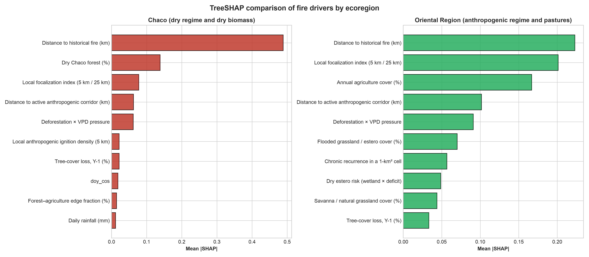
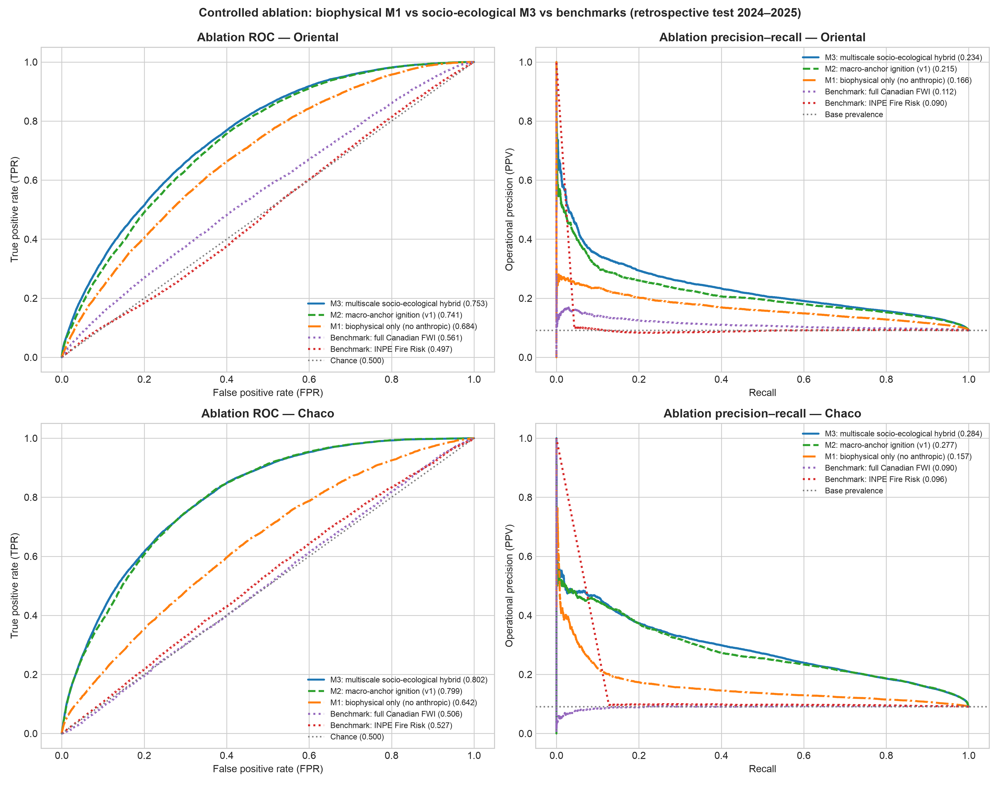
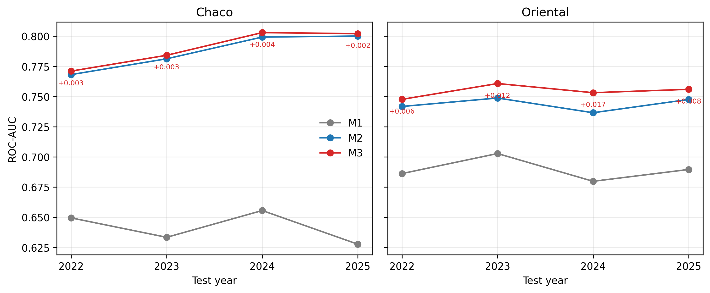
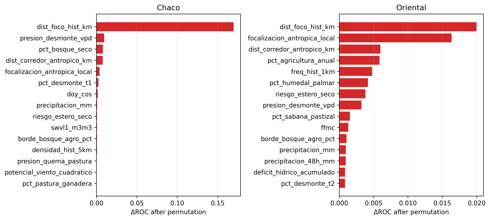
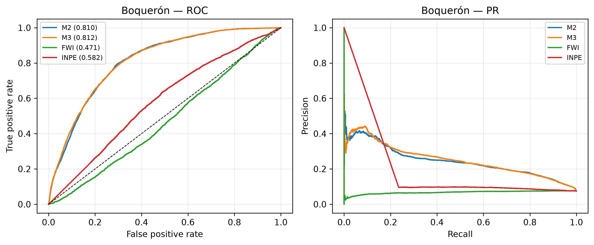

> **Versión de lectura en español.** Este documento traduce la prosa, los títulos, los epígrafes y las notas. Los datos de las tablas, las figuras, las cifras y los nombres de variables se conservan idénticos a la versión de envío en inglés (`material_suplementario.docx`).
>
> **Revista objetivo:** *Computers & Geosciences* (Elsevier). **Tipo de artículo:** artículo de investigación. **Revisión por pares:** simple anonimizada.  
> **Archivo suplementario:** `material_suplementario.docx` / `.html` — Notas S1–S5, Tablas S1–S34c y Figuras S1–S10.  
> **Código:** [github.com/sanchezmartin093-code/Incendios_PY](https://github.com/sanchezmartin093-code/Incendios_PY) (Licencia MIT; DOI conceptual del código [10.5281/zenodo.23675104](https://doi.org/10.5281/zenodo.23675104); release v2.1.0 de GitHub).  
> **Datos:** los datos procesados y las predicciones de test están disponibles en el release v2.1.0 de GitHub bajo CC BY 4.0 y se indexan bajo el DOI conceptual de datos [10.5281/zenodo.23675278](https://doi.org/10.5281/zenodo.23675278).

```{=html}
<style>
  #quarto-document-content table.table {
    font-size: 0.85rem;
  }
  #quarto-document-content table.table:has(tr > th:nth-child(10)) {
    display: block;
    overflow-x: auto;
    white-space: nowrap;
    max-width: 100%;
  }
</style>
```

# Contenido del material suplementario {.unnumbered}

• **Nota S1:** Datos, construcción del objetivo D2, control de calidad y muestreo.

• **Nota S2:** Calibración de Platt monótona acotada e hiperparámetros.

• **Nota S3:** Protocolo de evaluación y análisis ampliados.

• **Nota S4:** Implementación de los índices FWI e INPE.

• **Nota S5:** Análisis de robustez.

• **Tablas S1–S34c:** diccionario de variables, hiperparámetros, resultados departamentales, perfil computacional, cobertura conformal, evaluación poblacional, significancia pareada, bloques espaciales, lead time, muestreo, benchmark completo, ablación, baseline M1, política gated, holdout de confirmación, baseline acoplado, sensibilidad D2, SHAP, cost-loss, auditoría de datos, una línea base solo meteorología, una sensibilidad de A del INPE, una sensibilidad al solapamiento train/test, una tabla de beneficio neto, una prueba pareada de valor de decisión, estabilidad a semillas/capacidad, un backtest rolling-origin, una validación adversarial, sensibilidades de gate y etiquetas, una sensibilidad de muestreo y un control negativo, una validación espacial externa en Boquerón y una validación exploratoria entre países en Formosa y su benchmark clásico FWI/INPE.

• **Figuras S1–S10:** SHAP, ablación, cost-loss, beneficio neto, rolling-origin, sensibilidad al umbral, importancia por permutación, validación externa, precisión por presupuesto de alertas y curvas ROC/PR de Formosa.

---

# Nota complementaria S1. Datos, construcción del objetivo D2, control de calidad y muestreo

Las detecciones de fuego activo VIIRS de Suomi-NPP, NOAA-20 y NOAA-21 se adquieren como franjas transversales de 375 m desde NASA FIRMS [@nasa_firms]. En el borde de la franja, el píxel proyectado puede alcanzar aproximadamente 1.6 km en la dirección de escaneo y 0.8 km en la dirección de avance, produciendo el efecto geométrico Bow-Tie: detecciones repetidas del mismo incendio, dilución de la potencia radiativa del fuego (FRP) sobre un área aparente mayor y asignación incorrecta a la grilla nacional de 1 km² [@schroeder2014]. El filtro cinemático implementado es

$$\mathcal{D}_{\text{filtered}} = \left\{ f \in \mathcal{D}_{\text{raw}} \mid \text{scan}(f) \le 1.5\ \text{km} \;\land\; \text{confidence}(f) \neq \text{'low'} \right\}.$$

El máximo de escaneo observado en la ventana de estudio fue 0.8 km, por lo que la regla no eliminó registros, pero permanece activa para ventanas orbitales con ángulos de visión mayores. Los sobrepasos duplicados en la misma fecha civil se consolidan por celda de 1 km², conservando `num_focos_dia`, `max_frp_dia` y `sum_frp_dia`.

D2 separa la ignición primaria de la propagación táctica. Sea $F_t$ el conjunto de celdas con una detección térmica en el día $t$. La ignición D2 en la celda $i$ y el día $t$ requiere (i) $i \in F_t$, (ii) ninguna celda en $F_{t-1}$ a menos de 25 km y (iii) ninguna detección en la celda $i$ durante los 10 días previos. La propagación D2 requiere $i \in F_t$ y al menos una celda en $F_{t-1}$ a menos de 25 km. Los dos conjuntos de objetivos son disjuntos. El umbral de 25 km define el dominio del objetivo y no es un buffer de muestreo negativo; no se aplica un buffer de 20 km al conjunto de test. El buffer de 20 km se usa solo en el holdout de bloques espaciales.

La muestra caso-control se extrae a 1:10 por tarea y región. El entrenamiento usa 2018–2022, la validación usa 2023 y el test es el período congelado 2024–2025. Los denominadores poblacionales se mantienen por separado y se usan para la corrección de prior. Las mismas filas de test se usan para cada modelo, FWI e INPE, por lo que las comparaciones son pareadas. Los conteos de muestreo y las proporciones de clase están en la Tabla S10. El diccionario de variables está en la Tabla S1; el registro completo de auditoría está en la Tabla S15.

Las comprobaciones de calidad de datos colapsan sobrepasos VIIRS duplicados, eliminan detecciones de confianza `low`, reconstruyen la precipitación diaria a partir de incrementos subdiarios y rechazan valores imposibles por encima de 300 mm/día. Los nodos de ERA5-Land [@munoz2021era5land] se mapean a celdas con un cKDTree precomputado. El archivo de datos procesados contiene los objetivos de test, las probabilidades, las capas de benchmark, los planes de muestreo y los artefactos entrenados, de modo que las tablas de resultados pueden regenerarse sin el archivo crudo de varios terabytes.

# Nota complementaria S2. Calibración de Platt monótona acotada e hiperparámetros

Sea $z_i \in \mathbb{R}$ el margen producido por el ensamble LightGBM [@ke2017lightgbm] para la celda $i$, y sea $y_i \in \{0,1\}$ la etiqueta binaria de fuego. El escalado de Platt estándar [@platt1999] estima $w,b \in \mathbb{R}$ minimizando la entropía cruzada binaria:

$$\mathcal{L}(w,b) = -\sum_{i=1}^{M} \left[ y_i \log \sigma(w z_i + b) + (1-y_i)\log(1-\sigma(w z_i + b)) \right], \qquad \sigma(v)=\frac{1}{1+e^{-v}}.$$

Si y solo si $w>0$, el mapa $p(z)=\sigma(w z+b)$ es estrictamente creciente y preserva el ranking del ensamble. Su derivada es

$$\frac{dp}{dz}=w\,\sigma(w z+b)\,[1-\sigma(w z+b)],$$

y el factor sigmoide es estrictamente positivo, por lo que $\operatorname{sign}(dp/dz)=\operatorname{sign}(w)$. Una pendiente positiva deja ROC-AUC sin cambios. La regresión logística sin restricciones puede converger a $w<0$ bajo desbalance extremo o márgenes bimodales, invirtiendo el ranking y convirtiendo un ROC-AUC de 0.77 en 0.23.

La implementación minimiza una pérdida de Brier acotada con L-BFGS-B en `src/modelo.py`:

$$\min_{w,b}\frac{1}{M}\sum_{i=1}^{M}\left(y_i-\frac{1}{1+\exp(-(w z_i+b))}\right)^2,\qquad 0.10\le w\le 10.00,\quad -10.0\le b\le 10.0.$$

El límite inferior garantiza monotonicidad estricta y evita el colapso del gradiente en regiones asintóticas. La calibración se ajusta en 2023 y se congela para 2024–2025. La misma lógica de cutoff (umbral de corte) se usa para M1, M2, M3 y propagación; los cutoffs se seleccionan en validación con un criterio F0.5 y se aplican después de la corrección de prior. Los hiperparámetros están en la Tabla S2. La ablación usa una capacidad común (45/60 rondas y 23/31 hojas) para aislar el efecto de las variables.

# Nota complementaria S3. Protocolo de evaluación y análisis ampliados

El arnés de evaluación (harness) se fija antes de abrir el test. Contiene cinco componentes:

**(1)** Una división estrictamente temporal: entrenamiento 2018–2022, validación 2023 y test 2024–2025.

**(2)** Un holdout de bloques espaciales de 50 km con un buffer de 20 km; los priors se recalculan sin los incendios retenidos.

**(3)** Un bootstrap pareado agrupado por fecha ($B=1\,000$) para intervalos de confianza y diferencias frente a FWI [@vanwagner1987] e INPE [@setzer2019].

**(4)** Un análisis de lead time (tiempo de anticipación) usando meteorología de t-1 para cuantificar la brecha entre nowcast (pronóstico inmediato) y pronóstico.

**(5)** Análisis poblacional, conformal y cost-loss.

El bootstrap remuestrea por fecha, no por fila, porque la actividad diaria de incendios está fuertemente agrupada. Se retienen todas las celdas de una fecha muestreada; esto preserva la dependencia intradía. El holdout espacial elimina un bloque completo de 50 km más un buffer de 20 km, recalcula los priors históricos sin los incendios retenidos y evalúa tanto celdas retenidas como no retenidas. Las métricas principales son ROC-AUC y PR-AUC; también se reportan Brier score, error de calibración esperado, precisión, recall, F0.5 y falsos positivos. Los intervalos de AUC usan 500 réplicas bootstrap agrupadas; las diferencias pareadas usan 1 000. Las seis comparaciones confirmatorias se corrigen con Holm–Bonferroni y Benjamini–Hochberg; todas siguen siendo significativas con α = 0.05. La resolución del bootstrap es 0.001, por lo que los valores ajustados en el piso son cotas superiores.

El benchmark completo está en la Tabla S11 y su continuación, la significancia pareada en la Tabla S7, los resultados completos de bloques espaciales en la Tabla S8 y los resultados de lead time en la Tabla S9. La estabilidad a semillas/capacidad, el backtest rolling-origin y la validación adversarial están en las Tablas S25, S26 y S29 y la Figura S5; la sensibilidad al umbral está en la Tabla S14 (continuación) y la Figura S6. La ablación controlada está en la Tabla S12 y la Figura S2; SHAP está en la Tabla S13 y la Figura S1; la evaluación poblacional está en la Tabla S6; la cobertura conformal en la Tabla S5; el cost-loss en la Tabla S14 y la Figura S3. El perfil computacional está en la Tabla S4. Todos los análisis usan las filas de test congeladas archivadas con la release (versión publicada) del código.

# Nota complementaria S4. Implementación de los índices FWI e INPE

Esta nota documenta los dos índices del benchmark exactamente como están implementados. El FWI canadiense completo se produce con `scripts/02d_calcular_fwi_completo.py` a partir de `src/fwi.py`; el INPE Risco de Fogo con `scripts/02e_calcular_inpe.py` a partir de `src/inpe.py`; el benchmark une ambos a la grilla de 1 km por `nodo_clima_id` y `fecha` en `scripts/13_benchmarking_modelos.py`. Ninguno de los dos índices se ajustó a las etiquetas de fuego.

## S4.1 Índice canadiense FWI

### Códigos de combustible

Se implementa el sistema estándar de seis códigos, sin un tipo de combustible personalizado:

- **FFMC (Fine Fuel Moisture Code):** humedad de la hojarasca superficial y los combustibles finos (aproximadamente los primeros 1–2 cm); escala 0–101.
- **DMC (Duff Moisture Code):** humedad de la capa orgánica poco compactada; secado de mediano plazo.
- **DC (Drought Code):** humedad de la capa orgánica profunda y compactada; reservorio de sequía estacional.
- **BUI (Buildup Index):** combustible disponible para la combustión, derivado de DMC y DC.
- **ISI (Initial Spread Index):** potencial de propagación inicial, derivado de FFMC y viento.
- **FWI (Fire Weather Index):** intensidad frontal del fuego, derivada de ISI y BUI.

### Ecuaciones

Sean $F_t$, $D_t$ y $Q_t$ el FFMC, DMC y DC del día $t$; $T$ la temperatura a las 15:00 UTC (°C), $H$ la humedad relativa correspondiente (%), $W$ la velocidad del viento a 10 m (km h⁻¹) y $r$ la lluvia de 00–24 h (mm). La recursión se aplica por nodo en orden cronológico.

El contenido de humedad de combustibles finos es

$$m_{t-1}=\frac{147.2(101-F_{t-1})}{59.5+F_{t-1}}.$$

Para $r>0.5$ mm, con $r_f=r-0.5$,

$$m_0=m_{t-1}+42.5\,r_f\,e^{-100/(251-m_{t-1})}\left(1-e^{-6.93/r_f}\right)+\epsilon,$$

donde $\epsilon=0.0015(m_{t-1}-150)^2\sqrt{r_f}$ es el término de corrección pequeño codificado en `src/fwi.py`; $m_0$ se limita a 250. Los contenidos de humedad de equilibrio son

$$E_d=0.942H^{0.679}+11e^{(H-100)/10}+0.18(21.1-T)(1-e^{-0.115H}),$$

$$E_w=0.614H^{0.753}+10e^{(H-100)/10}+0.18(21.1-T)(1-e^{-0.115H}).$$

Las tasas de secado y humedecimiento son

$$k_d=\left[0.424\left(1-\left(\frac{100-H}{100}\right)^{1.7}\right)+0.0694\sqrt{W}\left(1-\left(\frac{100-H}{100}\right)^8\right)\right]0.581e^{0.0365T},$$

$$k_w=\left[0.424\left(1-\left(\frac{H}{100}\right)^{1.7}\right)+0.0694\sqrt{W}\left(1-\left(\frac{H}{100}\right)^8\right)\right]0.581e^{0.0365T}.$$

El contenido de humedad tras un día es

$$m_t=\begin{cases}E_d+(m_0-E_d)10^{-k_d}, & m_0<E_d,\\E_w+(m_0-E_w)10^{-k_w}, & m_0>E_w,\\m_0, & \text{en otro caso,}\end{cases}$$

y

$$F_t=\operatorname{clip}\left(\frac{59.5(250-m_t)}{147.2+m_t},\,0,\,101\right).$$

Para DMC, cuando $r>1.5$ mm,

$$r_e=0.92r-1.27,\qquad m_0=20+280e^{-0.023D_{t-1}},$$

$$b=\begin{cases}100/(0.5+0.3D_{t-1}), & D_{t-1}\le33,\\14-1.3\ln D_{t-1}, & 33<D_{t-1}\le65,\\6.2\ln D_{t-1}-17.2, & D_{t-1}>65,\end{cases}$$

$$m_r=m_0+\frac{1000r_e}{48.77+br_e},\qquad D'=43.43(5.6348-\ln(m_r-20)),$$

con $D'$ limitado inferiormente a cero; cuando $r\le1.5$ mm, $D'=D_{t-1}$. La actualización diaria usa

$$T_+=\max(T,-1.1),\qquad H_c=\operatorname{clip}(H,1,100),$$

$$K=1.894(T_++1.1)(100-H_c)L_e10^{-4},\qquad D_t=D'+K,$$

donde $L_e$ es el factor de longitud efectiva del día. Para el dominio (20°S), los doce valores mensuales son $L_e=(10.1,9.6,9.1,8.5,8.1,7.8,7.9,8.3,8.9,9.4,9.9,10.2)$.

Para DC, cuando $r>2.8$ mm,

$$r_d=0.83r-2.8,\qquad Q_0=800e^{-Q_{t-1}/400}+3.937r_d,$$

con $Q_0$ limitado a 800 y $Q'=400\ln(800/Q_0)$; en otro caso $Q'=Q_{t-1}$. Luego

$$Q_t=Q'+0.5\max(T,-2.8).$$

El BUI es

$$U_t=\begin{cases}0, & D_t\le0,\\\frac{0.8D_tQ_t}{D_t+0.4Q_t}, & D_t\le0.4Q_t,\\D_t-\left(1-\frac{0.8Q_t}{D_t+0.4Q_t}\right)\left[0.92+(0.0114D_t)^{1.7}\right], & \text{en otro caso.}\end{cases}$$

El ISI es

$$m=\frac{147.2(101-F_t)}{59.5+F_t},\qquad f_W=e^{0.05039W},$$

$$f_F=91.9e^{-0.1386m}\left(1+\frac{m^{5.31}}{4.93\times10^7}\right),\qquad R_t=0.208f_Wf_F.$$

Finalmente,

$$f_D=\begin{cases}0.626U_t^{0.809}+2, & U_t\le80,\\\frac{1000}{25+108.64e^{-0.023U_t}}, & U_t>80,\end{cases}\qquad B_t=0.1R_tf_D,$$

$$FWI_t=\begin{cases}e^{2.72(0.434\ln B_t)^{0.647}}, & B_t>1,\\B_t, & B_t\le1.\end{cases}$$

### Meteorología, momento del día y resolución

Los campos de las 15:00 UTC (aproximadamente el mediodía local) se extraen del archivo ERA5-Land cada 3 h [@munoz2021era5land]: temperatura a 2 m, punto de rocío a 2 m y componentes del viento a 10 m $u_{10}$ y $v_{10}$. La humedad relativa se deriva de la temperatura y el punto de rocío con la presión de vapor de saturación de Tetens $e_s=0.61078e^{17.27T/(T+237.3)}$ y $H=100e_a/e_s$, limitada a 1–100 %. La velocidad del viento es $W=3.6\sqrt{u_{10}^2+v_{10}^2}$ km h⁻¹. La lluvia es el total de 00–24 h de la tabla climática diaria.

El FWI usa meteorología del **mismo día**, no $t-1$: los códigos del día $t$ se impulsan con los campos de las 15:00 UTC y la lluvia del día $t$. Es una configuración de nowcast. El experimento con retardo $t-1$ usado para cuantificar la brecha de lead time es un análisis separado (Nota S3) y no entra en el benchmark.

El análisis climático usa una grilla de nodos de 0.25° (640 nodos). Cada nodo se empareja con el píxel ERA5-Land más cercano, y cada celda de 1 km² hereda un nodo mediante `nodo_clima_id`; el mapeo se precomputa con un cKDTree. La serie completa de FWI se guarda en `fwi_completo_diario.parquet`. Las columnas `ffmc` e `isi` usadas como variables por M1/M2/M3 son una aproximación diaria separada, calculada por `src/clima.py` a partir de la temperatura máxima diaria, la humedad relativa derivada del VPD, el viento máximo diario y la lluvia diaria; no son la misma serie que el FWI del benchmark.

### Inicialización y warm-up

En el primer día de cada serie de nodo (1 de enero de 2018) los códigos se inicializan como $F=85$, $D=6$ y $Q=15$. La recursión se ejecuta después de forma continua hasta 2025. No hay un spin-up previo a 2018 y no se descarta una ventana de warm-up separada: el año calendario 2018 se usa solo en el split de entrenamiento, por lo que cualquier transitorio de inicialización queda confinado al entrenamiento. En la validación de 2023 y el test 2024–2025 los códigos se han iterado durante al menos cinco años, y la memoria de los valores iniciales es despreciable.

## S4.2 INPE Risco de Fogo (2019)

La implementación sigue la formulación INPE 2019 versión 11 [@setzer2019]. El producto público aplica una corrección por focos de los tres días previos; esa corrección se omite deliberadamente aquí porque filtraría la etiqueta de ignición. El benchmark usa, por tanto, la formulación solo meteorológica.

### Índice de sequedad (PSE)

Sea $r_j$ la lluvia diaria y sea

$$R_k(t)=\sum_{j=t-k+1}^{t}r_j$$

la lluvia acumulada en los $k$ días que terminan en $t$, con los días anteriores al 1 de enero de 2018 tratados como cero. El PSE (período de secura; 0–105) es

$$PSE_t=105\prod_{j=1}^{11}\exp\left[-\lambda_j\left(R_{k_j}(t)-R_{k_{j-1}}(t)\right)\right],$$

con $R_0=0$, ventanas $k=(1,2,3,4,5,10,15,30,60,90,120)$ y coeficientes

$$\lambda=(0.14,0.07,0.04,0.03,0.02,0.01,0.008,0.004,0.002,0.001,0.0007).$$

La ventana de 120 días se trunca por la izquierda al inicio de la serie de 2018 y queda completa después de 120 días. El PSE se impulsa con la lluvia del mismo día, no con $t-1$.

### Constante de flamabilidad y riesgo básico

La especificación primaria usa una constante local ponderada por cobertura

$$A=\frac{6.0f_p+3.0f_s+1.72f_{ds}+1.72f_{dh}+1.5f_{pa}}{f_p+f_s+f_{ds}+f_{dh}+f_{pa}},$$

donde $f_p$, $f_s$, $f_{ds}$, $f_{dh}$ y $f_{pa}$ son los porcentajes MapBiomas de pastura, sabana, bosque seco, bosque húmedo y palmar [@mapbiomas2023]. Si el denominador es cero, $A=0$. El riesgo básico es

$$R_b=0.8\frac{1+\sin\left(\min\left(\frac{A\,PSE_t}{120},2\right)\frac{\pi}{2}-\frac{\pi}{2}\right)}{2}.$$

La $A$ local es la versión primaria; una $A$ fija $=3.0$ (coeficiente INPE de sabana abierta) se reporta como sensibilidad en la Tabla S22.

### Riesgo observado y momento del día

El riesgo observado es

$$RF_t=\operatorname{clip}\left(R_bF_{UR}F_TF_{lat}F_{alt},\,0,\,1\right),$$

con

$$F_{UR}=1.3-0.006H_{min},\qquad F_T=0.4+0.02T_{max},$$

$$F_{lat}=1+0.003|\phi|,\qquad F_{alt}=1+0.00003z,$$

donde $H_{min}$ y $T_{max}$ son la humedad relativa mínima y la temperatura máxima diarias del mismo día, $\phi$ es la latitud y $z$ la elevación (m). La tabla de la grilla de 1 km no contiene elevación, por lo que $F_{alt}=1$ en el benchmark. La serie INPE se guarda en `inpe_diario.parquet`; usa los campos diarios del mismo día y el mismo mapeo de nodo de 0.25° a celda que el FWI. No se aplica retardo $t-1$.

## S4.3 Calibración y puntos operativos

**No se aplicó calibración local a ninguno de los dos índices.** El FWI permanece en la escala del índice canadiense y el INPE en una escala de riesgo 0–1; ninguno es una probabilidad calibrada. Para ignición en cada región, el corte operativo se seleccionó en la validación de 2023 maximizando F0.5 y luego se congeló para 2024–2025 (Tablas S11 y S22). La ponderación local de $A$ es una parametrización de cobertura, no una calibración a observaciones de fuego.

# Nota complementaria S5. Análisis de robustez

Esta nota documenta los protocolos de las Tablas S25–S32 y las Figuras S5–S7. Todos los análisis usan los datos congelados 2018–2025 y las mismas definiciones de variables que los modelos principales, salvo que se indique lo contrario.

## S5.1 Backtest rolling-origin

Se evaluaron cuatro folds para los años de test $Y=2022,\dots,2025$. En cada fold, los modelos se entrenaron hasta $Y-2$, se calibraron y se umbralizaron en $Y-1$, y se evaluaron en $Y$. M1, M2 y M3 se reentrenaron con la capacidad operativa de la Tabla S2; el corte F0.5 se seleccionó en $Y-1$ y se congeló para $Y$. ROC-AUC y PR-AUC se calcularon sobre las filas caso-control de test. La diferencia M3−M2 usa un bootstrap pareado agrupado por fecha ($B=1\,000$). La construcción es estrictamente anidada: ningún año de test contribuye al entrenamiento ni a la selección del umbral (Tabla S26; Figura S5).

## S5.2 Estabilidad a semillas y capacidad

M2 y M3 se entrenaron con semillas 42, 7, 13, 21 y 33 y dos capacidades: la configuración operativa y una variante +20 % en `num_leaves` y `num_boost_round` (Chaco 28/54; Oriental 37/72). Los demás hiperparámetros quedaron fijos. ROC-AUC y PR-AUC se evaluaron en el test congelado. ΔROC es M3−M2 dentro de la misma semilla y capacidad; la tabla reporta media, desviación estándar, rango, intervalo t para la media y fracción de corridas positivas (Tabla S25).

## S5.3 Sensibilidad a umbral y métrica

Para la ignición M3 y el modelo de propagación, los cortes se seleccionaron en la validación de 2023 maximizando F0.5, F1, F2 y la J de Youden. Precisión, recall, F0.5, F1 y F2 se evaluaron después en el test 2024–2025. La Figura S6 muestra las curvas de validación; la Tabla S14 (continuación) reporta las métricas de test. El corte F0.5 operativo se mantiene en las tablas principales; este análisis prueba si el ranking depende de esa elección.

## S5.4 Validación adversarial

Se entrenó un clasificador LightGBM para separar filas de entrenamiento (2018–2022) de test (2024–2025) usando el conjunto de variables de M3. Se usaron cinco folds estratificados, 100 rondas, 31 hojas, learning rate 0.05 e importancia por ganancia. El AUC reportado es la media entre folds; las variables principales se ordenan por ganancia media. El AUC adversarial mide cambio de distribución y no es una métrica de desempeño del modelo de fuego (Tabla S29).

## S5.5 Control negativo y permutation importance

El control negativo reentrena M3 tras permutar aleatoriamente las etiquetas de entrenamiento, manteniendo las variables y las etiquetas de validación. Un pipeline correctamente especificado y sin fuga debería dar un AUC cercano a 0.5. El control se repitió con y sin las variables históricas (`dist_foco_hist_km`, `densidad_hist_25km`, `freq_hist_1km`). La importancia por permutación barre cada variable, o cada familia, en las filas de test y registra la caída media de ROC-AUC en tres repeticiones. Las familias son meteorología, combustible, antropogénicas, históricas y calendario. Los resultados están en la Tabla S32 y la Figura S7. Un AUC superior a 0.5 en el control indica información residual de celda o de variables; es un diagnóstico de lo que el score puede y no puede sostener, no un sustituto del ranking principal.

## S5.6 Umbrales del gate y muestra sin gate

El gate basal es combustible y VPD ≥ 0.8 kPa con lluvia 48 h < 10 mm. Las variantes estrictas usan VPD ≥ 1.0/1.2 kPa y lluvia < 5/2 mm. Se generó una muestra de ignición sin gate desde el archivo candidato completo con el mismo operador D2, ratio 1:10 y sin filtro biofísico (Tabla S31). Los positivos son todas las igniciones D2 del dominio muestreado; los negativos son todos los candidatos sin fuego. La muestra sin gate es independiente de la muestra gateada congelada; los años de validación y test no cambian. El FWI se evalúa en las mismas filas retenidas.

## S5.7 Sensibilidad a la razón de muestreo

La muestra 1:5 se obtuvo submuestreando negativos de entrenamiento del muestreo 1:10 congelado. La muestra 1:20 se generó de forma independiente desde el archivo candidato completo con el gate basal y 20 negativos por positivo. Validación y test permanecen en 1:10 para que ROC-AUC, PR-AUC y la precisión poblacional corregida por prevalencia sean comparables entre ratios de entrenamiento (Tabla S28). Los análisis 1:5 y 1:20 cambian solo el balance de clases de entrenamiento.

## S5.8 Variantes de calidad de etiquetas VIIRS

El archivo crudo FIRMS (2018–2025) se filtró a fuegos de vegetación con scan ≤ 1.5 km y confianza no baja. Se construyeron dos variantes: confianza alta (`h`) y FRP ≥ 10 MW. Las variantes se aplicaron a las filas positivas del muestreo 1:10 congelado; los negativos no cambiaron. Es una sensibilidad de etiquetas, no una reconstrucción completa de D2 bajo las máscaras variantes: quitar una detección de baja confianza o bajo FRP también puede cambiar el buffer t−1 y el estado de fuego reciente. La variante de nubosidad < 40 % no se reporta porque FIRMS no trae máscara de nubes y el proxy de nubosidad total ERA5 no completó en la cola del CDS (Tabla S30).

## S5.9 Verificación en entorno limpio

Se creó un entorno Python 3.12 separado desde `requirements-lock.txt`. Las 76 pruebas pasaron y `shasum -a 256 -c auditoria/HASHES.sha256` devolvió OK. La ejecución está registrada en `auditoria/R12_VERIFICACION_ENTORNO_LIMPIO.md`. Los hashes cubren tablas, figuras, fuentes del manuscrito y scripts de análisis.

---

La grilla de 1 km² es la unidad de modelado. Las fracciones de combustible provienen de mapas anuales de MapBiomas Colección 2 (2017–2023), unidos a cada fila con el mapa del año previo; 2024 usa 2023 con lag 1 y 2025 reutiliza 2023 con lag 2 [@mapbiomas2023]. Los priors históricos usan una ventana móvil causal de tres años en lugar del registro completo 2018–2022. `rafaga_max_kmh` es un proxy lineal y no se usa como variable. M3 contiene 44 variables en el Chaco y 45 en la Región Oriental; M2 contiene 35 y M1 contiene 24.

**Tabla S1.** Diccionario de variables y papel físico de los predictores.

| Variable | Description | Source | Role |
|----------------------------|--------------------------------------|--------------|--------------------|
| temp_max_c | Daily maximum temperature at 2 m (°C) | ERA5-Land | Ignition and propagation |
| temp_min_c | Daily minimum temperature at 2 m (°C) | ERA5-Land | Ignition and propagation |
| rango_termico_diario | Intraday thermal range (Tmax − Tmin) | Derived | Ignition and propagation |
| vpd_max_kpa | Maximum vapor pressure deficit (kPa) | Derived | Gate, ignition and propagation |
| deficit_hidrico_acumulado | Integrated desiccation stress (VPD × (CDD + 1), kPa·d) | Derived | Ignition and propagation |
| precipitacion_mm | Daily rainfall (00–24 h, mm) | ERA5-Land | Ignition and propagation |
| precipitacion_48h_mm | Antecedent 48-h rainfall (mm) | Derived | Gate, ignition and propagation |
| dias_secos_consecutivos | Consecutive days with rainfall <1.0 mm (CDD) | Derived | Ignition and propagation |
| viento_max_kmh | Maximum 10-m wind speed (km/h) | ERA5-Land | Ignition and propagation |
| rafaga_max_kmh | Linear wind proxy (1.3 × wind); not an ERA5-Land gust | Proxy | Not used |
| potencial_viento_cuadratico | Dynamic wind pressure ((v/10)², dimensionless) | Derived | Ignition and propagation |
| interaccion_viento_vpd | Advective–desiccant coupling (wind × VPD) | Derived | Ignition and propagation |
| swvl1_m3m3 | Topsoil volumetric water content, 0–7 cm (m³/m³) | ERA5-Land | M1, M2, M3 and propagation |
| fdd_heladas_60d | Antecedent frost severity over 60 days (°C-days) | ERA5-Land; derived | M1, M2, M3 and propagation |
| deficit_hidro_60d | Antecedent water deficit over 60 days (mm) | ERA5-Land; derived | M1, M2, M3 and propagation |
| riesgo_estero_seco | Dry estero risk (wetland × 60-day deficit) | Derived | M1, M2, M3 and propagation |
| combustible_curado_helada | Frost-cured pasture and grassland fuel | Derived | M1, M2, M3 and propagation |
| ffmc | Fine Fuel Moisture Code | FWI derived | Ignition and propagation |
| isi | Initial Spread Index | FWI derived | Ignition and propagation |
| dia_semana | Civil weekday (0 = Monday … 6 = Sunday) | Calendar | Ignition and propagation |
| es_fin_de_semana | Weekend indicator (Saturday/Sunday) | Calendar | Ignition and propagation |
| mes | Month of year (1–12) | Calendar | Ignition and propagation |
| dia_del_anio | Ordinal day of year (1–366) | Calendar | Ignition and propagation |
| pct_pastura | Total pasture, annual agriculture and forest plantation (0–100 %) | Derived from MapBiomas C2 annual (Y-1) | INPE benchmark only; not a model feature |
| pct_pastura_ganadera | Cultivated pasture fraction (0–100 %) | MapBiomas C2 annual (Y-1) | M1, M2, M3 and propagation |
| pct_agricultura_anual | Annual agriculture fraction (0–100 %) | MapBiomas C2 annual (Y-1) | M1, M2, M3 and propagation |
| pct_plantacion_forestal | Forest plantation fraction (0–100 %) | MapBiomas C2 annual (Y-1) | M1, M2, M3 and propagation |
| pct_sabana_pastizal | Savanna and natural grassland fraction (0–100 %) | MapBiomas C2 annual (Y-1) | Ignition and propagation |
| pct_humedal_palmar | Wetland and palm swamp fraction (0–100 %) | MapBiomas C2 annual (Y-1) | Ignition and propagation |
| pct_bosque_seco | Dry Chaco forest fraction (0–100 %) | MapBiomas C2 annual (Y-1) | Ignition and propagation (Chaco) |
| pct_bosque_humedo | Atlantic humid forest fraction (0–100 %) | MapBiomas C2 annual (Y-1) | Ignition and propagation (Oriental) |
| indice_ecotono | Forest–pasture edge disruption index | Derived | Ignition and propagation |
| borde_bosque_agro_pct | Forest–agriculture edge fraction (0–100 %) | Derived from MapBiomas C2 annual (Y-1) | M2, M3 and propagation |
| pct_desmonte_t1 | Tree-cover loss in the prior year (0–100 %) | Hansen GFC-2025 v1.13 (Y-1) | M2, M3 and propagation |
| pct_desmonte_t2 | Tree-cover loss two years before (0–100 %) | Hansen GFC-2025 v1.13 (Y-2) | M2, M3 and propagation |
| presion_desmonte_vpd | Deforestation × VPD pressure | Derived (Hansen Y-1 × VPD) | M2, M3 and propagation |
| dist_foco_hist_km | Minimum distance to training fires (km) | FIRMS, causal 3-year window | Ignition and propagation |
| densidad_hist_25km | Cumulative historical fire density within 25 km | FIRMS, causal 3-year window | Ignition and propagation |
| dist_foco_t1_km | Minimum distance to an active t-1 fire (km) | Causal spatial kernel | Propagation only |
| focos_25km_t1 | Active t-1 fires within 25 km | Causal spatial kernel | Propagation only |
| frp_25km_t1 | Accumulated t-1 FRP within 25 km (MW) | Causal spatial kernel | Propagation only |
| dist_corredor_antropico_km | Distance to chronic-recurrence cells (≥3 events, 2018–2022) | Anthropogenic prior | M3 only |
| densidad_hist_5km | Kernel density of historical fires within 5 km | Anthropogenic prior | M3 only |
| densidad_hist_10km | Kernel density of historical fires within 10 km | Anthropogenic prior | M3 only |
| freq_hist_1km | Point recurrence in the 1-km² cell (2018–2022) | Anthropogenic prior | M3 Oriental and M2 fallback selector |
| temporada_quema_ganadera | Livestock burning season indicator (August–October) | Anthropogenic calendar | M3 only |
| doy_sin | Continuous seasonal sine harmonic | Derived | M3 only |
| doy_cos | Continuous seasonal cosine harmonic | Derived | M3 only |
| presion_quema_pastura | Pasture burning pressure (pasture × VPD × month weight) | Human–climate interaction | M3 only |
| focalizacion_antropica_local | Local-to-macro concentration ratio (5 km / 25 km) | Multiscale ratio | M3 only |
| interaccion_acceso_vpd | Accessibility–desiccation synergy (exp(−d_hist/5) × VPD) | Human–climate interaction | M3 only |
| es_combustible | Combustible biomass indicator | MapBiomas C2 annual (Y-1) | Biophysical gate |

Los modelos operativos no se seleccionaron mediante una búsqueda completamente registrada. La tabla reporta la configuración de los boosters entrenados por `scripts/06_entrenar_modelos.py` y `scripts/16_ablacion_modelo_hibrido.py`.

**Tabla S2.** Hiperparámetros operativos y de ablación.

| Hyperparameter | M2 Chaco | Propagation Chaco | M2 Oriental | Propagation Oriental | M3 Chaco | M3 Oriental |
|------------------|-----------:|-----------:|-----------:|-----------:|-----------:|-----------:|
| objective | binary | binary | binary | binary | binary | binary |
| learning_rate | 0.03 | 0.03 | 0.03 | 0.03 | 0.03 | 0.03 |
| num_leaves | 15 | 15 | 15 | 15 | 23 | 31 |
| max_depth | 5 | 5 | 5 | 5 | 5 | 5 |
| min_child_samples | 20 | 20 | 10 | 10 | 20 | 10 |
| scale_pos_weight | 1.0 | 1.0 | 2.0 | 2.0 | 1.0 | 2.0 |
| feature_fraction | 0.80 | 0.80 | 0.80 | 0.80 | 0.80 | 0.80 |
| bagging_fraction | 0.80 | 0.80 | 0.80 | 0.80 | 0.80 | 0.80 |
| lambda_l1 | 0.20 | 0.20 | 0.20 | 0.20 | 0.20 | 0.20 |
| lambda_l2 | 1.00 | 1.00 | 1.00 | 1.00 | 1.00 | 1.00 |
| num_boost_round | 20 | 20 | 40 | 40 | 45 | 60 |
| early_stopping | None | None | None | None | None | None |

Los valores fueron generados por `scripts/14_auditoria_suplementaria.py`.

**Tabla S3.** Desempeño en el test D2 por departamento.

| Department | Region | Sovereign cells | Test samples | Test fires | Ignition ROC-AUC | Propagation ROC-AUC | Tactical precision |
|--------------|----------|-----------:|-----------:|---------:|-----------:|-----------:|------------:|
| SAN PEDRO | Oriental | 20 854 | 22 859 | 2 763 | 0.7150 | 0.7590 | 60.7 % |
| CONCEPCIÓN | Oriental | 18 523 | 24 486 | 2 022 | 0.7050 | 0.8110 | 74.3 % |
| ITAPÚA | Oriental | 15 868 | 21 861 | 1 355 | 0.7760 | 0.7800 | 50.4 % |
| CANINDEYÚ | Oriental | 15 052 | 19 820 | 1 700 | 0.8510 | 0.8340 | 65.3 % |
| ALTO PARANÁ | Oriental | 14 206 | 23 639 | 869 | 0.8430 | 0.8560 | 51.5 % |
| CAAGUAZÚ | Oriental | 12 901 | 14 333 | 1 571 | 0.7260 | 0.7490 | 54.9 % |
| AMAMBAY | Oriental | 12 555 | 15 122 | 1 517 | 0.7590 | 0.8360 | 76.1 % |
| ÑEEMBUCÚ | Oriental | 11 672 | 15 506 | 1 555 | 0.6380 | 0.7190 | 54.8 % |
| CAAZAPÁ | Oriental | 9 554 | 10 662 | 1 388 | 0.7130 | 0.7240 | 49.8 % |
| PARAGUARÍ | Oriental | 8 593 | 9 631 | 1 139 | 0.6250 | 0.7030 | 57.0 % |
| MISIONES | Oriental | 8 157 | 9 786 | 912 | 0.5970 | 0.7070 | 58.2 % |
| CORDILLERA | Oriental | 4 791 | 4 947 | 561 | 0.6790 | 0.7310 | 55.2 % |
| GUAIRÁ | Oriental | 3 866 | 4 455 | 469 | 0.6880 | 0.7160 | 46.8 % |
| CENTRAL | Oriental | 2 406 | 2 751 | 347 | 0.7040 | 0.7780 | 68.0 % |
| ASUNCIÓN | Oriental | 128 | 78 | 8 | 0.6800 | 0.7920 | 55.6 % |
| BOQUERÓN | Chaco | 88 623 | 66 587 | 5 038 | 0.8080 | 0.9270 | 88.9 % |
| ALTO PARAGUAY | Chaco | 78 613 | 60 983 | 4 075 | 0.8130 | 0.9210 | 86.9 % |
| PRESIDENTE HAYES | Chaco | 73 644 | 49 046 | 6 943 | 0.7090 | 0.8550 | 80.0 % |

ASUNCIÓN tiene solo ocho incendios de test; sus métricas departamentales se reportan por completitud y no deben interpretarse como estimaciones estables.

El perfil se midió en macOS ARM64; x86_64 no se midió. La fila de point-in-polygon (punto en polígono) es una referencia para 50 000 puntos y no se usa en inferencia.

**Tabla S4.** Perfil por etapa para el 2024-09-09.

| Stage | Method | Cells | Time (s) | Peak RAM (MB) | Note |
|----------------------|----------------|-----------:|---------:|-----------:|----------------------------|
| Integer cell_id lookup (O(1)) | NumPy int64 | 400 006 | 0.00073 | — | Median of 100 repetitions |
| Point-in-Polygon | GeoPandas sjoin | 50 000 | 0.02610 | — | 50 000 points; non-linear extrapolation |
| Ingestion, priors and gate | Polars/cKDTree | 400 006 | 2.40000 | — | Measured 2024-09-09 |
| Dual inference | LightGBM C++ | 400 006 | 1.03800 | — | Measured 2024-09-09 |
| Aggregation and bulletin | Polars | 400 006 | 0.03700 | — | Measured 2024-09-09 |
| Total pipeline | Integrated | 400 006 | 3.47400 | 2 212.9 | ARM64; x86_64 not measured |

**Tabla S5.** Cobertura conformal empírica. Estos valores no constituyen una garantía formal bajo cambio temporal.

| Region | $\hat{q}_{90}$ | Coverage 90 (%) | $\hat{q}_{95}$ | Coverage 95 (%) |
|--------------|---------------:|-----------------:|---------------:|-----------------:|
| Chaco | 0.3552 | 90.17 % | 0.8394 | 95.32 % |
| Oriental | 0.3583 | 90.31 % | 0.8637 | 94.79 % |

Las métricas poblacionales aplican corrección de prior desde la muestra caso-control al denominador poblacional. La precisión poblacional es la cantidad operativa relevante, no la precisión caso-control.

**Tabla S6.** Evaluación a nivel poblacional con corrección de prevalencia (test retrospectivo 2024–2025).

<!-- tablaS6:inicio -->

| Region | Task | Model | Pop. prevalence | Sample prevalence | Pop. cutoff | ROC-AUC | PR-AUC | Precision (%) [W; B] | Recall (%) [W; B] | F0.5 | Brier | BSS | ECE | Pop. N | Pop. positives |
|---|---|---|---|---|---|---|---|---|---|---|---|---|---|---|---|
| Chaco | ignicion | M3_ignicion_hibrida | 0.000153 | 0.090909 | 0.000467 | 0.8059 | 0.0009 | 0.082 [0.080–0.084; 0.075–0.088] | 27.304 [26.62–28.00; 26.16–28.56] | 0.0010 | 0.000153 | 0.0003 | 0.0000 | 104976526 | 16056 |
| Chaco | ignicion | M2_ignicion_base | 0.000153 | 0.090909 | 0.000428 | 0.8078 | 0.0007 | 0.090 [0.087–0.093; 0.082–0.098] | 24.589 [23.93–25.26; 23.26–25.91] | 0.0011 | 0.000153 | 0.0003 | 0.0000 | 104976526 | 16056 |
| Chaco | propagacion | M2_propagacion_tactica | 0.001553 | 0.090909 | 0.022388 | 0.9088 | 0.1270 | 9.667 [9.557–9.778; 9.087–10.316] | 50.652 [50.22–51.08; 49.01–52.02] | 0.1153 | 0.001447 | 0.0666 | 0.0002 | 33748163 | 52405 |
| Oriental | ignicion | M3_ignicion_hibrida | 0.000414 | 0.090909 | 0.001084 | 0.7627 | 0.0019 | 0.198 [0.192–0.204; 0.178–0.222] | 20.731 [20.15–21.33; 19.26–22.31] | 0.0025 | 0.000414 | 0.0005 | 0.0001 | 43887357 | 18176 |
| Oriental | ignicion | M2_ignicion_base | 0.000414 | 0.090909 | 0.000959 | 0.7549 | 0.0015 | 0.166 [0.161–0.171; 0.149–0.184] | 22.106 [21.51–22.72; 20.42–23.86] | 0.0021 | 0.000414 | 0.0005 | 0.0000 | 43887357 | 18176 |
| Oriental | propagacion | M2_propagacion_tactica | 0.002102 | 0.090909 | 0.017575 | 0.7963 | 0.0287 | 4.784 [4.709–4.860; 4.129–5.491] | 18.771 [18.50–19.05; 16.71–21.01] | 0.0562 | 0.002069 | 0.0135 | 0.0004 | 37235186 | 78269 |

<!-- tablaS6:fin -->

Ign. = ignition; Prop. = propagation. M2 is the baseline ignition model in the ignition task and the tactical propagation model in the propagation task; M3 is the hybrid ignition model. Precision and recall brackets are 95 % intervals: Wilson on population counts; date-grouped bootstrap (B = 1 000).

**Tabla S7.** Diferencias pareadas de ROC-AUC para las seis comparaciones confirmatorias (cuatro frente a FWI/INPE y dos M3−M2), agrupadas por fecha (test retrospectivo 2024–2025). Se reportan los valores p ajustados por Holm–Bonferroni y Benjamini–Hochberg.

<!-- tablaS7:inicio -->

| Region | Task | Comparison | ΔROC | p raw | p Holm | p BH | B |
|---|---|---|---|---|---|---|---|
| Oriental | ignicion | Incendios_PY (Ignición Híbrida M3) vs Canadian FWI completo | 0.1922 | ≤0.001 | 0.0060 | 0.0010 | 1000 |
| Oriental | ignicion | Incendios_PY (Ignición Híbrida M3) vs INPE Risco de Fogo | 0.2561 | ≤0.001 | 0.0060 | 0.0010 | 1000 |
| Oriental | ignicion | Incendios_PY (Ignición Híbrida M3) vs Incendios_PY (Ignición Base M2) | 0.0128 | ≤0.001 | 0.0060 | 0.0010 | 1000 |
| Chaco | ignicion | Incendios_PY (Ignición Híbrida M3) vs Canadian FWI completo | 0.2963 | ≤0.001 | 0.0060 | 0.0010 | 1000 |
| Chaco | ignicion | Incendios_PY (Ignición Híbrida M3) vs INPE Risco de Fogo | 0.2756 | ≤0.001 | 0.0060 | 0.0010 | 1000 |
| Chaco | ignicion | Incendios_PY (Ignición Híbrida M3) vs Incendios_PY (Ignición Base M2) | 0.0030 | ≤0.001 | 0.0060 | 0.0010 | 1000 |

<!-- tablaS7:fin -->

The family is pre-specified as the six confirmatory comparisons. With B = 1,000 the bootstrap resolution is 0.001, so the raw p-values sit at the resolution floor and the adjusted values are upper bounds. Values are retrospective diagnostics, not a blind confirmation.

**Tabla S8.** Resultados completos de bloques espaciales de desarrollo 2023.

| Region | Model | Split | n | n positive | Prevalence | ROC-AUC | PR-AUC | Brier | BSS | ECE | Precision | Recall | F0.5 | FP | FN |
|---|---|---|---|---|---|---|---|---|---|---|---|---|---|---|---|
| Chaco | M1_biofisico | holdout_espacial_2023 | 19304 | 1758 | 0.091069 | 0.6456 | 0.1668 | 0.0806 | 0.0259 | 0.0065 | 0.1680 | 0.2685 | 0.1816 | 2337 | 1286 |
| Chaco | M1_biofisico | heldin_referencia_2023 | 78079 | 7095 | 0.090870 | 0.6280 | 0.1429 | 0.0812 | 0.0176 | 0.0031 | 0.1611 | 0.2280 | 0.1712 | 8423 | 5477 |
| Chaco | M2_base | holdout_espacial_2023 | 19304 | 1758 | 0.091069 | 0.6773 | 0.1760 | 0.0843 | -0.0183 | 0.0589 | 0.4828 | 0.0080 | 0.0374 | 15 | 1744 |
| Chaco | M2_base | heldin_referencia_2023 | 78079 | 7095 | 0.090870 | 0.7832 | 0.2526 | 0.0748 | 0.0942 | 0.0049 | 0.3344 | 0.2148 | 0.3009 | 3033 | 5571 |
| Chaco | M3_hibrido | holdout_espacial_2023 | 19304 | 1758 | 0.091069 | 0.6496 | 0.1630 | 0.0849 | -0.0262 | 0.0606 | 0.4286 | 0.0085 | 0.0395 | 20 | 1743 |
| Chaco | M3_hibrido | heldin_referencia_2023 | 78079 | 7095 | 0.090870 | 0.7821 | 0.2511 | 0.0596 | 0.0926 | 0.0051 | 0.2761 | 0.3326 | 0.2858 | 6189 | 4735 |
| Oriental | M1_biofisico | holdout_espacial_2023 | 25961 | 1998 | 0.076962 | 0.7176 | 0.1574 | 0.0683 | 0.0386 | 0.0123 | 0.1867 | 0.1957 | 0.1885 | 1703 | 1607 |
| Oriental | M1_biofisico | heldin_referencia_2023 | 65163 | 6286 | 0.096466 | 0.6899 | 0.1857 | 0.0835 | 0.0423 | 0.0009 | 0.2430 | 0.2140 | 0.2366 | 4190 | 4941 |
| Oriental | M2_base | holdout_espacial_2023 | 25961 | 1998 | 0.076962 | 0.7470 | 0.1820 | 0.0701 | 0.0137 | 0.0392 | 0.4286 | 0.0015 | 0.0074 | 4 | 1995 |
| Oriental | M2_base | heldin_referencia_2023 | 65163 | 6286 | 0.096466 | 0.7365 | 0.2231 | 0.0814 | 0.0659 | 0.0066 | 0.2628 | 0.2719 | 0.2646 | 4794 | 4577 |
| Oriental | M3_hibrido | holdout_espacial_2023 | 25961 | 1998 | 0.076962 | 0.7277 | 0.1608 | 0.0716 | -0.0075 | 0.0474 | 0.3750 | 0.0015 | 0.0074 | 5 | 1995 |
| Oriental | M3_hibrido | heldin_referencia_2023 | 65163 | 6286 | 0.096466 | 0.7473 | 0.2384 | 0.0806 | 0.0757 | 0.0048 | 0.3087 | 0.2151 | 0.2840 | 3028 | 4934 |

M1 = biophysical only; M2 = macro-anchor baseline; M3 = multiscale socio-ecological hybrid. Holdout = 50-km spatial block; Held-in = reference cells not excluded from training. The confirmation holdout is evaluated separately in Table S18.

**Tabla S9.** Evaluación con meteorología de t-1 (anticipación de 24 h) en validación 2023.

| Region | Model | n | n positive | ROC-AUC | PR-AUC | Brier | BSS | ECE | Cutoff F0.5 | Precision | Recall | F0.5 |
|---|---|---|---|---|---|---|---|---|---|---|---|---|
| Chaco | M1_biofisico_t1 | 97383 | 8853 | 0.6342 | 0.1467 | 0.0810 | 0.0201 | 0.0032 | 0.129195 | 0.1749 | 0.1799 | 0.1759 |
| Chaco | M2_base_t1 | 97383 | 8853 | 0.7818 | 0.2444 | 0.0752 | 0.0902 | 0.0066 | 0.197253 | 0.2834 | 0.3063 | 0.2877 |
| Chaco | M3_hibrido_t1 | 97383 | 8853 | 0.7831 | 0.2523 | 0.0749 | 0.0940 | 0.0039 | 0.219858 | 0.2935 | 0.2913 | 0.2931 |
| Oriental | M1_biofisico_t1 | 91124 | 8284 | 0.6965 | 0.1765 | 0.0792 | 0.0412 | 0.0017 | 0.157237 | 0.2093 | 0.2703 | 0.2192 |
| Oriental | M2_base_t1 | 91124 | 8284 | 0.7463 | 0.2167 | 0.0770 | 0.0677 | 0.0056 | 0.193621 | 0.2586 | 0.2572 | 0.2583 |
| Oriental | M3_hibrido_t1 | 91124 | 8284 | 0.7613 | 0.2384 | 0.0759 | 0.0810 | 0.0038 | 0.213015 | 0.2852 | 0.2646 | 0.2808 |

M1 = biophysical only; M2 = base ignition; M3 = multiscale socio-ecological hybrid; t-1 = previous-day weather.

**Tabla S10.** Conteos de muestreo D2 y proporciones de clase.

| Partition | Task | Positives | Negatives | Ratio |
|----------------|----------------|---------------------:|-----------------------:|---------------------:|
| Train | Ignition | 91 271 | 912 710 | 1:10.00 |
| Validation | Ignition | 17 137 | 171 370 | 1:10.00 |
| Test | Ignition | 34 232 | 342 320 | 1:10.00 |
| Train | Propagation | 499 293 | 4 992 930 | 1:10.00 |
| Validation | Propagation | 75 706 | 757 060 | 1:10.00 |
| Test | Propagation | 130 674 | 1 306 740 | 1:10.00 |

El benchmark completo incluye M2, propagación, FWI, INPE y la línea base climatológica; su continuación añade un GBT con las variables de M3 más ambos índices. FWI e INPE son índices normalizados, no probabilidades calibradas. El GBT solo meteorología usa el mismo aprendiz, capacidad y calibración que M1/M2/M3, pero solo el conjunto de información del FWI; su detalle completo está en la Tabla S21. Todos los cortes, incluidos los de FWI e INPE, se seleccionaron en la validación de 2023 maximizando F0.5 y se congelaron para el test 2024–2025; ningún índice recibió calibración local. La constante A del INPE está ponderada por cobertura (A local); la Tabla S22 repite el benchmark con A fija = 3.0 y muestra que la conclusión de ranking no cambia. El FWI se reporta en la escala del índice canadiense (3.1285 en el Chaco, 20.4720 en Oriental) y el INPE en una escala de riesgo 0–1 (0.0364 en el Chaco, 0.0596 en Oriental).

**Tabla S11.** Benchmark completo en el test retrospectivo 2024–2025.

| Region | Task | Model | ROC-AUC | PR-AUC | Brier | BSS | ECE | Cutoff | Precision | Recall | F0.5 | FP |
|---|---|---|---|---|---|---|---|---|---|---|---|---|
| Chaco | ignicion | Incendios_PY (Ignición Híbrida M3) | 0.8021 | 0.2842 | 0.0733 | 0.1131 | 0.0082 | 0.2218 | 0.3282 | 0.3030 | 0.3228 | 9960 |
| Chaco | ignicion | Incendios_PY (Ignición Base M2) | 0.7991 | 0.2766 | 0.0737 | 0.1083 | 0.0104 | 0.2071 | 0.3328 | 0.2725 | 0.3187 | 8773 |
| Chaco | ignicion | Canadian FWI completo | 0.5059 | 0.0897 | — | — | — | 3.1285 | 0.0925 | 0.9573 | 0.1130 | 150705 |
| Chaco | ignicion | INPE Risco de Fogo | 0.5266 | 0.0964 | — | — | — | 0.0364 | 0.0924 | 0.9247 | 0.1126 | 145918 |
| Chaco | ignicion | Weather-only GBT | 0.5512 | 0.1071 | 0.0824 | 0.0025 | 0.0013 | 0.1020 | 0.1143 | 0.1932 | 0.1245 | 24036 |
| Chaco | ignicion | Línea Base Climatológica | 0.5000 | 0.0909 | 0.0826 | 0.0000 | 0.0000 | 0.0909 | 0.0000 | 0.0000 | 0.0000 | 0 |
| Chaco | propagacion | Incendios_PY (Propagación Táctica) | 0.9039 | 0.6935 | 0.0442 | 0.4656 | 0.0086 | 0.5467 | 0.8369 | 0.5240 | 0.7476 | 5353 |
| Chaco | propagacion | Línea Base Climatológica | 0.5000 | 0.0909 | 0.0826 | 0.0000 | 0.0000 | 0.0909 | 0.0000 | 0.0000 | 0.0000 | 0 |
| Oriental | ignicion | Incendios_PY (Ignición Híbrida M3) | 0.7534 | 0.2340 | 0.0765 | 0.0748 | 0.0082 | 0.2186 | 0.3013 | 0.1859 | 0.2680 | 7835 |
| Oriental | ignicion | Incendios_PY (Ignición Base M2) | 0.7406 | 0.2146 | 0.0774 | 0.0640 | 0.0070 | 0.1983 | 0.2610 | 0.1958 | 0.2447 | 10075 |
| Oriental | ignicion | Canadian FWI completo | 0.5611 | 0.1122 | — | — | — | 20.4720 | 0.1222 | 0.2185 | 0.1340 | 28526 |
| Oriental | ignicion | INPE Risco de Fogo | 0.4973 | 0.0902 | — | — | — | 0.0596 | 0.0924 | 0.8256 | 0.1123 | 147439 |
| Oriental | ignicion | Weather-only GBT | 0.5645 | 0.1077 | 0.0823 | 0.0042 | 0.0013 | 0.0975 | 0.1108 | 0.4244 | 0.1300 | 61905 |
| Oriental | ignicion | Línea Base Climatológica | 0.5000 | 0.0909 | 0.0826 | 0.0000 | 0.0000 | 0.0909 | 0.0000 | 0.0000 | 0.0000 | 0 |
| Oriental | propagacion | Incendios_PY (Propagación Táctica) | 0.7859 | 0.3752 | 0.0691 | 0.1633 | 0.0092 | 0.4320 | 0.6503 | 0.1984 | 0.4468 | 8351 |
| Oriental | propagacion | Línea Base Climatológica | 0.5000 | 0.0909 | 0.0826 | 0.0000 | 0.0000 | 0.0909 | 0.0000 | 0.0000 | 0.0000 | 0 |

FWI = full Canadian Fire Weather Index; INPE = INPE Fire Risk; M2 = baseline ignition model in the ignition task and tactical propagation model in the propagation task; M3 = hybrid ignition model; Climatology = climatological baseline; Ign. = ignition; Prop. = propagation.

**Tabla S11 (continuación).** GBT con el conjunto de variables de M3 más el FWI completo y el riesgo INPE local. ΔROC es este modelo menos M3, con bootstrap pareado agrupado por fecha (B = 1 000). Los valores positivos favorecen al modelo aumentado.

| Region | Model | ROC-AUC [95 % CI] | PR-AUC | Brier | BSS | ECE | Cutoff | Precision | Recall | F0.5 | FP | ΔROC vs M3 (p) |
|---|---|---|---:|---:|---:|---:|---:|---:|---:|---:|---:|---:|
| Chaco | M3 + FWI/INPE (contexto local) | 0.8018 [0.796 - 0.807] | 0.2862 | 0.0731 | 0.1153 | 0.0059 | 0.2642 | 0.3702 | 0.2352 | 0.3320 | 6,425 | -0.0003 (0.612) |
| Oriental | M3 + FWI/INPE (contexto local) | 0.7548 [0.749 - 0.760] | 0.2360 | 0.0764 | 0.0760 | 0.0079 | 0.2185 | 0.3038 | 0.1890 | 0.2709 | 7,870 | +0.0015 (0.001) |

**Tabla S12.** Ablación controlada de M1, M2 y M3 en el test retrospectivo 2024–2025.

| Region | Architecture | Variables | ROC-AUC | PR-AUC | Brier | BSS | ECE | Precision (%) | Recall (%) | F0.5 | FP |
|---|---|---|---|---|---|---|---|---|---|---|---|
| Chaco | M3: multiscale socio-ecological hybrid | 44 | 0.8021 | 0.2842 | 0.0733 | 0.1131 | 0.0082 | 32.81 | 30.31 | 0.3228 | 9963 |
| Chaco | M2: macro-anchor ignition (v1) | 35 | 0.7991 | 0.2766 | 0.0737 | 0.1083 | 0.0104 | 33.27 | 27.26 | 0.3187 | 8778 |
| Chaco | M1: biophysical only (no anthropic) | 24 | 0.6421 | 0.1574 | 0.0806 | 0.0250 | 0.0045 | 17.78 | 18.22 | 0.1787 | 13525 |
| Chaco | Benchmark: full Canadian FWI | 6 | 0.5059 | 0.0897 | — | — | — | 9.25 | 95.73 | 0.1130 | 150705 |
| Chaco | Benchmark: INPE Fire Risk | 7 | 0.5266 | 0.0964 | — | — | — | 9.24 | 92.47 | 0.1126 | 145918 |
| Oriental | M3: multiscale socio-ecological hybrid | 45 | 0.7534 | 0.2340 | 0.0765 | 0.0748 | 0.0082 | 30.13 | 18.59 | 0.2680 | 7835 |
| Oriental | M2: macro-anchor ignition (v1) | 35 | 0.7406 | 0.2146 | 0.0774 | 0.0640 | 0.0070 | 26.09 | 19.59 | 0.2447 | 10085 |
| Oriental | M1: biophysical only (no anthropic) | 24 | 0.6840 | 0.1660 | 0.0798 | 0.0345 | 0.0052 | 19.17 | 24.63 | 0.2006 | 18876 |
| Oriental | Benchmark: full Canadian FWI | 6 | 0.5611 | 0.1122 | — | — | — | 12.22 | 21.85 | 0.1340 | 28526 |
| Oriental | Benchmark: INPE Fire Risk | 7 | 0.4973 | 0.0902 | — | — | — | 9.24 | 82.56 | 0.1123 | 147439 |

M1 = biophysical only; M2 = macro-anchor baseline; M3 = multiscale socio-ecological hybrid; FWI = full Canadian Fire Weather Index; INPE = INPE Fire Risk. Feature counts are 24 (M1), 35 (M2), and 44/45 (M3 Chaco/Oriental).

**Tabla S13.** Valores medios absolutos de TreeSHAP para el modelo híbrido de ignición.

| Region | Feature | Description | Mean abs. SHAP | Rank |
|---|---|---|---:|---:|
| Chaco | `dist_foco_hist_km` | Distance to historical fire (km) | 0.488547 | 1 |
| Chaco | `pct_bosque_seco` | Dry Chaco forest (%) | 0.138441 | 2 |
| Chaco | `focalizacion_antropica_local` | Local focalization index (5 km / 25 km) | 0.077683 | 3 |
| Chaco | `dist_corredor_antropico_km` | Distance to active anthropogenic corridor (km) | 0.062769 | 4 |
| Chaco | `presion_desmonte_vpd` | Deforestation × VPD pressure | 0.062013 | 5 |
| Chaco | `densidad_hist_5km` | Local anthropogenic ignition density (5 km) | 0.021952 | 6 |
| Chaco | `pct_desmonte_t1` | Tree-cover loss, Y-1 (%) | 0.021775 | 7 |
| Chaco | `doy_cos` | doy_cos | 0.018402 | 8 |
| Chaco | `borde_bosque_agro_pct` | Forest–agriculture edge fraction (%) | 0.014573 | 9 |
| Chaco | `precipitacion_mm` | Daily rainfall (mm) | 0.011608 | 10 |
| Oriental | `dist_foco_hist_km` | Distance to historical fire (km) | 0.222959 | 1 |
| Oriental | `focalizacion_antropica_local` | Local focalization index (5 km / 25 km) | 0.201239 | 2 |
| Oriental | `pct_agricultura_anual` | Annual agriculture cover (%) | 0.166784 | 3 |
| Oriental | `dist_corredor_antropico_km` | Distance to active anthropogenic corridor (km) | 0.101604 | 4 |
| Oriental | `presion_desmonte_vpd` | Deforestation × VPD pressure | 0.090960 | 5 |
| Oriental | `pct_humedal_palmar` | Flooded grassland / estero cover (%) | 0.070122 | 6 |
| Oriental | `freq_hist_1km` | Chronic recurrence in a 1-km² cell | 0.056753 | 7 |
| Oriental | `riesgo_estero_seco` | Dry estero risk (wetland × deficit) | 0.048684 | 8 |
| Oriental | `pct_sabana_pastizal` | Savanna / natural grassland cover (%) | 0.043830 | 9 |
| Oriental | `pct_desmonte_t1` | Tree-cover loss, Y-1 (%) | 0.033324 | 10 |

{width="95%" fig-alt="Comparación TreeSHAP entre las regiones Chaco y Oriental"}

$\alpha=C/L$ es la relación entre el costo de falsa alarma y la pérdida evitada; $V(\alpha)$ es el valor normalizado. Es un modelo de decisión simple, no una estimación de presupuestos de agencias. TP, FP y FN se expresan como fracciones de la población; las filas con $V(\alpha)=0$ se mantienen para completitud. M2 = modelo base de ignición en la tarea de ignición y modelo táctico de propagación en la tarea de propagación; M3 = modelo híbrido de ignición.

**Tabla S14.** Valores cost-loss por región, tarea, modelo y $\alpha$, con intervalos bootstrap del 95 % agrupados por fecha (B = 1 000). Las filas de FWI e INPE usan sus cortes F0.5 congelados (3.1285/20.4720 y 0.0364/0.0596, Chaco/Oriental); las de los modelos usan $p \geq \alpha$. $V$ se recorta en −1; las filas congeladas de FWI/INPE alcanzan esa cota para $\alpha \geq 0.001$.

<!-- tablaS14:inicio -->

| Region | Task | Model | α | V(α) | V low | V high | TP rate | FP rate | FN rate | Prevalence |
|---|---|---|---:|---:|---:|---:|---:|---:|---:|---:|
| Chaco | Ign. | M3 | 0.0001 | 0.371968 | 0.355026 | 0.388001 | 0.000135 | 0.449056 | 0.000018 | 0.000153 |
| Chaco | Ign. | M3 | 0.0002 | 0.371293 | 0.346042 | 0.394553 | 0.000104 | 0.238459 | 0.000048 | 0.000153 |
| Chaco | Ign. | M3 | 0.0005 | 0.102264 | 0.087819 | 0.115987 | 0.000037 | 0.043532 | 0.000116 | 0.000153 |
| Chaco | Ign. | M3 | 0.0010 | 0.015548 | 0.010366 | 0.020359 | 0.000006 | 0.003896 | 0.000147 | 0.000153 |
| Chaco | Ign. | M3 | 0.0020 | 0.001293 | -0.000340 | 0.002881 | 0.000001 | 0.000244 | 0.000152 | 0.000153 |
| Chaco | Ign. | M3 | 0.0050 | 0.000000 | 0.000000 | 0.000000 | 0.000000 | 0.000000 | 0.000153 | 0.000153 |
| Chaco | Ign. | M3 | 0.0100 | 0.000000 | 0.000000 | 0.000000 | 0.000000 | 0.000000 | 0.000153 | 0.000153 |
| Chaco | Ign. | M3 | 0.0200 | 0.000000 | 0.000000 | 0.000000 | 0.000000 | 0.000000 | 0.000153 | 0.000153 |
| Chaco | Ign. | M3 | 0.0300 | 0.000000 | 0.000000 | 0.000000 | 0.000000 | 0.000000 | 0.000153 | 0.000153 |
| Chaco | Ign. | M3 | 0.0500 | 0.000000 | 0.000000 | 0.000000 | 0.000000 | 0.000000 | 0.000153 | 0.000153 |
| Chaco | Ign. | M3 | 0.1000 | 0.000000 | 0.000000 | 0.000000 | 0.000000 | 0.000000 | 0.000153 | 0.000153 |
| Chaco | Ign. | M3 | 0.1500 | 0.000000 | 0.000000 | 0.000000 | 0.000000 | 0.000000 | 0.000153 | 0.000153 |
| Chaco | Ign. | M3 | 0.2000 | 0.000000 | 0.000000 | 0.000000 | 0.000000 | 0.000000 | 0.000153 | 0.000153 |
| Chaco | Ign. | M3 | 0.3000 | 0.000000 | 0.000000 | 0.000000 | 0.000000 | 0.000000 | 0.000153 | 0.000153 |
| Chaco | Ign. | M3 | 0.4000 | 0.000000 | 0.000000 | 0.000000 | 0.000000 | 0.000000 | 0.000153 | 0.000153 |
| Chaco | Ign. | M3 | 0.5000 | 0.000000 | 0.000000 | 0.000000 | 0.000000 | 0.000000 | 0.000153 | 0.000153 |
| Chaco | Ign. | M2 | 0.0001 | 0.373056 | 0.356332 | 0.389129 | 0.000135 | 0.442730 | 0.000018 | 0.000153 |
| Chaco | Ign. | M2 | 0.0002 | 0.369399 | 0.344195 | 0.392619 | 0.000104 | 0.239955 | 0.000048 | 0.000153 |
| Chaco | Ign. | M2 | 0.0005 | 0.095787 | 0.083549 | 0.108823 | 0.000029 | 0.028926 | 0.000124 | 0.000153 |
| Chaco | Ign. | M2 | 0.0010 | 0.014202 | 0.008608 | 0.019183 | 0.000006 | 0.003873 | 0.000147 | 0.000153 |
| Chaco | Ign. | M2 | 0.0020 | 0.000775 | -0.001213 | 0.002864 | 0.000001 | 0.000397 | 0.000152 | 0.000153 |
| Chaco | Ign. | M2 | 0.0050 | 0.000000 | 0.000000 | 0.000000 | 0.000000 | 0.000000 | 0.000153 | 0.000153 |
| Chaco | Ign. | M2 | 0.0100 | 0.000000 | 0.000000 | 0.000000 | 0.000000 | 0.000000 | 0.000153 | 0.000153 |
| Chaco | Ign. | M2 | 0.0200 | 0.000000 | 0.000000 | 0.000000 | 0.000000 | 0.000000 | 0.000153 | 0.000153 |
| Chaco | Ign. | M2 | 0.0300 | 0.000000 | 0.000000 | 0.000000 | 0.000000 | 0.000000 | 0.000153 | 0.000153 |
| Chaco | Ign. | M2 | 0.0500 | 0.000000 | 0.000000 | 0.000000 | 0.000000 | 0.000000 | 0.000153 | 0.000153 |
| Chaco | Ign. | M2 | 0.1000 | 0.000000 | 0.000000 | 0.000000 | 0.000000 | 0.000000 | 0.000153 | 0.000153 |
| Chaco | Ign. | M2 | 0.1500 | 0.000000 | 0.000000 | 0.000000 | 0.000000 | 0.000000 | 0.000153 | 0.000153 |
| Chaco | Ign. | M2 | 0.2000 | 0.000000 | 0.000000 | 0.000000 | 0.000000 | 0.000000 | 0.000153 | 0.000153 |
| Chaco | Ign. | M2 | 0.3000 | 0.000000 | 0.000000 | 0.000000 | 0.000000 | 0.000000 | 0.000153 | 0.000153 |
| Chaco | Ign. | M2 | 0.4000 | 0.000000 | 0.000000 | 0.000000 | 0.000000 | 0.000000 | 0.000153 | 0.000153 |
| Chaco | Ign. | M2 | 0.5000 | 0.000000 | 0.000000 | 0.000000 | 0.000000 | 0.000000 | 0.000153 | 0.000153 |
| Chaco | Prop. | Propagation | 0.0001 | -0.000000 | -0.000000 | 0.000000 | 0.001553 | 0.998447 | 0.000000 | 0.001553 |
| Chaco | Prop. | Propagation | 0.0002 | -0.000000 | -0.000000 | 0.000000 | 0.001553 | 0.998447 | 0.000000 | 0.001553 |
| Chaco | Prop. | Propagation | 0.0005 | 0.330444 | 0.313593 | 0.344566 | 0.001502 | 0.566814 | 0.000051 | 0.001553 |
| Chaco | Prop. | Propagation | 0.0010 | 0.540306 | 0.518331 | 0.561899 | 0.001271 | 0.177558 | 0.000282 | 0.001553 |
| Chaco | Prop. | Propagation | 0.0020 | 0.627818 | 0.607931 | 0.645834 | 0.001082 | 0.053233 | 0.000471 | 0.001553 |
| Chaco | Prop. | Propagation | 0.0050 | 0.548056 | 0.529375 | 0.565812 | 0.000957 | 0.021117 | 0.000596 | 0.001553 |
| Chaco | Prop. | Propagation | 0.0100 | 0.487266 | 0.469234 | 0.504644 | 0.000885 | 0.012704 | 0.000668 | 0.001553 |
| Chaco | Prop. | Propagation | 0.0200 | 0.411943 | 0.395154 | 0.427191 | 0.000801 | 0.007887 | 0.000752 | 0.001553 |
| Chaco | Prop. | Propagation | 0.0300 | 0.354662 | 0.338463 | 0.369301 | 0.000752 | 0.006516 | 0.000801 | 0.001553 |
| Chaco | Prop. | Propagation | 0.0500 | 0.270765 | 0.254209 | 0.285067 | 0.000652 | 0.004407 | 0.000900 | 0.001553 |
| Chaco | Prop. | Propagation | 0.1000 | 0.149222 | 0.138649 | 0.159973 | 0.000372 | 0.001260 | 0.001181 | 0.001553 |
| Chaco | Prop. | Propagation | 0.1500 | 0.033145 | 0.025803 | 0.040243 | 0.000084 | 0.000182 | 0.001469 | 0.001553 |
| Chaco | Prop. | Propagation | 0.2000 | 0.008640 | 0.006040 | 0.011320 | 0.000019 | 0.000021 | 0.001534 | 0.001553 |
| Chaco | Prop. | Propagation | 0.3000 | 0.000000 | 0.000000 | 0.000000 | 0.000000 | 0.000000 | 0.001553 | 0.001553 |
| Chaco | Prop. | Propagation | 0.4000 | 0.000000 | 0.000000 | 0.000000 | 0.000000 | 0.000000 | 0.001553 | 0.001553 |
| Chaco | Prop. | Propagation | 0.5000 | 0.000000 | 0.000000 | 0.000000 | 0.000000 | 0.000000 | 0.001553 | 0.001553 |
| Chaco | Ign. | FWI | 0.0001 | 0.070405 | 0.054639 | 0.087849 | 0.000146 | 0.864111 | 0.000007 | 0.000153 |
| Chaco | Ign. | FWI | 0.0002 | -0.172889 | -0.253054 | -0.103929 | 0.000146 | 0.864111 | 0.000007 | 0.000153 |
| Chaco | Ign. | FWI | 0.0005 | -1.000000 | -1.000000 | -1.000000 | 0.000146 | 0.864111 | 0.000007 | 0.000153 |
| Chaco | Ign. | FWI | 0.0010 | -1.000000 | -1.000000 | -1.000000 | 0.000146 | 0.864111 | 0.000007 | 0.000153 |
| Chaco | Ign. | FWI | 0.0020 | -1.000000 | -1.000000 | -1.000000 | 0.000146 | 0.864111 | 0.000007 | 0.000153 |
| Chaco | Ign. | FWI | 0.0050 | -1.000000 | -1.000000 | -1.000000 | 0.000146 | 0.864111 | 0.000007 | 0.000153 |
| Chaco | Ign. | FWI | 0.0100 | -1.000000 | -1.000000 | -1.000000 | 0.000146 | 0.864111 | 0.000007 | 0.000153 |
| Chaco | Ign. | FWI | 0.0200 | -1.000000 | -1.000000 | -1.000000 | 0.000146 | 0.864111 | 0.000007 | 0.000153 |
| Chaco | Ign. | FWI | 0.0300 | -1.000000 | -1.000000 | -1.000000 | 0.000146 | 0.864111 | 0.000007 | 0.000153 |
| Chaco | Ign. | FWI | 0.0500 | -1.000000 | -1.000000 | -1.000000 | 0.000146 | 0.864111 | 0.000007 | 0.000153 |
| Chaco | Ign. | FWI | 0.1000 | -1.000000 | -1.000000 | -1.000000 | 0.000146 | 0.864111 | 0.000007 | 0.000153 |
| Chaco | Ign. | FWI | 0.1500 | -1.000000 | -1.000000 | -1.000000 | 0.000146 | 0.864111 | 0.000007 | 0.000153 |
| Chaco | Ign. | FWI | 0.2000 | -1.000000 | -1.000000 | -1.000000 | 0.000146 | 0.864111 | 0.000007 | 0.000153 |
| Chaco | Ign. | FWI | 0.3000 | -1.000000 | -1.000000 | -1.000000 | 0.000146 | 0.864111 | 0.000007 | 0.000153 |
| Chaco | Ign. | FWI | 0.4000 | -1.000000 | -1.000000 | -1.000000 | 0.000146 | 0.864111 | 0.000007 | 0.000153 |
| Chaco | Ign. | FWI | 0.5000 | -1.000000 | -1.000000 | -1.000000 | 0.000146 | 0.864111 | 0.000007 | 0.000153 |
| Chaco | Ign. | INPE | 0.0001 | -0.010928 | -0.032447 | 0.009790 | 0.000141 | 0.895616 | 0.000012 | 0.000153 |
| Chaco | Ign. | INPE | 0.0002 | -0.246668 | -0.332211 | -0.173252 | 0.000141 | 0.895616 | 0.000012 | 0.000153 |
| Chaco | Ign. | INPE | 0.0005 | -1.000000 | -1.000000 | -1.000000 | 0.000141 | 0.895616 | 0.000012 | 0.000153 |
| Chaco | Ign. | INPE | 0.0010 | -1.000000 | -1.000000 | -1.000000 | 0.000141 | 0.895616 | 0.000012 | 0.000153 |
| Chaco | Ign. | INPE | 0.0020 | -1.000000 | -1.000000 | -1.000000 | 0.000141 | 0.895616 | 0.000012 | 0.000153 |
| Chaco | Ign. | INPE | 0.0050 | -1.000000 | -1.000000 | -1.000000 | 0.000141 | 0.895616 | 0.000012 | 0.000153 |
| Chaco | Ign. | INPE | 0.0100 | -1.000000 | -1.000000 | -1.000000 | 0.000141 | 0.895616 | 0.000012 | 0.000153 |
| Chaco | Ign. | INPE | 0.0200 | -1.000000 | -1.000000 | -1.000000 | 0.000141 | 0.895616 | 0.000012 | 0.000153 |
| Chaco | Ign. | INPE | 0.0300 | -1.000000 | -1.000000 | -1.000000 | 0.000141 | 0.895616 | 0.000012 | 0.000153 |
| Chaco | Ign. | INPE | 0.0500 | -1.000000 | -1.000000 | -1.000000 | 0.000141 | 0.895616 | 0.000012 | 0.000153 |
| Chaco | Ign. | INPE | 0.1000 | -1.000000 | -1.000000 | -1.000000 | 0.000141 | 0.895616 | 0.000012 | 0.000153 |
| Chaco | Ign. | INPE | 0.1500 | -1.000000 | -1.000000 | -1.000000 | 0.000141 | 0.895616 | 0.000012 | 0.000153 |
| Chaco | Ign. | INPE | 0.2000 | -1.000000 | -1.000000 | -1.000000 | 0.000141 | 0.895616 | 0.000012 | 0.000153 |
| Chaco | Ign. | INPE | 0.3000 | -1.000000 | -1.000000 | -1.000000 | 0.000141 | 0.895616 | 0.000012 | 0.000153 |
| Chaco | Ign. | INPE | 0.4000 | -1.000000 | -1.000000 | -1.000000 | 0.000141 | 0.895616 | 0.000012 | 0.000153 |
| Chaco | Ign. | INPE | 0.5000 | -1.000000 | -1.000000 | -1.000000 | 0.000141 | 0.895616 | 0.000012 | 0.000153 |
| Oriental | Ign. | M3 | 0.0001 | 0.118356 | 0.103991 | 0.133034 | 0.000403 | 0.773058 | 0.000011 | 0.000414 |
| Oriental | Ign. | M3 | 0.0002 | 0.227428 | 0.210583 | 0.243789 | 0.000380 | 0.603330 | 0.000034 | 0.000414 |
| Oriental | Ign. | M3 | 0.0005 | 0.312940 | 0.283686 | 0.337783 | 0.000245 | 0.231522 | 0.000169 | 0.000414 |
| Oriental | Ign. | M3 | 0.0010 | 0.109388 | 0.090944 | 0.126584 | 0.000098 | 0.052440 | 0.000316 | 0.000414 |
| Oriental | Ign. | M3 | 0.0020 | 0.027366 | 0.018049 | 0.036984 | 0.000027 | 0.007784 | 0.000387 | 0.000414 |
| Oriental | Ign. | M3 | 0.0050 | 0.002752 | 0.001157 | 0.004441 | 0.000002 | 0.000122 | 0.000412 | 0.000414 |
| Oriental | Ign. | M3 | 0.0100 | 0.000000 | 0.000000 | 0.000000 | 0.000000 | 0.000000 | 0.000414 | 0.000414 |
| Oriental | Ign. | M3 | 0.0200 | 0.000000 | 0.000000 | 0.000000 | 0.000000 | 0.000000 | 0.000414 | 0.000414 |
| Oriental | Ign. | M3 | 0.0300 | 0.000000 | 0.000000 | 0.000000 | 0.000000 | 0.000000 | 0.000414 | 0.000414 |
| Oriental | Ign. | M3 | 0.0500 | 0.000000 | 0.000000 | 0.000000 | 0.000000 | 0.000000 | 0.000414 | 0.000414 |
| Oriental | Ign. | M3 | 0.1000 | 0.000000 | 0.000000 | 0.000000 | 0.000000 | 0.000000 | 0.000414 | 0.000414 |
| Oriental | Ign. | M3 | 0.1500 | 0.000000 | 0.000000 | 0.000000 | 0.000000 | 0.000000 | 0.000414 | 0.000414 |
| Oriental | Ign. | M3 | 0.2000 | 0.000000 | 0.000000 | 0.000000 | 0.000000 | 0.000000 | 0.000414 | 0.000414 |
| Oriental | Ign. | M3 | 0.3000 | 0.000000 | 0.000000 | 0.000000 | 0.000000 | 0.000000 | 0.000414 | 0.000414 |
| Oriental | Ign. | M3 | 0.4000 | 0.000000 | 0.000000 | 0.000000 | 0.000000 | 0.000000 | 0.000414 | 0.000414 |
| Oriental | Ign. | M3 | 0.5000 | 0.000000 | 0.000000 | 0.000000 | 0.000000 | 0.000000 | 0.000414 | 0.000414 |
| Oriental | Ign. | M2 | 0.0001 | 0.115532 | 0.101955 | 0.129397 | 0.000404 | 0.782261 | 0.000010 | 0.000414 |
| Oriental | Ign. | M2 | 0.0002 | 0.217896 | 0.203703 | 0.231666 | 0.000388 | 0.650334 | 0.000026 | 0.000414 |
| Oriental | Ign. | M2 | 0.0005 | 0.302413 | 0.274158 | 0.327699 | 0.000239 | 0.228395 | 0.000175 | 0.000414 |
| Oriental | Ign. | M2 | 0.0010 | 0.084210 | 0.067654 | 0.101712 | 0.000084 | 0.049473 | 0.000330 | 0.000414 |
| Oriental | Ign. | M2 | 0.0020 | 0.022331 | 0.015035 | 0.029399 | 0.000020 | 0.005288 | 0.000394 | 0.000414 |
| Oriental | Ign. | M2 | 0.0050 | 0.000000 | 0.000000 | 0.000000 | 0.000000 | 0.000000 | 0.000414 | 0.000414 |
| Oriental | Ign. | M2 | 0.0100 | 0.000000 | 0.000000 | 0.000000 | 0.000000 | 0.000000 | 0.000414 | 0.000414 |
| Oriental | Ign. | M2 | 0.0200 | 0.000000 | 0.000000 | 0.000000 | 0.000000 | 0.000000 | 0.000414 | 0.000414 |
| Oriental | Ign. | M2 | 0.0300 | 0.000000 | 0.000000 | 0.000000 | 0.000000 | 0.000000 | 0.000414 | 0.000414 |
| Oriental | Ign. | M2 | 0.0500 | 0.000000 | 0.000000 | 0.000000 | 0.000000 | 0.000000 | 0.000414 | 0.000414 |
| Oriental | Ign. | M2 | 0.1000 | 0.000000 | 0.000000 | 0.000000 | 0.000000 | 0.000000 | 0.000414 | 0.000414 |
| Oriental | Ign. | M2 | 0.1500 | 0.000000 | 0.000000 | 0.000000 | 0.000000 | 0.000000 | 0.000414 | 0.000414 |
| Oriental | Ign. | M2 | 0.2000 | 0.000000 | 0.000000 | 0.000000 | 0.000000 | 0.000000 | 0.000414 | 0.000414 |
| Oriental | Ign. | M2 | 0.3000 | 0.000000 | 0.000000 | 0.000000 | 0.000000 | 0.000000 | 0.000414 | 0.000414 |
| Oriental | Ign. | M2 | 0.4000 | 0.000000 | 0.000000 | 0.000000 | 0.000000 | 0.000000 | 0.000414 | 0.000414 |
| Oriental | Ign. | M2 | 0.5000 | 0.000000 | 0.000000 | 0.000000 | 0.000000 | 0.000000 | 0.000414 | 0.000414 |
| Oriental | Prop. | Propagation | 0.0001 | -0.000000 | -0.000000 | 0.000000 | 0.002102 | 0.997898 | 0.000000 | 0.002102 |
| Oriental | Prop. | Propagation | 0.0002 | 0.033842 | 0.027791 | 0.039150 | 0.002096 | 0.935665 | 0.000006 | 0.002102 |
| Oriental | Prop. | Propagation | 0.0005 | 0.120646 | 0.109791 | 0.130265 | 0.002038 | 0.748713 | 0.000064 | 0.002102 |
| Oriental | Prop. | Propagation | 0.0010 | 0.224014 | 0.203781 | 0.242369 | 0.001828 | 0.500427 | 0.000274 | 0.002102 |
| Oriental | Prop. | Propagation | 0.0020 | 0.399464 | 0.371134 | 0.418532 | 0.001307 | 0.202447 | 0.000795 | 0.002102 |
| Oriental | Prop. | Propagation | 0.0050 | 0.246237 | 0.220007 | 0.272527 | 0.000709 | 0.038032 | 0.001393 | 0.002102 |
| Oriental | Prop. | Propagation | 0.0100 | 0.169867 | 0.146363 | 0.193857 | 0.000505 | 0.014683 | 0.001597 | 0.002102 |
| Oriental | Prop. | Propagation | 0.0200 | 0.110556 | 0.089139 | 0.132778 | 0.000367 | 0.006588 | 0.001735 | 0.002102 |
| Oriental | Prop. | Propagation | 0.0300 | 0.078518 | 0.060126 | 0.098847 | 0.000281 | 0.003749 | 0.001821 | 0.002102 |
| Oriental | Prop. | Propagation | 0.0500 | 0.040991 | 0.026958 | 0.057576 | 0.000167 | 0.001529 | 0.001935 | 0.002102 |
| Oriental | Prop. | Propagation | 0.1000 | 0.008372 | 0.001704 | 0.016569 | 0.000044 | 0.000241 | 0.002058 | 0.002102 |
| Oriental | Prop. | Propagation | 0.1500 | 0.001604 | 0.000060 | 0.003434 | 0.000007 | 0.000019 | 0.002095 | 0.002102 |
| Oriental | Prop. | Propagation | 0.2000 | 0.000000 | 0.000000 | 0.000000 | 0.000000 | 0.000000 | 0.002102 | 0.002102 |
| Oriental | Prop. | Propagation | 0.3000 | 0.000000 | 0.000000 | 0.000000 | 0.000000 | 0.000000 | 0.002102 | 0.002102 |
| Oriental | Prop. | Propagation | 0.4000 | 0.000000 | 0.000000 | 0.000000 | 0.000000 | 0.000000 | 0.002102 | 0.002102 |
| Oriental | Prop. | Propagation | 0.5000 | 0.000000 | 0.000000 | 0.000000 | 0.000000 | 0.000000 | 0.002102 | 0.002102 |
| Oriental | Ign. | FWI | 0.0001 | -1.000000 | -1.000000 | -1.000000 | 0.000090 | 0.116813 | 0.000324 | 0.000414 |
| Oriental | Ign. | FWI | 0.0002 | -0.735555 | -0.875429 | -0.595858 | 0.000090 | 0.116813 | 0.000324 | 0.000414 |
| Oriental | Ign. | FWI | 0.0005 | 0.077378 | 0.050957 | 0.108411 | 0.000090 | 0.116813 | 0.000324 | 0.000414 |
| Oriental | Ign. | FWI | 0.0010 | -0.063860 | -0.093613 | -0.029257 | 0.000090 | 0.116813 | 0.000324 | 0.000414 |
| Oriental | Ign. | FWI | 0.0020 | -0.346762 | -0.404930 | -0.291623 | 0.000090 | 0.116813 | 0.000324 | 0.000414 |
| Oriental | Ign. | FWI | 0.0050 | -1.000000 | -1.000000 | -1.000000 | 0.000090 | 0.116813 | 0.000324 | 0.000414 |
| Oriental | Ign. | FWI | 0.0100 | -1.000000 | -1.000000 | -1.000000 | 0.000090 | 0.116813 | 0.000324 | 0.000414 |
| Oriental | Ign. | FWI | 0.0200 | -1.000000 | -1.000000 | -1.000000 | 0.000090 | 0.116813 | 0.000324 | 0.000414 |
| Oriental | Ign. | FWI | 0.0300 | -1.000000 | -1.000000 | -1.000000 | 0.000090 | 0.116813 | 0.000324 | 0.000414 |
| Oriental | Ign. | FWI | 0.0500 | -1.000000 | -1.000000 | -1.000000 | 0.000090 | 0.116813 | 0.000324 | 0.000414 |
| Oriental | Ign. | FWI | 0.1000 | -1.000000 | -1.000000 | -1.000000 | 0.000090 | 0.116813 | 0.000324 | 0.000414 |
| Oriental | Ign. | FWI | 0.1500 | -1.000000 | -1.000000 | -1.000000 | 0.000090 | 0.116813 | 0.000324 | 0.000414 |
| Oriental | Ign. | FWI | 0.2000 | -1.000000 | -1.000000 | -1.000000 | 0.000090 | 0.116813 | 0.000324 | 0.000414 |
| Oriental | Ign. | FWI | 0.3000 | -1.000000 | -1.000000 | -1.000000 | 0.000090 | 0.116813 | 0.000324 | 0.000414 |
| Oriental | Ign. | FWI | 0.4000 | -1.000000 | -1.000000 | -1.000000 | 0.000090 | 0.116813 | 0.000324 | 0.000414 |
| Oriental | Ign. | FWI | 0.5000 | -1.000000 | -1.000000 | -1.000000 | 0.000090 | 0.116813 | 0.000324 | 0.000414 |
| Oriental | Ign. | INPE | 0.0001 | -0.453935 | -0.539070 | -0.365793 | 0.000342 | 0.731785 | 0.000072 | 0.000414 |
| Oriental | Ign. | INPE | 0.0002 | -0.092976 | -0.133377 | -0.047642 | 0.000342 | 0.731785 | 0.000072 | 0.000414 |
| Oriental | Ign. | INPE | 0.0005 | -0.058159 | -0.135598 | 0.012917 | 0.000342 | 0.731785 | 0.000072 | 0.000414 |
| Oriental | Ign. | INPE | 0.0010 | -0.942962 | -1.000000 | -0.806062 | 0.000342 | 0.731785 | 0.000072 | 0.000414 |
| Oriental | Ign. | INPE | 0.0020 | -1.000000 | -1.000000 | -1.000000 | 0.000342 | 0.731785 | 0.000072 | 0.000414 |
| Oriental | Ign. | INPE | 0.0050 | -1.000000 | -1.000000 | -1.000000 | 0.000342 | 0.731785 | 0.000072 | 0.000414 |
| Oriental | Ign. | INPE | 0.0100 | -1.000000 | -1.000000 | -1.000000 | 0.000342 | 0.731785 | 0.000072 | 0.000414 |
| Oriental | Ign. | INPE | 0.0200 | -1.000000 | -1.000000 | -1.000000 | 0.000342 | 0.731785 | 0.000072 | 0.000414 |
| Oriental | Ign. | INPE | 0.0300 | -1.000000 | -1.000000 | -1.000000 | 0.000342 | 0.731785 | 0.000072 | 0.000414 |
| Oriental | Ign. | INPE | 0.0500 | -1.000000 | -1.000000 | -1.000000 | 0.000342 | 0.731785 | 0.000072 | 0.000414 |
| Oriental | Ign. | INPE | 0.1000 | -1.000000 | -1.000000 | -1.000000 | 0.000342 | 0.731785 | 0.000072 | 0.000414 |
| Oriental | Ign. | INPE | 0.1500 | -1.000000 | -1.000000 | -1.000000 | 0.000342 | 0.731785 | 0.000072 | 0.000414 |
| Oriental | Ign. | INPE | 0.2000 | -1.000000 | -1.000000 | -1.000000 | 0.000342 | 0.731785 | 0.000072 | 0.000414 |
| Oriental | Ign. | INPE | 0.3000 | -1.000000 | -1.000000 | -1.000000 | 0.000342 | 0.731785 | 0.000072 | 0.000414 |
| Oriental | Ign. | INPE | 0.4000 | -1.000000 | -1.000000 | -1.000000 | 0.000342 | 0.731785 | 0.000072 | 0.000414 |
| Oriental | Ign. | INPE | 0.5000 | -1.000000 | -1.000000 | -1.000000 | 0.000342 | 0.731785 | 0.000072 | 0.000414 |

<!-- tablaS14:fin -->

{width="80%" fig-alt="Ablación controlada de modelos biofísicos e híbridos"}

{width="95%" fig-alt="Curvas cost-loss por región y tarea"}

**Tabla S14 (continuación).** Sensibilidad al umbral y a la métrica. Los cortes F0.5, F1, F2 y Youden se seleccionan en la validación de 2023; precisión, recall y Fβ se calculan en el test 2024–2025. La Figura S6 muestra las curvas de validación.

| Region | Task | Model | Criterion | Cutoff | Precision | Recall | F0.5 | F1 | F2 |
|---|---|---|---|---:|---:|---:|---:|---:|---:|
| Chaco | ignicion | M3 | F0.5 | 0.2218 | 0.3281 | 0.3031 | 0.3228 | 0.3151 | 0.3078 |
| Chaco | ignicion | M3 | F1 | 0.1649 | 0.2728 | 0.4936 | 0.2996 | 0.3514 | 0.4248 |
| Chaco | ignicion | M3 | F2 | 0.0827 | 0.1824 | 0.8149 | 0.2159 | 0.2981 | 0.4812 |
| Chaco | ignicion | M3 | Youden | 0.0827 | 0.1824 | 0.8149 | 0.2159 | 0.2981 | 0.4812 |
| Oriental | ignicion | M3 | F0.5 | 0.2186 | 0.3013 | 0.1859 | 0.2680 | 0.2299 | 0.2013 |
| Oriental | ignicion | M3 | F1 | 0.1484 | 0.2354 | 0.3903 | 0.2557 | 0.2937 | 0.3449 |
| Oriental | ignicion | M3 | F2 | 0.0884 | 0.1733 | 0.6985 | 0.2040 | 0.2777 | 0.4349 |
| Oriental | ignicion | M3 | Youden | 0.0884 | 0.1733 | 0.6985 | 0.2040 | 0.2777 | 0.4349 |
| Chaco | propagacion | Propagation | F0.5 | 0.5467 | 0.8369 | 0.5240 | 0.7476 | 0.6445 | 0.5664 |
| Chaco | propagacion | Propagation | F1 | 0.2649 | 0.7253 | 0.6068 | 0.6980 | 0.6608 | 0.6273 |
| Chaco | propagacion | Propagation | F2 | 0.1091 | 0.5152 | 0.7019 | 0.5441 | 0.5942 | 0.6545 |
| Chaco | propagacion | Propagation | Youden | 0.0856 | 0.4338 | 0.7380 | 0.4727 | 0.5464 | 0.6472 |
| Oriental | propagacion | Propagation | F0.5 | 0.4320 | 0.6502 | 0.1985 | 0.4468 | 0.3041 | 0.2305 |
| Oriental | propagacion | Propagation | F1 | 0.1863 | 0.4122 | 0.3459 | 0.3970 | 0.3761 | 0.3574 |
| Oriental | propagacion | Propagation | F2 | 0.0853 | 0.2152 | 0.6318 | 0.2479 | 0.3211 | 0.4554 |
| Oriental | propagacion | Propagation | Youden | 0.0828 | 0.2099 | 0.6456 | 0.2427 | 0.3168 | 0.4562 |

{width="95%" fig-alt="Curvas de sensibilidad al umbral"}

![**Figura S4.** Análisis de curvas de decisión: beneficio neto por 1 000 celdas-día muestreadas en función de la probabilidad umbral $p_t$, calculado sobre la muestra caso-control del test. La ignición (0–0.30) y la propagación (0–0.90) se muestran por separado por región. Las referencias son no alertar (NB = 0), alertar todo y climatología. FWI e INPE son índices sin calibrar; para cada $p_t$ su umbral operativo se seleccionó en la validación de 2023 maximizando el beneficio neto y se congeló para el test. El eje y se recorta en −20; la referencia de alertar todo cae por debajo en $p_t$ altos.](../../entregables/figuras/supp_fig04_net_benefit.png){width="95%" fig-alt="Análisis de curvas de decisión por región y tarea"}

{width="95%" fig-alt="Precisión poblacional frente al presupuesto diario de alertas por región y tarea"}

**Tabla S15.** Registro de auditoría de datos generado por las comprobaciones del repositorio.

| Section | Check | Value | Status | Note |
|------------|--------------------------------------|---------------:|----------|------------------------|
| Grid | Rows | 400 006 | OK |  |
| Grid | Unique cell IDs | 400 006 | OK |  |
| Grid | Chaco cells | 240 880 | OK |  |
| Grid | Oriental cells | 159 126 | OK |  |
| Climate | Rows | 1 870 080 | OK |  |
| Climate | Nodes | 640 | OK |  |
| Climate | First date | 2018-01-01 | OK |  |
| Climate | Last date | 2025-12-31 | OK | May exceed the climate window. |
| Climate | Precipitation >300 mm | 0 | OK | Plausible but unlikely; review de-accumulation. |
| Climate | Maximum precipitation (mm) | 237.383 | OK | External Open-Meteo correction is still pending. |
| Climate | Nonzero ET0 | 1 870 080 | OK | Hargreaves-Samani from CDS Tmax/Tmin; not FAO-56. |
| Climate | Gust proxy 1.3× | 4e-06 | WARN | Gust is a 1.3× wind proxy. |
| FIRMS | Positive cell-days | 892 533 | OK |  |
| FIRMS | First date | 2018-01-01 | OK |  |
| FIRMS | Last date | 2026-01-04 | WARN | May exceed the climate window. |
| Raw FIRMS | Detections | 3 685 836 | OK |  |
| Raw FIRMS | Maximum scan (km) | 0.8 | WARN | The Bow-Tie filter retains records when maximum scan ≤1.5 km. |
| Raw FIRMS | Detections with type != 0 | 5319 | WARN | Type was not filtered; review industrial/offshore sources. |
| Unified dataset | Rows | 915 561 114 | OK |  |
| Unified dataset | Fires | 867 430 | OK |  |
| Unified dataset | Prevalence | 0.000947 | OK |  |
| Unified dataset | Cells | 397 448 | OK |  |
| Partitions | Train ignition rows | 1 003 981 | OK |  |
| Partitions | Train ignition prevalence | 0.090909 | OK |  |
| Priors | Train Chaco positives at zero historical distance (%) | 48.17 | OK | 100 % would indicate leakage from the event itself. |
| Priors | Train Oriental positives at zero historical distance (%) | 62.79 | OK | 100 % would indicate leakage from the event itself. |
| Partitions | Validation ignition rows | 188 507 | OK |  |
| Partitions | Validation ignition prevalence | 0.090909 | OK |  |
| Priors | Validation Chaco positives at zero historical distance (%) | 59.75 | OK | 100 % would indicate leakage from the event itself. |
| Priors | Validation Oriental positives at zero historical distance (%) | 78.85 | OK | 100 % would indicate leakage from the event itself. |
| Partitions | Test ignition rows | 376 552 | OK |  |
| Partitions | Test ignition prevalence | 0.090909 | OK |  |
| Priors | Test Chaco positives at zero historical distance (%) | 58.78 | OK | 100 % would indicate leakage from the event itself. |
| Priors | Test Oriental positives at zero historical distance (%) | 71.92 | OK | 100 % would indicate leakage from the event itself. |
| Spatial leakage | Test cells present in training (%) | 90.65 | WARN | Temporal test; spatial holdout requires blocks or regions. |
| Models | M3 Chaco booster | present | OK |  |
| Models | M3 Oriental booster | present | OK |  |
| Models | Propagation Chaco booster | present | OK |  |
| Models | Propagation Oriental booster | present | OK |  |
| Manifest | Pending hashes | 0 | OK |  |
| Manifest | Rows | 69 | OK |  |


**Tabla S16.** Baseline biofísico M1 en validación 2023.

| Región | Evaluación | ROC-AUC | PR-AUC | F0.5 |
|:---|:---|---:|---:|---:|
| Chaco | Temporal 2023, todas las celdas | 0.6354 | 0.1480 | 0.1762 |
| Oriental | Temporal 2023, todas las celdas | 0.7041 | 0.1818 | 0.2301 |
| Chaco | Celdas sin historia (`freq_hist_1km = 0`) | 0.6650 | 0.0841 | — |
| Oriental | Celdas sin historia (`freq_hist_1km = 0`) | 0.7018 | 0.0740 | — |

M1 es un baseline biofísico diagnóstico y no se usó operativamente. Los resultados de bloques espaciales están en la Tabla S8, los de lead time en la Tabla S9 y la ablación retrospectiva 2024–2025 en la Tabla S12.


**Tabla S17.** Política operativa gated M3/M2 en el test retrospectivo 2024–2025. M3 se usa donde `freq_hist_1km > 0`; M2 donde es cero. El cutoff F0.5 se seleccionó en validación 2023 y se congeló.

| Región | Política | ROC-AUC [IC 95 %] | PR-AUC | Precisión (%) | Recall (%) | F0.5 | FP |
|:---|:---|:---|---:|---:|---:|---:|---:|
| Chaco | M3/M2 gated | 0.8035 [0.799–0.809] | 0.2843 | 32.70 | 30.87 | 0.3232 | 10 200 |
| Oriental | M3/M2 gated | 0.7502 [0.744–0.756] | 0.2327 | 30.15 | 18.55 | 0.2679 | 7 811 |

Métricas poblacionales tras corrección de prior: Chaco ROC-AUC 0.8081, PR-AUC 0.0009, precisión 0.077 %, recall 30.873 %, F0.5 0.0010; Oriental ROC-AUC 0.7598, PR-AUC 0.0019, precisión 0.210 %, recall 18.546 %, F0.5 0.0026. Cutoffs: Chaco 0.2218 muestra / 0.000436 población; Oriental 0.2186 muestra / 0.001158 población.


**Tabla S18.** Holdout espacial independiente de confirmación en 2023. Los modelos se reentrenaron excluyendo los 31 bloques de confirmación y su buffer de 20 km; el cutoff se seleccionó en celdas held-in de 2023 y se aplicó una vez a las celdas de confirmación.

| Región | Modelo | Evaluación | n | Positivos | ROC-AUC | PR-AUC | Precisión | Recall | F0.5 |
|:---|:---|:---|---:|---:|---:|---:|---:|---:|---:|
| Chaco | M1 | Confirmación | 16 579 | 1 404 | 0.6435 | 0.1263 | 14.57 % | 9.26 % | 0.1307 |
| Chaco | M2 | Confirmación | 16 579 | 1 404 | 0.6871 | 0.1759 | 44.44 % | 0.57 % | 0.0271 |
| Chaco | M3 | Confirmación | 16 579 | 1 404 | 0.6757 | 0.1663 | 60.00 % | 0.43 % | 0.0208 |
| Chaco | M3/M2 gated | Confirmación | 16 579 | 1 404 | 0.6871 | 0.1759 | 54.55 % | 0.43 % | 0.0207 |
| Oriental | M1 | Confirmación | 14 551 | 1 615 | 0.6388 | 0.1735 | 20.48 % | 25.57 % | 0.2133 |
| Oriental | M2 | Confirmación | 14 551 | 1 615 | 0.6621 | 0.1842 | 25.00 % | 0.12 % | 0.0061 |
| Oriental | M3 | Confirmación | 14 551 | 1 615 | 0.6344 | 0.1700 | 50.00 % | 0.06 % | 0.0031 |
| Oriental | M3/M2 gated | Confirmación | 14 551 | 1 615 | 0.6621 | 0.1842 | 14.29 % | 0.06 % | 0.0030 |

Las filas held-in de referencia 2023 y los conteos completos de precisión/recall/FP/FN están en `tablas/tablaS18_confirmacion_espacial_2023.csv`. El recall bajo con el cutoff congelado refleja el cambio de calibración entre held-in y confirmación; la comparación principal es la discriminación (ROC-AUC/PR-AUC).


**Tabla S19.** Baseline acoplado t-1 frente a la arquitectura desacoplada en la muestra combinada de fuego. El baseline acoplado es un único modelo binario de fuego en `t` con las tres variables causales de fuego t-1; el comparador desacoplado usa M3 en filas de ignición y el modelo de propagación en filas de propagación. Ambos usan las mismas filas de test caso-control combinadas.

| Región | Comparador | ROC-AUC | PR-AUC | Brier | BSS | ECE | n | Positivos |
|:---|:---|---:|---:|---:|---:|---:|---:|---:|
| Chaco | Acoplado t-1 | 0.8862 | 0.6223 | 0.0513 | 0.3788 | 0.0091 | 753 071 | 68 461 |
| Chaco | Modelos desacoplados | 0.8868 | 0.6262 | 0.0510 | 0.3829 | 0.0084 | 753 071 | 68 461 |
| Oriental | Acoplado t-1 | 0.7871 | 0.3598 | 0.0701 | 0.1512 | 0.0089 | 1 060 895 | 96 445 |
| Oriental | Modelos desacoplados | 0.7806 | 0.3532 | 0.0705 | 0.1467 | 0.0090 | 1 060 895 | 96 445 |

Es un comparador para la discusión de fuga, no un modelo operativo. Como ambos lados usan la misma muestra gated caso-control, no prueba el efecto de eliminar el gating.


**Tabla S20.** Sensibilidad D2 con reentrenamiento completo. Cada fila es una corrida independiente: se regeneró la muestra de ignición 1:10, se reentrenaron M1/M2/M3, y el cutoff se seleccionó en 2023 y se aplicó a 2024–2025. Los priors y predictores se mantuvieron fijos; solo cambiaron el radio D2 y la ventana de la misma celda. La fila 25 km/10 d es la referencia en este arnés.

| R (km) | W (d) | Región | n 2023 | Pos 2023 | ROC 2023 | PR 2023 | n 2024–25 | Pos 2024–25 | ROC 2024–25 | PR 2024–25 |
|---:|---:|:---|---:|---:|---:|---:|---:|---:|---:|---:|
| 15 | 7 | Chaco | 139,139 | 12,649 | 0.7824 | 0.2499 | 250,470 | 22,770 | 0.7893 | 0.2667 |
| 15 | 7 | Oriental | 168,630 | 15,330 | 0.7630 | 0.2491 | 358,952 | 32,632 | 0.7525 | 0.2384 |
| 15 | 10 | Chaco | 135,300 | 12,300 | 0.7803 | 0.2458 | 243,518 | 22,138 | 0.7877 | 0.2638 |
| 15 | 10 | Oriental | 165,891 | 15,081 | 0.7613 | 0.2464 | 353,650 | 32,150 | 0.7515 | 0.2341 |
| 15 | 14 | Chaco | 131,549 | 11,959 | 0.7774 | 0.2406 | 236,368 | 21,488 | 0.7854 | 0.2572 |
| 15 | 14 | Oriental | 162,569 | 14,779 | 0.7592 | 0.2402 | 347,204 | 31,564 | 0.7501 | 0.2312 |
| 25 | 7 | Chaco | 100,408 | 9,128 | 0.7783 | 0.2417 | 181,852 | 16,532 | 0.7933 | 0.2658 |
| 25 | 7 | Oriental | 92,884 | 8,444 | 0.7664 | 0.2555 | 202,928 | 18,448 | 0.7548 | 0.2420 |
| 25 | 10 | Chaco | 97,383 | 8,853 | 0.7763 | 0.2422 | 176,616 | 16,056 | 0.7923 | 0.2600 |
| 25 | 10 | Oriental | 91,124 | 8,284 | 0.7622 | 0.2433 | 199,936 | 18,176 | 0.7526 | 0.2360 |
| 25 | 14 | Chaco | 94,468 | 8,588 | 0.7735 | 0.2379 | 171,281 | 15,571 | 0.7906 | 0.2550 |
| 25 | 14 | Oriental | 89,430 | 8,130 | 0.7608 | 0.2410 | 196,053 | 17,823 | 0.7505 | 0.2317 |
| 35 | 7 | Chaco | 73,051 | 6,641 | 0.7764 | 0.2428 | 130,449 | 11,859 | 0.7974 | 0.2672 |
| 35 | 7 | Oriental | 59,488 | 5,408 | 0.7676 | 0.2513 | 127,446 | 11,586 | 0.7531 | 0.2447 |
| 35 | 10 | Chaco | 70,598 | 6,418 | 0.7734 | 0.2361 | 126,357 | 11,487 | 0.7949 | 0.2612 |
| 35 | 10 | Oriental | 58,234 | 5,294 | 0.7634 | 0.2445 | 125,510 | 11,410 | 0.7523 | 0.2406 |
| 35 | 14 | Chaco | 68,420 | 6,220 | 0.7710 | 0.2342 | 122,386 | 11,126 | 0.7936 | 0.2548 |
| 35 | 14 | Oriental | 57,068 | 5,188 | 0.7616 | 0.2434 | 123,068 | 11,188 | 0.7499 | 0.2376 |


La tabla completa con M1, M2 y la política gated está en `tablas/tablaS20_sensibilidad_d2.csv`. La fila 25 km/10 d reproduce la misma muestra y features que las particiones principales; su pequeña diferencia con la Tabla 10 refleja el reentrenamiento dentro de este arnés, no un target o muestra distintos. M3 superó a M2 en las 18 comparaciones región × evaluación (ΔROC +0.004 a +0.016). La ventana de 7 días tuvo el mayor ROC-AUC en cada par región × radio, y el efecto del radio fue pequeño: 35 km fue ligeramente mejor en Chaco y 25 km en Oriental. El ranking y la conclusión de D2 son estables.

**Tabla S21.** Línea base GBT solo meteorología en el test retrospectivo 2024–2025. El modelo usa el mismo aprendiz, capacidad, restricciones monótonas y calibración de Platt monótona que M1/M2/M3, pero solo el conjunto de información disponible para el FWI canadiense.

| Region | ROC-AUC [95 % CI] | PR-AUC | Brier | BSS | ECE | Cutoff | Precision | Recall | F0.5 | FP | ΔROC vs M3 (p) |
|---|---|---|---|---|---|---|---|---|---|---|---|
| Chaco | 0.5512 [0.542–0.560] | 0.1071 | 0.0824 | 0.0025 | 0.0013 | 0.1020 | 0.1143 | 0.1932 | 0.1245 | 24036 | +0.2509 (≤0.001) |
| Oriental | 0.5645 [0.556–0.575] | 0.1077 | 0.0823 | 0.0042 | 0.0013 | 0.0975 | 0.1108 | 0.4244 | 0.1300 | 61905 | +0.1889 (≤0.001) |

Variables (9): `temp_max_c`, `temp_min_c`, `vpd_max_kpa`, `viento_max_kmh`, `precipitacion_mm`, `precipitacion_48h_mm`, `dias_secos_consecutivos`, `ffmc`, `isi`. El BSS es relativo a la prevalencia de entrenamiento 2018–2022. ΔROC es M3 menos el GBT solo meteorología, con bootstrap pareado agrupado por fecha (B = 1 000). La tabla legible por máquina está en `tablas/tablaS21_benchmark_weather_only.csv`.

**Tabla S22.** Sensibilidad del INPE Risco de Fogo a la constante de flamabilidad A en el test retrospectivo 2024–2025. La versión primaria usa A ponderada por las fracciones de cobertura de MapBiomas (A local, específica por celda); la versión de sensibilidad fija A = 3.0, el coeficiente INPE de sabana abierta, para todas las celdas. Los cortes se seleccionaron en la validación de 2023 maximizando F0.5 y se congelaron para 2024–2025, por lo que precisión, recall y F0.5 corresponden a puntos operativos distintos y no son directamente comparables entre filas. ΔROC es A fija menos A local, con bootstrap pareado agrupado por fecha (B = 1 000); los valores positivos favorecen la versión fija. Ambas versiones quedan muy por debajo de M3 (ROC-AUC 0.8021/0.7534; Tabla 4). En la muestra de test, la A local promedia 2.89 en el Chaco y 3.71 en Oriental.

<!-- tablaS22:inicio -->

| Region | INPE version | A | ROC-AUC [95 % CI] | PR-AUC | Cutoff | Precision | Recall | F0.5 | FP | ΔROC vs local (p) |
|---|---|---|---:|---:|---:|---:|---:|---:|---:|---:|
| Chaco | Local (land cover) | cell | 0.5266 [0.515 - 0.538] | 0.0964 | 0.0364 | 0.0924 | 0.9247 | 0.1126 | 145,918 | — |
| Chaco | Fixed A = 3.0 | 3.0 | 0.4976 [0.488 - 0.507] | 0.0881 | 0.0052 | 0.0913 | 0.9889 | 0.1115 | 158,080 | -0.0290 (0.001) |
| Oriental | Local (land cover) | cell | 0.4973 [0.486 - 0.508] | 0.0902 | 0.0596 | 0.0924 | 0.8256 | 0.1123 | 147,439 | — |
| Oriental | Fixed A = 3.0 | 3.0 | 0.5497 [0.540 - 0.561] | 0.1078 | 0.7653 | 0.1229 | 0.1163 | 0.1216 | 15,082 | +0.0524 (0.001) |

<!-- tablaS22:fin -->

**Tabla S23.** Beneficio neto por 1 000 celdas-día muestreadas en umbrales seleccionados del análisis de curvas de decisión (Figura S4), calculado sobre la muestra caso-control del test. Las referencias (no alertar, alertar todo, climatología) se muestran en la figura.

<!-- tablaS23:inicio -->

| Region | Task | Model | $p_t$ | NB per 1 000 |
|---|---|---|---:|---:|
| Chaco | ignicion | M1 | 0.05 | 45.888 |
| Chaco | ignicion | M2 | 0.05 | 59.032 |
| Chaco | ignicion | M3 | 0.05 | 58.714 |
| Chaco | ignicion | Gated | 0.05 | 59.032 |
| Chaco | ignicion | FWI | 0.05 | 43.114 |
| Chaco | ignicion | INPE | 0.05 | 43.062 |
| Chaco | ignicion | M1 | 0.10 | 13.459 |
| Chaco | ignicion | M2 | 0.10 | 37.682 |
| Chaco | ignicion | M3 | 0.10 | 37.628 |
| Chaco | ignicion | Gated | 0.10 | 38.083 |
| Chaco | ignicion | FWI | 0.10 | -0.009 |
| Chaco | ignicion | INPE | 0.10 | -0.476 |
| Chaco | ignicion | M1 | 0.20 | 2.190 |
| Chaco | ignicion | M2 | 0.20 | 12.587 |
| Chaco | ignicion | M3 | 0.20 | 14.618 |
| Chaco | ignicion | Gated | 0.20 | 14.683 |
| Chaco | ignicion | FWI | 0.20 | -0.020 |
| Chaco | ignicion | INPE | 0.20 | 0.000 |
| Chaco | propagacion | Propagation | 0.30 | 46.241 |
| Chaco | propagacion | Propagation | 0.50 | 38.409 |
| Chaco | propagacion | Propagation | 0.70 | 27.821 |
| Oriental | ignicion | M1 | 0.05 | 49.050 |
| Oriental | ignicion | M2 | 0.05 | 54.201 |
| Oriental | ignicion | M3 | 0.05 | 54.725 |
| Oriental | ignicion | Gated | 0.05 | 54.301 |
| Oriental | ignicion | FWI | 0.05 | 43.291 |
| Oriental | ignicion | INPE | 0.05 | 43.016 |
| Oriental | ignicion | M1 | 0.10 | 19.882 |
| Oriental | ignicion | M2 | 0.10 | 27.247 |
| Oriental | ignicion | M3 | 0.10 | 29.432 |
| Oriental | ignicion | Gated | 0.10 | 28.830 |
| Oriental | ignicion | FWI | 0.10 | 4.083 |
| Oriental | ignicion | INPE | 0.10 | -0.058 |
| Oriental | ignicion | M1 | 0.20 | 1.313 |
| Oriental | ignicion | M2 | 0.20 | 5.247 |
| Oriental | ignicion | M3 | 0.20 | 7.515 |
| Oriental | ignicion | Gated | 0.20 | 7.474 |
| Oriental | ignicion | FWI | 0.20 | 0.000 |
| Oriental | ignicion | INPE | 0.20 | 0.000 |
| Oriental | propagacion | Propagation | 0.30 | 14.951 |
| Oriental | propagacion | Propagation | 0.50 | 8.729 |
| Oriental | propagacion | Propagation | 0.70 | 3.459 |

<!-- tablaS23:fin -->

**Tabla S23 (continuación).** Carga operativa en el corte poblacional congelado y con presupuestos de K alertas/día (K = 10, 50, 100). Alertas/día, precisión, recall y lift están ponderados por población; alertas/acierto = 1/precisión; α* maximiza V(α).

<!-- tablaS23b:inicio -->

| Region | Model | Alerts/day | Prec. (op.) % | Rec. (op.) % | Alerts/hit | Lift | R@10 | R@50 | R@100 | P@10 | P@50 | P@100 | α* |
|---|---|---:|---:|---:|---:|---:|---:|---:|---:|---:|---:|---:|---:|
| Chaco | M3 | 8237.8 | 0.082 | 27.35 | 1226.7 | 5.3 | 0.118 | 0.517 | 0.859 | 0.28 | 0.25 | 0.21 | 0.0001 |
| Chaco | M2 | 6723.1 | 0.090 | 24.60 | 1113.4 | 5.9 | 0.100 | 0.480 | 0.884 | 0.24 | 0.23 | 0.22 | 0.0001 |
| Chaco | Gated | 9834.2 | 0.077 | 30.87 | 1297.5 | 5.0 | 0.112 | 0.511 | 0.909 | 0.26 | 0.25 | 0.21 | 0.0002 |
| Chaco | Propagation | 451.6 | 9.667 | 50.65 | 10.3 | 62.3 | 3.998 | 15.270 | 25.656 | 33.70 | 26.28 | 22.10 | 0.0020 |
| Oriental | M3 | 3072.9 | 0.198 | 20.76 | 504.0 | 4.8 | 0.424 | 1.320 | 2.239 | 1.19 | 0.77 | 0.66 | 0.0005 |
| Oriental | M2 | 3918.5 | 0.166 | 22.10 | 603.8 | 4.0 | 0.286 | 1.084 | 1.821 | 0.83 | 0.63 | 0.53 | 0.0005 |
| Oriental | Gated | 2597.2 | 0.210 | 18.55 | 476.9 | 5.1 | 0.424 | 1.320 | 2.239 | 1.19 | 0.77 | 0.66 | 0.0005 |
| Oriental | Propagation | 525.0 | 4.784 | 18.77 | 20.9 | 22.8 | 1.352 | 4.640 | 7.492 | 17.90 | 12.41 | 10.02 | 0.0020 |

<!-- tablaS23b:fin -->

**Tabla S24.** Diferencias pareadas de valor de decisión, ΔV(α) = V(M3) − V(referencia), para M2 y FWI, con bootstrap agrupado por fecha. Los valores positivos favorecen a M3. Los intervalos son percentiles del 95 % con B = 1 000 remuestreos de fechas; el p es bilateral. «Sí» marca los α en que el intervalo excluye cero. Para FWI, el umbral de cada α se seleccionó en la validación de 2023 maximizando V(α) y se congeló para el test.

<!-- tablaS24:inicio -->

| Region | Comparison | α | V(M3) | V(ref) | ΔV | 95% CI | p | CI excludes 0 |
|---|---|---:|---:|---:|---:|---|---:|---|
| Chaco | M3 - M2 | 0.0001 | 0.3720 | 0.3731 | -0.0011 | [-0.0051, +0.0030] | 0.584 | no |
| Chaco | M3 - M2 | 0.0002 | 0.3713 | 0.3694 | +0.0019 | [-0.0050, +0.0090] | 0.598 | no |
| Chaco | M3 - M2 | 0.0005 | 0.1023 | 0.0958 | +0.0065 | [-0.0035, +0.0163] | 0.196 | no |
| Chaco | M3 - M2 | 0.0010 | 0.0155 | 0.0142 | +0.0013 | [-0.0026, +0.0055] | 0.532 | no |
| Chaco | M3 - M2 | 0.0020 | 0.0013 | 0.0008 | +0.0005 | [-0.0009, +0.0020] | 0.498 | no |
| Chaco | M3 - M2 | 0.0050 | 0.0000 | 0.0000 | +0.0000 | [+0.0000, +0.0000] | 1.000 | no |
| Chaco | M3 - M2 | 0.0100 | 0.0000 | 0.0000 | +0.0000 | [+0.0000, +0.0000] | 1.000 | no |
| Chaco | M3 - M2 | 0.0200 | 0.0000 | 0.0000 | +0.0000 | [+0.0000, +0.0000] | 1.000 | no |
| Chaco | M3 - M2 | 0.0300 | 0.0000 | 0.0000 | +0.0000 | [+0.0000, +0.0000] | 1.000 | no |
| Chaco | M3 - M2 | 0.0500 | 0.0000 | 0.0000 | +0.0000 | [+0.0000, +0.0000] | 1.000 | no |
| Chaco | M3 - M2 | 0.1000 | 0.0000 | 0.0000 | +0.0000 | [+0.0000, +0.0000] | 1.000 | no |
| Chaco | M3 - M2 | 0.1500 | 0.0000 | 0.0000 | +0.0000 | [+0.0000, +0.0000] | 1.000 | no |
| Chaco | M3 - M2 | 0.2000 | 0.0000 | 0.0000 | +0.0000 | [+0.0000, +0.0000] | 1.000 | no |
| Chaco | M3 - M2 | 0.3000 | 0.0000 | 0.0000 | +0.0000 | [+0.0000, +0.0000] | 1.000 | no |
| Chaco | M3 - M2 | 0.4000 | 0.0000 | 0.0000 | +0.0000 | [+0.0000, +0.0000] | 1.000 | no |
| Chaco | M3 - M2 | 0.5000 | 0.0000 | 0.0000 | +0.0000 | [+0.0000, +0.0000] | 1.000 | no |
| Chaco | M3 - FWI | 0.0001 | 0.3720 | 0.0689 | +0.3030 | [+0.2816, +0.3219] | ≤0.001 | yes |
| Chaco | M3 - FWI | 0.0002 | 0.3713 | -0.0058 | +0.3771 | [+0.3495, +0.4052] | ≤0.001 | yes |
| Chaco | M3 - FWI | 0.0005 | 0.1023 | -0.0001 | +0.1024 | [+0.0879, +0.1160] | ≤0.001 | yes |
| Chaco | M3 - FWI | 0.0010 | 0.0155 | -0.0003 | +0.0158 | [+0.0106, +0.0206] | ≤0.001 | yes |
| Chaco | M3 - FWI | 0.0020 | 0.0013 | 0.0000 | +0.0013 | [-0.0003, +0.0029] | 0.134 | no |
| Chaco | M3 - FWI | 0.0050 | 0.0000 | 0.0000 | +0.0000 | [+0.0000, +0.0000] | 1.000 | no |
| Chaco | M3 - FWI | 0.0100 | 0.0000 | 0.0000 | +0.0000 | [+0.0000, +0.0000] | 1.000 | no |
| Chaco | M3 - FWI | 0.0200 | 0.0000 | 0.0000 | +0.0000 | [+0.0000, +0.0000] | 1.000 | no |
| Chaco | M3 - FWI | 0.0300 | 0.0000 | 0.0000 | +0.0000 | [+0.0000, +0.0000] | 1.000 | no |
| Chaco | M3 - FWI | 0.0500 | 0.0000 | 0.0000 | +0.0000 | [+0.0000, +0.0000] | 1.000 | no |
| Chaco | M3 - FWI | 0.1000 | 0.0000 | 0.0000 | +0.0000 | [+0.0000, +0.0000] | 1.000 | no |
| Chaco | M3 - FWI | 0.1500 | 0.0000 | 0.0000 | +0.0000 | [+0.0000, +0.0000] | 1.000 | no |
| Chaco | M3 - FWI | 0.2000 | 0.0000 | 0.0000 | +0.0000 | [+0.0000, +0.0000] | 1.000 | no |
| Chaco | M3 - FWI | 0.3000 | 0.0000 | 0.0000 | +0.0000 | [+0.0000, +0.0000] | 1.000 | no |
| Chaco | M3 - FWI | 0.4000 | 0.0000 | 0.0000 | +0.0000 | [+0.0000, +0.0000] | 1.000 | no |
| Chaco | M3 - FWI | 0.5000 | 0.0000 | 0.0000 | +0.0000 | [+0.0000, +0.0000] | 1.000 | no |
| Oriental | M3 - M2 | 0.0001 | 0.1184 | 0.1155 | +0.0028 | [-0.0045, +0.0101] | 0.390 | no |
| Oriental | M3 - M2 | 0.0002 | 0.2274 | 0.2179 | +0.0095 | [+0.0022, +0.0164] | 0.016 | yes |
| Oriental | M3 - M2 | 0.0005 | 0.3129 | 0.3024 | +0.0105 | [+0.0018, +0.0185] | 0.010 | yes |
| Oriental | M3 - M2 | 0.0010 | 0.1094 | 0.0842 | +0.0252 | [+0.0178, +0.0320] | ≤0.001 | yes |
| Oriental | M3 - M2 | 0.0020 | 0.0274 | 0.0223 | +0.0050 | [+0.0008, +0.0093] | 0.026 | yes |
| Oriental | M3 - M2 | 0.0050 | 0.0028 | 0.0000 | +0.0028 | [+0.0012, +0.0044] | ≤0.001 | yes |
| Oriental | M3 - M2 | 0.0100 | 0.0000 | 0.0000 | +0.0000 | [+0.0000, +0.0000] | 1.000 | no |
| Oriental | M3 - M2 | 0.0200 | 0.0000 | 0.0000 | +0.0000 | [+0.0000, +0.0000] | 1.000 | no |
| Oriental | M3 - M2 | 0.0300 | 0.0000 | 0.0000 | +0.0000 | [+0.0000, +0.0000] | 1.000 | no |
| Oriental | M3 - M2 | 0.0500 | 0.0000 | 0.0000 | +0.0000 | [+0.0000, +0.0000] | 1.000 | no |
| Oriental | M3 - M2 | 0.1000 | 0.0000 | 0.0000 | +0.0000 | [+0.0000, +0.0000] | 1.000 | no |
| Oriental | M3 - M2 | 0.1500 | 0.0000 | 0.0000 | +0.0000 | [+0.0000, +0.0000] | 1.000 | no |
| Oriental | M3 - M2 | 0.2000 | 0.0000 | 0.0000 | +0.0000 | [+0.0000, +0.0000] | 1.000 | no |
| Oriental | M3 - M2 | 0.3000 | 0.0000 | 0.0000 | +0.0000 | [+0.0000, +0.0000] | 1.000 | no |
| Oriental | M3 - M2 | 0.4000 | 0.0000 | 0.0000 | +0.0000 | [+0.0000, +0.0000] | 1.000 | no |
| Oriental | M3 - M2 | 0.5000 | 0.0000 | 0.0000 | +0.0000 | [+0.0000, +0.0000] | 1.000 | no |
| Oriental | M3 - FWI | 0.0001 | 0.1184 | 0.0088 | +0.1095 | [+0.0842, +0.1345] | ≤0.001 | yes |
| Oriental | M3 - FWI | 0.0002 | 0.2274 | 0.0615 | +0.1659 | [+0.1439, +0.1864] | ≤0.001 | yes |
| Oriental | M3 - FWI | 0.0005 | 0.3129 | 0.0911 | +0.2219 | [+0.1963, +0.2471] | ≤0.001 | yes |
| Oriental | M3 - FWI | 0.0010 | 0.1094 | 0.0094 | +0.0999 | [+0.0810, +0.1175] | ≤0.001 | yes |
| Oriental | M3 - FWI | 0.0020 | 0.0274 | 0.0000 | +0.0274 | [+0.0180, +0.0370] | ≤0.001 | yes |
| Oriental | M3 - FWI | 0.0050 | 0.0028 | 0.0000 | +0.0028 | [+0.0012, +0.0044] | ≤0.001 | yes |
| Oriental | M3 - FWI | 0.0100 | 0.0000 | 0.0000 | +0.0000 | [+0.0000, +0.0000] | 1.000 | no |
| Oriental | M3 - FWI | 0.0200 | 0.0000 | 0.0000 | +0.0000 | [+0.0000, +0.0000] | 1.000 | no |
| Oriental | M3 - FWI | 0.0300 | 0.0000 | 0.0000 | +0.0000 | [+0.0000, +0.0000] | 1.000 | no |
| Oriental | M3 - FWI | 0.0500 | 0.0000 | 0.0000 | +0.0000 | [+0.0000, +0.0000] | 1.000 | no |
| Oriental | M3 - FWI | 0.1000 | 0.0000 | 0.0000 | +0.0000 | [+0.0000, +0.0000] | 1.000 | no |
| Oriental | M3 - FWI | 0.1500 | 0.0000 | 0.0000 | +0.0000 | [+0.0000, +0.0000] | 1.000 | no |
| Oriental | M3 - FWI | 0.2000 | 0.0000 | 0.0000 | +0.0000 | [+0.0000, +0.0000] | 1.000 | no |
| Oriental | M3 - FWI | 0.3000 | 0.0000 | 0.0000 | +0.0000 | [+0.0000, +0.0000] | 1.000 | no |
| Oriental | M3 - FWI | 0.4000 | 0.0000 | 0.0000 | +0.0000 | [+0.0000, +0.0000] | 1.000 | no |
| Oriental | M3 - FWI | 0.5000 | 0.0000 | 0.0000 | +0.0000 | [+0.0000, +0.0000] | 1.000 | no |

<!-- tablaS24:fin -->

**Tabla S25.** Estabilidad de M2 y M3 a la semilla y la capacidad (5 semillas × 2 capacidades por región). La variante de capacidad alta aumenta hojas y rondas en 20 %. ΔROC es M3 − M2 dentro de la misma semilla y capacidad; el IC del 95 % es un intervalo t entre corridas, y la última columna es la fracción de corridas con Δ positivo.

| Region | Capacity | Runs | M3 ROC (mean ± SD) | M2 ROC (mean ± SD) | ΔROC mean ± SD | 95 % CI | Range | Δ > 0 |
|---|---|---:|---:|---:|---:|---:|---:|---:|
| Chaco | actual | 5 | 0.8021 ± 0.0004 | 0.7985 ± 0.0011 | +0.0036 ± 0.0009 | ±0.0011 | +0.0029 to +0.0047 | 100 % |
| Chaco | alta | 5 | 0.8028 ± 0.0003 | 0.7994 ± 0.0009 | +0.0035 ± 0.0007 | ±0.0009 | +0.0029 to +0.0043 | 100 % |
| Oriental | actual | 5 | 0.7537 ± 0.0003 | 0.7409 ± 0.0002 | +0.0128 ± 0.0002 | ±0.0003 | +0.0124 to +0.0130 | 100 % |
| Oriental | alta | 5 | 0.7545 ± 0.0001 | 0.7417 ± 0.0002 | +0.0128 ± 0.0002 | ±0.0003 | +0.0125 to +0.0130 | 100 % |

**Tabla S26.** Backtest rolling-origin. Cada fold entrena hasta Y−2, valida en Y−1 (cutoff y calibración de Platt) y testea en Y. M1/M2/M3 se reentrenan en cada fold; ΔROC es M3−M2 con bootstrap pareado agrupado por fecha (B = 1 000). La Figura S5 muestra las trayectorias por fold.

| Region | Fold | Model | ROC-AUC | PR-AUC | n train | n val | n test | Pos test | ΔROC M3−M2 (p) |
|---|---|---|---:|---:|---:|---:|---:|---:|---:|
| Chaco | test_2022 | M1 | 0.6495 | 0.1455 | 288,376 | 110,275 | 100,111 | 9,101 | — |
| Chaco | test_2022 | M2 | 0.7682 | 0.2314 | 288,376 | 110,275 | 100,111 | 9,101 | — |
| Chaco | test_2022 | M3 | 0.7711 | 0.2404 | 288,376 | 110,275 | 100,111 | 9,101 | +0.0030 (0.032) |
| Chaco | test_2023 | M1 | 0.6334 | 0.1469 | 398,651 | 100,111 | 97,383 | 8,853 | — |
| Chaco | test_2023 | M2 | 0.7813 | 0.2456 | 398,651 | 100,111 | 97,383 | 8,853 | — |
| Chaco | test_2023 | M3 | 0.7842 | 0.2531 | 398,651 | 100,111 | 97,383 | 8,853 | +0.0029 (0.082) |
| Chaco | test_2024 | M1 | 0.6556 | 0.1700 | 498,762 | 97,383 | 101,244 | 9,204 | — |
| Chaco | test_2024 | M2 | 0.7993 | 0.2764 | 498,762 | 97,383 | 101,244 | 9,204 | — |
| Chaco | test_2024 | M3 | 0.8030 | 0.2820 | 498,762 | 97,383 | 101,244 | 9,204 | +0.0038 (0.004) |
| Chaco | test_2025 | M1 | 0.6277 | 0.1424 | 596,145 | 101,244 | 75,372 | 6,852 | — |
| Chaco | test_2025 | M2 | 0.8001 | 0.2820 | 596,145 | 101,244 | 75,372 | 6,852 | — |
| Chaco | test_2025 | M3 | 0.8021 | 0.2926 | 596,145 | 101,244 | 75,372 | 6,852 | +0.0019 (0.148) |
| Oriental | test_2022 | M1 | 0.6862 | 0.1694 | 305,426 | 106,480 | 93,313 | 8,483 | — |
| Oriental | test_2022 | M2 | 0.7418 | 0.2218 | 305,426 | 106,480 | 93,313 | 8,483 | — |
| Oriental | test_2022 | M3 | 0.7477 | 0.2310 | 305,426 | 106,480 | 93,313 | 8,483 | +0.0059 (0.006) |
| Oriental | test_2023 | M1 | 0.7028 | 0.1792 | 411,906 | 93,313 | 91,124 | 8,284 | — |
| Oriental | test_2023 | M2 | 0.7488 | 0.2223 | 411,906 | 93,313 | 91,124 | 8,284 | — |
| Oriental | test_2023 | M3 | 0.7608 | 0.2405 | 411,906 | 93,313 | 91,124 | 8,284 | +0.0120 (0.001) |
| Oriental | test_2024 | M1 | 0.6798 | 0.1615 | 505,219 | 91,124 | 100,507 | 9,137 | — |
| Oriental | test_2024 | M2 | 0.7366 | 0.2095 | 505,219 | 91,124 | 100,507 | 9,137 | — |
| Oriental | test_2024 | M3 | 0.7532 | 0.2316 | 505,219 | 91,124 | 100,507 | 9,137 | +0.0166 (0.001) |
| Oriental | test_2025 | M1 | 0.6896 | 0.1728 | 596,343 | 100,507 | 99,429 | 9,039 | — |
| Oriental | test_2025 | M2 | 0.7476 | 0.2236 | 596,343 | 100,507 | 99,429 | 9,039 | — |
| Oriental | test_2025 | M3 | 0.7560 | 0.2396 | 596,343 | 100,507 | 99,429 | 9,039 | +0.0084 (0.001) |

{width="95%" fig-alt="ROC-AUC rolling-origin por fold"}

**Tabla S27.** Sensibilidad al solapamiento train/test en el test retrospectivo 2024–2025. Las métricas se recalculan con los cortes congelados de 2023 sobre: el test completo; celdas nunca vistas en entrenamiento; celdas sin ninguna detección de fuego en entrenamiento; celdas con `freq_hist_1km = 0`; y solo 2025. El BSS usa la prevalencia del test completo de cada región como referencia, de modo que las filas `full` reproducen la Tabla 2. Δ es relativo al test completo para el mismo modelo. La precisión, el recall y el F0.5 se reportan como fracciones en el corte congelado.

<!-- tablaS27:inicio -->

**Ignition**

| Region | Subset | Model | n | n+ | Prev. (%) | ROC-AUC | ROC 95% CI | PR-AUC | PR 95% CI | Brier | BSS | Prec. | Rec. | F0.5 | FP | ΔROC | ΔF0.5 |
|---|---|---|---|---|---|---|---|---|---|---|---|---|---|---|---|---|---|
| Chaco | Full | M3 | 176616 | 16056 | 9.09 | 0.8021 | [0.797 - 0.807] | 0.2842 | [0.276 - 0.293] | 0.0733 | 0.1131 | 0.3282 | 0.3030 | 0.3228 | 9960 | — | — |
| Chaco | Full | M2 | 176616 | 16056 | 9.09 | 0.7991 | [0.794 - 0.804] | 0.2766 | [0.269 - 0.285] | 0.0737 | 0.1083 | 0.3328 | 0.2725 | 0.3187 | 8773 | — | — |
| Chaco | Full | Gated | 176616 | 16056 | 9.09 | 0.8035 | [0.799 - 0.809] | 0.2843 | [0.276 - 0.293] | 0.0733 | 0.1135 | 0.3270 | 0.3087 | 0.3232 | 10200 | — | — |
| Chaco | Unseen cell | M3 | 23074 | 2115 | 9.17 | 0.7841 | [0.773 - 0.794] | 0.2757 | [0.257 - 0.295] | 0.0747 | 0.1023 | 0.3363 | 0.2652 | 0.3192 | 1107 | -0.0180 | -0.0036 |
| Chaco | Unseen cell | M2 | 23074 | 2115 | 9.17 | 0.7781 | [0.768 - 0.788] | 0.2605 | [0.244 - 0.280] | 0.0754 | 0.0943 | 0.3076 | 0.2520 | 0.2946 | 1200 | -0.0210 | -0.0241 |
| Chaco | Unseen cell | Gated | 23074 | 2115 | 9.17 | 0.7846 | [0.774 - 0.794] | 0.2750 | [0.257 - 0.295] | 0.0748 | 0.1022 | 0.3327 | 0.2695 | 0.3178 | 1143 | -0.0189 | -0.0054 |
| Chaco | No train fire | M3 | 150696 | 11540 | 7.66 | 0.8118 | [0.806 - 0.818] | 0.2736 | [0.264 - 0.284] | 0.0626 | 0.1167 | 0.3384 | 0.2768 | 0.3240 | 6245 | +0.0097 | +0.0012 |
| Chaco | No train fire | M2 | 150696 | 11540 | 7.66 | 0.8096 | [0.804 - 0.815] | 0.2623 | [0.252 - 0.273] | 0.0631 | 0.1106 | 0.3262 | 0.2548 | 0.3088 | 6074 | +0.0105 | -0.0099 |
| Chaco | No train fire | Gated | 150696 | 11540 | 7.66 | 0.8136 | [0.808 - 0.819] | 0.2735 | [0.264 - 0.285] | 0.0626 | 0.1170 | 0.3355 | 0.2832 | 0.3235 | 6473 | +0.0101 | +0.0003 |
| Chaco | No history | M3 | 132562 | 6619 | 4.99 | 0.7806 | [0.773 - 0.787] | 0.1659 | [0.158 - 0.175] | 0.0446 | 0.0923 | 0.3816 | 0.0577 | 0.1798 | 619 | -0.0215 | -0.1430 |
| Chaco | No history | M2 | 132562 | 6619 | 4.99 | 0.7841 | [0.777 - 0.791] | 0.1677 | [0.159 - 0.178] | 0.0445 | 0.0931 | 0.3390 | 0.0778 | 0.2028 | 1004 | -0.0150 | -0.1159 |
| Chaco | No history | Gated | 132562 | 6619 | 4.99 | 0.7841 | [0.777 - 0.791] | 0.1677 | [0.159 - 0.178] | 0.0445 | 0.0931 | 0.3550 | 0.0718 | 0.1984 | 863 | -0.0194 | -0.1248 |
| Chaco | 2025 only | M3 | 75372 | 6852 | 9.09 | 0.8011 | [0.794 - 0.808] | 0.2874 | [0.277 - 0.300] | 0.0733 | 0.1133 | 0.3306 | 0.2904 | 0.3217 | 4030 | -0.0010 | -0.0011 |
| Chaco | 2025 only | M2 | 75372 | 6852 | 9.09 | 0.7991 | [0.792 - 0.806] | 0.2780 | [0.267 - 0.290] | 0.0738 | 0.1075 | 0.3489 | 0.2583 | 0.3260 | 3303 | +0.0000 | +0.0073 |
| Chaco | 2025 only | Gated | 75372 | 6852 | 9.09 | 0.8026 | [0.796 - 0.810] | 0.2869 | [0.277 - 0.300] | 0.0733 | 0.1135 | 0.3304 | 0.2947 | 0.3226 | 4092 | -0.0003 | -0.0006 |
| Oriental | Full | M3 | 199936 | 18176 | 9.09 | 0.7534 | [0.747 - 0.759] | 0.2340 | [0.224 - 0.244] | 0.0765 | 0.0748 | 0.3013 | 0.1859 | 0.2680 | 7835 | — | — |
| Oriental | Full | M2 | 199936 | 18176 | 9.09 | 0.7406 | [0.735 - 0.746] | 0.2146 | [0.207 - 0.224] | 0.0774 | 0.0640 | 0.2610 | 0.1958 | 0.2447 | 10075 | — | — |
| Oriental | Full | Gated | 199936 | 18176 | 9.09 | 0.7502 | [0.744 - 0.756] | 0.2327 | [0.223 - 0.242] | 0.0766 | 0.0736 | 0.3015 | 0.1855 | 0.2679 | 7811 | — | — |
| Oriental | Unseen cell | M3 | 9378 | 882 | 9.40 | 0.7148 | [0.697 - 0.735] | 0.2145 | [0.189 - 0.243] | 0.0803 | 0.0572 | 0.2783 | 0.1451 | 0.2351 | 332 | -0.0386 | -0.0329 |
| Oriental | Unseen cell | M2 | 9378 | 882 | 9.40 | 0.7089 | [0.693 - 0.727] | 0.2012 | [0.178 - 0.231] | 0.0809 | 0.0504 | 0.2496 | 0.1927 | 0.2357 | 511 | -0.0317 | -0.0090 |
| Oriental | Unseen cell | Gated | 9378 | 882 | 9.40 | 0.7129 | [0.695 - 0.734] | 0.2141 | [0.188 - 0.242] | 0.0804 | 0.0569 | 0.2783 | 0.1451 | 0.2351 | 332 | -0.0373 | -0.0328 |
| Oriental | No train fire | M3 | 154948 | 11049 | 7.13 | 0.7557 | [0.750 - 0.761] | 0.1908 | [0.181 - 0.199] | 0.0621 | 0.0684 | 0.2739 | 0.1326 | 0.2258 | 3884 | +0.0023 | -0.0422 |
| Oriental | No train fire | M2 | 154948 | 11049 | 7.13 | 0.7460 | [0.741 - 0.752] | 0.1769 | [0.169 - 0.185] | 0.0626 | 0.0601 | 0.2314 | 0.1569 | 0.2114 | 5759 | +0.0054 | -0.0333 |
| Oriental | No train fire | Gated | 154948 | 11049 | 7.13 | 0.7514 | [0.746 - 0.757] | 0.1890 | [0.180 - 0.197] | 0.0622 | 0.0668 | 0.2740 | 0.1320 | 0.2255 | 3866 | +0.0012 | -0.0424 |
| Oriental | No history | M3 | 116022 | 5104 | 4.40 | 0.7401 | [0.733 - 0.748] | 0.1104 | [0.105 - 0.117] | 0.0407 | 0.0815 | 0.2353 | 0.0016 | 0.0076 | 26 | -0.0133 | -0.2604 |
| Oriental | No history | M2 | 116022 | 5104 | 4.40 | 0.7300 | [0.722 - 0.738] | 0.1018 | [0.097 - 0.108] | 0.0408 | 0.0776 | 0.1429 | 0.0004 | 0.0019 | 12 | -0.0106 | -0.2428 |
| Oriental | No history | Gated | 116022 | 5104 | 4.40 | 0.7300 | [0.722 - 0.738] | 0.1018 | [0.097 - 0.108] | 0.0408 | 0.0776 | 0.0000 | 0.0000 | 0.0000 | 2 | -0.0202 | -0.2679 |
| Oriental | 2025 only | M3 | 99429 | 9039 | 9.09 | 0.7539 | [0.746 - 0.762] | 0.2377 | [0.224 - 0.252] | 0.0764 | 0.0753 | 0.3189 | 0.1678 | 0.2702 | 3240 | +0.0005 | +0.0022 |
| Oriental | 2025 only | M2 | 99429 | 9039 | 9.09 | 0.7451 | [0.736 - 0.753] | 0.2220 | [0.211 - 0.234] | 0.0771 | 0.0668 | 0.2836 | 0.1829 | 0.2554 | 4176 | +0.0045 | +0.0107 |
| Oriental | 2025 only | Gated | 99429 | 9039 | 9.09 | 0.7515 | [0.743 - 0.760] | 0.2364 | [0.223 - 0.250] | 0.0765 | 0.0744 | 0.3188 | 0.1676 | 0.2701 | 3237 | +0.0015 | +0.0022 |

**Propagation**

| Region | Subset | Model | n | n+ | Prev. (%) | ROC-AUC | ROC 95% CI | PR-AUC | PR 95% CI | Brier | BSS | Prec. | Rec. | F0.5 | FP | ΔROC | ΔF0.5 |
|---|---|---|---|---|---|---|---|---|---|---|---|---|---|---|---|---|---|
| Chaco | Full | Propagation | 576455 | 52405 | 9.09 | 0.9039 | [0.899 - 0.909] | 0.6935 | [0.683 - 0.703] | 0.0442 | 0.4656 | 0.8369 | 0.5240 | 0.7476 | 5353 | — | — |
| Chaco | No train fire | Propagation | 334981 | 22067 | 6.59 | 0.9289 | [0.924 - 0.934] | 0.7466 | [0.735 - 0.759] | 0.0277 | 0.5536 | 0.8611 | 0.6085 | 0.7951 | 2166 | +0.0250 | +0.0475 |
| Chaco | No history | Propagation | 378637 | 20024 | 5.29 | 0.9094 | [0.901 - 0.918] | 0.6892 | [0.668 - 0.708] | 0.0249 | 0.5159 | 0.8428 | 0.5605 | 0.7657 | 2093 | +0.0055 | +0.0181 |
| Chaco | 2025 only | Propagation | 164054 | 14914 | 9.09 | 0.8982 | [0.893 - 0.905] | 0.6915 | [0.678 - 0.707] | 0.0441 | 0.4661 | 0.8719 | 0.5091 | 0.7631 | 1115 | -0.0057 | +0.0155 |
| Oriental | Full | Propagation | 860959 | 78269 | 9.09 | 0.7859 | [0.779 - 0.794] | 0.3752 | [0.359 - 0.395] | 0.0691 | 0.1633 | 0.6503 | 0.1984 | 0.4468 | 8351 | — | — |
| Oriental | No train fire | Propagation | 305498 | 10005 | 3.28 | 0.7913 | [0.783 - 0.800] | 0.2964 | [0.277 - 0.319] | 0.0267 | 0.2383 | 0.6808 | 0.1989 | 0.4586 | 933 | +0.0054 | +0.0118 |
| Oriental | No history | Propagation | 420420 | 16835 | 4.00 | 0.7705 | [0.760 - 0.783] | 0.2654 | [0.233 - 0.305] | 0.0334 | 0.1861 | 0.6542 | 0.1572 | 0.4008 | 1399 | -0.0154 | -0.0460 |
| Oriental | 2025 only | Propagation | 346797 | 31527 | 9.09 | 0.7785 | [0.772 - 0.785] | 0.3578 | [0.345 - 0.371] | 0.0702 | 0.1503 | 0.6583 | 0.1776 | 0.4271 | 2907 | -0.0074 | -0.0197 |

<!-- tablaS27:fin -->

Los intervalos son percentiles bootstrap del 95 % con 500 réplicas que remuestrean fechas, no filas. Los subconjuntos cambian la prevalencia, por lo que PR-AUC, precisión, recall y F0.5 no son directamente comparables entre filas; ROC-AUC es la comparación primaria. El subconjunto de celdas no vistas es pequeño y espacialmente sesgado, sobre todo en Oriental, y no sustituye a un holdout espacial ciego. La propagación no se evalúa en el subconjunto de celdas no vistas porque contiene solo 3 292/145 filas (115/2 positivos). El subconjunto sin historia tiene menor prevalencia (4.0–5.3 %), por lo que los cortes congelados producen un recall bajo; es un efecto de composición, no evidencia de fallo del modelo.

**Tabla S27 (continuación).** Diferencias pareadas M3 − M2 de ROC-AUC y PR-AUC por subconjunto. Los valores positivos favorecen a M3. Los intervalos son percentiles bootstrap pareados del 95 % agrupados por fecha (B = 1 000); el p es bilateral y tiene resolución 0.001.

<!-- tablaS27b:inicio -->

| Region | Subset | n | n+ | ΔROC (M3 − M2) | 95% CI | p | ΔPR-AUC | 95% CI | p |
|---|---|---:|---:|---:|---|---:|---:|---|---:|
| Chaco | Full | 176616 | 16056 | +0.0030 | [+0.0014, +0.0046] | ≤0.001 | +0.0076 | [+0.0026, +0.0128] | 0.004 |
| Chaco | Unseen cell | 23074 | 2115 | +0.0059 | [+0.0022, +0.0093] | 0.004 | +0.0152 | [+0.0048, +0.0260] | 0.012 |
| Chaco | No train fire | 150696 | 11540 | +0.0022 | [+0.0005, +0.0038] | 0.008 | +0.0113 | [+0.0054, +0.0164] | 0.002 |
| Chaco | No history | 132562 | 6619 | -0.0035 | [-0.0056, -0.0014] | 0.002 | -0.0019 | [-0.0060, +0.0024] | 0.380 |
| Chaco | 2025 only | 75372 | 6852 | +0.0020 | [-0.0006, +0.0044] | 0.120 | +0.0094 | [+0.0022, +0.0161] | 0.014 |
| Oriental | Full | 199936 | 18176 | +0.0128 | [+0.0105, +0.0149] | ≤0.001 | +0.0194 | [+0.0160, +0.0226] | ≤0.001 |
| Oriental | Unseen cell | 9378 | 882 | +0.0059 | [-0.0027, +0.0147] | 0.174 | +0.0133 | [+0.0023, +0.0237] | 0.018 |
| Oriental | No train fire | 154948 | 11049 | +0.0097 | [+0.0075, +0.0120] | ≤0.001 | +0.0139 | [+0.0109, +0.0171] | ≤0.001 |
| Oriental | No history | 116022 | 5104 | +0.0101 | [+0.0066, +0.0134] | ≤0.001 | +0.0086 | [+0.0054, +0.0118] | ≤0.001 |
| Oriental | 2025 only | 99429 | 9039 | +0.0088 | [+0.0058, +0.0118] | ≤0.001 | +0.0157 | [+0.0112, +0.0209] | ≤0.001 |

<!-- tablaS27b:fin -->

**Tabla S28.** Sensibilidad a la razón de muestreo. La fila 1:5 submuestrea negativos de entrenamiento del muestreo 1:10 congelado; la fila 1:20 usa negativos independientes de un plan 20:1 generado desde el archivo candidato completo. Validación y test permanecen en 1:10 para que las métricas sean comparables. La precisión poblacional aplica la corrección por prevalencia.

| Region | Ratio | Model | n train | Pos train | ROC-AUC | PR-AUC | Cutoff F0.5 | Population precision |
|---|---|---|---:|---:|---:|---:|---:|---:|
| Chaco | 1:10 (baseline) | M2 | 498,762 | 45,342 | 0.7991 | 0.2766 | 0.2071 | 0.000861 |
| Chaco | 1:10 (baseline) | M3 | 498,762 | 45,342 | 0.8021 | 0.2842 | 0.2218 | 0.000775 |
| Chaco | 1:5 | M2 | 272,052 | 45,342 | 0.7984 | 0.2747 | 0.2060 | 0.000814 |
| Chaco | 1:5 | M3 | 272,052 | 45,342 | 0.8016 | 0.2822 | 0.2266 | 0.000766 |
| Chaco | 1:20 (independientes) | M2 | 952,182 | 45,342 | 0.7836 | 0.2379 | 0.2105 | 0.000651 |
| Chaco | 1:20 (independientes) | M3 | 952,182 | 45,342 | 0.7926 | 0.2617 | 0.2285 | 0.000718 |
| Oriental | 1:10 (baseline) | M2 | 505,219 | 45,929 | 0.7406 | 0.2146 | 0.1983 | 0.001723 |
| Oriental | 1:10 (baseline) | M3 | 505,219 | 45,929 | 0.7534 | 0.2340 | 0.2186 | 0.002098 |
| Oriental | 1:5 | M2 | 275,574 | 45,929 | 0.7405 | 0.2141 | 0.1986 | 0.001695 |
| Oriental | 1:5 | M3 | 275,574 | 45,929 | 0.7534 | 0.2330 | 0.2274 | 0.002106 |
| Oriental | 1:20 (independientes) | M2 | 964,509 | 45,929 | 0.7402 | 0.2099 | 0.2005 | 0.001715 |
| Oriental | 1:20 (independientes) | M3 | 964,509 | 45,929 | 0.7526 | 0.2362 | 0.2002 | 0.001950 |

**Tabla S29.** Validación adversarial entre filas de entrenamiento (2018–2022) y test (2024–2025) usando el conjunto de variables de M3. El AUC es la media de cinco folds estratificados; las variables principales se ordenan por ganancia media de LightGBM. Un AUC alto indica cambio de distribución, no desempeño del modelo.

| Region | Adversarial AUC (mean ± SD) |
|---|---:|
| Chaco | 0.8832 ± 0.0021 |
| Oriental | 0.9241 ± 0.0019 |

Top features by gain:

| Region | Rank | Feature | Gain (%) |
|---|---:|---|---:|
| Chaco | 1 | `dia_del_anio` | 14.50 |
| Chaco | 2 | `densidad_hist_25km` | 13.82 |
| Chaco | 3 | `doy_sin` | 12.72 |
| Chaco | 4 | `doy_cos` | 9.60 |
| Chaco | 5 | `deficit_hidro_60d` | 7.50 |
| Chaco | 6 | `temp_min_c` | 5.46 |
| Chaco | 7 | `precipitacion_48h_mm` | 5.41 |
| Chaco | 8 | `precipitacion_mm` | 4.17 |
| Chaco | 9 | `dias_secos_consecutivos` | 3.08 |
| Chaco | 10 | `dia_semana` | 2.65 |
| Oriental | 1 | `dia_del_anio` | 14.35 |
| Oriental | 2 | `doy_cos` | 13.90 |
| Oriental | 3 | `deficit_hidro_60d` | 13.77 |
| Oriental | 4 | `densidad_hist_25km` | 12.31 |
| Oriental | 5 | `doy_sin` | 8.73 |
| Oriental | 6 | `temp_min_c` | 4.58 |
| Oriental | 7 | `precipitacion_48h_mm` | 4.42 |
| Oriental | 8 | `pct_agricultura_anual` | 3.42 |
| Oriental | 9 | `precipitacion_mm` | 2.83 |
| Oriental | 10 | `mes` | 2.19 |

**Tabla S30.** Variantes de calidad de etiquetas VIIRS. `high_confidence` conserva detecciones de confianza alta; `frp_ge_10` conserva detecciones con FRP ≥ 10 MW. Las variantes se aplican a las filas positivas del muestreo 1:10 congelado; los negativos no cambian. La variante de nubosidad < 40 % no se reporta: FIRMS no contiene una máscara de nubes y la descarga del proxy de nubosidad total ERA5 no completó en la cola del CDS. Es una sensibilidad de etiquetas, no una reconstrucción completa de D2.

| Region | Variant | Model | Pos train | Pos test | Pos retained | ROC-AUC | PR-AUC | Precision | Recall |
|---|---|---|---:|---:|---:|---:|---:|---:|---:|
| Chaco | baseline | M2 | 45,342 | 16,056 | 1.000 | 0.7991 | 0.2766 | 0.3327 | 0.2726 |
| Chaco | baseline | M3 | 45,342 | 16,056 | 1.000 | 0.8021 | 0.2842 | 0.3281 | 0.3031 |
| Chaco | high_confidence | M2 | 5,849 | 1,957 | 0.122 | 0.8187 | 0.0701 | 0.1449 | 0.1119 |
| Chaco | high_confidence | M3 | 5,849 | 1,957 | 0.122 | 0.8228 | 0.0719 | 0.1318 | 0.1124 |
| Chaco | frp_ge_10 | M2 | 15,047 | 5,120 | 0.319 | 0.8096 | 0.1350 | 0.1904 | 0.2164 |
| Chaco | frp_ge_10 | M3 | 15,047 | 5,120 | 0.319 | 0.8136 | 0.1404 | 0.2306 | 0.1658 |
| Oriental | baseline | M2 | 45,929 | 18,176 | 1.000 | 0.7406 | 0.2146 | 0.2609 | 0.1959 |
| Oriental | baseline | M3 | 45,929 | 18,176 | 1.000 | 0.7534 | 0.2340 | 0.3013 | 0.1859 |
| Oriental | high_confidence | M2 | 2,935 | 1,178 | 0.065 | 0.7686 | 0.0220 | 0.0437 | 0.0365 |
| Oriental | high_confidence | M3 | 2,935 | 1,178 | 0.065 | 0.7793 | 0.0246 | 0.0535 | 0.0416 |
| Oriental | frp_ge_10 | M2 | 8,990 | 3,447 | 0.190 | 0.7654 | 0.0643 | 0.1194 | 0.0844 |
| Oriental | frp_ge_10 | M3 | 8,990 | 3,447 | 0.190 | 0.7763 | 0.0688 | 0.1346 | 0.0702 |

**Tabla S31.** Ablación del umbral del gate. El gate basal es VPD ≥ 0.8 kPa y lluvia 48 h < 10 mm; las variantes estrictas retienen 73–92 % de los positivos. La fila sin gate usa una muestra 1:10 independiente generada sin el filtro biofísico desde el archivo candidato completo. El FWI se evalúa en las mismas filas.

| Region | Gate | Rows retained | Positives retained | M3 ROC | M2 ROC | FWI ROC | ΔROC M3−M2 |
|---|---|---:|---:|---:|---:|---:|---:|
| Chaco | gate 0.8/10 (baseline) | 1.000 | 1.000 | 0.8021 | 0.7991 | 0.5059 | +0.0030 |
| Chaco | sin gate | 0.975 | 1.000 | 0.7924 | 0.7833 | 0.4988 | +0.0091 |
| Chaco | gate 1.0/5 | 0.918 | 0.928 | 0.8026 | 0.7995 | 0.5012 | +0.0032 |
| Chaco | gate 1.2/2 | 0.811 | 0.828 | 0.8052 | 0.8024 | 0.4947 | +0.0027 |
| Oriental | gate 0.8/10 (baseline) | 1.000 | 1.000 | 0.7534 | 0.7406 | 0.5611 | +0.0128 |
| Oriental | sin gate | 0.927 | 1.000 | 0.7510 | 0.7379 | 0.5528 | +0.0131 |
| Oriental | gate 1.0/5 | 0.882 | 0.915 | 0.7527 | 0.7400 | 0.5512 | +0.0127 |
| Oriental | gate 1.2/2 | 0.727 | 0.783 | 0.7548 | 0.7416 | 0.5445 | +0.0131 |

**Tabla S32.** Control negativo y permutation importance. El control negativo reentrena M3 con etiquetas de entrenamiento permutadas; el AUC debería ser ~0.5. La importancia es el ΔROC medio al permutar cada variable o familia en el test (tres repeticiones). El AUC del control sigue por encima de 0.5 en el Chaco, por lo que el score no debe leerse causalmente; las variables históricas dominan en el Chaco, mientras que la información estática de celda y el solapamiento train/test son fuentes adicionales. La Figura S7 muestra el ranking individual.

| Region | Setting | Negative-control AUC |
|---|---|---:|
| Chaco | all features | 0.6297 |
| Chaco | without historical | 0.6276 |
| Oriental | all features | 0.5138 |
| Oriental | without historical | 0.5168 |

| Region | Family | Features | ΔROC |
|---|---|---:|---:|
| Chaco | weather | 18 | 0.0034 |
| Chaco | fuel | 11 | 0.0282 |
| Chaco | anthropogenic | 7 | 0.0234 |
| Chaco | historical | 2 | 0.1701 |
| Chaco | calendar | 6 | 0.0018 |
| Oriental | weather | 18 | 0.0128 |
| Oriental | fuel | 11 | 0.0411 |
| Oriental | anthropogenic | 7 | 0.0408 |
| Oriental | historical | 3 | 0.0342 |
| Oriental | calendar | 6 | 0.0022 |

| Region | Feature | ΔROC |
|---|---|---:|
| Chaco | `dist_foco_hist_km` | 0.1698 |
| Chaco | `presion_desmonte_vpd` | 0.0096 |
| Chaco | `pct_bosque_seco` | 0.0079 |
| Chaco | `dist_corredor_antropico_km` | 0.0078 |
| Chaco | `focalizacion_antropica_local` | 0.0038 |
| Chaco | `pct_desmonte_t1` | 0.0026 |
| Chaco | `doy_cos` | 0.0016 |
| Chaco | `precipitacion_mm` | 0.0010 |
| Chaco | `riesgo_estero_seco` | 0.0007 |
| Chaco | `swvl1_m3m3` | 0.0007 |
| Oriental | `dist_foco_hist_km` | 0.0200 |
| Oriental | `focalizacion_antropica_local` | 0.0164 |
| Oriental | `dist_corredor_antropico_km` | 0.0060 |
| Oriental | `pct_agricultura_anual` | 0.0059 |
| Oriental | `freq_hist_1km` | 0.0048 |
| Oriental | `pct_humedal_palmar` | 0.0042 |
| Oriental | `riesgo_estero_seco` | 0.0038 |
| Oriental | `presion_desmonte_vpd` | 0.0032 |
| Oriental | `pct_sabana_pastizal` | 0.0016 |
| Oriental | `ffmc` | 0.0013 |

{width="95%" fig-alt="Importancia por permutación por región"}

**Tabla S33.** Validación espacial externa en Boquerón. Boquerón y un buffer de 25 km se excluyeron de entrenamiento y validación; los priors causales se recalcularon sin esas celdas. M2/M3 se reentrenaron y calibraron en 2023 fuera del buffer; los cortes de FWI/INPE se seleccionaron en las mismas filas de 2023. Las métricas son en el corte F0.5 sobre las filas de Boquerón 2024–2025 (66 845 filas; 5 038 positivos). Se reportan métricas caso-control y poblacionales; los pesos poblacionales usan conteos D2 por departamento reconstruidos desde el archivo candidato completo. ΔROC es M3−M2 con bootstrap pareado agrupado por fecha (B = 1 000). La precisión poblacional es una fracción; multiplicar por 100 para %. 

| Model | ROC-AUC [95 % CI] | PR-AUC | Brier | ECE | Cutoff | Precision | Recall | F0.5 | Precision pop. | Recall pop. | FP | ΔROC vs M2 (p) |
|---|---|---:|---:|---:|---:|---:|---:|---:|---:|---:|---:|---:|
| M2 | 0.8104 [0.803–0.818] | 0.2440 | 0.0626 | 0.0124 | 0.2542 | 0.3512 | 0.1624 | 0.2849 | 0.000891 | 0.1624 | 1,511 | — |
| M3 | 0.8120 [0.804–0.820] | 0.2505 | 0.0624 | 0.0104 | 0.2370 | 0.2911 | 0.2707 | 0.2868 | 0.000678 | 0.2705 | 3,322 | +0.0016 (0.254) |
| FWI | 0.4708 [0.455–0.486] | 0.0674 | — | — | 15.6205 | 0.0730 | 0.6622 | 0.0888 | 0.000150 | 0.6622 | 42,342 | — |
| INPE | 0.5817 [0.567–0.596] | 0.0924 | — | — | 0.0786 | 0.0785 | 0.9450 | 0.0961 | 0.000132 | 0.9450 | 55,914 | — |

**Tabla S33b.** Sensibilidad al buffer en la validación externa de Boquerón. M2/M3 se reentrenaron con buffers de 20, 25 y 30 km; 25 km es la especificación primaria. El p de M3−M2 cambia con el buffer, por lo que la ventaja híbrida no es robusta a esta elección. FWI/INPE no cambian porque no se entrenan con el buffer. La precisión poblacional es una fracción.

| Buffer (km) | M2 ROC | M3 ROC | M2 PR | M3 PR | ΔROC M3−M2 | p | M2 pop. precision | M3 pop. precision |
|---:|---:|---:|---:|---:|---:|---:|---:|---:|
| 20 | 0.8106 | 0.8145 | 0.2448 | 0.2557 | +0.0039 | 0.010 | 0.000865 | 0.000757 |
| 25 | 0.8104 | 0.8120 | 0.2440 | 0.2505 | +0.0016 | 0.254 | 0.000891 | 0.000678 |
| 30 | 0.8079 | 0.8099 | 0.2414 | 0.2501 | +0.0020 | 0.206 | 0.000836 | 0.000702 |

{width="90%" fig-alt="Validación externa en Boquerón"}

## S5.10 Validación espacial externa en Boquerón

El piloto leave-one-department-out excluyó Boquerón y un buffer de 25 km de entrenamiento y validación. Los priors históricos causales se recalcularon con `excluir_cell_ids` para las celdas excluidas. M2 y M3 se reentrenaron con la capacidad operativa; la calibración y el corte F0.5 usaron filas de 2023 fuera del área excluida. Los cortes de FWI e INPE se seleccionaron en las mismas filas de 2023. La evaluación usó las filas de Boquerón 2024–2025 (66 845 filas muestreadas; 5 038 positivos). Las métricas se reportan caso-control y ponderadas por población; estas últimas usan conteos D2 por departamento reconstruidos desde el archivo candidato completo, porque `conteos_poblacionales_d2.parquet` guarda denominadores por región. La sensibilidad al buffer usa 20, 25 y 30 km (Tabla S33b). Es una validación externa espacial dentro de Paraguay, no entre países.

## S5.11 Validación externa entre países en Formosa (G0)

G0-Formosa se diseñó como una prueba externa condicional entre países del sistema M2/M3-Chaco congelado. El dominio contiene 75 236 celdas de 1 km² (75 229 km²). El test caso-control tiene 68 959 filas y 6 269 celda-días positivas de ignición D2 (2024: 3 429; 2025: 2 840); el muestreo 1:10 coincide con el diseño de Paraguay. Los boosters M2/M3 se congelaron para G0-Z, y G0-C recalibró Platt y el corte F0.5 solo con Formosa 2023. G0-R reentrenó ambos modelos con Paraguay y Formosa 2018–2022 y evaluó 2024–2025.

La armonización primaria (H-A) asigna las clases 3/4/6 de MapBiomas Argentina a `pct_bosque_seco`, 9 a plantación, 11/73 a humedal, 10/12/63/66/77 a sabana, 15 a pastura, 18/19/36 a agricultura y 22/24/25/26/33/34 a no combustible. La clase 6 (bosque inundable) representa 22.3 % del área y 42.9 % de las detecciones VIIRS. H-B (clase 6 → humedal) y H-C (enmascarar celdas con ≥50 % de clase 6) son sensibilidades. El crosswalk está en `auditoria/G0/crosswalk_mapbiomas_argentina.csv`.

En 2024, M2/M3 alcanzaron ROC-AUC 0.7133/0.7245 y PR-AUC 0.1839/0.1943; el ΔROC pareado M3−M2 fue +0.0112 (IC 95 % +0.0065–+0.0155). En 2025, M2/M3 alcanzaron 0.7050/0.7112 y 0.1735/0.1716, con ΔROC +0.0062 (IC 95 % −0.0001–+0.0129). G0-C redujo el ECE a 0.0078–0.0153, pero el corte local bajó el F0.5 de M3 en 2025. Ningún brazo alcanzó el umbral pre-registrado de transporte ROC-AUC > 0.75. G0-R solo mejoró M3 a 0.7275/0.7150 y no eliminó la incertidumbre de 2025. H-B fue prácticamente igual (M3 0.7256/0.7127); H-C subió M3 a 0.7616/0.7357 pero eliminó 22 % del área, 43 % de las detecciones y 32.5 % de los positivos. Por tanto, el resultado indica transporte limitado y condicional, no una réplica exitosa entre países ni una demostración de superioridad de M3.

Dos limitaciones acotan la corrida. Primero, 19 de las 44 features de M3 superan PSI > 0.2 o KS > 0.1 entre Formosa y Paraguay-Chaco; los mayores cambios son la fracción de pastura (PSI 1.18), la presión de quema de pastura (1.03), el borde bosque–agricultura (0.51), el índice de ecotono (0.47), la temperatura mínima (0.25) y la densidad histórica a 25 km (0.24). Formosa casi no tiene pastura (mediana 0 %), mientras que el entrenamiento de Paraguay-Chaco es rico en pastura. Segundo, Open-Meteo tuvo cuota limitada durante la corrida, por lo que el clima usó precipitación CDS y ET0 de Hargreaves en lugar de la corrección Open-Meteo de Paraguay; esta diferencia de fuente es una sensibilidad pendiente. Una comparación agregada con MapBiomas Chaco C5 2023 mostró una diferencia máxima de 5.2 pp (clase 6: +4.7 pp), pero no se pudo calcular kappa pixel a pixel porque C5 solo está disponible como asset de Google Earth Engine en este entorno. Un piloto visual de 60 puntos coincidió en 53/60 casos (88.3 %); la auditoría completa de 300 puntos sigue pendiente. Por eso los resultados deben leerse como un stress test exploratorio, no como una validación externa certificada.

**Tabla S34.** Validación externa G0-C en Formosa (caso-control, 1:10). M2/M3 son boosters Chaco congelados con recalibración Platt y corte seleccionado en Formosa 2023. ΔROC es M3−M2 con bootstrap pareado por fecha (1 000 réplicas). No se reporta precisión poblacional porque no había un denominador poblacional aprobado para Formosa.

| Año | Modelo | ROC-AUC | PR-AUC | Brier | ECE | Corte | Precisión | Recall | F0.5 | ΔROC M3−M2 (IC 95 %; p) |
|---|---|---:|---:|---:|---:|---:|---:|---:|---:|---:|
| 2024 | M2 | 0.7133 | 0.1839 | 0.0788 | 0.0078 | 0.1869 | 0.2112 | 0.1665 | 0.2005 | — |
| 2024 | M3 | 0.7245 | 0.1943 | 0.0783 | 0.0106 | 0.2046 | 0.2347 | 0.1385 | 0.2061 | +0.0112 (+0.0065–+0.0155; p<0.001) |
| 2025 | M2 | 0.7050 | 0.1735 | 0.0793 | 0.0129 | 0.1869 | 0.2203 | 0.1187 | 0.1881 | — |
| 2025 | M3 | 0.7112 | 0.1716 | 0.0794 | 0.0153 | 0.2046 | 0.2016 | 0.0806 | 0.1551 | +0.0062 (-0.0001–+0.0129; p=0.052) |
| pooled | M2 | 0.7094 | 0.1788 | 0.0790 | 0.0100 | 0.1869 | 0.2145 | 0.1448 | 0.1957 | — |
| pooled | M3 | 0.7184 | 0.1836 | 0.0788 | 0.0125 | 0.2046 | 0.2228 | 0.1123 | 0.1862 | +0.0090 (+0.0050–+0.0128; p<0.001) |

**Tabla S34b.** Brazos y sensibilidades obligatorias de G0. ROC-AUC se muestra como M2/M3. H-C no es comparable con el resultado primario porque elimina 22 % del área, 43 % de las detecciones y 32.5 % de los celda-días positivos. La sensibilidad de buffer cambia el buffer de fuego t−1 usado por el plan de muestreo D2.

| Brazo / variante | ROC 2024 M2 / M3 | ROC 2025 M2 / M3 | Nota |
|---|---:|---:|---|
| G0-Z | 0.7133 / 0.7245 | 0.7050 / 0.7112 | congelado |
| G0-C | 0.7133 / 0.7245 | 0.7050 / 0.7112 | recalibración local |
| G0-R | 0.7178 / 0.7275 | 0.7144 / 0.7150 | reentrenamiento PY+Formosa |
| H-B (class 6 → wetland) | 0.7170 / 0.7256 | 0.7066 / 0.7127 | sensibilidad |
| H-C (mask class 6 ≥50 %) | 0.7508 / 0.7616 | 0.7324 / 0.7357 | elimina 22 % del área, 43 % de detecciones, 33 % de positivos |
| t−1 buffer 20 km | 0.7058 / 0.7173 | 0.6967 / 0.7041 | G0-C |
| t−1 buffer 30 km | 0.7148 / 0.7251 | 0.7014 / 0.7111 | G0-C |

**Tabla S34c.** Modelos clásicos en Formosa (caso-control, 1:10). El FWI canadiense y el Riesgo de Fuego del INPE se calcularon con el mismo clima ERA5-Land de Formosa y las fracciones de combustible H-A. Sus cortes se seleccionaron en Formosa 2023 maximizando F0.5 y se congelaron para 2024–2025, igual que G0-C. Son índices, no probabilidades calibradas, por lo que no se reportan Brier ni ECE. Las filas M2/M3 son G0-C.

| Año | Modelo | ROC-AUC | PR-AUC | Precisión | Recall | F0.5 | Corte |
|---|---|---:|---:|---:|---:|---:|---:|
| 2024 | M2 | 0.7133 | 0.1839 | 0.2112 | 0.1665 | 0.2005 | 0.1869 |
| 2025 | M2 | 0.7050 | 0.1735 | 0.2203 | 0.1187 | 0.1881 | 0.1869 |
| pooled | M2 | 0.7094 | 0.1788 | 0.2145 | 0.1448 | 0.1957 | 0.1869 |
| 2024 | M3 | 0.7245 | 0.1943 | 0.2347 | 0.1385 | 0.2061 | 0.2046 |
| 2025 | M3 | 0.7112 | 0.1716 | 0.2016 | 0.0806 | 0.1551 | 0.2046 |
| pooled | M3 | 0.7184 | 0.1836 | 0.2228 | 0.1123 | 0.1862 | 0.2046 |
| 2024 | FWI | 0.4654 | 0.0841 | 0.0910 | 0.9495 | 0.1111 | 4.0846 |
| 2025 | FWI | 0.4919 | 0.0860 | 0.0918 | 0.8866 | 0.1118 | 4.0846 |
| pooled | FWI | 0.4778 | 0.0849 | 0.0914 | 0.9210 | 0.1114 | 4.0846 |
| 2024 | INPE | 0.4670 | 0.0843 | 0.0883 | 0.8469 | 0.1076 | 0.0486 |
| 2025 | INPE | 0.4658 | 0.0854 | 0.0891 | 0.7845 | 0.1083 | 0.0486 |
| pooled | INPE | 0.4669 | 0.0849 | 0.0886 | 0.8186 | 0.1079 | 0.0486 |

Los índices clásicos fueron mucho más débiles que cualquiera de los modelos aprendidos. El FWI alcanzó ROC-AUC 0.465 en 2024 y 0.492 en 2025; el INPE, 0.467 y 0.466. Su PR-AUC fue 0.084–0.086, por debajo de 0.17–0.19 de M2/M3, y su F0.5 fue 0.107–0.112 frente a 0.19–0.21. El INPE obtuvo recall alto solo porque alerta casi todo (precisión ≈0.09). Por tanto, M2/M3 superan claramente a los índices canadiense y brasileño en Formosa, pero los modelos aprendidos tampoco alcanzan el umbral de transporte de 0.75. La comparación clásica no rescata la afirmación entre países; solo muestra que los modelos entrenados siguen siendo el mejor ranking disponible en este dominio (Fig. S10).


# Disponibilidad de datos {.unnumbered}

Los datos procesados, las predicciones de test, los modelos entrenados y las tablas derivadas están disponibles en el release v2.1.0 de GitHub bajo CC BY 4.0 y se indexan bajo el DOI conceptual de datos [10.5281/zenodo.23675278](https://doi.org/10.5281/zenodo.23675278). Los datos crudos de NASA FIRMS, ERA5-Land/CDS, MapBiomas, Hansen GFC y geoBoundaries se obtienen de sus proveedores originales bajo sus propios términos y están documentados con hashes SHA-256 en `fuentes/MANIFIESTO_DATOS_v3.csv`. Los objetivos de test y las probabilidades archivadas son suficientes para regenerar cada tabla y figura de este suplemento sin descargar el archivo crudo de varios terabytes.

# Disponibilidad del código informático {.unnumbered}

**Nombre:** `Incendios_PY`  
**Desarrollador y contacto:** Martín Sánchez Insfrán, `sanchez.martin093@gmail.com`  
**Año de primera disponibilidad:** 2026  
**Hardware:** x86_64 o ARM64, al menos 8 GB de RAM  
**Sistema operativo:** macOS 13+, Linux Ubuntu 22.04+, Windows 11 con WSL2  
**Lenguaje:** Python 3.12+; Polars, DuckDB y NumPy para operaciones vectorizadas; backend C++ de LightGBM  
**Dependencias:** fijadas en `requirements-lock.txt`  
**Licencia:** MIT  
**Repositorio:** [https://github.com/sanchezmartin093-code/Incendios_PY](https://github.com/sanchezmartin093-code/Incendios_PY)  
**DOI conceptual del código:** [10.5281/zenodo.23675104](https://doi.org/10.5281/zenodo.23675104)  
**Pruebas:** 76 pruebas pasan con `python -m pytest -q tests`. El repositorio incluye un README en inglés, instrucciones de instalación y uso, una guía de usuario y los scripts necesarios para reproducir los resultados principales.

# Referencias {.unnumbered}

::: {#refs}
:::
