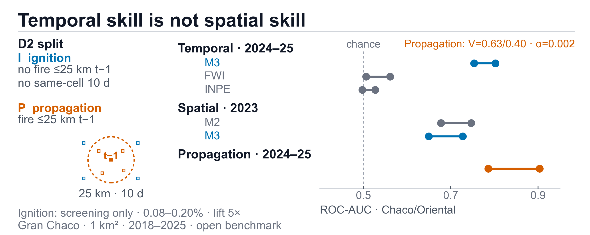

# 1. Información del Manuscrito / Article Details

- **Título Principal (Español):**  
  *Un marco computacional reproducible para el desacoplamiento y benchmarking de ignición y propagación de incendios en el Gran Chaco (2018–2025)*
- **Subtítulo (Español):**  
  *Targets D2, inferencia con gating y fallback M2/M3, y benchmark abierto frente a Canadian FWI e INPE Risco de Fogo*
- **Title (English):**  
  *A reproducible computational framework for decoupled wildfire ignition and propagation benchmarking in the Gran Chaco (2018–2025)*
- **Subtitle (English):**  
  *D2 targets, M3/M2 inference and an open benchmark against Canadian FWI and INPE*
- **Título Corto / Running Head:**  
  *Reproducible Decoupled Wildfire Benchmarking in the Gran Chaco*
- **Revista Objetivo / Target Journal:**  
  *Computers & Geosciences* (Elsevier, ISSN: 0098-3004)
- **Áreas Temáticas de la Revista:**  
  *Computer Science Applications* & *Earth and Planetary Sciences*
- **Modalidad de Revisión / Peer Review Track:**  
  Revisión de un solo anonimizado (*Single-Anonymized Peer Review*, política de C&G)
- **Tipo de Artículo / Article Type:**  
  *Research Paper* (Metodología Computacional y Algorítmica en Geociencias)

---

# 2. Autores y Afiliaciones / Authors and Affiliations

- **Autor / Corresponding author:**  
  **Martín Sánchez Insfrán, MD**  
  *Investigador Independiente / Médico Cirujano*  
  Asunción, Paraguay  
  - **Dirección postal / Postal address:** Asunción, Paraguay  
  - **Teléfono / Telephone:** +595 971 907 727  
  - **ORCID:** [0000-0003-4138-9668](https://orcid.org/0000-0003-4138-9668)  
  - **Email:** `sanchez.martin093@gmail.com`  
  - **Rol:** Conceptualización, diseño de arquitectura de software, ingeniería de datos espaciales, modelado predictivo, benchmarking, redacción y validación.

---

# 3. Aspectos Destacados / Highlights (Obligatorio en Elsevier)

> *Lineamientos de Computers & Geosciences: 3 a 5 puntos concisos, máximo 85 caracteres cada uno (incluidos espacios).*

1. **D2 formally separates primary ignition from tactical fire spread.** (61 chars)
2. **Gated M3/M2 inference links calibration, spatial blocks and cost-loss.** (69 chars)
3. **M3 outperforms full Canadian FWI and INPE under the same retrospective D2 test.** (71 chars)
4. **Spatial block holdout shows where the hybrid model does not transfer.** (70 chars)
5. **National inference runs in 3.47 s and 2.21 GB peak RAM on ARM64.** (62 chars)

---

# 4. Resumen Gráfico / Graphical Abstract

{width=100%}

**Graphical abstract.** Decoupled D2 targets, M3/M2 inference, causal t-1 propagation and a retrospective benchmark against FWI and INPE. The visual uses only current, traceable results.

---

# 5. Resumen / Abstract & Keywords

### Resumen (Español)
La predicción de incendios forestales mediante aprendizaje automático suele sufrir fugas espaciales y baja transferibilidad de los índices boreales a biomas subtropicales. Para Paraguay (2018–2025), presentamos D2, un operador computacional abierto que desacopla la ignición primaria de la propagación táctica, complementado con filtrado biofísico e inferencia en dos etapas con LightGBM (nowcasting M3; respaldo M2). En el test congelado 2024–2025, M3 alcanza un ROC-AUC de 0.8021/0.7534 (Chaco/Oriental), superando sustancialmente al Canadian Fire Weather Index (0.5059/0.5611) y al INPE Risco de Fogo (0.5266/0.4973); la propagación alcanza 0.9039/0.7859. La validación en bloques espaciales demuestra que la ventaja del modelo híbrido es temporal y no espacial. La baja precisión de ignición a escala poblacional (0.08 %/0.20 %) confirma su rol operacional en cribado y priorización de recursos antes que como alerta autónoma. El operador D2, la arquitectura de inferencia y el arnés de evaluación se publican como software abierto y reproducible.

**Palabras clave:** Nowcasting de incendios; GeoAI; reproducibilidad; validación espacial; LightGBM; Gran Chaco.

---

### Abstract (English)
Wildfire machine learning often suffers from spatial leakage and poor transferability of boreal indices to subtropical biomes. Across Paraguay (2018–2025), we introduce D2, an open computational operator decoupling primary ignition from tactical propagation, paired with biophysical gating and two-stage LightGBM inference (M3 nowcasting; M2 fallback). On the frozen 2024–2025 test, M3 achieves ROC-AUC of 0.8021/0.7534 (Chaco/Oriental), outperforming the Canadian Fire Weather Index (0.5059/0.5611) and INPE Risco de Fogo (0.5266/0.4973); propagation reaches 0.9039/0.7859. Spatial block validation demonstrates that the hybrid gain is temporal rather than spatial. Low population ignition precision (0.08 %/0.20 %) confirms an operational role in screening and prioritization rather than stand-alone warnings. The D2 operator, inference architecture, and evaluation harness are released as open, reproducible software.

**Keywords:** Wildfire nowcasting; GeoAI; reproducibility; spatial cross-validation; LightGBM; Gran Chaco.

---

# 6. Declaraciones Obligatorias de Elsevier / Declarations

### A. Disponibilidad del Código Computacional / Computer Code Availability
- **Nombre del Software:** `Incendios_PY`
- **Desarrollador / Contacto:** Martín Sánchez Insfrán (`sanchez.martin093@gmail.com`)
- **Año de Primera Disponibilidad:** 2026
- **Hardware Requerido:** Procesador multinúcleo x86_64 o ARM64 (Apple Silicon M-Series o procesador estándar Intel/AMD); mínimo 8 GB de RAM.
- **Software Requerido:** Python 3.12+, DuckDB $\ge 1.0$, Polars $\ge 1.0$, LightGBM $\ge 4.0$, Quarto $\ge 1.5$.
- **Lenguaje de Programación:** Python (con extensiones vectorizadas en C++ y Rust).
- **Disponibilidad y Licencia:** Código abierto bajo Licencia MIT.
- **Repositorio Oficial:** [https://github.com/sanchezmartin093-code/Incendios_PY](https://github.com/sanchezmartin093-code/Incendios_PY)
- **Versión del release:** 2.1.0 (2026-10-28)
- **DOI conceptual del Código:** [10.5281/zenodo.23675104](https://doi.org/10.5281/zenodo.23675104)
- **DOI conceptual de los Datos:** [10.5281/zenodo.23675278](https://doi.org/10.5281/zenodo.23675278)

### B. Disponibilidad de Datos / Data Availability Statement
Todos los conjuntos de datos primarios utilizados son de acceso público internacional y gratuito:
1. **Detecciones térmicas activas:** NASA FIRMS (sensores VIIRS Suomi-NPP, NOAA-20 y NOAA-21) disponibles en [firms.modaps.eosdis.nasa.gov](https://firms.modaps.eosdis.nasa.gov/).
2. **Reanálisis meteorológico:** Copernicus Climate Data Store (CDS) ERA5-Land reanalysis ([cds.climate.copernicus.eu](https://cds.climate.copernicus.eu/)) procesado mediante pipeline nativo ECMWF CDS API (`src/clima_cds.py`).
3. **Cobertura vegetal y biomas:** objetivo MapBiomas Chaco y Bosque Atlántico; se usan mapas anuales de MapBiomas Colección 2 (2017–2023), unidos por año previo.
4. **Pérdida de cobertura arbórea:** Hansen Global Forest Change GFC-2025 v1.13 ([earthenginepartners.appspot.com](https://storage.googleapis.com/earthenginepartners-hansen/GFC-2025-v1.13/)).
5. **Límites cartográficos nacionales:** Marco geoBoundaries ADM0 y ADM1 ([geoboundaries.org](https://www.geoboundaries.org/)).  
Los datasets consolidados y procesados no se versionan en git; se documentan con hashes en `fuentes/MANIFIESTO_DATOS_v3.csv` y están archivados en el asset de datos v2.0.1 (`Incendios_PY_data_v2.0.1.zip`, 1.18 GB) bajo licencia CC BY 4.0, además del DOI conceptual de datos ([10.5281/zenodo.23675278](https://doi.org/10.5281/zenodo.23675278)).

### C. Financiamiento / Funding
Esta investigación fue realizada como un desarrollo de investigación independiente y de acceso abierto autofinanciado por el autor. No se recibieron subvenciones específicas de organismos del sector público, comercial o sin fines de lucro.

### D. Conflicto de Intereses / Competing Interests
El autor declara que no existen conflictos de interés financieros, institucionales ni personales que hayan podido influir en el diseño, análisis, interpretación o presentación de los resultados expuestos en este manuscrito.

### E. Contribución de Autores / Author Contributions (CRediT)
- **Martín Sánchez Insfrán:** Conceptualización, Metodología, Software, Validación, Análisis Formal, Investigación, Recursos, Curación de Datos, Redacción - Borrador Original, Redacción - Revisión y Edición, Visualización, Supervisión y Administración del Proyecto.
