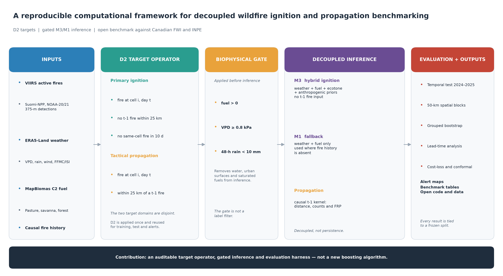
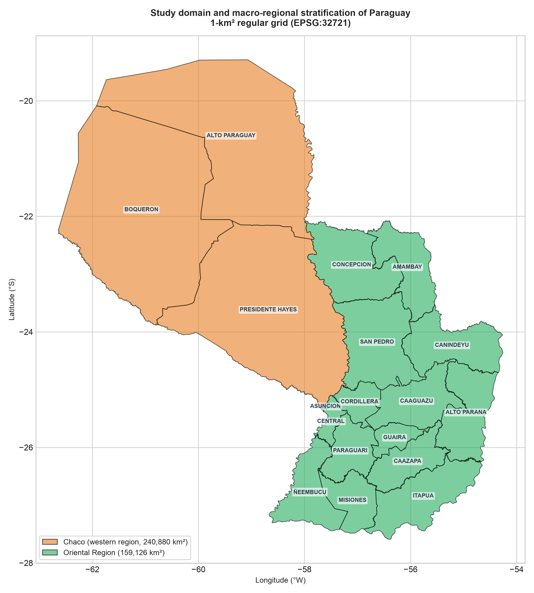
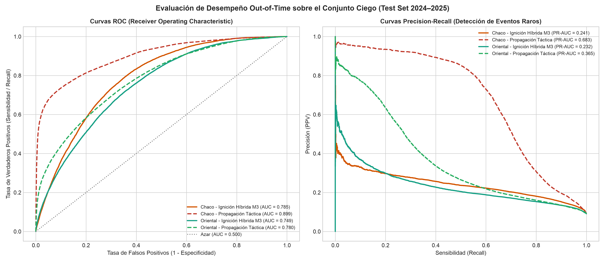
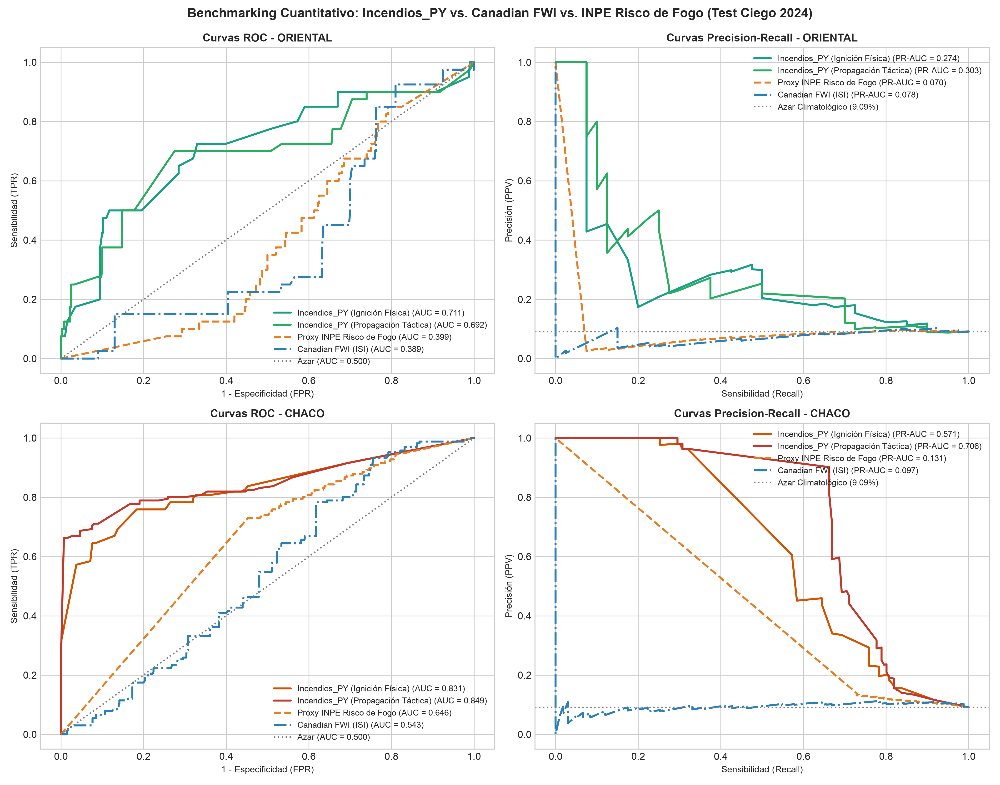
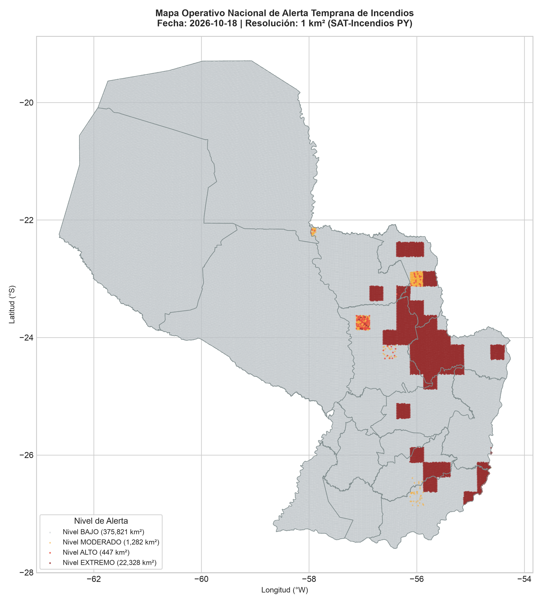

> **Versión de lectura en español.** Este documento traduce el manuscrito de investigación. Los datos de las tablas, las figuras, las cifras y los nombres de variables se conservan idénticos a la versión de envío en inglés (`manuscrito.pdf`, `manuscrito.docx`). La versión oficial para *Computers & Geosciences* es la inglesa.
>
> **Revista objetivo:** *Computers & Geosciences* (Elsevier) — **Tipo de artículo:** artículo de investigación. **Revisión por pares:** simple anonimizada. Los datos de autor, afiliación y repositorio están en la portada (`title_page.qmd`).

# Resumen {.unnumbered}

La predicción operativa de incendios con aprendizaje automático sufre a menudo fugas espaciales y una transferibilidad limitada de los índices boreales a biomas subtropicales. Presentamos D2, un operador de objetivos computacional que separa formalmente la ignición primaria de la propagación táctica, y un marco de inferencia con gating y evaluación que hace explícitos la construcción del objetivo, el control de fuga y la comparación de modelos. D2 define la ignición como fuego en el día t sin fuego t-1 a menos de 25 km y sin fuego en la misma celda en los 10 días previos; la propagación se evalúa a menos de 25 km de un fuego t-1. Un gate biofísico elimina celdas-día no combustibles y húmedas. Un modelo híbrido LightGBM (M3) predice ignición sin insumos de fuego t-1, con M2 como fallback para celdas sin historia y M1 como baseline biofísico. En validación 2023, M3 alcanza ROC-AUC 0.7844/0.7628 (Chaco/Oriental), frente a 0.7817/0.7496 de M2; el baseline biofísico M1 se reporta en la Tabla S16 del suplemento. En bloques espaciales de desarrollo 2023, M2 es el más robusto (0.6773/0.7470) y M1 no supera a M2 en celdas sin historia, por lo que M1 se rechaza como fallback operativo (Tablas S8 y S16 del suplemento). Un holdout independiente de bloques de confirmación 2023 retuvo a M2 como el mejor modelo (0.6871/0.6621), por delante de M3 (0.6757/0.6344) y M1 (0.6435/0.6388). En el test retrospectivo 2024–2025, M3 alcanza 0.8021/0.7534 frente a 0.5173/0.5564 del FWI canadiense y 0.5389/0.4990 del INPE; la propagación alcanza 0.9039/0.7859. La precisión poblacional de ignición es solo 0.082 %/0.198 %, por lo que el sistema es una herramienta de nowcast y priorización, no un sistema de alerta autónomo. El test 2024–2025 ya fue observado y se reporta como retrospectivo, no como ciego. La contribución computacional es el operador D2, la política de inferencia con gating y un arnés de evaluación reutilizable, publicado como software abierto; el aprendiz es una elección de implementación, no la novedad.

**Palabras clave:** Nowcasting de incendios; GeoAI; reproducibilidad; validación espacial; LightGBM; Gran Chaco.

# 1. Introducción

Los incendios de vegetación en el Gran Chaco sudamericano son una amenaza recurrente para los ecosistemas, el clima regional y la salud pública [@flannigan2009; @jolly2015; @baumann2017]. La región combina algunas de las fronteras agrícolas más rápidas de Sudamérica con estaciones secas prolongadas y calor extremo [@vallejos2015; @alvarado2018; @pivello2021]. El peligro operativo de incendios allí se basa todavía en gran medida en índices de peligro meteorológico desarrollados para sistemas templados o de sabana tropical: el índice canadiense de peligro meteorológico de incendios (FWI) [@vanwagner1987; @stocks1989; @sanmiguel2012] y el Risco de Fogo del INPE [@setzer2019]. Estos índices se usan ampliamente, pero no fueron diseñados para el régimen de ignición del Chaco Seco, limitado por humedad, limitado por combustible y fuertemente antropogénico. El análisis cubre el registro continuo VIIRS 2018–2025 sobre 400 006 celdas, un período en el que la constelación multi-sensor VIIRS (Suomi-NPP, NOAA-20 y NOAA-21) proporciona un esfuerzo de muestreo comparativamente consistente.

El aprendizaje automático se ha convertido en una alternativa común para el mapeo de susceptibilidad a incendios [@jain2020review; @barmpoutis2020], típicamente con árboles de boosting de gradiente [@ke2017lightgbm]. Dos problemas metodológicos limitan el valor operativo de muchos modelos publicados. Primero, cuando los rezagos espaciales o las variables de fuego t-1 entran en la capa de ignición, el modelo aprende persistencia en lugar de ignición; la discriminación reportada puede ser alta mientras el modelo es incapaz de anticipar nuevas igniciones [@roberts2017; @ploton2020; @tobler1970; @legendre1993; @dormann2007]. Segundo, los índices de peligro meteorológico calibrados en sistemas boreales o templados no necesariamente se transfieren a biomas subtropicales, y su fallo rara vez se cuantifica en un test retrospectivo común. Por lo tanto, se necesita un benchmark reproducible no solo para comparar modelos, sino para hacer explícitos y auditables la definición del objetivo, los controles de fuga y el protocolo de evaluación.

El contexto operativo añade una tercera restricción: la mayoría de las agencias necesitan un producto diario que pueda ejecutarse en hardware de uso común, con insumos transparentes y un modo de fallo documentado. Un modelo que no puede reproducirse o auditarse es difícil de adoptar incluso cuando su puntuación agregada es alta. Por eso el marco se diseña alrededor de objetivos explícitos, un test congelado y una pila de software pequeña e inspeccionable.

Abordamos ambos problemas formalizando tres componentes computacionales reutilizables. El aprendiz es intencionalmente reemplazable: (i) un operador de objetivos D2 que separa la ignición primaria de la propagación táctica; (ii) una arquitectura de inferencia con gating que usa un modelo híbrido (M3) donde existe historia de fuego y el modelo base (M2) donde no; y (iii) un arnés de evaluación que combina holdout temporal, bloques espaciales, bootstrap agrupado, lead time y análisis cost-loss. La contribución geocientífica es un benchmark transferible y controlado contra fugas: el FWI completo y el INPE se prueban bajo el mismo protocolo D2 en el Gran Chaco, y se reportan explícitamente los límites temporales y espaciales del modelo híbrido.

La novedad es computacional e infraestructural: D2 formaliza el contrato del objetivo, la inferencia con gating define la política operativa, el arnés hace reproducible la evidencia espacial, temporal, de calibración y cost-loss, y el software expone el contrato a otros aprendices. El caso nacional es un banco de pruebas para regiones subtropicales con escasez de datos; no afirmamos validez universal. Las principales contribuciones computacionales son:

- **Operador de objetivos D2.** Una regla reproducible que evita mezclar persistencia con ignición y hace explícitos los controles de fuga.
- **Inferencia M3/M2.** Una arquitectura de dos etapas que combina cribado biofísico con un modelo híbrido de ignición y un fallback base para celdas sin historia de fuego.
- **Arnés de evaluación reproducible.** Bootstrap agrupado, bloques espaciales, lead time, cobertura conformal y cost-loss en un solo protocolo.
- **Software y datos abiertos.** Un pipeline zero-copy en Polars/DuckDB, código público, DOI y pruebas.

# 2. Marco computacional

## 2.1 Operador de objetivos D2

El operador de objetivos D2 se aplica a la grilla nacional de 1 km² y a todas las observaciones diarias VIIRS de 2018 a 2025. Para una celda i y un día t:

- **Ignición primaria:** fuego en (i,t) cuando no hay fuego a menos de 25 km en t-1 y no hay fuego en la celda i durante los 10 días previos.
- **Propagación táctica:** fuego en (i,t) a menos de 25 km de al menos un fuego en t-1.

Los dos dominios son disjuntos. Esto evita que un modelo obtenga alta discriminación aprendiendo “el fuego continúa junto al fuego de ayer” mientras se evalúa como modelo de ignición. El mismo operador se usa para entrenamiento, validación, test y generación de alertas. Los conteos completos de muestreo y la estratificación espacial se reportan en la Nota complementaria S1 y la Tabla S10.

La población se muestrea a una proporción 1:10 por tarea y región. El entrenamiento usa 2018–2022, la validación usa 2023 y el test es el período retrospectivo 2024–2025. El test de ignición contiene 376 552 celdas-día (34 232 positivos) y el test de propagación contiene 1 437 414 celdas-día (130 674 positivos). El test combinado a nivel de tarea tiene, por tanto, 1 813 966 celdas-día. La muestra es caso-control; los denominadores poblacionales se mantienen por separado y se usan para la corrección de prior. Las mismas filas de test se usan para cada modelo y para FWI/INPE, por lo que la comparación es pareada por construcción.

Formalmente, sea $F_t$ el conjunto de celdas con una detección térmica en el día $t$. La ignición D2 en la celda $i$ y el día $t$ requiere $i \in F_t$, ninguna celda en $F_{t-1}$ a menos de 25 km de $i$, y ninguna detección en la celda $i$ durante los diez días previos. La propagación D2 requiere $i \in F_t$ y al menos una celda en $F_{t-1}$ a menos de 25 km. El umbral de 25 km es una restricción de dominio, no un buffer de muestreo negativo; no se aplica un buffer de 20 km a la muestra de test. El buffer se usa solo en el holdout de bloques espaciales descrito más abajo.

## 2.2 Gate biofísico e inferencia desacoplada

Un gate de primera etapa elimina celdas-día sin combustible, con VPD inferior a 0.8 kPa o con precipitación de 48 h de al menos 10 mm. El gating se aplica antes de la construcción de variables; reduce el espacio de inferencia mientras retiene el 97.17 % de las detecciones térmicas y elimina el 21.7 % de las celdas-día. El gate no se usa como filtro de etiquetas: solo elimina candidatos físicamente implausibles. Por tanto, el agua, las superficies urbanas consolidadas y los combustibles saturados se excluyen de la inferencia, pero permanecen en la población de auditoría usada para calcular la retención.

Dos modelos comparten el espacio con gating. M3 es un modelo híbrido LightGBM con meteorología, combustible, ecotono, priors antropogénicos y variables históricas causales. No contiene ninguna variable de fuego t-1. M2 es un modelo base LightGBM con meteorología, combustible, ecotono y ancla histórica. En la capa operativa, M3 se usa para celdas con historia de fuego observada (`freq_hist_1km > 0`) y M2 se usa como fallback para celdas sin historia; M1 queda como baseline biofísico. La capa de propagación usa un modelo separado con un kernel causal en t-1: distancia al fuego activo más cercano, conteos de fuego a menos de 25 km y FRP acumulada. La arquitectura se resume en @fig-framework.

M1 usa 24 variables meteorológicas y de combustible, M2 añade el ecotono y un ancla histórica de 25 km (35 variables), y M3 añade densidad local, ciclo anual y términos de accesibilidad (44 variables en el Chaco y 45 en Oriental). Las familias de variables están deliberadamente separadas: M3 no recibe ninguna variable de fuego t-1, mientras que la propagación recibe solo información causal de fuego t-1. Esta separación hace interpretable la ablación y evita que el fallback se convierta en un modelo de persistencia oculto. M3 agrupa meteorología (temperatura máxima y mínima, rango térmico, VPD, viento, lluvia de 48 h, días secos consecutivos, FFMC e ISI), fracciones de combustible (pastura, sabana, bosque seco, bosque húmedo y humedal/palmar), ecotono, calendario civil y temporada de quema, corredores de accesibilidad, densidad local a 5 y 10 km y recurrencia causal. M1 contiene solo los subconjuntos meteorológicos y de combustible. Las listas de variables están congeladas en la release del código. La regla de fallback se evalúa en celdas con `freq_hist_1km = 0`; M2 es el fallback validado y M1 se conserva solo como baseline diagnóstico.

{#fig-framework width="100%"}

Las probabilidades se calibran con una transformación de Platt monótona y acotada. La restricción monótona preserva el ranking del ensamble de árboles y evita la inversión de pendiente que puede ocurrir bajo desbalance severo de clases [@platt1999; @niculescu2005]. La calibración se ajusta en 2023 y se congela para el test 2024–2025. Los detalles de calibración, incluida la prueba de monotonicidad y la tabla completa de hiperparámetros, están en la Nota complementaria S2 y la Tabla S2.

La misma lógica de calibración y cutoff se usa para M1, M2, M3 y propagación. Los cutoffs se seleccionan en validación con un criterio F0.5 y luego se congelan. La alerta operativa aplica el cutoff después de la corrección de prior, no antes; de lo contrario, la prevalencia poblacional cambiaría el umbral de ranking. Esta distinción es importante porque un cutoff que parece conservador en una muestra 1:10 puede ser extremadamente permisivo en prevalencia poblacional.

## 2.3 Arnés de evaluación reproducible

El arnés de evaluación es parte de la contribución computacional. Contiene cinco componentes:

1. Una división estrictamente temporal: entrenamiento 2018–2022, validación 2023, test 2024–2025.
2. Un holdout de bloques espaciales de 50 km con un buffer de 20 km, usado para separar la generalización temporal de la espacial.
3. Un bootstrap pareado agrupado por fecha (`B = 1 000`) para intervalos de confianza y diferencias frente a FWI e INPE.
4. Una evaluación de lead time usando meteorología de t-1 para cuantificar la brecha entre nowcast y pronóstico.
5. Una evaluación poblacional y cost-loss para ir más allá de la precisión caso-control.

El bootstrap remuestrea fechas en lugar de filas, porque la actividad diaria de incendios está fuertemente agrupada en el tiempo. Para cada réplica se retienen todas las celdas de las fechas muestreadas; esto preserva la dependencia intradía y produce intervalos más honestos que el remuestreo por filas. La misma estructura de bloques se usa para las diferencias pareadas frente a FWI e INPE. El holdout espacial divide el país en bloques de 50 km, elimina un bloque completo y un buffer de 20 km del entrenamiento, recalcula los priors históricos sin los incendios retenidos y evalúa tanto celdas retenidas como no retenidas. Las métricas principales son ROC-AUC y PR-AUC. También se reportan Brier score, error de calibración esperado, precisión, recall, F0.5 y falsos positivos en el cutoff de validación. Los intervalos de confianza de AUC usan 500 réplicas bootstrap agrupadas; las diferencias pareadas entre modelos usan 1 000 réplicas. Como se hacen cuatro comparaciones principales frente a FWI e INPE, las afirmaciones de significancia deben leerse como un cribado conservador, no como inferencia ajustada por multiplicidad. La resolución del bootstrap es 0.001, por lo que los valores p se reportan como ≤0.001. El protocolo se aplica sin modificar el test. El operador de objetivos, la lista de celdas-día de test y los scripts de evaluación están archivados con la release del código. El protocolo completo se reporta en la Nota complementaria S3 y las Tablas S7–S14.

## 2.4 Datos e implementación

La grilla contiene 400 006 celdas de 1 km² en la zona UTM 21S. Los insumos diarios son detecciones de fuego activo VIIRS de 375 m de Suomi-NPP, NOAA-20 y NOAA-21; meteorología ERA5-Land de 3 horas agregada a valores diarios; mapas anuales de MapBiomas Colección 2 (2017–2023), unidos a cada fila con el mapa del año previo; pérdida de cobertura arbórea Hansen GFC-2025 v1.13 en t-1 y t-2 [@hansen2013]; y priors históricos causales construidos con un corte mensual y una ventana móvil de tres años. Los datos crudos son públicos pero no se redistribuyen; los datos procesados y los modelos entrenados se archivan con un DOI.

El pipeline usa un `cell_id` entero determinista, una búsqueda NumPy en O(1) y joins columnares en Polars y DuckDB. Un spatial join de 50 000 puntos se muestra solo como referencia; la búsqueda operativa evita el point-in-polygon en inferencia. El pipeline completo de inferencia procesa 400 006 celdas en 3.474 s con 2 212.9 MB de RAM pico en ARM64; x86_64 no se midió. El dominio de estudio y la división regional se muestran en @fig-area; el perfil por etapa está en la Tabla S4 del suplemento.

Las comprobaciones de calidad de datos son parte del pipeline: se colapsan sobrepasos VIIRS duplicados, se eliminan detecciones de confianza `low`, se reconstruye la precipitación diaria a partir de incrementos subdiarios y se rechazan valores imposibles por encima de 300 mm/día. Los nodos de ERA5-Land se mapean a celdas con un cKDTree precomputado. El archivo procesado contiene los objetivos de test, las probabilidades del modelo, las capas de benchmark, el plan de muestreo y los artefactos entrenados, de modo que las tablas de resultados pueden regenerarse sin descargar el archivo crudo completo. El diccionario de datos y las comprobaciones están en la Nota complementaria S1 y la Tabla S15. El repositorio incluye 76 pruebas unitarias, un archivo de dependencias fijadas, un flujo de integración continua y un release público en GitHub. La suite de pruebas cubre definiciones de objetivos, filtrado VIIRS, agregación climática, calibración monótona, métricas y la capa de alerta; puede ejecutarse sin descargar el archivo crudo. Esta separación entre un paquete de evaluación reproducible y el pipeline completo de datos crudos es deliberada: los revisores pueden auditar las tablas sin una descarga de varios terabytes, mientras los scripts canónicos siguen disponibles para una reconstrucción completa.

{#fig-area width="80%"}

# 3. Resultados

## 3.1 Selección en validación 2023 y test retrospectivo

La selección de modelo se realizó exclusivamente con la validación de 2023 y el holdout espacial de desarrollo evaluado en 2023. El test 2024–2025 no se usó para elegir modelo, variables ni umbrales. @tbl-val resume la validación temporal.

| Región | Modelo | ROC-AUC | PR-AUC | F0.5 |
|:---|:---|---:|---:|---:|
| Chaco | M2 base | 0.7817 | 0.2452 | 0.2933 |
| Chaco | M3 híbrido | 0.7844 | 0.2542 | 0.2979 |
| Oriental | M2 base | 0.7496 | 0.2221 | 0.2631 |
| Oriental | M3 híbrido | 0.7628 | 0.2441 | 0.2875 |

: Validación temporal 2023 (caso-control 1:10). La selección se congeló antes de evaluar el test 2024–2025. El baseline M1 se reporta en la Tabla S16 del suplemento. {#tbl-val}

La diferencia pareada M3 − M2 fue +0.0028 [+0.0001, +0.0054] ROC-AUC y +0.0089 [+0.0034, +0.0144] PR-AUC en el Chaco, y +0.0132 [+0.0097, +0.0169] y +0.0221 [+0.0166, +0.0272] en Oriental (bootstrap agrupado por fecha, B = 1 000). Con el margen preespecificado δ = 0.01, M3 se retiene en ambas regiones. En bloques espaciales de 2023, M2 fue el más robusto (0.6773/0.7470), por delante de M3 (0.6496/0.7277). M1 se evaluó como baseline diagnóstico y no superó a M2 en celdas sin historia; por eso M1 se rechaza como fallback operativo (Tablas S8 y S16 del suplemento). La arquitectura final es M3 para celdas con historia y M2 para celdas sin historia.

@tbl-test reporta el test retrospectivo 2024–2025. M3 alcanza ROC-AUC 0.8021 en el Chaco y 0.7534 en la Región Oriental. La propagación alcanza 0.9039/0.7859. La precisión F0.5 caso-control es 32.82 %/30.13 % para ignición y 83.69 %/65.03 % para propagación. Estas son métricas a nivel de muestra; no son precisión operativa. La política gated M3/M2 real es cercana a M3 pero no es uniformemente mejor: en el Chaco mejora ligeramente ROC-AUC y reduce precisión; en Oriental mejora la precisión frente a M3 pero reduce ROC-AUC. La comparación completa de muestra y población está en la Tabla S17 del suplemento.

| Región | Modelo | ROC-AUC [IC 95 %] | PR-AUC | Precisión (%) | Recall (%) | FP |
|:---|:---|:---|---:|---:|---:|---:|
| Chaco | M3 ignición | 0.8021 [0.797–0.807] | 0.2842 | 32.82 | 30.30 | 9 960 |
| Chaco | M3/M2 gated | 0.8035 [0.799–0.809] | 0.2843 | 32.70 | 30.87 | 10 200 |
| Chaco | M2 ignición | 0.7991 [0.794–0.805] | 0.2766 | 33.28 | 27.26 | 8 773 |
| Chaco | Propagación | 0.9039 [0.899–0.909] | 0.6935 | 83.69 | 52.40 | 5 353 |
| Oriental | M3 ignición | 0.7534 [0.747–0.759] | 0.2340 | 30.13 | 18.59 | 7 835 |
| Oriental | M3/M2 gated | 0.7502 [0.744–0.756] | 0.2327 | 30.15 | 18.55 | 7 811 |
| Oriental | M2 ignición | 0.7406 [0.735–0.746] | 0.2146 | 26.09 | 19.59 | 10 075 |
| Oriental | Propagación | 0.7859 [0.779–0.794] | 0.3752 | 65.03 | 19.84 | 8 351 |

: Test retrospectivo D2 (2024–2025; 1 813 966 celdas-día-tarea en total: 376 552 de ignición y 1 437 414 de propagación). La precisión y el recall son caso-control (9.09 % de prevalencia) en el cutoff F0.5. El test ya fue observado y no se usa para selección. Las métricas poblacionales están en la Tabla S6 del suplemento. {#tbl-test}

@fig-test muestra las curvas ROC y de precisión–recall correspondientes para las capas de ignición híbrida y propagación. La figura separa las dos tareas y las dos regiones, de modo que el trade-off entre la alta discriminación de propagación y la mucho menor discriminación de ignición es visible sin una segunda capa de benchmark. Las curvas son descriptivas; los puntos operativos de @tbl-test son los que se usan para la capa de alerta. Las curvas ROC de ignición ascienden pronunciadamente solo a tasas de falsos positivos relativamente altas, y las curvas de precisión–recall correspondientes permanecen cerca de la línea base caso-control. Las curvas de propagación están más lejos de la diagonal en ambas regiones, especialmente en el Chaco, lo que es consistente con la señal de evento más fuerte en esa tarea. La brecha visual entre ROC-AUC y PR-AUC es esperable con 9.09 % de prevalencia y recuerda que un ROC-AUC alto puede coexistir con una precisión modesta.

La precisión poblacional de ignición es 0.082 % en el Chaco y 0.198 % en la Región Oriental. La precisión de propagación es 9.67 % y 4.78 %. Estos valores son los relevantes para la operación y son mucho más bajos que los valores caso-control. Respecto a la prevalencia, la precisión de ignición es aproximadamente 5.4× y 4.8× superior al azar, mientras que la de propagación es aproximadamente 62× y 23× superior. La precisión absoluta sigue siendo baja; el modelo es, por tanto, una capa de priorización y nowcast, no un sistema de alerta autónomo.

En el test retrospectivo, M3 no domina uniformemente a M2. En el Chaco, M3 mejora ROC-AUC y PR-AUC, pero M2 tiene una precisión ligeramente mayor y menos falsos positivos; en Oriental, M3 mejora precisión y reduce falsos positivos, con menor recall. La ganancia es un trade-off, no una superioridad universal. Por año, M3 mantiene ROC-AUC 0.8030/0.8011 en el Chaco y 0.7532/0.7539 en Oriental para 2024/2025; la propagación cae de 0.9069 a 0.8982 en el Chaco y de 0.7911 a 0.7785 en Oriental. 2024 usa fuel 2023 con lag 1 y 2025 usa fuel 2023 con lag 2; por eso las métricas se reportan por separado y no como un promedio único.

{#fig-test width="100%"}

## 3.2 Benchmark frente a FWI e INPE

@tbl-benchmark compara M3 con el FWI completo y el INPE en el mismo test retrospectivo. M3 supera al FWI por ΔROC = +0.2848 en el Chaco y +0.1970 en la Región Oriental, y al INPE por +0.2633 y +0.2544. Todas las comparaciones pareadas tienen p ≤ 0.001 con B = 1 000. El benchmark completo, incluidas las filas de M2 y propagación, está en la Tabla S11 del suplemento; la tabla completa de significancia está en la Tabla S7.

| Región | Modelo | ROC-AUC | PR-AUC | ΔROC frente a M3 | p |
|:---|:---|---:|---:|---:|---:|
| Chaco | M3 ignición | 0.8021 | 0.2842 | — | — |
| Chaco | FWI canadiense completo | 0.5173 | 0.0957 | +0.2848 | ≤0.001 |
| Chaco | INPE Risco de Fogo | 0.5389 | 0.1031 | +0.2633 | ≤0.001 |
| Oriental | M3 ignición | 0.7534 | 0.2340 | — | — |
| Oriental | FWI canadiense completo | 0.5564 | 0.1061 | +0.1970 | ≤0.001 |
| Oriental | INPE Risco de Fogo | 0.4990 | 0.0908 | +0.2544 | ≤0.001 |
| Chaco | Línea base climatológica | 0.5000 | 0.0909 | +0.3021 | — |
| Oriental | Línea base climatológica | 0.5000 | 0.0909 | +0.2534 | — |

: Benchmark en el test retrospectivo 2024–2025. ΔROC es M3 menos la referencia. FWI e INPE son índices normalizados, no probabilidades calibradas. La tabla completa está en la Tabla S11 del suplemento. {#tbl-benchmark}

@fig-benchmark muestra las curvas ROC y de precisión–recall correspondientes. Los índices canónicos están cerca de la diagonal en el Chaco; en la Región Oriental también son débiles y no mejoran materialmente respecto a una línea base climatológica. El FWI completo tiene un ROC-AUC de 0.5173/0.5564 y el INPE de 0.5389/0.4990; ninguno es competitivo con M3 en las mismas fechas retrospectivas. El resultado no afirma que los índices sean universalmente inválidos, sino que su transferencia a este sistema subtropical no está respaldada. FWI e INPE son índices de peligro normalizados, por lo que su punto operativo aparente depende fuertemente del cutoff elegido en validación. En el Chaco, el FWI completo alcanza un recall alto solo con una precisión muy baja, mientras que el INPE es conservador en ambas regiones; ninguno de los dos comportamientos se traduce en un ranking competitivo. Los valores de PR-AUC están cerca de la línea base caso-control de 0.09, lo que significa que los índices añaden poca discriminación más allá del azar en estas fechas retrospectivas.

La ablación controlada confirma que las variables socioecológicas mejoran el ranking, sobre todo en Oriental. Con la misma capacidad (45/60 rondas y 23/31 hojas), M2 alcanza 0.7991/0.7406 y M3 0.8021/0.7534; M1 es el más bajo en ambas regiones. La ganancia M3 − M2 es +0.0030/+0.0128 ROC-AUC y +0.0076/+0.0194 PR-AUC. En Chaco la precisión de M3 es 32.81 % frente a 33.27 % de M2; en Oriental es 30.13 % frente a 26.09 %. La ventaja no es uniforme y no se presenta como una mejora de precisión en ambas regiones. La tabla completa de ablación está en la Tabla S12 del suplemento. TreeSHAP ordena la distancia histórica, la fracción de bosque seco, la accesibilidad, la presión de desmonte×VPD y la estacionalidad como los impulsores dominantes en el Chaco; en Oriental dominan la distancia histórica, la focalización local, la agricultura anual y la presión de desmonte. La tabla y figura completas de SHAP están en la Tabla S13 y la Figura S1 del suplemento. Esto no establece causalidad, pero muestra que el modelo no depende de una sola variable meteorológica.

{#fig-benchmark width="100%"}

## 3.3 Generalización temporal y espacial

La ventaja de M3 es temporal, no espacial. En el holdout de bloques de 50 km con buffer de 20 km evaluado en 2023, M2 alcanza 0.6773 en el Chaco y 0.7470 en Oriental, y M3 alcanza 0.6496 y 0.7277; M1 se reporta en la Tabla S8 del suplemento. M2 es el modelo más robusto en bloques no vistos. M3 cae desde 0.7821 en celdas retenidas a 0.6496 en holdout en el Chaco, y desde 0.7473 a 0.7277 en Oriental; M2 cae de 0.7832 a 0.6773 en Chaco pero mejora de 0.7365 a 0.7470 en Oriental. M1 es más estable, pero su nivel absoluto es menor (Tabla S8 del suplemento). @tbl-spatial reporta la comparación compacta; la tabla completa de bloques y el diseño están en la Tabla S8 del suplemento.

| Región | Modelo | ROC-AUC en celdas retenidas | ROC-AUC en holdout | PR-AUC en holdout |
|:---|:---|---:|---:|---:|
| Chaco | M2 base | 0.7832 | 0.6773 | 0.1760 |
| Chaco | M3 híbrido | 0.7821 | 0.6496 | 0.1630 |
| Oriental | M2 base | 0.7365 | 0.7470 | 0.1820 |
| Oriental | M3 híbrido | 0.7473 | 0.7277 | 0.1608 |

: Validación por bloques espaciales de desarrollo con bloques de 50 km y un buffer de 20 km, evaluada en 2023. Los valores retenidos son la referencia para celdas no excluidas del entrenamiento. Los resultados completos, incluido M1, están en la Tabla S8 del suplemento. {#tbl-spatial}

El diseño espacial de desarrollo retiene 44 bloques y excluye un buffer de 20 km alrededor de las celdas holdout durante el entrenamiento; los priors se recalculan sin los incendios retenidos. Un holdout independiente de confirmación (31 bloques, 68 719 celdas), con modelos reentrenados sin los bloques de confirmación y su buffer de 20 km, retuvo a M2 como el mejor modelo: M2 0.6871/0.6621, M3 0.6757/0.6344 y M1 0.6435/0.6388 en Chaco/Oriental. La política gated cayó en M2 en las celdas de confirmación. El resultado no sostiene que M3 sea un extrapolador espacial, y tampoco convierte a M1 en la mejor opción: M1 fue un baseline estable pero inferior y se rechazó como fallback operativo. Los resultados completos de desarrollo y confirmación están en las Tablas S8, S16 y S18 del suplemento; la arquitectura M3/M2 responde a esa evidencia.

Con meteorología de t-1, M3 retiene 0.7831/0.7613 y M2 0.7818/0.7463; M1 es inferior y se reporta en la Tabla S9 del suplemento. La pequeña caída de M3 muestra que los priors de recurrencia, no la meteorología del mismo día, dominan la señal híbrida. Por eso el sistema actual es un nowcast/hindcast; un sistema real de pronóstico a un día requeriría meteorología pronosticada. Los detalles de lead time están en la Tabla S9 del suplemento. Como comparador directo de fuga, un modelo acoplado entrenado sobre la muestra combinada de fuego con variables t-1 no superó materialmente a la arquitectura desacoplada: 0.8862 vs 0.8868 ROC-AUC en Chaco y 0.7871 vs 0.7806 en Oriental. Este comparador usa la misma muestra gated caso-control, por lo que no prueba la eliminación del gating; solo muestra que el atajo acoplado no ofrece una ventaja grande en esta muestra (Tabla S19 del suplemento). Una sensibilidad D2 completa de 3 × 3 (15/25/35 km × 7/10/14 d) regeneró el muestreo 1:10 y reentrenó M1, M2 y M3 para cada combinación. M3 superó a M2 en las nueve combinaciones tanto en validación como en test, con una diferencia M3 − M2 de ROC-AUC entre +0.004 y +0.016, y fue el mejor modelo en test en las nueve; su rango fue 0.771–0.782 en 2023 y 0.785–0.797 en Chaco para 2024–2025, y 0.759–0.768 y 0.750–0.755 en Oriental. La ventana de 7 días dio el mayor ROC-AUC en cada par región × radio, y el efecto del radio fue pequeño: 35 km fue ligeramente mejor en Chaco y 25 km en Oriental. La conclusión de D2 no depende de la elección de 25 km/10 d (Tabla S20 del suplemento).

## 3.4 Utilidad operativa

El análisis cost-loss es sobrio para la ignición: M3 no supera claramente a M2, y en el Chaco M2 es ligeramente mejor en el óptimo. La capa de propagación sí muestra valor cerca de α = 0.002. La tabla y las curvas completas de cost-loss están en la Tabla S14 y la Figura S3 del suplemento. El producto operativo, por tanto, prioriza la propagación y usa la ignición como capa de cribado.

Cost-loss se define como el valor esperado de emitir una alerta cuando el costo de una falsa alarma es $C$ y la pérdida evitada por una alerta verdadera es $L$; la relación $\alpha=C/L$ varía de 0 a 0.5. Es un modelo de decisión deliberadamente simple, no una estimación de presupuestos de agencias. Es útil porque expone el régimen en el que una capa probabilística tiene valor. Para ignición, las curvas son casi planas cerca de cero; para propagación, el valor se concentra en $\alpha$ pequeños. El resultado respalda la elección operativa de priorizar la propagación y tratar la ignición como capa de cribado.

La cobertura conformal es empírica: 90.17 %/90.31 % para un nivel nominal del 90 % y 95.32 %/94.79 % para el 95 %. Estos valores están cerca de lo nominal, pero no constituyen una garantía formal bajo cambio temporal. El resultado sigue siendo útil porque muestra que la capa de calibración no es groseramente sobreconfiada. Un diagrama de fiabilidad y la tabla conformal completa están en la Tabla S5 del suplemento.

@fig-map muestra un ejemplo de mapa nacional de alerta. Las celdas se clasifican como bajas, moderadas o altas; el producto se genera con el mismo pipeline de test congelado. El mapa es ilustrativo del formato de salida, no un pronóstico institucional. Es una capa de comunicación construida a partir de las mismas probabilidades y cutoffs congelados; hereda los supuestos de calibración y prevalencia del modelo subyacente. Por tanto, el mapa debe leerse junto con la precisión poblacional de @tbl-test y la limitación espacial de @tbl-spatial, no como un producto de alerta autónomo.

{#fig-map width="80%"}

## 3.5 Comprobaciones de reproducibilidad

Las releases de código y datos son parte del resultado. El repositorio contiene el operador de objetivos, los scripts de evaluación congelados, los boosters y calibradores entrenados, las tablas generadas y un entorno fijado. Una ejecución de las 76 pruebas unitarias en un entorno limpio cubre la construcción de objetivos, el filtrado VIIRS, la agregación climática, la calibración monótona, las métricas y el enrutamiento de alertas. El archivo de datos contiene los objetivos de test y las probabilidades del modelo, de modo que las tablas principales pueden regenerarse sin el archivo crudo de varios terabytes. El pipeline completo de datos crudos sigue disponible para una reconstrucción total.

Merece la pena reportar dos comprobaciones prácticas. Primera, la división de test está congelada y el cutoff se selecciona en validación; ninguna fila de test se usa para selección de modelo. Segunda, las capas de calibración y conformal se ajustan antes del test y nunca se actualizan. Estas comprobaciones no eliminan el cambio de distribución, pero eliminan las fuentes más comunes de sesgo optimista. Las tablas de este manuscrito se regeneran desde el repositorio y corresponden a la release v2.0.1; los DOI conceptuales de código y datos se reportan en las secciones de disponibilidad.

# 4. Discusión

## 4.1 Por qué fallan los índices canónicos

El FWI completo y el INPE son débiles en ambas regiones. El Chaco está limitado por humedad y por combustible al mismo tiempo: los combustibles finos se secan rápidamente bajo VPD alto, pero la ignición depende del acceso humano, el manejo de pasturas y la historia de fuego. Un único índice meteorológico no puede representar esa interacción. En la Región Oriental, la señal es más antropogénica y menos dependiente de la meteorología del mismo día. Estos resultados no implican que FWI o INPE sean inútiles globalmente; muestran que su transferencia a este sistema subtropical no está respaldada por el test retrospectivo.

La asimetría regional es informativa. En el Chaco, el contraste dominante de cobertura es entre bosque seco, pasturas y pastizales naturales; el fuego suele ser una herramienta de manejo en una matriz con alta conectividad de combustible. En la Región Oriental, el paisaje es más húmedo y fragmentado, y la ignición está estrechamente acoplada a caminos, fincas y al calendario agrícola. La misma arquitectura híbrida opera, por tanto, bajo regímenes estructurales diferentes, y los rankings de SHAP reflejan esa diferencia: la fracción de bosque seco es importante en el Chaco, mientras que la concentración antrópica local lo es más en Oriental. Un modelo con un único conjunto de pesos regionales difuminaría ese contraste.

El débil desempeño de FWI/INPE también tiene una implicación práctica: cambiar a un “mejor índice” no es suficiente. La representación de insumos, la definición del objetivo y el diseño de evaluación importan tanto como el aprendiz. El benchmark compara, por tanto, el pipeline computacional completo, no solo la clase de modelo.

## 4.2 Qué aporta el desacoplamiento y dónde falla

El desacoplamiento produce un diagnóstico útil. M3 es un nowcast temporal fuerte para celdas con historia, pero su ventaja desaparece en bloques espaciales no vistos. M2 es el modelo más robusto en esos bloques y también supera a M1 en celdas sin historia, por lo que sustituye a M1 como fallback. Este es un resultado doble: la capa operativa no debería presentar M3 como un extrapolador espacial, y tampoco debería mantener un fallback biofísico que la validación 2023 no sostiene.

El operador D2 es también una barrera contra la fuga. Sin él, un modelo puede mezclar persistencia e ignición y obtener métricas impresionantes pero no operativas. La combinación de D2, una capa de ignición sin t-1 y un holdout de bloques espaciales es la principal contribución metodológica. También explica por qué una única puntuación agregada no basta: el mismo modelo puede ser fuerte en celdas retenidas, débil en bloques de holdout y débil en prevalencia poblacional, y cada uno de estos resultados responde a una pregunta distinta. Reportar las tres visiones por separado es más informativo que seleccionar la más favorable.

Desde la perspectiva del software, el avance relevante no es el tamaño del modelo sino la auditabilidad del camino desde las observaciones crudas hasta un mapa. Un identificador entero único de celda, joins deterministas, metadatos de prevalencia congelados y un entorno fijado hacen que el pipeline sea reproducible en un portátil. La comparación con un spatial join de GeoPandas se incluye solo para mostrar por qué la búsqueda entera importa a escala nacional; no es un benchmark de bibliotecas SIG. Los DOI abiertos de código y datos permiten reejecutar independientemente las tablas principales y reemplazar el modelo por otro aprendiz.

El marco también está deliberadamente acotado. No incluye una nueva arquitectura neuronal, un esquema de asimilación de datos ni un simulador completo de propagación de incendios. Su contribución es hacer comparable y reproducible un problema aplicado difícil. Es una afirmación más estrecha que un algoritmo nuevo, pero es la que respalda la evidencia.

Una segunda lección es que el diseño del benchmark cambia la conclusión. Si el test hubiera sido una división aleatoria, M3 habría parecido más fuerte; si la capa de ignición hubiera incluido densidad de fuego t-1, habría parecido aún más fuerte. El bloque espacial y el objetivo D2 hacen visibles esos atajos. Por eso el resultado negativo no es una debilidad del artículo sino parte de su contribución: da al trabajo futuro una línea base clara que superar sin fuga.

## 4.3 Implicaciones para la geociencia computacional

El marco sugiere una división práctica del trabajo para el aprendizaje automático geocientífico. El aprendiz puede reemplazarse; el operador de objetivos, los controles de fuga y el arnés de evaluación no. En este sentido, la contribución es un protocolo computacional y una infraestructura de software, no un nuevo aprendiz. Esa distinción importa para la geociencia computacional porque hace que la contribución sea reutilizable más allá de Paraguay: otro equipo puede conservar la lógica D2, sustituir las capas locales de combustible y meteorología, y comparar su modelo en el mismo tipo de test retrospectivo.

El marco también hace explícito el fallo. Un modelo excelente en celdas retenidas pero pobre en bloques espaciales no es un modelo universal, y un modelo que solo es competitivo en una muestra caso-control no es un sistema operativo. Reportar ambas visiones es más útil que reportar un único AUC alto. Esta es la principal lección metodológica del estudio y generaliza más allá de los incendios: cualquier pipeline geocientífico que combine priors espaciales, objetivos temporales y eventos raros necesita la misma separación entre habilidad de ranking, calibración y prevalencia operativa.

## 4.4 Limitaciones

1. El estudio cubre un solo país y dos macro-regiones; aún falta validación externa.
2. El combustible es una serie anual de MapBiomas Colección 2 (2017–2023) unida por año previo; 2024 usa el mapa 2023 con lag 1 y 2025 reutiliza 2023 con lag 2, por lo que el estado de combustible de 2025 es extrapolado.
3. VIIRS puede perder incendios bajo nubes; no se implementa un modelo de observación explícito.
4. ERA5-Land se usa a 0.25° y resolución de 3 horas; los picos intradía de VPD y viento pueden subestimarse.
5. La precisión poblacional de ignición es muy baja (0.082 %/0.198 %), y cost-loss no muestra una ventaja clara de M3 sobre M2.
6. M3 pierde transferibilidad espacial; M2 es el fallback operativo y M1 queda como baseline. M1 no debe presentarse como solución para celdas nuevas.
7. El sistema es un nowcast/hindcast; un pronóstico a un día requiere predicción numérica del tiempo.
8. La cobertura conformal es empírica y no garantiza desempeño bajo cambio temporal.
9. Se implementó un baseline acoplado t-1 sobre la muestra gated combinada y no superó materialmente a la arquitectura desacoplada (Tabla S19); como usa la misma muestra gated, no prueba la eliminación del gating.
10. El modelo no se ha probado prospectivamente con una agencia operativa; los resultados de cost-loss y del mapa de alerta son retrospectivos.
11. La grilla nacional y los priors están adaptados a Paraguay; la transferencia a otro país requeriría reconstruir la grilla, los priors históricos y los metadatos de prevalencia.
12. La exclusión de 10 días en la misma celda se mantuvo como default operativo; las ventanas 7/10/14 d y los radios 15/25/35 km se reestimaron con reentrenamiento completo y no cambiaron el ranking de modelos (Tabla S20).
13. El test 2024–2025 es retrospectivo, no ciego: ya fue observado durante el desarrollo. El 90.65 % de las celdas de test aparecen también en train por solapamiento temporal, lo que limita la interpretación como generalización espacial.
14. El lock de dependencias tiene versiones exactas pero no hashes de ruedas; la excepción está documentada en `auditoria/FASE2_0_LOCK_EXCEPTION.md`.

# 5. Conclusiones

Presentamos un marco computacional reproducible para el benchmarking desacoplado de ignición y propagación de incendios. D2 separa la ignición de la persistencia; la arquitectura M3/M2 proporciona un nowcast temporal con un fallback espacialmente más robusto; y el arnés abierto hace auditable el benchmark. La selección se hizo con validación 2023: M3 alcanzó ROC-AUC 0.7844/0.7628 y M2 fue el mejor en bloques espaciales (0.6773/0.7470). En el test retrospectivo 2024–2025, M3 alcanza 0.8021/0.7534 frente a 0.5173/0.5564 del FWI completo y 0.5389/0.4990 del INPE, pero la precisión poblacional es baja y la ventaja híbrida no se transfiere espacialmente. M1 no se sostiene como fallback; M2 lo reemplaza y M3 se presenta como un nowcast consciente de la recurrencia, no como un modelo universal de ignición. El resultado más útil no es un único mapa: es un protocolo que muestra dónde es válido un modelo, dónde falla y cómo reproducir el resultado. El comparador acoplado t-1 se reporta en la Tabla S19 del suplemento y el holdout independiente de confirmación en la Tabla S18. El trabajo futuro debería añadir validación en otro país y una fuente de meteorología a un día. El código y los datos se archivan bajo los DOI conceptuales reportados abajo, y el benchmark puede extenderse a otras regiones subtropicales sin cambiar la lógica de objetivos.

# 6. Disponibilidad de datos

Los datos procesados, las predicciones de test, los modelos entrenados y las tablas derivadas están disponibles en el release v2.0.1 de GitHub (<https://github.com/sanchezmartin093-code/Incendios_PY/releases/tag/v2.0.1>; asset `Incendios_PY_data_v2.0.1.zip`) bajo CC BY 4.0, y se documentan bajo el DOI conceptual de datos [10.5281/zenodo.23675278](https://doi.org/10.5281/zenodo.23675278). Los datos crudos de NASA FIRMS, ERA5-Land/CDS, MapBiomas, Hansen GFC y geoBoundaries se obtienen de sus proveedores originales bajo sus propios términos y están documentados con hashes SHA-256 en `fuentes/MANIFIESTO_DATOS_v3.csv`.

# 7. Agradecimientos

Agradecemos a NASA FIRMS, al Copernicus Climate Data Store, a MapBiomas, a Hansen/UMD y a geoBoundaries por los datos abiertos. El autor es responsable de todas las interpretaciones y errores.

# 8. Financiamiento

Esta investigación no recibió ninguna subvención específica de organismos de financiamiento públicos, comerciales o sin fines de lucro.

# 9. Conflictos de interés

El autor declara no tener conflictos de interés financieros ni no financieros.

# 10. Contribuciones de autoría

Martín Sánchez Insfrán: conceptualización, metodología, software, curación de datos, análisis formal, validación, visualización, redacción—borrador original, redacción—revisión y edición, administración del proyecto.

# 11. Declaración sobre IA generativa

Se utilizaron herramientas de IA generativa para edición de lenguaje y asistencia de código. El autor revisó y verificó todo el contenido y asume la responsabilidad total del artículo publicado.

# 12. Disponibilidad del código informático

**Nombre:** `Incendios_PY`  
**Desarrollador y contacto:** Martín Sánchez Insfrán, `sanchez.martin093@gmail.com`  
**Año de primera disponibilidad:** 2026  
**Hardware:** x86_64 o ARM64, al menos 8 GB de RAM  
**Sistema operativo:** macOS 13+, Linux Ubuntu 22.04+, Windows 11 con WSL2  
**Lenguaje:** Python 3.12+; Polars, DuckDB y NumPy para operaciones vectorizadas; backend C++ de LightGBM  
**Dependencias:** fijadas en `requirements-lock.txt`  
**Licencia:** MIT  
**Repositorio:** [https://github.com/sanchezmartin093-code/Incendios_PY](https://github.com/sanchezmartin093-code/Incendios_PY)  
**DOI de versión del código:** [10.5281/zenodo.23718675](https://doi.org/10.5281/zenodo.23718675)  
**DOI de versión de los datos:** [10.5281/zenodo.23718676](https://doi.org/10.5281/zenodo.23718676)  
**DOI conceptual del código:** [10.5281/zenodo.23675104](https://doi.org/10.5281/zenodo.23675104)  
**DOI conceptual de los datos:** [10.5281/zenodo.23675278](https://doi.org/10.5281/zenodo.23675278)  
**Guía de usuario:** `docs/USER_GUIDE.md`  
**Tutorial:** `docs/TUTORIAL.md`  
**Pruebas:** 76 pruebas pasan con `python -m pytest -q tests`.

# Referencias {.unnumbered}
::: {#refs}
:::
