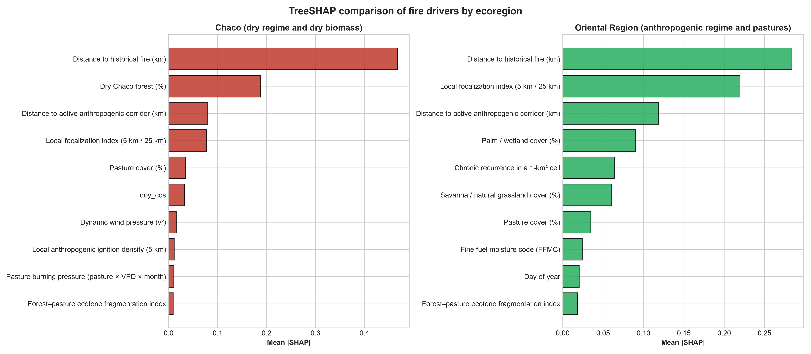
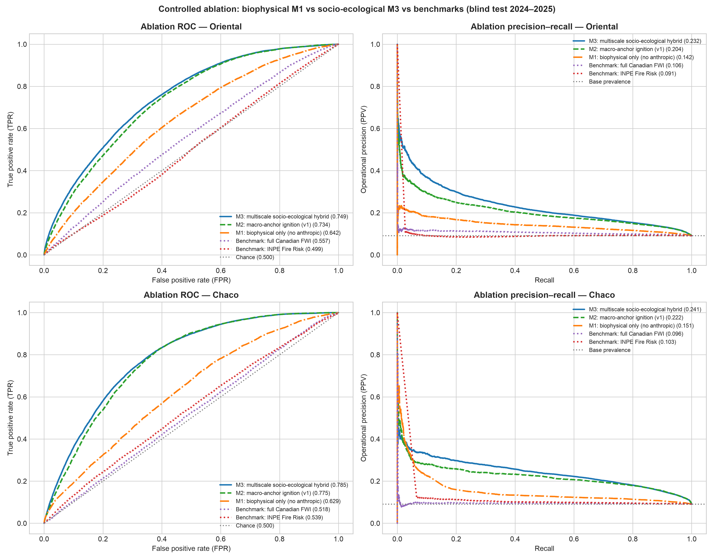

> **Target journal:** *Computers & Geosciences* (Elsevier) — **Peer review:** single-anonymized.  
> **Supplementary material:** this file is self-contained and uses the same data and code release as the main manuscript.

# Supplementary contents {.unnumbered}

- **Note S1:** Data, D2 target construction, quality control and sampling.
- **Note S2:** Bounded monotonic Platt calibration and hyperparameters.
- **Note S3:** Evaluation protocol and extended analyses.
- **Tables S1–S15:** variable dictionary, hyperparameters, departmental results, computational profile, conformal coverage, population evaluation, paired significance, spatial blocks, lead time, sampling, full benchmark, ablation, SHAP, cost-loss and data audit.
- **Figures S1–S3:** SHAP, ablation and cost-loss.

---

# Supplementary Note S1. Data, D2 target construction, quality control and sampling

VIIRS active-fire detections from Suomi-NPP, NOAA-20 and NOAA-21 are acquired as 375-m cross-track swaths. At the swath edge the projected pixel can reach approximately 1.6 km along scan and 0.8 km along track, producing the geometric Bow-Tie effect: repeated detections of the same fire, dilution of fire radiative power (FRP) over a larger apparent area and incorrect assignment to the national 1-km² grid [@schroeder2014]. The implemented kinematic filter is

$$\mathcal{D}_{\text{filtered}} = \left\{ f \in \mathcal{D}_{\text{raw}} \mid \text{scan}(f) \le 1.5\ \text{km} \;\land\; \text{confidence}(f) \neq \text{'low'} \right\}.$$

The observed maximum scan in the study window was 0.8 km, so the rule removed no records but remains active for orbital windows with larger view angles. Duplicate overpasses on the same civil date are consolidated by 1-km² cell, retaining `num_focos_dia`, `max_frp_dia` and `sum_frp_dia`.

D2 separates primary ignition from tactical propagation. Let $F_t$ be the set of cells with a thermal detection on day $t$. D2 ignition at cell $i$ and day $t$ requires (i) $i \in F_t$, (ii) no cell in $F_{t-1}$ within 25 km and (iii) no detection in cell $i$ during the preceding 10 days. D2 propagation requires $i \in F_t$ and at least one cell in $F_{t-1}$ within 25 km. The two target sets are disjoint. The 25-km threshold defines the target domain and is not a negative-sampling buffer; no 20-km buffer is applied to the test set. The 20-km buffer is used only in the spatial block holdout.

The case-control sample is drawn at 1:10 per task and region. Training uses 2018–2022, validation uses 2023 and the test is the frozen 2024–2025 period. Population denominators are kept separately and are used for prior correction. The same test rows are used for every model, FWI and INPE, so comparisons are paired. Sampling counts and class ratios are in Table S10. The variable dictionary is in Table S1; the full audit log is in Table S15.

Data quality checks collapse duplicate VIIRS overpasses, remove `low`-confidence detections, reconstruct daily precipitation from sub-daily increments and reject impossible values above 300 mm/day. ERA5-Land nodes are mapped to cells with a precomputed cKDTree. The processed data archive contains test targets, probabilities, benchmark layers, sampling plans and trained artifacts, so the result tables can be regenerated without the raw multi-terabyte archive.

# Supplementary Note S2. Bounded monotonic Platt calibration and hyperparameters

Let $z_i \in \mathbb{R}$ be the margin produced by the LightGBM ensemble for cell $i$, and let $y_i \in \{0,1\}$ be the binary fire label. Standard Platt scaling estimates $w,b \in \mathbb{R}$ by minimizing binary cross-entropy:

$$\mathcal{L}(w,b) = -\sum_{i=1}^{M} \left[ y_i \log \sigma(w z_i + b) + (1-y_i)\log(1-\sigma(w z_i + b)) \right], \qquad \sigma(v)=\frac{1}{1+e^{-v}}.$$

If and only if $w>0$, the map $p(z)=\sigma(w z+b)$ is strictly increasing and preserves the ranking of the ensemble. Its derivative is

$$\frac{dp}{dz}=w\,\sigma(w z+b)\,[1-\sigma(w z+b)],$$

and the sigmoid factor is strictly positive, so $\operatorname{sign}(dp/dz)=\operatorname{sign}(w)$. A positive slope therefore leaves ROC-AUC unchanged. Unconstrained logistic regression can converge to $w<0$ under extreme imbalance or bimodal margins, inverting the ranking and turning a ROC-AUC of 0.77 into 0.23.

The implementation minimizes a bounded Brier loss with L-BFGS-B in `src/modelo.py`:

$$\min_{w,b}\frac{1}{M}\sum_{i=1}^{M}\left(y_i-\frac{1}{1+\exp(-(w z_i+b))}\right)^2,\qquad 0.10\le w\le 10.00,\quad -10.0\le b\le 10.0.$$

The lower bound guarantees strict monotonicity and prevents gradient collapse in asymptotic regions. Calibration is fitted on 2023 and frozen for 2024–2025. The same cutoff logic is used for M1, M2, M3 and propagation; cutoffs are selected on validation with an F0.5 criterion and applied after prior correction. Hyperparameters are in Table S2. The ablation uses a common capacity (45/60 rounds and 23/31 leaves) to isolate the feature effect.

# Supplementary Note S3. Evaluation protocol and extended analyses

The harness is fixed before the test is opened. It contains five components:

1. A strictly temporal split: training 2018–2022, validation 2023 and test 2024–2025.
2. A 50-km spatial block holdout with a 20-km buffer; priors are recomputed without held-out fires.
3. A paired bootstrap grouped by date ($B=1{,}000$) for confidence intervals and differences against FWI and INPE.
4. A lead-time analysis using t-1 weather to quantify the nowcast-to-forecast gap.
5. Population-level, conformal and cost-loss analyses.

Bootstrap resampling is by date, not by row, because daily fire activity is strongly clustered. All cells from a sampled date are retained; this preserves within-day dependence. The spatial holdout removes an entire 50-km block plus a 20-km buffer, recomputes historical priors without the held-out fires and evaluates both held-in and held-out cells. The primary metrics are ROC-AUC and PR-AUC; Brier score, expected calibration error, precision, recall, F0.5 and false positives are also reported. AUC intervals use 500 grouped bootstrap replicates; paired differences use 1,000. Because four main comparisons are made against FWI and INPE, the significance statements are a conservative screening result rather than multiplicity-adjusted inference. The bootstrap resolution is 0.001.

The full benchmark is in Table S11, paired significance in Table S7, the complete spatial block results in Table S8 and the lead-time results in Table S9. The controlled ablation is in Table S12 and Figure S2; SHAP is in Table S13 and Figure S1; population evaluation is in Table S6; conformal coverage is in Table S5; cost-loss is in Table S14 and Figure S3. The computational profile is in Table S4. All analyses use the frozen test rows archived with the code release.

---

# Table S1. Variable dictionary

The 1-km² grid is the modelling unit. Fuel fractions come from MapBiomas Collection 2 (2023). Historical priors use a causal three-year rolling window rather than the full 2018–2022 record. `rafaga_max_kmh` is a linear proxy and is not used as a feature. M3 contains 33 variables in the Chaco and 34 in the Oriental Region; M2 contains 24 and M1 contains 17.

| Variable | Description | Source | Role |
|---|---|---|---|
| temp_max_c | Daily maximum temperature at 2 m (°C) | ERA5-Land | Ignition/propagation |
| temp_min_c | Daily minimum temperature at 2 m (°C) | ERA5-Land | Ignition/propagation |
| rango_termico_diario | Intraday thermal range (Tmax − Tmin) | Derived | Ignition/propagation |
| vpd_max_kpa | Maximum vapor pressure deficit (kPa) | Derived | Gate/ignition/propagation |
| deficit_hidrico_acumulado | Integrated desiccation stress (VPD × (CDD + 1), kPa·d) | Derived | Ignition/propagation |
| precipitacion_mm | Daily rainfall (00–24 h, mm) | ERA5-Land | Ignition/propagation |
| precipitacion_48h_mm | Antecedent 48-h rainfall (mm) | Derived | Gate/ignition/propagation |
| dias_secos_consecutivos | Consecutive days with rainfall <1.0 mm (CDD) | Derived | Ignition/propagation |
| viento_max_kmh | Maximum 10-m wind speed (km/h) | ERA5-Land | Ignition/propagation |
| rafaga_max_kmh | Linear wind proxy (1.3 × wind); not an ERA5-Land gust | Proxy | Not used |
| potencial_viento_cuadratico | Dynamic wind pressure ((v/10)², dimensionless) | Derived | Ignition/propagation |
| interaccion_viento_vpd | Advective–desiccant coupling (wind × VPD) | Derived | Ignition/propagation |
| ffmc | Fine Fuel Moisture Code | FWI derived | Ignition/propagation |
| isi | Initial Spread Index | FWI derived | Ignition/propagation |
| dia_semana | Civil weekday (0 = Monday … 6 = Sunday) | Calendar | Ignition/propagation |
| es_fin_de_semana | Weekend indicator (Saturday/Sunday) | Calendar | Ignition/propagation |
| mes | Month of year (1–12) | Calendar | Ignition/propagation |
| dia_del_anio | Ordinal day of year (1–366) | Calendar | Ignition/propagation |
| pct_pastura | Cultivated pasture fraction (0–100 %) | MapBiomas C2 2023 | Ignition/propagation |
| pct_sabana_pastizal | Savanna and natural grassland fraction (0–100 %) | MapBiomas C2 2023 | Ignition/propagation |
| pct_humedal_palmar | Wetland and palm swamp fraction (0–100 %) | MapBiomas C2 2023 | Ignition/propagation |
| pct_bosque_seco | Dry Chaco forest fraction (0–100 %) | MapBiomas C2 2023 | Ignition/propagation (Chaco) |
| pct_bosque_humedo | Atlantic humid forest fraction (0–100 %) | MapBiomas C2 2023 | Ignition/propagation (Oriental) |
| indice_ecotono | Forest–pasture edge disruption index | Derived | Ignition/propagation |
| dist_foco_hist_km | Minimum distance to training fires (km) | FIRMS, causal 3-year window | Ignition/propagation |
| densidad_hist_25km | Cumulative historical fire density within 25 km | FIRMS, causal 3-year window | Ignition/propagation |
| dist_foco_t1_km | Minimum distance to an active t-1 fire (km) | Causal spatial kernel | Propagation only |
| focos_25km_t1 | Active t-1 fires within 25 km | Causal spatial kernel | Propagation only |
| frp_25km_t1 | Accumulated t-1 FRP within 25 km (MW) | Causal spatial kernel | Propagation only |
| dist_corredor_antropico_km | Distance to chronic-recurrence cells (≥3 events, 2018–2022) | Anthropogenic prior | M3 only |
| densidad_hist_5km | Kernel density of historical fires within 5 km | Anthropogenic prior | M3 only |
| densidad_hist_10km | Kernel density of historical fires within 10 km | Anthropogenic prior | M3 only |
| freq_hist_1km | Point recurrence in the 1-km² cell (2018–2022) | Anthropogenic prior | M3 and fallback selector |
| temporada_quema_ganadera | Livestock burning season indicator (August–October) | Anthropogenic calendar | M3 only |
| doy_sin | Continuous seasonal sine harmonic | Derived | M3 only |
| doy_cos | Continuous seasonal cosine harmonic | Derived | M3 only |
| presion_quema_pastura | Pasture burning pressure (pasture × VPD × month weight) | Human–climate interaction | M3 only |
| focalizacion_antropica_local | Local-to-macro concentration ratio (5 km / 25 km) | Multiscale ratio | M3 only |
| interaccion_acceso_vpd | Accessibility–desiccation synergy (exp(−d_hist/5) × VPD) | Human–climate interaction | M3 only |
| es_combustible | Combustible biomass indicator | MapBiomas C2 2023 | Biophysical gate |

: Table S1. Predictor specification and physical role.

# Table S2. Hyperparameters

The operational models were not selected through a fully registered search. The table reports the configuration of the boosters trained by `scripts/06_entrenar_modelos.py` and `scripts/16_ablacion_modelo_hibrido.py`.

| Hyperparameter | M2 Chaco | Propagation Chaco | M2 Oriental | Propagation Oriental | M3 Chaco | M3 Oriental |
|---|---:|---:|---:|---:|---:|---:|
| objective | binary | binary | binary | binary | binary | binary |
| learning_rate | 0.03 | 0.03 | 0.03 | 0.03 | 0.03 | 0.03 |
| num_leaves | 15 | 15 | 15 | 15 | 23 | 31 |
| max_depth | 5 | 5 | 5 | 5 | 5 | 5 |
| min_child_samples | 20 | 20 | 10 | 10 | 20 | 10 |
| scale_pos_weight | 1.0 | 1.0 | 2.0 | 2.0 | 1.0 | 2.0 |
| feature_fraction | 0.80 | 0.80 | 0.80 | 0.80 | 0.80 | 0.80 |
| bagging_fraction | 0.80 | 0.80 | 0.80 | 0.80 | 0.80 | 0.80 |
| lambda_l1 | 0.20 | 0.20 | 0.20 | 0.20 | 0.20 | 0.20 |
| lambda_l2 | 1.00 | 1.00 | 1.00 | 1.00 | 1.00 | 1.00 |
| num_boost_round | 20 | 20 | 40 | 40 | 45 | 60 |
| early_stopping | None | None | None | None | None | None |

: Table S2. Operational and ablation hyperparameters.

# Table S3. Departmental performance

| Department | Region | Sovereign cells | Test samples | Test fires | Ignition ROC-AUC | Propagation ROC-AUC | Tactical precision |
|---|---|---:|---:|---:|---:|---:|---:|
| SAN PEDRO | Oriental | 20,854 | 22,859 | 2,763 | 0.7150 | 0.7590 | 60.7 % |
| CONCEPCION | Oriental | 18,523 | 24,486 | 2,022 | 0.7050 | 0.8110 | 74.3 % |
| ITAPUA | Oriental | 15,868 | 21,861 | 1,355 | 0.7760 | 0.7800 | 50.4 % |
| CANINDEYU | Oriental | 15,052 | 19,820 | 1,700 | 0.8510 | 0.8340 | 65.3 % |
| ALTO PARANA | Oriental | 14,206 | 23,639 | 869 | 0.8430 | 0.8560 | 51.5 % |
| CAAGUAZU | Oriental | 12,901 | 14,333 | 1,571 | 0.7260 | 0.7490 | 54.9 % |
| AMAMBAY | Oriental | 12,555 | 15,122 | 1,517 | 0.7590 | 0.8360 | 76.1 % |
| ÑEEMBUCU | Oriental | 11,672 | 15,506 | 1,555 | 0.6380 | 0.7190 | 54.8 % |
| CAAZAPA | Oriental | 9,554 | 10,662 | 1,388 | 0.7130 | 0.7240 | 49.8 % |
| PARAGUARI | Oriental | 8,593 | 9,631 | 1,139 | 0.6250 | 0.7030 | 57.0 % |
| MISIONES | Oriental | 8,157 | 9,786 | 912 | 0.5970 | 0.7070 | 58.2 % |
| CORDILLERA | Oriental | 4,791 | 4,947 | 561 | 0.6790 | 0.7310 | 55.2 % |
| GUAIRA | Oriental | 3,866 | 4,455 | 469 | 0.6880 | 0.7160 | 46.8 % |
| CENTRAL | Oriental | 2,406 | 2,751 | 347 | 0.7040 | 0.7780 | 68.0 % |
| ASUNCION | Oriental | 128 | 78 | 8 | 0.6800 | 0.7920 | 55.6 % |
| BOQUERON | Chaco | 88,623 | 66,587 | 5,038 | 0.8080 | 0.9270 | 88.9 % |
| ALTO PARAGUAY | Chaco | 78,613 | 60,983 | 4,075 | 0.8130 | 0.9210 | 86.9 % |
| PRESIDENTE HAYES | Chaco | 73,644 | 49,046 | 6,943 | 0.7090 | 0.8550 | 80.0 % |

: Table S3. D2 test performance by department (`scripts/14_auditoria_suplementaria.py`).

# Table S4. Computational profile

The profile was measured on macOS ARM64; x86_64 was not measured. The point-in-polygon row is a reference for 50,000 points and is not used at inference.

| Stage | Method | Cells | Time (s) | Peak RAM (MB) | Note |
|---|---|---:|---:|---:|---|
| Integer cell_id lookup (O(1)) | NumPy int64 | 400,006 | 0.00073 | — | Median of 100 repetitions |
| Point-in-Polygon | GeoPandas sjoin | 50,000 | 0.02610 | — | 50k points; non-linear extrapolation |
| Ingestion, priors and gate | Polars/cKDTree | 400,006 | 1.26800 | — | 2024-09-09 |
| Dual inference | LightGBM C++ | 400,006 | 0.28500 | — | 2024-09-09 |
| Aggregation and bulletin | Polars | 400,006 | 0.01600 | — | 2024-09-09 |
| Total pipeline | Integrated | 400,006 | 1.56900 | 2182.1 | ARM64; x86_64 not measured |

: Table S4. Stage-level profile for 2024-09-09.

# Table S5. Conformal coverage

| Region | q-hat 90 | Coverage 90 | q-hat 95 | Coverage 95 |
|---|---:|---:|---:|---:|
| Chaco | 0.3360 | 89.77 % | 0.8457 | 95.04 % |
| Oriental | 0.3743 | 90.18 % | 0.8464 | 94.56 % |

: Table S5. Empirical conformal coverage. These values are not a formal guarantee under temporal shift.

# Table S6. Population-level evaluation

Population metrics apply prior correction from the case-control sample to the population denominator. Population precision is the relevant operational quantity, not case-control precision.

| Region | Task | Model | Population prevalence | Sample prevalence | Population cutoff | ROC-AUC | PR-AUC | Precision (%) | Recall (%) | F0.5 | Brier | BSS | ECE | Population n | Population positives |
|---|---|---|---:|---:|---:|---:|---:|---:|---:|---:|---:|---:|---:|---:|---:|
| Chaco | ignition | M3 hybrid ignition | 0.000153 | 0.090909 | 0.000417 | 0.7884 | 0.0007 | 0.062 | 27.56 | 0.0008 | 0.000153 | 0.0002 | 0.0000 | 104,976,526 | 16,056 |
| Chaco | ignition | M2 baseline ignition | 0.000153 | 0.090909 | 0.000313 | 0.7771 | 0.0005 | 0.048 | 38.07 | 0.0006 | 0.000153 | 0.0002 | 0.0000 | 104,976,526 | 16,056 |
| Chaco | propagation | M2 tactical propagation | 0.001553 | 0.090909 | 0.026484 | 0.9050 | 0.1120 | 9.960 | 48.91 | 0.1185 | 0.001455 | 0.0617 | 0.0002 | 33,748,163 | 52,405 |
| Oriental | ignition | M3 hybrid ignition | 0.000414 | 0.090909 | 0.001074 | 0.7618 | 0.0017 | 0.206 | 22.78 | 0.0026 | 0.000414 | 0.0006 | 0.0001 | 43,887,357 | 18,176 |
| Oriental | ignition | M2 baseline ignition | 0.000414 | 0.090909 | 0.000936 | 0.7507 | 0.0014 | 0.169 | 24.55 | 0.0021 | 0.000414 | 0.0004 | 0.0000 | 43,887,357 | 18,176 |
| Oriental | propagation | M2 tactical propagation | 0.002102 | 0.090909 | 0.016883 | 0.7913 | 0.0280 | 4.493 | 19.61 | 0.0531 | 0.002071 | 0.0129 | 0.0003 | 37,235,186 | 78,269 |

: Table S6. Population-level evaluation with prevalence correction.

# Table S7. Paired bootstrap significance

| Region | Task | Comparison | ΔROC | p-value | Bootstrap replicates |
|---|---|---|---:|---:|---:|
| Oriental | ignition | Incendios_PY (hybrid ignition M3) vs full Canadian FWI | 0.1916 | 0.001 | 1,000 |
| Oriental | ignition | Incendios_PY (hybrid ignition M3) vs INPE Fire Risk | 0.2492 | 0.001 | 1,000 |
| Chaco | ignition | Incendios_PY (hybrid ignition M3) vs full Canadian FWI | 0.2667 | 0.001 | 1,000 |
| Chaco | ignition | Incendios_PY (hybrid ignition M3) vs INPE Fire Risk | 0.2465 | 0.001 | 1,000 |

: Table S7. Paired ROC-AUC differences against FWI and INPE, grouped by date.

# Table S8. Spatial block validation

The holdout uses 50-km blocks and a 20-km buffer. Held-in values are the reference for cells not excluded from training.

| Region | Model | Evaluation | n | n positive | Prevalence | ROC-AUC [95% CI] | PR-AUC | Brier | BSS | ECE | Precision | Recall | F0.5 | FP | FN |
|---|---|---|---:|---:|---:|---:|---:|---:|---:|---:|---:|---:|---:|---:|---:|
| Chaco | M1 biophysical | spatial holdout | 34,219 | 3,390 | 0.099068 | 0.6338 [0.620–0.649] | 0.1607 | 0.0873 | 0.0220 | 0.0035 | 0.1936 | 0.1466 | 0.1819 | 2,070 | 2,893 |
| Chaco | M1 biophysical | held-in reference | 142,397 | 12,666 | 0.088949 | 0.6191 [0.612–0.627] | 0.1451 | 0.0796 | 0.0172 | 0.0097 | 0.1655 | 0.1366 | 0.1588 | 8,723 | 10,936 |
| Chaco | M2 baseline | spatial holdout | 34,219 | 3,390 | 0.099068 | 0.6333 [0.619–0.647] | 0.1426 | 0.0921 | -0.0317 | 0.0633 | 0.0000 | 0.0000 | 0.0000 | 0 | 3,390 |
| Chaco | M2 baseline | held-in reference | 142,397 | 12,666 | 0.088949 | 0.7824 [0.776–0.788] | 0.2258 | 0.0743 | 0.0834 | 0.0110 | 0.2587 | 0.1866 | 0.2401 | 6,775 | 10,302 |
| Chaco | M3 hybrid | spatial holdout | 34,219 | 3,390 | 0.099068 | 0.6243 [0.611–0.638] | 0.1410 | 0.0922 | -0.0327 | 0.0637 | 0.1667 | 0.0006 | 0.0029 | 10 | 3,388 |
| Chaco | M3 hybrid | held-in reference | 142,397 | 12,666 | 0.088949 | 0.7914 [0.785–0.797] | 0.2499 | 0.0733 | 0.0950 | 0.0088 | 0.3001 | 0.2174 | 0.2789 | 6,423 | 9,912 |
| Oriental | M1 biophysical | spatial holdout | 58,563 | 4,389 | 0.074945 | 0.6176 [0.605–0.631] | 0.1098 | 0.0694 | -0.0008 | 0.0233 | 0.1228 | 0.2593 | 0.1372 | 8,131 | 3,251 |
| Oriental | M1 biophysical | held-in reference | 141,373 | 13,787 | 0.097522 | 0.6335 [0.626–0.642] | 0.1488 | 0.0864 | 0.0187 | 0.0045 | 0.1647 | 0.2840 | 0.1798 | 19,855 | 9,871 |
| Oriental | M2 baseline | spatial holdout | 58,563 | 4,389 | 0.074945 | 0.6010 [0.588–0.615] | 0.1099 | 0.0708 | -0.0205 | 0.0449 | 0.0000 | 0.0000 | 0.0000 | 0 | 4,389 |
| Oriental | M2 baseline | held-in reference | 141,373 | 13,787 | 0.097522 | 0.7233 [0.717–0.730] | 0.2073 | 0.0831 | 0.0561 | 0.0054 | 0.2379 | 0.2354 | 0.2374 | 10,395 | 10,542 |
| Oriental | M3 hybrid | spatial holdout | 58,563 | 4,389 | 0.074945 | 0.5754 [0.562–0.589] | 0.0991 | 0.0713 | -0.0289 | 0.0485 | 0.0000 | 0.0000 | 0.0000 | 0 | 4,389 |
| Oriental | M3 hybrid | held-in reference | 141,373 | 13,787 | 0.097522 | 0.7343 [0.727–0.741] | 0.2313 | 0.0820 | 0.0682 | 0.0057 | 0.3151 | 0.1643 | 0.2662 | 4,924 | 11,522 |

: Table S8. Full spatial block results.

# Table S9. Lead-time evaluation

The t-1 weather experiment replaces same-day weather with the previous day's weather while keeping the frozen target and model logic.

| Region | Model | n | n positive | ROC-AUC | PR-AUC | Brier | BSS | ECE | Cutoff F0.5 | Precision | Recall | F0.5 | FP | FN |
|---|---|---:|---:|---:|---:|---:|---:|---:|---:|---:|---:|---:|---:|---:|
| Chaco | M1 biophysical (t-1 weather) | 176,616 | 16,056 | 0.6222 | 0.1473 | 0.0811 | 0.0186 | 0.0108 | 0.1376 | 0.1434 | 0.2194 | 0.1541 | 21,034 | 12,534 |
| Chaco | M3 hybrid (t-1 weather) | 176,616 | 16,056 | 0.7841 | 0.2386 | 0.0754 | 0.0880 | 0.0116 | 0.2087 | 0.2769 | 0.2802 | 0.2776 | 11,749 | 11,557 |
| Oriental | M1 biophysical (t-1 weather) | 199,936 | 18,176 | 0.6340 | 0.1412 | 0.0812 | 0.0180 | 0.0028 | 0.1373 | 0.1579 | 0.2556 | 0.1710 | 24,775 | 13,530 |
| Oriental | M3 hybrid (t-1 weather) | 199,936 | 18,176 | 0.7465 | 0.2299 | 0.0767 | 0.0723 | 0.0057 | 0.2046 | 0.2831 | 0.2197 | 0.2677 | 10,115 | 14,182 |

: Table S9. Evaluation with t-1 weather (24-h anticipation).

# Table S10. D2 sampling

The sample is case-control at 1:10. Population denominators are kept separately; the ratio is not the operational prevalence.

| Partition | Task | Positives | Negatives | Ratio |
|---|---|---:|---:|---:|
| Train | Ignition | 92,604 | 926,040 | 1:10.00 |
| Validation | Ignition | 17,134 | 171,340 | 1:10.00 |
| Test | Ignition | 34,232 | 342,320 | 1:10.00 |
| Train | Propagation | 500,849 | 5,008,490 | 1:10.00 |
| Validation | Propagation | 75,697 | 756,970 | 1:10.00 |
| Test | Propagation | 130,674 | 1,306,740 | 1:10.00 |

: Table S10. D2 sampling counts and class ratios.

# Table S11. Full benchmark

The full benchmark includes M2, propagation, FWI, INPE and the climatological baseline. FWI and INPE are normalized indices, not calibrated probabilities.

| Region | Task | Model | ROC-AUC [95% CI] | PR-AUC | Brier | BSS | ECE | Precision | Recall | F0.5 | FP |
|---|---|---|---:|---:|---:|---:|---:|---:|---:|---:|---:|
| Chaco | ignition | Full Canadian FWI | 0.5185 [0.513–0.524] | 0.0960 | — | — | — | 0.0929 | 0.9608 | 0.1134 | 150,654 |
| Chaco | ignition | INPE Fire Risk | 0.5386 [0.528–0.549] | 0.1030 | — | — | — | 0.1160 | 0.1300 | 0.1185 | 15,910 |
| Chaco | ignition | Incendios_PY (baseline ignition M2) | 0.7733 [0.768–0.780] | 0.2148 | 0.0765 | 0.0748 | 0.0123 | 0.2310 | 0.4008 | 0.2524 | 21,425 |
| Chaco | ignition | Incendios_PY (hybrid ignition M3) | 0.7851 [0.779–0.791] | 0.2410 | 0.0752 | 0.0896 | 0.0110 | 0.2754 | 0.3080 | 0.2813 | 13,011 |
| Chaco | ignition | Climatological baseline | 0.5000 [0.500–0.500] | 0.0909 | 0.0826 | 0.0000 | 0.0000 | 0.0000 | 0.0000 | 0.0000 | 0 |
| Chaco | propagation | Incendios_PY (tactical propagation) | 0.8989 [0.894–0.904] | 0.6831 | 0.0447 | 0.4586 | 0.0113 | 0.8494 | 0.5033 | 0.7467 | 4,677 |
| Chaco | propagation | Climatological baseline | 0.5000 [0.500–0.500] | 0.0909 | 0.0826 | 0.0000 | 0.0000 | 0.0000 | 0.0000 | 0.0000 | 0 |
| Oriental | ignition | Full Canadian FWI | 0.5569 [0.548–0.567] | 0.1063 | — | — | — | 0.1098 | 0.3574 | 0.1275 | 52,650 |
| Oriental | ignition | INPE Fire Risk | 0.4994 [0.489–0.510] | 0.0909 | — | — | — | 0.0924 | 0.7979 | 0.1123 | 142,453 |
| Oriental | ignition | Incendios_PY (baseline ignition M2) | 0.7324 [0.727–0.738] | 0.2036 | 0.0778 | 0.0583 | 0.0052 | 0.2449 | 0.2152 | 0.2384 | 12,060 |
| Oriental | ignition | Incendios_PY (hybrid ignition M3) | 0.7485 [0.742–0.754] | 0.2318 | 0.0766 | 0.0735 | 0.0065 | 0.2967 | 0.2040 | 0.2720 | 8,787 |
| Oriental | ignition | Climatological baseline | 0.5000 [0.500–0.500] | 0.0909 | 0.0826 | 0.0000 | 0.0000 | 0.0000 | 0.0000 | 0.0000 | 0 |
| Oriental | propagation | Incendios_PY (tactical propagation) | 0.7799 [0.773–0.788] | 0.3651 | 0.0697 | 0.1572 | 0.0078 | 0.6242 | 0.2055 | 0.4435 | 9,681 |
| Oriental | propagation | Climatological baseline | 0.5000 [0.500–0.500] | 0.0909 | 0.0826 | 0.0000 | 0.0000 | 0.0000 | 0.0000 | 0.0000 | 0 |

: Table S11. Full benchmark on the blind 2024–2025 test.

# Table S12. Controlled ablation

The ablation uses a common capacity to isolate the contribution of the socio-ecological features. M1 is biophysical, M2 adds the macro-anchor and M3 adds local density, seasonality and accessibility.

| Region | Architecture | Variables | ROC-AUC [95% CI] | PR-AUC | Brier | BSS | ECE | Precision (%) | Recall (%) | F0.5 | FP |
|---|---|---:|---:|---:|---:|---:|---:|---:|---:|---:|---:|
| Chaco | M3: multiscale socio-ecological hybrid | 33 | 0.7851 [0.780–0.791] | 0.2410 | 0.0752 | 0.0896 | 0.0110 | 27.54 | 30.80 | 0.2813 | 13,016 |
| Chaco | M2: macro-anchor ignition (v1) | 24 | 0.7751 [0.769–0.781] | 0.2219 | 0.0761 | 0.0787 | 0.0110 | 23.27 | 39.26 | 0.2533 | 20,787 |
| Chaco | M1: biophysical only (no anthropic) | 17 | 0.6287 [0.622–0.636] | 0.1515 | 0.0809 | 0.0207 | 0.0106 | 16.86 | 17.38 | 0.1696 | 13,765 |
| Chaco | Benchmark: full Canadian FWI | 6 | 0.5185 [0.513–0.524] | 0.0960 | — | — | — | 9.29 | 96.08 | 0.1134 | 150,654 |
| Chaco | Benchmark: INPE Fire Risk | 7 | 0.5386 [0.527–0.548] | 0.1030 | — | — | — | 11.60 | 13.00 | 0.1185 | 15,910 |
| Oriental | M3: multiscale socio-ecological hybrid | 34 | 0.7485 [0.742–0.754] | 0.2318 | 0.0766 | 0.0735 | 0.0065 | 29.67 | 20.40 | 0.2719 | 8,789 |
| Oriental | M2: macro-anchor ignition (v1) | 24 | 0.7340 [0.728–0.740] | 0.2044 | 0.0778 | 0.0592 | 0.0053 | 23.91 | 24.24 | 0.2397 | 14,021 |
| Oriental | M1: biophysical only (no anthropic) | 17 | 0.6421 [0.634–0.650] | 0.1422 | 0.0810 | 0.0197 | 0.0031 | 16.46 | 21.86 | 0.1732 | 20,165 |
| Oriental | Benchmark: full Canadian FWI | 6 | 0.5569 [0.548–0.567] | 0.1063 | — | — | — | 10.98 | 35.74 | 0.1275 | 52,650 |
| Oriental | Benchmark: INPE Fire Risk | 7 | 0.4994 [0.489–0.509] | 0.0909 | — | — | — | 9.24 | 79.79 | 0.1123 | 142,453 |

: Table S12. Controlled ablation of M1, M2 and M3.

# Table S13. SHAP ranking

| Region | Feature | Description | Mean abs. SHAP | Rank |
|---|---|---|---:|---:|
| Chaco | `dist_foco_hist_km` | Distance to historical ignition (km) | 0.468108 | 1 |
| Chaco | `pct_bosque_seco` | Dry Chaco forest fraction (%) | 0.187779 | 2 |
| Chaco | `dist_corredor_antropico_km` | Distance to active anthropogenic corridor (km) | 0.080344 | 3 |
| Chaco | `focalizacion_antropica_local` | Local focalization index (5 km / 25 km) | 0.077876 | 4 |
| Chaco | `pct_pastura` | Cultivated pasture fraction (%) | 0.034180 | 5 |
| Chaco | `doy_cos` | Seasonal cosine harmonic (DOY) | 0.032798 | 6 |
| Chaco | `potencial_viento_cuadratico` | Dynamic wind pressure (v²) | 0.015865 | 7 |
| Chaco | `densidad_hist_5km` | Local anthropogenic ignition density (5 km) | 0.011482 | 8 |
| Chaco | `presion_quema_pastura` | Pasture burning pressure (pasture × VPD × month) | 0.010718 | 9 |
| Chaco | `indice_ecotono` | Ecotone index | 0.009495 | 10 |
| Oriental | `dist_foco_hist_km` | Distance to historical ignition (km) | 0.283984 | 1 |
| Oriental | `focalizacion_antropica_local` | Local focalization index (5 km / 25 km) | 0.219708 | 2 |
| Oriental | `dist_corredor_antropico_km` | Distance to active anthropogenic corridor (km) | 0.118975 | 3 |
| Oriental | `pct_humedal_palmar` | Palm/wetland fraction (%) | 0.090180 | 4 |
| Oriental | `freq_hist_1km` | Chronic recurrence in a 1-km² cell | 0.064126 | 5 |
| Oriental | `pct_sabana_pastizal` | Savanna/natural grassland fraction | 0.060748 | 6 |
| Oriental | `pct_pastura` | Cultivated pasture fraction (%) | 0.034921 | 7 |
| Oriental | `ffmc` | Fine fuel moisture code (FFMC) | 0.024360 | 8 |
| Oriental | `dia_del_anio` | Day of year (DOY) | 0.020410 | 9 |
| Oriental | `indice_ecotono` | Ecotone index | 0.018477 | 10 |

: Table S13. Mean absolute TreeSHAP values for the hybrid ignition model.

{width="95%"}

**Figure S1.** TreeSHAP comparison for the hybrid ignition model. The two regions use separate models and feature sets.

# Table S14. Cost-loss analysis

$\alpha=C/L$ is the ratio of false-alarm cost to avoided loss; $V(\alpha)$ is the normalized value. This is a simple decision model, not an estimate of agency budgets.

| Region | Task | Model | α | V(α) | TP | FP | FN | Prevalence |
|---|---|---|---:|---:|---:|---:|---:|---:|
| Chaco | ignition | M3 hybrid ignition | 0.0001 | 0.353363 | 0.000136 | 0.478232 | 0.000017 | 0.000153 |
| Chaco | ignition | M3 hybrid ignition | 0.0002 | 0.345244 | 0.000100 | 0.238185 | 0.000052 | 0.000153 |
| Chaco | ignition | M3 hybrid ignition | 0.0005 | 0.053152 | 0.000032 | 0.047998 | 0.000121 | 0.000153 |
| Chaco | ignition | M3 hybrid ignition | 0.0010 | 0.002592 | 0.000001 | 0.000603 | 0.000152 | 0.000153 |
| Chaco | ignition | M3 hybrid ignition | 0.0020 | 0.000000 | 0.000000 | 0.000000 | 0.000153 | 0.000153 |
| Chaco | ignition | M3 hybrid ignition | 0.0050 | 0.000000 | 0.000000 | 0.000000 | 0.000153 | 0.000153 |
| Chaco | ignition | M3 hybrid ignition | 0.0100 | 0.000000 | 0.000000 | 0.000000 | 0.000153 | 0.000153 |
| Chaco | ignition | M3 hybrid ignition | 0.0200 | 0.000000 | 0.000000 | 0.000000 | 0.000153 | 0.000153 |
| Chaco | ignition | M3 hybrid ignition | 0.0300 | 0.000000 | 0.000000 | 0.000000 | 0.000153 | 0.000153 |
| Chaco | ignition | M3 hybrid ignition | 0.0500 | 0.000000 | 0.000000 | 0.000000 | 0.000153 | 0.000153 |
| Chaco | ignition | M3 hybrid ignition | 0.1000 | 0.000000 | 0.000000 | 0.000000 | 0.000153 | 0.000153 |
| Chaco | ignition | M3 hybrid ignition | 0.1500 | 0.000000 | 0.000000 | 0.000000 | 0.000153 | 0.000153 |
| Chaco | ignition | M3 hybrid ignition | 0.2000 | 0.000000 | 0.000000 | 0.000000 | 0.000153 | 0.000153 |
| Chaco | ignition | M3 hybrid ignition | 0.3000 | 0.000000 | 0.000000 | 0.000000 | 0.000153 | 0.000153 |
| Chaco | ignition | M3 hybrid ignition | 0.4000 | 0.000000 | 0.000000 | 0.000000 | 0.000153 | 0.000153 |
| Chaco | ignition | M3 hybrid ignition | 0.5000 | 0.000000 | 0.000000 | 0.000000 | 0.000153 | 0.000153 |
| Chaco | ignition | M2 baseline ignition | 0.0001 | 0.355114 | 0.000136 | 0.474100 | 0.000017 | 0.000153 |
| Chaco | ignition | M2 baseline ignition | 0.0002 | 0.311610 | 0.000096 | 0.243186 | 0.000057 | 0.000153 |
| Chaco | ignition | M2 baseline ignition | 0.0005 | 0.013008 | 0.000024 | 0.044086 | 0.000129 | 0.000153 |
| Chaco | ignition | M2 baseline ignition | 0.0010 | 0.000366 | 0.000000 | 0.000011 | 0.000153 | 0.000153 |
| Chaco | ignition | M2 baseline ignition | 0.0020 | 0.000000 | 0.000000 | 0.000000 | 0.000153 | 0.000153 |
| Chaco | ignition | M2 baseline ignition | 0.0050 | 0.000000 | 0.000000 | 0.000000 | 0.000153 | 0.000153 |
| Chaco | ignition | M2 baseline ignition | 0.0100 | 0.000000 | 0.000000 | 0.000000 | 0.000153 | 0.000153 |
| Chaco | ignition | M2 baseline ignition | 0.0200 | 0.000000 | 0.000000 | 0.000000 | 0.000153 | 0.000153 |
| Chaco | ignition | M2 baseline ignition | 0.0300 | 0.000000 | 0.000000 | 0.000000 | 0.000153 | 0.000153 |
| Chaco | ignition | M2 baseline ignition | 0.0500 | 0.000000 | 0.000000 | 0.000000 | 0.000153 | 0.000153 |
| Chaco | ignition | M2 baseline ignition | 0.1000 | 0.000000 | 0.000000 | 0.000000 | 0.000153 | 0.000153 |
| Chaco | ignition | M2 baseline ignition | 0.1500 | 0.000000 | 0.000000 | 0.000000 | 0.000153 | 0.000153 |
| Chaco | ignition | M2 baseline ignition | 0.2000 | 0.000000 | 0.000000 | 0.000000 | 0.000153 | 0.000153 |
| Chaco | ignition | M2 baseline ignition | 0.3000 | 0.000000 | 0.000000 | 0.000000 | 0.000153 | 0.000153 |
| Chaco | ignition | M2 baseline ignition | 0.4000 | 0.000000 | 0.000000 | 0.000000 | 0.000153 | 0.000153 |
| Chaco | ignition | M2 baseline ignition | 0.5000 | 0.000000 | 0.000000 | 0.000000 | 0.000153 | 0.000153 |
| Chaco | propagation | Tactical propagation | 0.0001 | 0.000000 | 0.001553 | 0.998447 | 0.000000 | 0.001553 |
| Chaco | propagation | Tactical propagation | 0.0002 | 0.000000 | 0.001553 | 0.998447 | 0.000000 | 0.001553 |
| Chaco | propagation | Tactical propagation | 0.0005 | 0.318867 | 0.001504 | 0.582993 | 0.000049 | 0.001553 |
| Chaco | propagation | Tactical propagation | 0.0010 | 0.524845 | 0.001247 | 0.168573 | 0.000306 | 0.001553 |
| Chaco | propagation | Tactical propagation | 0.0020 | 0.622603 | 0.001057 | 0.045164 | 0.000496 | 0.001553 |
| Chaco | propagation | Tactical propagation | 0.0050 | 0.540023 | 0.000933 | 0.018858 | 0.000620 | 0.001553 |
| Chaco | propagation | Tactical propagation | 0.0100 | 0.480229 | 0.000871 | 0.012425 | 0.000682 | 0.001553 |
| Chaco | propagation | Tactical propagation | 0.0200 | 0.405757 | 0.000795 | 0.008064 | 0.000758 | 0.001553 |
| Chaco | propagation | Tactical propagation | 0.0300 | 0.350540 | 0.000751 | 0.006695 | 0.000801 | 0.001553 |
| Chaco | propagation | Tactical propagation | 0.0500 | 0.263214 | 0.000640 | 0.004402 | 0.000912 | 0.001553 |
| Chaco | propagation | Tactical propagation | 0.1000 | 0.100916 | 0.000253 | 0.000871 | 0.001299 | 0.001553 |
| Chaco | propagation | Tactical propagation | 0.1500 | 0.024609 | 0.000079 | 0.000233 | 0.001473 | 0.001553 |
| Chaco | propagation | Tactical propagation | 0.2000 | 0.000494 | 0.000001 | 0.000003 | 0.001551 | 0.001553 |
| Chaco | propagation | Tactical propagation | 0.3000 | 0.000000 | 0.000000 | 0.000000 | 0.001553 | 0.001553 |
| Chaco | propagation | Tactical propagation | 0.4000 | 0.000000 | 0.000000 | 0.000000 | 0.001553 | 0.001553 |
| Chaco | propagation | Tactical propagation | 0.5000 | 0.000000 | 0.000000 | 0.000000 | 0.001553 | 0.001553 |
| Oriental | ignition | M3 hybrid ignition | 0.0001 | 0.108055 | 0.000403 | 0.781304 | 0.000011 | 0.000414 |
| Oriental | ignition | M3 hybrid ignition | 0.0002 | 0.223223 | 0.000374 | 0.576666 | 0.000040 | 0.000414 |
| Oriental | ignition | M3 hybrid ignition | 0.0005 | 0.309159 | 0.000244 | 0.231920 | 0.000170 | 0.000414 |
| Oriental | ignition | M3 hybrid ignition | 0.0010 | 0.126219 | 0.000108 | 0.055401 | 0.000306 | 0.000414 |
| Oriental | ignition | M3 hybrid ignition | 0.0020 | 0.035039 | 0.000033 | 0.009109 | 0.000381 | 0.000414 |
| Oriental | ignition | M3 hybrid ignition | 0.0050 | 0.002940 | 0.000003 | 0.000311 | 0.000411 | 0.000414 |
| Oriental | ignition | M3 hybrid ignition | 0.0100 | 0.000000 | 0.000000 | 0.000000 | 0.000414 | 0.000414 |
| Oriental | ignition | M3 hybrid ignition | 0.0200 | 0.000000 | 0.000000 | 0.000000 | 0.000414 | 0.000414 |
| Oriental | ignition | M3 hybrid ignition | 0.0300 | 0.000000 | 0.000000 | 0.000000 | 0.000414 | 0.000414 |
| Oriental | ignition | M3 hybrid ignition | 0.0500 | 0.000000 | 0.000000 | 0.000000 | 0.000414 | 0.000414 |
| Oriental | ignition | M3 hybrid ignition | 0.1000 | 0.000000 | 0.000000 | 0.000000 | 0.000414 | 0.000414 |
| Oriental | ignition | M3 hybrid ignition | 0.1500 | 0.000000 | 0.000000 | 0.000000 | 0.000414 | 0.000414 |
| Oriental | ignition | M3 hybrid ignition | 0.2000 | 0.000000 | 0.000000 | 0.000000 | 0.000414 | 0.000414 |
| Oriental | ignition | M3 hybrid ignition | 0.3000 | 0.000000 | 0.000000 | 0.000000 | 0.000414 | 0.000414 |
| Oriental | ignition | M3 hybrid ignition | 0.4000 | 0.000000 | 0.000000 | 0.000000 | 0.000414 | 0.000414 |
| Oriental | ignition | M3 hybrid ignition | 0.5000 | 0.000000 | 0.000000 | 0.000000 | 0.000414 | 0.000414 |
| Oriental | ignition | M2 baseline ignition | 0.0001 | 0.098205 | 0.000404 | 0.795252 | 0.000011 | 0.000414 |
| Oriental | ignition | M2 baseline ignition | 0.0002 | 0.213427 | 0.000376 | 0.597393 | 0.000038 | 0.000414 |
| Oriental | ignition | M2 baseline ignition | 0.0005 | 0.299350 | 0.000254 | 0.260173 | 0.000160 | 0.000414 |
| Oriental | ignition | M2 baseline ignition | 0.0010 | 0.096056 | 0.000089 | 0.049283 | 0.000325 | 0.000414 |
| Oriental | ignition | M2 baseline ignition | 0.0020 | 0.009330 | 0.000009 | 0.002552 | 0.000405 | 0.000414 |
| Oriental | ignition | M2 baseline ignition | 0.0050 | 0.000000 | 0.000000 | 0.000000 | 0.000414 | 0.000414 |
| Oriental | ignition | M2 baseline ignition | 0.0100 | 0.000000 | 0.000000 | 0.000000 | 0.000414 | 0.000414 |
| Oriental | ignition | M2 baseline ignition | 0.0200 | 0.000000 | 0.000000 | 0.000000 | 0.000414 | 0.000414 |
| Oriental | ignition | M2 baseline ignition | 0.0300 | 0.000000 | 0.000000 | 0.000000 | 0.000414 | 0.000414 |
| Oriental | ignition | M2 baseline ignition | 0.0500 | 0.000000 | 0.000000 | 0.000000 | 0.000414 | 0.000414 |
| Oriental | ignition | M2 baseline ignition | 0.1000 | 0.000000 | 0.000000 | 0.000000 | 0.000414 | 0.000414 |
| Oriental | ignition | M2 baseline ignition | 0.1500 | 0.000000 | 0.000000 | 0.000000 | 0.000414 | 0.000414 |
| Oriental | ignition | M2 baseline ignition | 0.2000 | 0.000000 | 0.000000 | 0.000000 | 0.000414 | 0.000414 |
| Oriental | ignition | M2 baseline ignition | 0.3000 | 0.000000 | 0.000000 | 0.000000 | 0.000414 | 0.000414 |
| Oriental | ignition | M2 baseline ignition | 0.4000 | 0.000000 | 0.000000 | 0.000000 | 0.000414 | 0.000414 |
| Oriental | ignition | M2 baseline ignition | 0.5000 | 0.000000 | 0.000000 | 0.000000 | 0.000414 | 0.000414 |
| Oriental | propagation | Tactical propagation | 0.0001 | 0.000000 | 0.002102 | 0.997898 | 0.000000 | 0.002102 |
| Oriental | propagation | Tactical propagation | 0.0002 | 0.000000 | 0.002102 | 0.997898 | 0.000000 | 0.002102 |
| Oriental | propagation | Tactical propagation | 0.0005 | 0.112058 | 0.002057 | 0.795132 | 0.000045 | 0.002102 |
| Oriental | propagation | Tactical propagation | 0.0010 | 0.220486 | 0.001856 | 0.532198 | 0.000246 | 0.002102 |
| Oriental | propagation | Tactical propagation | 0.0020 | 0.388701 | 0.001285 | 0.202092 | 0.000817 | 0.002102 |
| Oriental | propagation | Tactical propagation | 0.0050 | 0.242135 | 0.000702 | 0.038460 | 0.001400 | 0.002102 |
| Oriental | propagation | Tactical propagation | 0.0100 | 0.168701 | 0.000506 | 0.014958 | 0.001596 | 0.002102 |
| Oriental | propagation | Tactical propagation | 0.0200 | 0.112571 | 0.000378 | 0.006948 | 0.001724 | 0.002102 |
| Oriental | propagation | Tactical propagation | 0.0300 | 0.081204 | 0.000286 | 0.003735 | 0.001816 | 0.002102 |
| Oriental | propagation | Tactical propagation | 0.0500 | 0.040467 | 0.000170 | 0.001612 | 0.001932 | 0.002102 |
| Oriental | propagation | Tactical propagation | 0.1000 | 0.004147 | 0.000012 | 0.000029 | 0.002090 | 0.002102 |
| Oriental | propagation | Tactical propagation | 0.1500 | 0.000000 | 0.000000 | 0.000000 | 0.002102 | 0.002102 |
| Oriental | propagation | Tactical propagation | 0.2000 | 0.000000 | 0.000000 | 0.000000 | 0.002102 | 0.002102 |
| Oriental | propagation | Tactical propagation | 0.3000 | 0.000000 | 0.000000 | 0.000000 | 0.002102 | 0.002102 |
| Oriental | propagation | Tactical propagation | 0.4000 | 0.000000 | 0.000000 | 0.000000 | 0.002102 | 0.002102 |
| Oriental | propagation | Tactical propagation | 0.5000 | 0.000000 | 0.000000 | 0.000000 | 0.002102 | 0.002102 |

: Table S14. Cost-loss values by region, task, model and $\alpha$.

{width="95%"}

**Figure S2.** Controlled ablation under the D2 test. The figure complements Table S12.

{width="95%"}

**Figure S3.** Cost-loss curves. The figure complements Table S14.

# Table S15. Data audit

| Section | Check | Value | Status | Note |
|---|---|---:|---|---|
| Grid | Rows | 400006 | OK |  |
| Grid | Unique cell IDs | 400006 | OK |  |
| Grid | Chaco cells | 240880 | OK |  |
| Grid | Oriental cells | 159126 | OK |  |
| Climate | Rows | 1870080 | OK |  |
| Climate | Nodes | 640 | OK |  |
| Climate | First date | 2018-01-01 | OK |  |
| Climate | Last date | 2025-12-31 | OK | May exceed the climate window. |
| Climate | Precipitation >300 mm | 0 | OK | Plausible but unlikely; review de-accumulation. |
| Climate | Maximum precipitation (mm) | 237.383 | OK | External Open-Meteo correction is still pending. |
| Climate | Nonzero ET0 | 0 | WARN | ET0 is zero in the source data. |
| Climate | Gust proxy 1.3x | 4e-06 | WARN | Gust is a 1.3x wind proxy. |
| FIRMS | Positive cell-days | 892533 | OK |  |
| FIRMS | First date | 2018-01-01 | OK |  |
| FIRMS | Last date | 2026-01-04 | WARN | May exceed the climate window. |
| Raw FIRMS | Detections | 3685836 | OK |  |
| Raw FIRMS | Maximum scan (km) | 0.8 | WARN | The Bow-Tie filter retains records when maximum scan ≤1.5 km. |
| Raw FIRMS | Detections with type != 0 | 5319 | WARN | Type was not filtered; review industrial/offshore sources. |
| Unified dataset | Rows | 915562849 | OK |  |
| Unified dataset | Fires | 867354 | OK |  |
| Unified dataset | Prevalence | 0.000947 | OK |  |
| Unified dataset | Cells | 397336 | OK |  |
| Partitions | Train ignition rows | 1018644 | OK |  |
| Partitions | Train ignition prevalence | 0.090909 | OK |  |
| Priors | Train Chaco positives at zero historical distance (%) | 47.46 | OK | 100 % would indicate leakage from the event itself. |
| Priors | Train Oriental positives at zero historical distance (%) | 62.01 | OK | 100 % would indicate leakage from the event itself. |
| Partitions | Validation ignition rows | 188474 | OK |  |
| Partitions | Validation ignition prevalence | 0.090909 | OK |  |
| Priors | Validation Chaco positives at zero historical distance (%) | 59.75 | OK | 100 % would indicate leakage from the event itself. |
| Priors | Validation Oriental positives at zero historical distance (%) | 78.83 | OK | 100 % would indicate leakage from the event itself. |
| Partitions | Test ignition rows | 376552 | OK |  |
| Partitions | Test ignition prevalence | 0.090909 | OK |  |
| Priors | Test Chaco positives at zero historical distance (%) | 58.78 | OK | 100 % would indicate leakage from the event itself. |
| Priors | Test Oriental positives at zero historical distance (%) | 71.92 | OK | 100 % would indicate leakage from the event itself. |
| Spatial leakage | Test cells present in training (%) | 90.94 | WARN | Temporal test; spatial holdout requires blocks or regions. |
| Models | M3 Chaco booster | present | OK |  |
| Models | M3 Oriental booster | present | OK |  |
| Models | Propagation Chaco booster | present | OK |  |
| Models | Propagation Oriental booster | present | OK |  |
| Manifest | Pending hashes | 0 | OK |  |
| Manifest | Rows | 36 | OK |  |

: Table S15. Data audit log generated by the repository checks.

# References {.unnumbered}

::: {#refs}
:::
