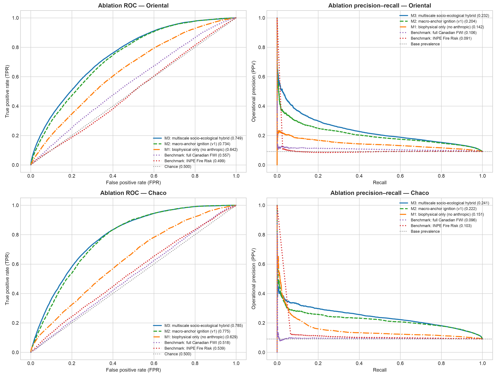
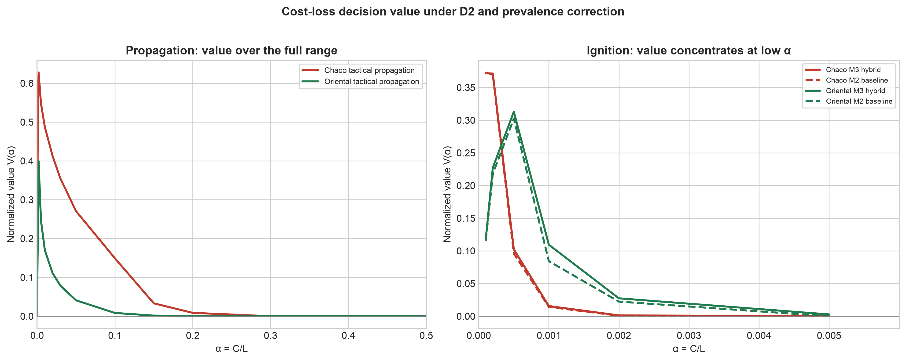

> **Target journal:** *Computers & Geosciences* (Elsevier). **Article type:** research article. **Peer review:** single-anonymized.  
> **Supplementary file:** `material_suplementario.pdf` — Notes S1–S3, Tables S1–S16 and Figures S1–S3.  
> **Code:** [github.com/sanchezmartin093-code/Incendios_PY](https://github.com/sanchezmartin093-code/Incendios_PY) (MIT License; code concept DOI [10.5281/zenodo.23675104](https://doi.org/10.5281/zenodo.23675104); v2.0.0).  
> **Data:** processed data and test predictions are archived in Zenodo under CC BY 4.0 (data concept DOI [10.5281/zenodo.23675278](https://doi.org/10.5281/zenodo.23675278); v2.0.0).

# Supplementary contents {.unnumbered}

• **Note S1:** Data, D2 target construction, quality control and sampling.

• **Note S2:** Bounded monotonic Platt calibration and hyperparameters.

• **Note S3:** Evaluation protocol and extended analyses.

• **Tables S1–S16:** variable dictionary, hyperparameters, departmental results, computational profile, conformal coverage, population evaluation, paired significance, spatial blocks, lead time, sampling, full benchmark, ablation, M1 baseline, SHAP, cost-loss and data audit.

• **Figures S1–S3:** SHAP, ablation and cost-loss.

---

# Supplementary Note S1. Data, D2 target construction, quality control and sampling

VIIRS active-fire detections from Suomi-NPP, NOAA-20 and NOAA-21 are acquired as 375-m cross-track swaths from NASA FIRMS [@nasa_firms]. At the swath edge the projected pixel can reach approximately 1.6 km along scan and 0.8 km along track, producing the geometric Bow-Tie effect: repeated detections of the same fire, dilution of fire radiative power (FRP) over a larger apparent area and incorrect assignment to the national 1-km² grid [@schroeder2014]. The implemented kinematic filter is

$$\mathcal{D}_{\text{filtered}} = \left\{ f \in \mathcal{D}_{\text{raw}} \mid \text{scan}(f) \le 1.5\ \text{km} \;\land\; \text{confidence}(f) \neq \text{'low'} \right\}.$$

The observed maximum scan in the study window was 0.8 km, so the rule removed no records but remains active for orbital windows with larger view angles. Duplicate overpasses on the same civil date are consolidated by 1-km² cell, retaining `num_focos_dia`, `max_frp_dia` and `sum_frp_dia`.

D2 separates primary ignition from tactical propagation. Let $F_t$ be the set of cells with a thermal detection on day $t$. D2 ignition at cell $i$ and day $t$ requires (i) $i \in F_t$, (ii) no cell in $F_{t-1}$ within 25 km and (iii) no detection in cell $i$ during the preceding 10 days. D2 propagation requires $i \in F_t$ and at least one cell in $F_{t-1}$ within 25 km. The two target sets are disjoint. The 25-km threshold defines the target domain and is not a negative-sampling buffer; no 20-km buffer is applied to the test set. The 20-km buffer is used only in the spatial block holdout.

The case-control sample is drawn at 1:10 per task and region. Training uses 2018–2022, validation uses 2023 and the test is the frozen 2024–2025 period. Population denominators are kept separately and are used for prior correction. The same test rows are used for every model, FWI and INPE, so comparisons are paired. Sampling counts and class ratios are in Table S10. The variable dictionary is in Table S1; the full audit log is in Table S15.

Data quality checks collapse duplicate VIIRS overpasses, remove `low`-confidence detections, reconstruct daily precipitation from sub-daily increments and reject impossible values above 300 mm/day. ERA5-Land nodes [@munoz2021era5land] are mapped to cells with a precomputed cKDTree. The processed data archive contains test targets, probabilities, benchmark layers, sampling plans and trained artifacts, so the result tables can be regenerated without the raw multi-terabyte archive.

# Supplementary Note S2. Bounded monotonic Platt calibration and hyperparameters

Let $z_i \in \mathbb{R}$ be the margin produced by the LightGBM ensemble [@ke2017lightgbm] for cell $i$, and let $y_i \in \{0,1\}$ be the binary fire label. Standard Platt scaling [@platt1999] estimates $w,b \in \mathbb{R}$ by minimizing binary cross-entropy:

$$\mathcal{L}(w,b) = -\sum_{i=1}^{M} \left[ y_i \log \sigma(w z_i + b) + (1-y_i)\log(1-\sigma(w z_i + b)) \right], \qquad \sigma(v)=\frac{1}{1+e^{-v}}.$$

If and only if $w>0$, the map $p(z)=\sigma(w z+b)$ is strictly increasing and preserves the ranking of the ensemble. Its derivative is

$$\frac{dp}{dz}=w\,\sigma(w z+b)\,[1-\sigma(w z+b)],$$

and the sigmoid factor is strictly positive, so $\operatorname{sign}(dp/dz)=\operatorname{sign}(w)$. A positive slope therefore leaves ROC-AUC unchanged. Unconstrained logistic regression can converge to $w<0$ under extreme imbalance or bimodal margins, inverting the ranking and turning a ROC-AUC of 0.77 into 0.23.

The implementation minimizes a bounded Brier loss with L-BFGS-B in `src/modelo.py`:

$$\min_{w,b}\frac{1}{M}\sum_{i=1}^{M}\left(y_i-\frac{1}{1+\exp(-(w z_i+b))}\right)^2,\qquad 0.10\le w\le 10.00,\quad -10.0\le b\le 10.0.$$

The lower bound guarantees strict monotonicity and prevents gradient collapse in asymptotic regions. Calibration is fitted on 2023 and frozen for 2024–2025. The same cutoff logic is used for M1, M2, M3 and propagation; cutoffs are selected on validation with an F0.5 criterion and applied after prior correction. Hyperparameters are in Table S2. The ablation uses a common capacity (45/60 rounds and 23/31 leaves) to isolate the feature effect.

# Supplementary Note S3. Evaluation protocol and extended analyses

The harness is fixed before the test is opened. It contains five components:

**(1)** A strictly temporal split: training 2018–2022, validation 2023 and test 2024–2025.

**(2)** A 50-km spatial block holdout with a 20-km buffer; priors are recomputed without held-out fires.

**(3)** A paired bootstrap grouped by date ($B=1\,000$) for confidence intervals and differences against FWI [@vanwagner1987] and INPE [@setzer2019].

**(4)** A lead-time analysis using t-1 weather to quantify the nowcast-to-forecast gap.

**(5)** Population-level, conformal and cost-loss analyses.

Bootstrap resampling is by date, not by row, because daily fire activity is strongly clustered. All cells from a sampled date are retained; this preserves within-day dependence. The spatial holdout removes an entire 50-km block plus a 20-km buffer, recomputes historical priors without the held-out fires and evaluates both held-in and held-out cells. The primary metrics are ROC-AUC and PR-AUC; Brier score, expected calibration error, precision, recall, F0.5 and false positives are also reported. AUC intervals use 500 grouped bootstrap replicates; paired differences use 1 000. Because four main comparisons are made against FWI and INPE, the significance statements are a conservative screening result rather than multiplicity-adjusted inference. The bootstrap resolution is 0.001.

The full benchmark is in Table S11, paired significance in Table S7, the complete spatial block results in Table S8 and the lead-time results in Table S9. The controlled ablation is in Table S12 and Figure S2; SHAP is in Table S13 and Figure S1; population evaluation is in Table S6; conformal coverage is in Table S5; cost-loss is in Table S14 and Figure S3. The computational profile is in Table S4. All analyses use the frozen test rows archived with the code release.

---

The 1-km² grid is the modeling unit. Fuel fractions come from MapBiomas Collection 2 (2023) [@mapbiomas2023]. Historical priors use a causal three-year rolling window rather than the full 2018–2022 record. `rafaga_max_kmh` is a linear proxy and is not used as a feature. M3 contains 44 variables in the Chaco and 45 in the Oriental Region; M2 contains 35 and M1 contains 24.

**Table S1.** Variable dictionary and physical role of the predictors.

| Variable | Description | Source | Role |
|----------------------------|--------------------------------------|--------------|--------------------|
| temp_max_c | Daily maximum temperature at 2 m (°C) | ERA5-Land | Ignition and propagation |
| temp_min_c | Daily minimum temperature at 2 m (°C) | ERA5-Land | Ignition and propagation |
| rango_termico_diario | Intraday thermal range (Tmax − Tmin) | Derived | Ignition and propagation |
| vpd_max_kpa | Maximum vapor pressure deficit (kPa) | Derived | Gate, ignition and propagation |
| deficit_hidrico_acumulado | Integrated desiccation stress (VPD × (CDD + 1), kPa·d) | Derived | Ignition and propagation |
| precipitacion_mm | Daily rainfall (00–24 h, mm) | ERA5-Land | Ignition and propagation |
| precipitacion_48h_mm | Antecedent 48-h rainfall (mm) | Derived | Gate, ignition and propagation |
| dias_secos_consecutivos | Consecutive days with rainfall <1.0 mm (CDD) | Derived | Ignition and propagation |
| viento_max_kmh | Maximum 10-m wind speed (km/h) | ERA5-Land | Ignition and propagation |
| rafaga_max_kmh | Linear wind proxy (1.3 × wind); not an ERA5-Land gust | Proxy | Not used |
| potencial_viento_cuadratico | Dynamic wind pressure ((v/10)², dimensionless) | Derived | Ignition and propagation |
| interaccion_viento_vpd | Advective–desiccant coupling (wind × VPD) | Derived | Ignition and propagation |
| ffmc | Fine Fuel Moisture Code | FWI derived | Ignition and propagation |
| isi | Initial Spread Index | FWI derived | Ignition and propagation |
| dia_semana | Civil weekday (0 = Monday … 6 = Sunday) | Calendar | Ignition and propagation |
| es_fin_de_semana | Weekend indicator (Saturday/Sunday) | Calendar | Ignition and propagation |
| mes | Month of year (1–12) | Calendar | Ignition and propagation |
| dia_del_anio | Ordinal day of year (1–366) | Calendar | Ignition and propagation |
| pct_pastura | Cultivated pasture fraction (0–100 %) | MapBiomas C2 2023 | Ignition and propagation |
| pct_sabana_pastizal | Savanna and natural grassland fraction (0–100 %) | MapBiomas C2 2023 | Ignition and propagation |
| pct_humedal_palmar | Wetland and palm swamp fraction (0–100 %) | MapBiomas C2 2023 | Ignition and propagation |
| pct_bosque_seco | Dry Chaco forest fraction (0–100 %) | MapBiomas C2 2023 | Ignition and propagation (Chaco) |
| pct_bosque_humedo | Atlantic humid forest fraction (0–100 %) | MapBiomas C2 2023 | Ignition and propagation (Oriental) |
| indice_ecotono | Forest–pasture edge disruption index | Derived | Ignition and propagation |
| dist_foco_hist_km | Minimum distance to training fires (km) | FIRMS, causal 3-year window | Ignition and propagation |
| densidad_hist_25km | Cumulative historical fire density within 25 km | FIRMS, causal 3-year window | Ignition and propagation |
| dist_foco_t1_km | Minimum distance to an active t-1 fire (km) | Causal spatial kernel | Propagation only |
| focos_25km_t1 | Active t-1 fires within 25 km | Causal spatial kernel | Propagation only |
| frp_25km_t1 | Accumulated t-1 FRP within 25 km (MW) | Causal spatial kernel | Propagation only |
| dist_corredor_antropico_km | Distance to chronic-recurrence cells (≥3 events, 2018–2022) | Anthropogenic prior | M3 only |
| densidad_hist_5km | Kernel density of historical fires within 5 km | Anthropogenic prior | M3 only |
| densidad_hist_10km | Kernel density of historical fires within 10 km | Anthropogenic prior | M3 only |
| freq_hist_1km | Point recurrence in the 1-km² cell (2018–2022) | Anthropogenic prior | M3 Oriental and M2 fallback selector |
| temporada_quema_ganadera | Livestock burning season indicator (August–October) | Anthropogenic calendar | M3 only |
| doy_sin | Continuous seasonal sine harmonic | Derived | M3 only |
| doy_cos | Continuous seasonal cosine harmonic | Derived | M3 only |
| presion_quema_pastura | Pasture burning pressure (pasture × VPD × month weight) | Human–climate interaction | M3 only |
| focalizacion_antropica_local | Local-to-macro concentration ratio (5 km / 25 km) | Multiscale ratio | M3 only |
| interaccion_acceso_vpd | Accessibility–desiccation synergy (exp(−d_hist/5) × VPD) | Human–climate interaction | M3 only |
| es_combustible | Combustible biomass indicator | MapBiomas C2 2023 | Biophysical gate |

The operational models were not selected through a fully registered search. The table reports the configuration of the boosters trained by `scripts/06_entrenar_modelos.py` and `scripts/16_ablacion_modelo_hibrido.py`.

**Table S2.** Operational and ablation hyperparameters.

| Hyperparameter | M2 Chaco | Propagation Chaco | M2 Oriental | Propagation Oriental | M3 Chaco | M3 Oriental |
|------------------|-----------:|-----------:|-----------:|-----------:|-----------:|-----------:|
| objective | binary | binary | binary | binary | binary | binary |
| learning_rate | 0.03 | 0.03 | 0.03 | 0.03 | 0.03 | 0.03 |
| num_leaves | 15 | 15 | 15 | 15 | 23 | 31 |
| max_depth | 5 | 5 | 5 | 5 | 5 | 5 |
| min_child_samples | 20 | 20 | 10 | 10 | 20 | 10 |
| scale_pos_weight | 1.0 | 1.0 | 2.0 | 2.0 | 1.0 | 2.0 |
| feature_fraction | 0.80 | 0.80 | 0.80 | 0.80 | 0.80 | 0.80 |
| bagging_fraction | 0.80 | 0.80 | 0.80 | 0.80 | 0.80 | 0.80 |
| lambda_l1 | 0.20 | 0.20 | 0.20 | 0.20 | 0.20 | 0.20 |
| lambda_l2 | 1.00 | 1.00 | 1.00 | 1.00 | 1.00 | 1.00 |
| num_boost_round | 20 | 20 | 40 | 40 | 45 | 60 |
| early_stopping | None | None | None | None | None | None |

The values were generated by `scripts/14_auditoria_suplementaria.py`.

**Table S3.** D2 test performance by department.

| Department | Region | Sovereign cells | Test samples | Test fires | Ignition ROC-AUC | Propagation ROC-AUC | Tactical precision |
|--------------|----------|-----------:|-----------:|---------:|-----------:|-----------:|------------:|
| SAN PEDRO | Oriental | 20 854 | 22 859 | 2 763 | 0.7150 | 0.7590 | 60.7 % |
| CONCEPCIÓN | Oriental | 18 523 | 24 486 | 2 022 | 0.7050 | 0.8110 | 74.3 % |
| ITAPÚA | Oriental | 15 868 | 21 861 | 1 355 | 0.7760 | 0.7800 | 50.4 % |
| CANINDEYÚ | Oriental | 15 052 | 19 820 | 1 700 | 0.8510 | 0.8340 | 65.3 % |
| ALTO PARANÁ | Oriental | 14 206 | 23 639 | 869 | 0.8430 | 0.8560 | 51.5 % |
| CAAGUAZÚ | Oriental | 12 901 | 14 333 | 1 571 | 0.7260 | 0.7490 | 54.9 % |
| AMAMBAY | Oriental | 12 555 | 15 122 | 1 517 | 0.7590 | 0.8360 | 76.1 % |
| ÑEEMBUCÚ | Oriental | 11 672 | 15 506 | 1 555 | 0.6380 | 0.7190 | 54.8 % |
| CAAZAPÁ | Oriental | 9 554 | 10 662 | 1 388 | 0.7130 | 0.7240 | 49.8 % |
| PARAGUARÍ | Oriental | 8 593 | 9 631 | 1 139 | 0.6250 | 0.7030 | 57.0 % |
| MISIONES | Oriental | 8 157 | 9 786 | 912 | 0.5970 | 0.7070 | 58.2 % |
| CORDILLERA | Oriental | 4 791 | 4 947 | 561 | 0.6790 | 0.7310 | 55.2 % |
| GUAIRÁ | Oriental | 3 866 | 4 455 | 469 | 0.6880 | 0.7160 | 46.8 % |
| CENTRAL | Oriental | 2 406 | 2 751 | 347 | 0.7040 | 0.7780 | 68.0 % |
| ASUNCIÓN | Oriental | 128 | 78 | 8 | 0.6800 | 0.7920 | 55.6 % |
| BOQUERÓN | Chaco | 88 623 | 66 587 | 5 038 | 0.8080 | 0.9270 | 88.9 % |
| ALTO PARAGUAY | Chaco | 78 613 | 60 983 | 4 075 | 0.8130 | 0.9210 | 86.9 % |
| PRESIDENTE HAYES | Chaco | 73 644 | 49 046 | 6 943 | 0.7090 | 0.8550 | 80.0 % |

ASUNCIÓN has only eight test fires; its department-level metrics are reported for completeness and should not be interpreted as stable estimates.

The profile was measured on macOS ARM64; x86_64 was not measured. The point-in-polygon row is a reference for 50 000 points and is not used at inference.

**Table S4.** Stage-level profile for 2024-09-09.

| Stage | Method | Cells | Time (s) | Peak RAM (MB) | Note |
|----------------------|----------------|-----------:|---------:|-----------:|----------------------------|
| Integer cell_id lookup (O(1)) | NumPy int64 | 400 006 | 0.00073 | — | Median of 100 repetitions |
| Point-in-Polygon | GeoPandas sjoin | 50 000 | 0.02610 | — | 50 000 points; non-linear extrapolation |
| Ingestion, priors and gate | Polars/cKDTree | 400 006 | 1.26800 | — | Measured 2024-09-09 |
| Dual inference | LightGBM C++ | 400 006 | 0.28500 | — | Measured 2024-09-09 |
| Aggregation and bulletin | Polars | 400 006 | 0.01600 | — | Measured 2024-09-09 |
| Total pipeline | Integrated | 400 006 | 1.56900 | 2 182.1 | ARM64; x86_64 not measured |

**Table S5.** Empirical conformal coverage. These values are not a formal guarantee under temporal shift.

| Region | $\hat{q}_{90}$ | Coverage 90 (%) | $\hat{q}_{95}$ | Coverage 95 (%) |
|--------------|---------------:|-----------------:|---------------:|-----------------:|
| Chaco | 0.3360 | 89.77 % | 0.8457 | 95.04 % |
| Oriental | 0.3743 | 90.18 % | 0.8464 | 94.56 % |

Population metrics apply prior correction from the case-control sample to the population denominator. Population precision is the relevant operational quantity, not case-control precision.

**Table S6.** Population-level evaluation with prevalence correction (retrospective 2024–2025 test).

| Region | Task | Model | Pop. prevalence | Sample prevalence | Pop. cutoff | ROC-AUC | PR-AUC | Precision (%) | Recall (%) | F0.5 | Brier | BSS | ECE | Pop. N | Pop. positives |
|---|---|---|---|---|---|---|---|---|---|---|---|---|---|---|---|
| Chaco | ignicion | M3_ignicion_hibrida | 0.000153 | 0.090909 | 0.000467 | 0.8059 | 0.0009 | 0.082 | 27.304 | 0.0010 | 0.000153 | 0.0003 | 0.0000 | 104976526 | 16056 |
| Chaco | ignicion | M2_ignicion_base | 0.000153 | 0.090909 | 0.000428 | 0.8078 | 0.0007 | 0.090 | 24.589 | 0.0011 | 0.000153 | 0.0003 | 0.0000 | 104976526 | 16056 |
| Chaco | propagacion | M2_propagacion_tactica | 0.001553 | 0.090909 | 0.022388 | 0.9088 | 0.1270 | 9.667 | 50.652 | 0.1153 | 0.001447 | 0.0666 | 0.0002 | 33748163 | 52405 |
| Oriental | ignicion | M3_ignicion_hibrida | 0.000414 | 0.090909 | 0.001084 | 0.7627 | 0.0019 | 0.198 | 20.731 | 0.0025 | 0.000414 | 0.0005 | 0.0001 | 43887357 | 18176 |
| Oriental | ignicion | M2_ignicion_base | 0.000414 | 0.090909 | 0.000959 | 0.7549 | 0.0015 | 0.166 | 22.106 | 0.0021 | 0.000414 | 0.0005 | 0.0000 | 43887357 | 18176 |
| Oriental | propagacion | M2_propagacion_tactica | 0.002102 | 0.090909 | 0.017575 | 0.7963 | 0.0287 | 4.784 | 18.771 | 0.0562 | 0.002069 | 0.0135 | 0.0004 | 37235186 | 78269 |

Ign. = ignition; Prop. = propagation. M2 is the baseline ignition model in the ignition task and the tactical propagation model in the propagation task; M3 is the hybrid ignition model.

**Table S7.** Paired ROC-AUC differences against FWI and INPE, grouped by date (retrospective 2024–2025 test).

| Region | Task | Comparison | ΔROC | p value | Bootstrap replicates |
|---|---|---|---|---|---|
| Oriental | ignicion | Incendios_PY (Ignición Híbrida M3) vs Canadian FWI completo | 0.1970 | 0.001 | 1000 |
| Oriental | ignicion | Incendios_PY (Ignición Híbrida M3) vs INPE Risco de Fogo | 0.2544 | 0.001 | 1000 |
| Chaco | ignicion | Incendios_PY (Ignición Híbrida M3) vs Canadian FWI completo | 0.2848 | 0.001 | 1000 |
| Chaco | ignicion | Incendios_PY (Ignición Híbrida M3) vs INPE Risco de Fogo | 0.2633 | 0.001 | 1000 |

The comparison uses B = 1,000 grouped-by-date bootstrap replicates. Values are retrospective diagnostics, not a blind confirmation.

**Table S8.** Full spatial block results on 2023 development blocks.

| Region | Model | Split | n | n positive | Prevalence | ROC-AUC | PR-AUC | Brier | BSS | ECE | Precision | Recall | F0.5 | FP | FN |
|---|---|---|---|---|---|---|---|---|---|---|---|---|---|---|---|
| Chaco | M1_biofisico | holdout_espacial_2023 | 19304 | 1758 | 0.091069 | 0.6456 | 0.1668 | 0.0806 | 0.0259 | 0.0065 | 0.1680 | 0.2685 | 0.1816 | 2337 | 1286 |
| Chaco | M1_biofisico | heldin_referencia_2023 | 78079 | 7095 | 0.090870 | 0.6280 | 0.1429 | 0.0812 | 0.0176 | 0.0031 | 0.1611 | 0.2280 | 0.1712 | 8423 | 5477 |
| Chaco | M2_base | holdout_espacial_2023 | 19304 | 1758 | 0.091069 | 0.6773 | 0.1760 | 0.0843 | -0.0183 | 0.0589 | 0.4828 | 0.0080 | 0.0374 | 15 | 1744 |
| Chaco | M2_base | heldin_referencia_2023 | 78079 | 7095 | 0.090870 | 0.7832 | 0.2526 | 0.0748 | 0.0942 | 0.0049 | 0.3344 | 0.2148 | 0.3009 | 3033 | 5571 |
| Chaco | M3_hibrido | holdout_espacial_2023 | 19304 | 1758 | 0.091069 | 0.6496 | 0.1630 | 0.0849 | -0.0262 | 0.0606 | 0.4286 | 0.0085 | 0.0395 | 20 | 1743 |
| Chaco | M3_hibrido | heldin_referencia_2023 | 78079 | 7095 | 0.090870 | 0.7821 | 0.2511 | 0.0750 | 0.0926 | 0.0051 | 0.2761 | 0.3326 | 0.2858 | 6189 | 4735 |
| Oriental | M1_biofisico | holdout_espacial_2023 | 25961 | 1998 | 0.076962 | 0.7176 | 0.1574 | 0.0683 | 0.0386 | 0.0123 | 0.1867 | 0.1957 | 0.1885 | 1703 | 1607 |
| Oriental | M1_biofisico | heldin_referencia_2023 | 65163 | 6286 | 0.096466 | 0.6899 | 0.1857 | 0.0835 | 0.0423 | 0.0009 | 0.2430 | 0.2140 | 0.2366 | 4190 | 4941 |
| Oriental | M2_base | holdout_espacial_2023 | 25961 | 1998 | 0.076962 | 0.7470 | 0.1820 | 0.0701 | 0.0137 | 0.0392 | 0.4286 | 0.0015 | 0.0074 | 4 | 1995 |
| Oriental | M2_base | heldin_referencia_2023 | 65163 | 6286 | 0.096466 | 0.7365 | 0.2231 | 0.0814 | 0.0659 | 0.0066 | 0.2628 | 0.2719 | 0.2646 | 4794 | 4577 |
| Oriental | M3_hibrido | holdout_espacial_2023 | 25961 | 1998 | 0.076962 | 0.7277 | 0.1608 | 0.0716 | -0.0075 | 0.0474 | 0.3750 | 0.0015 | 0.0074 | 5 | 1995 |
| Oriental | M3_hibrido | heldin_referencia_2023 | 65163 | 6286 | 0.096466 | 0.7473 | 0.2384 | 0.0806 | 0.0757 | 0.0048 | 0.3087 | 0.2151 | 0.2840 | 3028 | 4934 |

M1 = biophysical only; M2 = macro-anchor baseline; M3 = multiscale socio-ecological hybrid. Holdout = 50-km spatial block; Held-in = reference cells not excluded from training. The confirmation holdout is not used here.

**Table S9.** Evaluation with t-1 weather (24-h anticipation) on 2023 validation.

| Region | Model | n | n positive | ROC-AUC | PR-AUC | Brier | BSS | ECE | Cutoff F0.5 | Precision | Recall | F0.5 |
|---|---|---|---|---|---|---|---|---|---|---|---|---|
| Chaco | M1_biofisico_t1 | 97383 | 8853 | 0.6342 | 0.1467 | 0.0810 | 0.0201 | 0.0032 | 0.129195 | 0.1749 | 0.1799 | 0.1759 |
| Chaco | M2_base_t1 | 97383 | 8853 | 0.7818 | 0.2444 | 0.0752 | 0.0902 | 0.0066 | 0.197253 | 0.2834 | 0.3063 | 0.2877 |
| Chaco | M3_hibrido_t1 | 97383 | 8853 | 0.7831 | 0.2523 | 0.0749 | 0.0940 | 0.0039 | 0.219858 | 0.2935 | 0.2913 | 0.2931 |
| Oriental | M1_biofisico_t1 | 91124 | 8284 | 0.6965 | 0.1765 | 0.0792 | 0.0412 | 0.0017 | 0.157237 | 0.2093 | 0.2703 | 0.2192 |
| Oriental | M2_base_t1 | 91124 | 8284 | 0.7463 | 0.2167 | 0.0770 | 0.0677 | 0.0056 | 0.193621 | 0.2586 | 0.2572 | 0.2583 |
| Oriental | M3_hibrido_t1 | 91124 | 8284 | 0.7613 | 0.2384 | 0.0759 | 0.0810 | 0.0038 | 0.213015 | 0.2852 | 0.2646 | 0.2808 |

M1 = biophysical only; M2 = base ignition; M3 = multiscale socio-ecological hybrid; t-1 = previous-day weather.

**Table S10.** D2 sampling counts and class ratios.

| Partition | Task | Positives | Negatives | Ratio |
|----------------|----------------|---------------------:|-----------------------:|---------------------:|
| Train | Ignition | 91 271 | 912 710 | 1:10.00 |
| Validation | Ignition | 17 137 | 171 370 | 1:10.00 |
| Test | Ignition | 34 232 | 342 320 | 1:10.00 |
| Train | Propagation | 499 293 | 4 992 930 | 1:10.00 |
| Validation | Propagation | 75 706 | 757 060 | 1:10.00 |
| Test | Propagation | 130 674 | 1 306 740 | 1:10.00 |

The full benchmark includes M2, propagation, FWI, INPE and the climatological baseline. FWI and INPE are normalized indices, not calibrated probabilities.

**Table S11.** Full benchmark on the retrospective 2024–2025 test.

| Region | Task | Model | ROC-AUC | PR-AUC | Brier | BSS | ECE | Precision | Recall | F0.5 | FP |
|---|---|---|---|---|---|---|---|---|---|---|---|
| Chaco | ignicion | Incendios_PY (Ignición Híbrida M3) | 0.8021 | 0.2842 | 0.0733 | 0.1131 | 0.0082 | 0.3282 | 0.3030 | 0.3228 | 9960 |
| Chaco | ignicion | Incendios_PY (Ignición Base M2) | 0.7991 | 0.2766 | 0.0737 | 0.1083 | 0.0104 | 0.3328 | 0.2725 | 0.3187 | 8773 |
| Chaco | ignicion | Canadian FWI completo | 0.5173 | 0.0957 | — | — | — | 0.0928 | 0.9608 | 0.1133 | 150807 |
| Chaco | ignicion | INPE Risco de Fogo | 0.5389 | 0.1031 | — | — | — | 0.1172 | 0.1257 | 0.1188 | 15207 |
| Chaco | ignicion | Línea Base Climatológica | 0.5000 | 0.0909 | 0.0826 | 0.0000 | 0.0000 | 0.0000 | 0.0000 | 0.0000 | 0 |
| Chaco | propagacion | Incendios_PY (Propagación Táctica) | 0.9039 | 0.6935 | 0.0442 | 0.4656 | 0.0086 | 0.8369 | 0.5240 | 0.7476 | 5353 |
| Chaco | propagacion | Línea Base Climatológica | 0.5000 | 0.0909 | 0.0826 | 0.0000 | 0.0000 | 0.0000 | 0.0000 | 0.0000 | 0 |
| Oriental | ignicion | Incendios_PY (Ignición Híbrida M3) | 0.7534 | 0.2340 | 0.0765 | 0.0748 | 0.0082 | 0.3013 | 0.1859 | 0.2680 | 7835 |
| Oriental | ignicion | Incendios_PY (Ignición Base M2) | 0.7406 | 0.2146 | 0.0774 | 0.0640 | 0.0070 | 0.2610 | 0.1958 | 0.2447 | 10075 |
| Oriental | ignicion | Canadian FWI completo | 0.5564 | 0.1061 | — | — | — | 0.1076 | 0.3899 | 0.1258 | 58766 |
| Oriental | ignicion | INPE Risco de Fogo | 0.4990 | 0.0908 | — | — | — | 0.0924 | 0.7947 | 0.1123 | 141802 |
| Oriental | ignicion | Línea Base Climatológica | 0.5000 | 0.0909 | 0.0826 | 0.0000 | 0.0000 | 0.0000 | 0.0000 | 0.0000 | 0 |
| Oriental | propagacion | Incendios_PY (Propagación Táctica) | 0.7859 | 0.3752 | 0.0691 | 0.1633 | 0.0092 | 0.6503 | 0.1984 | 0.4468 | 8351 |
| Oriental | propagacion | Línea Base Climatológica | 0.5000 | 0.0909 | 0.0826 | 0.0000 | 0.0000 | 0.0000 | 0.0000 | 0.0000 | 0 |

FWI = full Canadian Fire Weather Index; INPE = INPE Fire Risk; M2 = baseline ignition model in the ignition task and tactical propagation model in the propagation task; M3 = hybrid ignition model; Climatology = climatological baseline; Ign. = ignition; Prop. = propagation.

**Table S12.** Controlled ablation of M1, M2 and M3 on the retrospective 2024–2025 test.

| Region | Architecture | Variables | ROC-AUC | PR-AUC | Brier | BSS | ECE | Precision (%) | Recall (%) | F0.5 | FP |
|---|---|---|---|---|---|---|---|---|---|---|---|
| Chaco | M3: multiscale socio-ecological hybrid | 44 | 0.8021 | 0.2842 | 0.0733 | 0.1131 | 0.0082 | 32.81 | 30.31 | 0.3228 | 9963 |
| Chaco | M2: macro-anchor ignition (v1) | 35 | 0.7991 | 0.2766 | 0.0737 | 0.1083 | 0.0104 | 33.27 | 27.26 | 0.3187 | 8778 |
| Chaco | M1: biophysical only (no anthropic) | 24 | 0.6421 | 0.1574 | 0.0806 | 0.0250 | 0.0045 | 17.78 | 18.22 | 0.1787 | 13525 |
| Chaco | Benchmark: full Canadian FWI | 6 | 0.5173 | 0.0957 | — | — | — | 9.28 | 96.08 | 0.1133 | 150807 |
| Chaco | Benchmark: INPE Fire Risk | 7 | 0.5389 | 0.1031 | — | — | — | 11.72 | 12.57 | 0.1188 | 15207 |
| Oriental | M3: multiscale socio-ecological hybrid | 45 | 0.7534 | 0.2340 | 0.0765 | 0.0748 | 0.0082 | 30.13 | 18.59 | 0.2680 | 7835 |
| Oriental | M2: macro-anchor ignition (v1) | 35 | 0.7406 | 0.2146 | 0.0774 | 0.0640 | 0.0070 | 26.09 | 19.59 | 0.2447 | 10085 |
| Oriental | M1: biophysical only (no anthropic) | 24 | 0.6840 | 0.1660 | 0.0798 | 0.0345 | 0.0052 | 19.17 | 24.63 | 0.2006 | 18876 |
| Oriental | Benchmark: full Canadian FWI | 6 | 0.5564 | 0.1061 | — | — | — | 10.76 | 38.99 | 0.1258 | 58766 |
| Oriental | Benchmark: INPE Fire Risk | 7 | 0.4990 | 0.0908 | — | — | — | 9.24 | 79.47 | 0.1123 | 141802 |

M1 = biophysical only; M2 = macro-anchor baseline; M3 = multiscale socio-ecological hybrid; FWI = full Canadian Fire Weather Index; INPE = INPE Fire Risk. Feature counts are 24 (M1), 35 (M2), and 44/45 (M3 Chaco/Oriental).

**Table S13.** Mean absolute TreeSHAP values for the hybrid ignition model.

| Region | Feature | Description | Mean abs. SHAP | Rank |
|----------|------------------------------|--------------------------------------|-----------:|---------:|
| Chaco | `dist_foco_hist_km` | Distance to historical ignition (km) | 0.468108 | 1 |
| Chaco | `pct_bosque_seco` | Dry Chaco forest fraction (%) | 0.187779 | 2 |
| Chaco | `dist_corredor_antropico_km` | Distance to active anthropogenic corridor (km) | 0.080344 | 3 |
| Chaco | `focalizacion_antropica_local` | Local focalization index (5 km / 25 km) | 0.077876 | 4 |
| Chaco | `pct_pastura` | Cultivated pasture fraction (%) | 0.034180 | 5 |
| Chaco | `doy_cos` | Seasonal cosine harmonic (DOY) | 0.032798 | 6 |
| Chaco | `potencial_viento_cuadratico` | Dynamic wind pressure (v²) | 0.015865 | 7 |
| Chaco | `densidad_hist_5km` | Local anthropogenic ignition density (5 km) | 0.011482 | 8 |
| Chaco | `presion_quema_pastura` | Pasture burning pressure (pasture × VPD × month) | 0.010718 | 9 |
| Chaco | `indice_ecotono` | Ecotone index | 0.009495 | 10 |
| Oriental | `dist_foco_hist_km` | Distance to historical ignition (km) | 0.283984 | 1 |
| Oriental | `focalizacion_antropica_local` | Local focalization index (5 km / 25 km) | 0.219708 | 2 |
| Oriental | `dist_corredor_antropico_km` | Distance to active anthropogenic corridor (km) | 0.118975 | 3 |
| Oriental | `pct_humedal_palmar` | Palm/wetland fraction (%) | 0.090180 | 4 |
| Oriental | `freq_hist_1km` | Chronic recurrence in a 1-km² cell | 0.064126 | 5 |
| Oriental | `pct_sabana_pastizal` | Savanna/natural grassland fraction | 0.060748 | 6 |
| Oriental | `pct_pastura` | Cultivated pasture fraction (%) | 0.034921 | 7 |
| Oriental | `ffmc` | Fine fuel moisture code (FFMC) | 0.024360 | 8 |
| Oriental | `dia_del_anio` | Day of year (DOY) | 0.020410 | 9 |
| Oriental | `indice_ecotono` | Ecotone index | 0.018477 | 10 |

{width="95%" fig-alt="TreeSHAP comparison between the Chaco and Oriental regions"}

$\alpha=C/L$ is the ratio of false-alarm cost to avoided loss; $V(\alpha)$ is the normalized value. This is a simple decision model, not an estimate of agency budgets. TP, FP and FN are expressed as fractions of the population; rows with $V(\alpha)=0$ are retained for completeness. M2 = baseline ignition model in the ignition task and tactical propagation model in the propagation task; M3 = hybrid ignition model.

**Table S14.** Cost-loss values by region, task, model and $\alpha$.

| Region | Task | Model | $\alpha$ | $V(\alpha)$ | TP rate | FP rate | FN rate | Prevalence |
|----------|------|----------|------:|-------:|-------:|-------:|-------:|---------:|
| Chaco | Ign. | M3 | 0.0001 | 0.353363 | 0.000136 | 0.478232 | 0.000017 | 0.000153 |
| Chaco | Ign. | M3 | 0.0002 | 0.345244 | 0.000100 | 0.238185 | 0.000052 | 0.000153 |
| Chaco | Ign. | M3 | 0.0005 | 0.053152 | 0.000032 | 0.047998 | 0.000121 | 0.000153 |
| Chaco | Ign. | M3 | 0.0010 | 0.002592 | 0.000001 | 0.000603 | 0.000152 | 0.000153 |
| Chaco | Ign. | M3 | 0.0020 | 0.000000 | 0.000000 | 0.000000 | 0.000153 | 0.000153 |
| Chaco | Ign. | M3 | 0.0050 | 0.000000 | 0.000000 | 0.000000 | 0.000153 | 0.000153 |
| Chaco | Ign. | M3 | 0.0100 | 0.000000 | 0.000000 | 0.000000 | 0.000153 | 0.000153 |
| Chaco | Ign. | M3 | 0.0200 | 0.000000 | 0.000000 | 0.000000 | 0.000153 | 0.000153 |
| Chaco | Ign. | M3 | 0.0300 | 0.000000 | 0.000000 | 0.000000 | 0.000153 | 0.000153 |
| Chaco | Ign. | M3 | 0.0500 | 0.000000 | 0.000000 | 0.000000 | 0.000153 | 0.000153 |
| Chaco | Ign. | M3 | 0.1000 | 0.000000 | 0.000000 | 0.000000 | 0.000153 | 0.000153 |
| Chaco | Ign. | M3 | 0.1500 | 0.000000 | 0.000000 | 0.000000 | 0.000153 | 0.000153 |
| Chaco | Ign. | M3 | 0.2000 | 0.000000 | 0.000000 | 0.000000 | 0.000153 | 0.000153 |
| Chaco | Ign. | M3 | 0.3000 | 0.000000 | 0.000000 | 0.000000 | 0.000153 | 0.000153 |
| Chaco | Ign. | M3 | 0.4000 | 0.000000 | 0.000000 | 0.000000 | 0.000153 | 0.000153 |
| Chaco | Ign. | M3 | 0.5000 | 0.000000 | 0.000000 | 0.000000 | 0.000153 | 0.000153 |
| Chaco | Ign. | M2 | 0.0001 | 0.355114 | 0.000136 | 0.474100 | 0.000017 | 0.000153 |
| Chaco | Ign. | M2 | 0.0002 | 0.311610 | 0.000096 | 0.243186 | 0.000057 | 0.000153 |
| Chaco | Ign. | M2 | 0.0005 | 0.013008 | 0.000024 | 0.044086 | 0.000129 | 0.000153 |
| Chaco | Ign. | M2 | 0.0010 | 0.000366 | 0.000000 | 0.000011 | 0.000153 | 0.000153 |
| Chaco | Ign. | M2 | 0.0020 | 0.000000 | 0.000000 | 0.000000 | 0.000153 | 0.000153 |
| Chaco | Ign. | M2 | 0.0050 | 0.000000 | 0.000000 | 0.000000 | 0.000153 | 0.000153 |
| Chaco | Ign. | M2 | 0.0100 | 0.000000 | 0.000000 | 0.000000 | 0.000153 | 0.000153 |
| Chaco | Ign. | M2 | 0.0200 | 0.000000 | 0.000000 | 0.000000 | 0.000153 | 0.000153 |
| Chaco | Ign. | M2 | 0.0300 | 0.000000 | 0.000000 | 0.000000 | 0.000153 | 0.000153 |
| Chaco | Ign. | M2 | 0.0500 | 0.000000 | 0.000000 | 0.000000 | 0.000153 | 0.000153 |
| Chaco | Ign. | M2 | 0.1000 | 0.000000 | 0.000000 | 0.000000 | 0.000153 | 0.000153 |
| Chaco | Ign. | M2 | 0.1500 | 0.000000 | 0.000000 | 0.000000 | 0.000153 | 0.000153 |
| Chaco | Ign. | M2 | 0.2000 | 0.000000 | 0.000000 | 0.000000 | 0.000153 | 0.000153 |
| Chaco | Ign. | M2 | 0.3000 | 0.000000 | 0.000000 | 0.000000 | 0.000153 | 0.000153 |
| Chaco | Ign. | M2 | 0.4000 | 0.000000 | 0.000000 | 0.000000 | 0.000153 | 0.000153 |
| Chaco | Ign. | M2 | 0.5000 | 0.000000 | 0.000000 | 0.000000 | 0.000153 | 0.000153 |
| Chaco | Prop. | M2 | 0.0001 | 0.000000 | 0.001553 | 0.998447 | 0.000000 | 0.001553 |
| Chaco | Prop. | M2 | 0.0002 | 0.000000 | 0.001553 | 0.998447 | 0.000000 | 0.001553 |
| Chaco | Prop. | M2 | 0.0005 | 0.318867 | 0.001504 | 0.582993 | 0.000049 | 0.001553 |
| Chaco | Prop. | M2 | 0.0010 | 0.524845 | 0.001247 | 0.168573 | 0.000306 | 0.001553 |
| Chaco | Prop. | M2 | 0.0020 | 0.622603 | 0.001057 | 0.045164 | 0.000496 | 0.001553 |
| Chaco | Prop. | M2 | 0.0050 | 0.540023 | 0.000933 | 0.018858 | 0.000620 | 0.001553 |
| Chaco | Prop. | M2 | 0.0100 | 0.480229 | 0.000871 | 0.012425 | 0.000682 | 0.001553 |
| Chaco | Prop. | M2 | 0.0200 | 0.405757 | 0.000795 | 0.008064 | 0.000758 | 0.001553 |
| Chaco | Prop. | M2 | 0.0300 | 0.350540 | 0.000751 | 0.006695 | 0.000801 | 0.001553 |
| Chaco | Prop. | M2 | 0.0500 | 0.263214 | 0.000640 | 0.004402 | 0.000912 | 0.001553 |
| Chaco | Prop. | M2 | 0.1000 | 0.100916 | 0.000253 | 0.000871 | 0.001299 | 0.001553 |
| Chaco | Prop. | M2 | 0.1500 | 0.024609 | 0.000079 | 0.000233 | 0.001473 | 0.001553 |
| Chaco | Prop. | M2 | 0.2000 | 0.000494 | 0.000001 | 0.000003 | 0.001551 | 0.001553 |
| Chaco | Prop. | M2 | 0.3000 | 0.000000 | 0.000000 | 0.000000 | 0.001553 | 0.001553 |
| Chaco | Prop. | M2 | 0.4000 | 0.000000 | 0.000000 | 0.000000 | 0.001553 | 0.001553 |
| Chaco | Prop. | M2 | 0.5000 | 0.000000 | 0.000000 | 0.000000 | 0.001553 | 0.001553 |
| Oriental | Ign. | M3 | 0.0001 | 0.108055 | 0.000403 | 0.781304 | 0.000011 | 0.000414 |
| Oriental | Ign. | M3 | 0.0002 | 0.223223 | 0.000374 | 0.576666 | 0.000040 | 0.000414 |
| Oriental | Ign. | M3 | 0.0005 | 0.309159 | 0.000244 | 0.231920 | 0.000170 | 0.000414 |
| Oriental | Ign. | M3 | 0.0010 | 0.126219 | 0.000108 | 0.055401 | 0.000306 | 0.000414 |
| Oriental | Ign. | M3 | 0.0020 | 0.035039 | 0.000033 | 0.009109 | 0.000381 | 0.000414 |
| Oriental | Ign. | M3 | 0.0050 | 0.002940 | 0.000003 | 0.000311 | 0.000411 | 0.000414 |
| Oriental | Ign. | M3 | 0.0100 | 0.000000 | 0.000000 | 0.000000 | 0.000414 | 0.000414 |
| Oriental | Ign. | M3 | 0.0200 | 0.000000 | 0.000000 | 0.000000 | 0.000414 | 0.000414 |
| Oriental | Ign. | M3 | 0.0300 | 0.000000 | 0.000000 | 0.000000 | 0.000414 | 0.000414 |
| Oriental | Ign. | M3 | 0.0500 | 0.000000 | 0.000000 | 0.000000 | 0.000414 | 0.000414 |
| Oriental | Ign. | M3 | 0.1000 | 0.000000 | 0.000000 | 0.000000 | 0.000414 | 0.000414 |
| Oriental | Ign. | M3 | 0.1500 | 0.000000 | 0.000000 | 0.000000 | 0.000414 | 0.000414 |
| Oriental | Ign. | M3 | 0.2000 | 0.000000 | 0.000000 | 0.000000 | 0.000414 | 0.000414 |
| Oriental | Ign. | M3 | 0.3000 | 0.000000 | 0.000000 | 0.000000 | 0.000414 | 0.000414 |
| Oriental | Ign. | M3 | 0.4000 | 0.000000 | 0.000000 | 0.000000 | 0.000414 | 0.000414 |
| Oriental | Ign. | M3 | 0.5000 | 0.000000 | 0.000000 | 0.000000 | 0.000414 | 0.000414 |
| Oriental | Ign. | M2 | 0.0001 | 0.098205 | 0.000404 | 0.795252 | 0.000011 | 0.000414 |
| Oriental | Ign. | M2 | 0.0002 | 0.213427 | 0.000376 | 0.597393 | 0.000038 | 0.000414 |
| Oriental | Ign. | M2 | 0.0005 | 0.299350 | 0.000254 | 0.260173 | 0.000160 | 0.000414 |
| Oriental | Ign. | M2 | 0.0010 | 0.096056 | 0.000089 | 0.049283 | 0.000325 | 0.000414 |
| Oriental | Ign. | M2 | 0.0020 | 0.009330 | 0.000009 | 0.002552 | 0.000405 | 0.000414 |
| Oriental | Ign. | M2 | 0.0050 | 0.000000 | 0.000000 | 0.000000 | 0.000414 | 0.000414 |
| Oriental | Ign. | M2 | 0.0100 | 0.000000 | 0.000000 | 0.000000 | 0.000414 | 0.000414 |
| Oriental | Ign. | M2 | 0.0200 | 0.000000 | 0.000000 | 0.000000 | 0.000414 | 0.000414 |
| Oriental | Ign. | M2 | 0.0300 | 0.000000 | 0.000000 | 0.000000 | 0.000414 | 0.000414 |
| Oriental | Ign. | M2 | 0.0500 | 0.000000 | 0.000000 | 0.000000 | 0.000414 | 0.000414 |
| Oriental | Ign. | M2 | 0.1000 | 0.000000 | 0.000000 | 0.000000 | 0.000414 | 0.000414 |
| Oriental | Ign. | M2 | 0.1500 | 0.000000 | 0.000000 | 0.000000 | 0.000414 | 0.000414 |
| Oriental | Ign. | M2 | 0.2000 | 0.000000 | 0.000000 | 0.000000 | 0.000414 | 0.000414 |
| Oriental | Ign. | M2 | 0.3000 | 0.000000 | 0.000000 | 0.000000 | 0.000414 | 0.000414 |
| Oriental | Ign. | M2 | 0.4000 | 0.000000 | 0.000000 | 0.000000 | 0.000414 | 0.000414 |
| Oriental | Ign. | M2 | 0.5000 | 0.000000 | 0.000000 | 0.000000 | 0.000414 | 0.000414 |
| Oriental | Prop. | M2 | 0.0001 | 0.000000 | 0.002102 | 0.997898 | 0.000000 | 0.002102 |
| Oriental | Prop. | M2 | 0.0002 | 0.000000 | 0.002102 | 0.997898 | 0.000000 | 0.002102 |
| Oriental | Prop. | M2 | 0.0005 | 0.112058 | 0.002057 | 0.795132 | 0.000045 | 0.002102 |
| Oriental | Prop. | M2 | 0.0010 | 0.220486 | 0.001856 | 0.532198 | 0.000246 | 0.002102 |
| Oriental | Prop. | M2 | 0.0020 | 0.388701 | 0.001285 | 0.202092 | 0.000817 | 0.002102 |
| Oriental | Prop. | M2 | 0.0050 | 0.242135 | 0.000702 | 0.038460 | 0.001400 | 0.002102 |
| Oriental | Prop. | M2 | 0.0100 | 0.168701 | 0.000506 | 0.014958 | 0.001596 | 0.002102 |
| Oriental | Prop. | M2 | 0.0200 | 0.112571 | 0.000378 | 0.006948 | 0.001724 | 0.002102 |
| Oriental | Prop. | M2 | 0.0300 | 0.081204 | 0.000286 | 0.003735 | 0.001816 | 0.002102 |
| Oriental | Prop. | M2 | 0.0500 | 0.040467 | 0.000170 | 0.001612 | 0.001932 | 0.002102 |
| Oriental | Prop. | M2 | 0.1000 | 0.004147 | 0.000012 | 0.000029 | 0.002090 | 0.002102 |
| Oriental | Prop. | M2 | 0.1500 | 0.000000 | 0.000000 | 0.000000 | 0.002102 | 0.002102 |
| Oriental | Prop. | M2 | 0.2000 | 0.000000 | 0.000000 | 0.000000 | 0.002102 | 0.002102 |
| Oriental | Prop. | M2 | 0.3000 | 0.000000 | 0.000000 | 0.000000 | 0.002102 | 0.002102 |
| Oriental | Prop. | M2 | 0.4000 | 0.000000 | 0.000000 | 0.000000 | 0.002102 | 0.002102 |
| Oriental | Prop. | M2 | 0.5000 | 0.000000 | 0.000000 | 0.000000 | 0.002102 | 0.002102 |

{width="80%" fig-alt="Controlled ablation of biophysical and hybrid models"}

{width="95%" fig-alt="Cost-loss curves by region and task"}

**Table S15.** Data audit log generated by the repository checks.

| Section | Check | Value | Status | Note |
|------------|--------------------------------------|---------------:|----------|------------------------|
| Grid | Rows | 400 006 | OK |  |
| Grid | Unique cell IDs | 400 006 | OK |  |
| Grid | Chaco cells | 240 880 | OK |  |
| Grid | Oriental cells | 159 126 | OK |  |
| Climate | Rows | 1 870 080 | OK |  |
| Climate | Nodes | 640 | OK |  |
| Climate | First date | 2018-01-01 | OK |  |
| Climate | Last date | 2025-12-31 | OK | May exceed the climate window. |
| Climate | Precipitation >300 mm | 0 | OK | Plausible but unlikely; review de-accumulation. |
| Climate | Maximum precipitation (mm) | 237.383 | OK | External Open-Meteo correction is still pending. |
| Climate | Nonzero ET0 | 1 870 080 | OK | Hargreaves-Samani from CDS Tmax/Tmin; not FAO-56. |
| Climate | Gust proxy 1.3× | 4e-06 | WARN | Gust is a 1.3× wind proxy. |
| FIRMS | Positive cell-days | 892 533 | OK |  |
| FIRMS | First date | 2018-01-01 | OK |  |
| FIRMS | Last date | 2026-01-04 | WARN | May exceed the climate window. |
| Raw FIRMS | Detections | 3 685 836 | OK |  |
| Raw FIRMS | Maximum scan (km) | 0.8 | WARN | The Bow-Tie filter retains records when maximum scan ≤1.5 km. |
| Raw FIRMS | Detections with type != 0 | 5319 | WARN | Type was not filtered; review industrial/offshore sources. |
| Unified dataset | Rows | 915 561 114 | OK |  |
| Unified dataset | Fires | 867 430 | OK |  |
| Unified dataset | Prevalence | 0.000947 | OK |  |
| Unified dataset | Cells | 397 448 | OK |  |
| Partitions | Train ignition rows | 1 003 981 | OK |  |
| Partitions | Train ignition prevalence | 0.090909 | OK |  |
| Priors | Train Chaco positives at zero historical distance (%) | 48.17 | OK | 100 % would indicate leakage from the event itself. |
| Priors | Train Oriental positives at zero historical distance (%) | 62.79 | OK | 100 % would indicate leakage from the event itself. |
| Partitions | Validation ignition rows | 188 507 | OK |  |
| Partitions | Validation ignition prevalence | 0.090909 | OK |  |
| Priors | Validation Chaco positives at zero historical distance (%) | 59.75 | OK | 100 % would indicate leakage from the event itself. |
| Priors | Validation Oriental positives at zero historical distance (%) | 78.85 | OK | 100 % would indicate leakage from the event itself. |
| Partitions | Test ignition rows | 376 552 | OK |  |
| Partitions | Test ignition prevalence | 0.090909 | OK |  |
| Priors | Test Chaco positives at zero historical distance (%) | 58.78 | OK | 100 % would indicate leakage from the event itself. |
| Priors | Test Oriental positives at zero historical distance (%) | 71.92 | OK | 100 % would indicate leakage from the event itself. |
| Spatial leakage | Test cells present in training (%) | 90.65 | WARN | Temporal test; spatial holdout requires blocks or regions. |
| Models | M3 Chaco booster | present | OK |  |
| Models | M3 Oriental booster | present | OK |  |
| Models | Propagation Chaco booster | present | OK |  |
| Models | Propagation Oriental booster | present | OK |  |
| Manifest | Pending hashes | 0 | OK |  |
| Manifest | Rows | 69 | OK |  |

**Table S16.** M1 biophysical baseline on 2023 validation.

| Region | Evaluation | ROC-AUC | PR-AUC | F0.5 |
|:---|:---|---:|---:|---:|
| Chaco | Temporal 2023, all cells | 0.6354 | 0.1480 | 0.1762 |
| Oriental | Temporal 2023, all cells | 0.7041 | 0.1818 | 0.2301 |
| Chaco | Cells without history (`freq_hist_1km = 0`) | 0.6650 | 0.0841 | — |
| Oriental | Cells without history (`freq_hist_1km = 0`) | 0.7018 | 0.0740 | — |

M1 is a diagnostic biophysical baseline and was not used operationally. Spatial block results are in Table S8, lead-time results in Table S9, and the retrospective 2024–2025 ablation in Table S12.

# Data availability {.unnumbered}

Processed data, test predictions, trained models and derived tables are archived in Zenodo under CC BY 4.0 (concept DOI): [10.5281/zenodo.23675278](https://doi.org/10.5281/zenodo.23675278). Raw NASA FIRMS, ERA5-Land/CDS, MapBiomas and geoBoundaries data are obtained from their original providers under their own terms and are documented with SHA-256 hashes in `fuentes/MANIFIESTO_DATOS_v3.csv`. The archived test targets and probabilities are sufficient to regenerate every table and figure in this supplement without downloading the raw multi-terabyte archive.

# Computer code availability {.unnumbered}

**Name:** `Incendios_PY`  
**Developer and contact:** Martín Sánchez Insfrán, `sanchez.martin093@gmail.com`  
**Year first available:** 2026  
**Hardware:** x86_64 or ARM64, at least 8 GB RAM  
**Operating system:** macOS 13+, Linux Ubuntu 22.04+, Windows 11 with WSL2  
**Language:** Python 3.12+; Polars, DuckDB and NumPy for vectorized operations; LightGBM C++ backend  
**Dependencies:** pinned in `requirements-lock.txt`  
**License:** MIT  
**Repository:** [https://github.com/sanchezmartin093-code/Incendios_PY](https://github.com/sanchezmartin093-code/Incendios_PY)  
**Code concept DOI (v2.0.0):** [10.5281/zenodo.23675104](https://doi.org/10.5281/zenodo.23675104)  
**Tests:** 76 tests pass with `python -m pytest -q tests`. The repository includes a README in English, installation and usage instructions, a user guide, and the scripts required to reproduce the main results.

# References {.unnumbered}

::: {#refs}
:::
