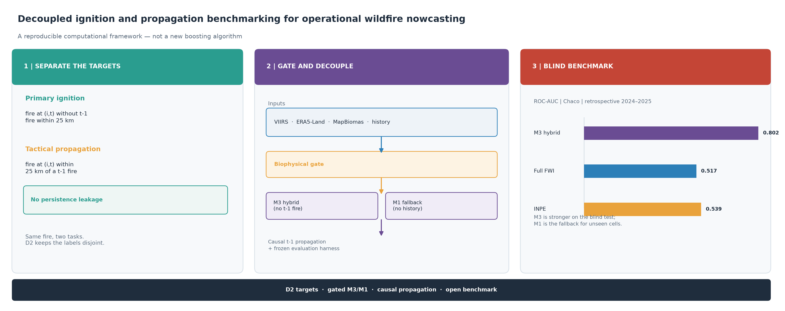

# 1. Información del Manuscrito / Article Details

- **Título Principal (Español):**  
  *Un marco computacional reproducible para el desacoplamiento y benchmarking de ignición y propagación de incendios en el Gran Chaco (2018–2025)*
- **Subtítulo (Español):**  
  *Targets D2, inferencia con gating y fallback M2/M3, y benchmark abierto frente a Canadian FWI e INPE Risco de Fogo*
- **Title (English):**  
  *A reproducible computational framework for decoupled wildfire ignition and propagation benchmarking in the Gran Chaco (2018–2025)*
- **Subtitle (English):**  
  *D2 targets, M3/M2 inference and an open benchmark against Canadian FWI and INPE*
- **Título Corto / Running Head:**  
  *Reproducible Decoupled Wildfire Benchmarking in the Gran Chaco*
- **Revista Objetivo / Target Journal:**  
  *Computers & Geosciences* (Elsevier, ISSN: 0098-3004)
- **Áreas Temáticas de la Revista:**  
  *Computer Science Applications* & *Earth and Planetary Sciences*
- **Modalidad de Revisión / Peer Review Track:**  
  Revisión de un solo anonimizado (*Single-Anonymized Peer Review*, política de C&G)
- **Tipo de Artículo / Article Type:**  
  *Research Paper* (Metodología Computacional y Algorítmica en Geociencias)

---

# 2. Autores y Afiliaciones / Authors and Affiliations

- **Autor / Corresponding author:**  
  **Martín Sánchez Insfrán, MD**  
  *Investigador Independiente / Médico Cirujano*  
  Asunción, Paraguay  
  - **Dirección postal / Postal address:** Asunción, Paraguay  
  - **Teléfono / Telephone:** +595 971 907 727  
  - **ORCID:** [0000-0003-4138-9668](https://orcid.org/0000-0003-4138-9668)  
  - **Email:** `sanchez.martin093@gmail.com`  
  - **Rol:** Conceptualización, diseño de arquitectura de software, ingeniería de datos espaciales, modelado predictivo, benchmarking, redacción y validación.

---

# 3. Aspectos Destacados / Highlights (Obligatorio en Elsevier)

> *Lineamientos de Computers & Geosciences: 3 a 5 puntos concisos, máximo 85 caracteres cada uno (incluidos espacios).*

1. **D2 formally separates primary ignition from tactical fire spread.** (61 chars)
2. **Gated M3/M2 inference links calibration, spatial blocks and cost-loss.** (69 chars)
3. **M3 outperforms full Canadian FWI and INPE under the same retrospective D2 test.** (71 chars)
4. **Spatial block holdout shows where the hybrid model does not transfer.** (70 chars)
5. **National inference runs in 3.47 s and 2.21 GB peak RAM on ARM64.** (62 chars)

---

# 4. Resumen Gráfico / Graphical Abstract

{width=100%}

**Graphical abstract.** Decoupled D2 targets, M3/M2 inference, causal t-1 propagation and a retrospective benchmark against FWI and INPE. The visual uses only current, traceable results.

---

# 5. Resumen / Abstract & Keywords

### Resumen (Español)
La predicción operativa de incendios con aprendizaje automático sufre a menudo fugas espaciales y una transferibilidad limitada de los índices boreales a biomas subtropicales. Presentamos D2, un operador de objetivos computacional que separa formalmente la ignición primaria de la propagación táctica, y un marco de inferencia con gating y evaluación que hace explícitos la construcción del objetivo, el control de fuga y la comparación de modelos. D2 define la ignición como fuego en el día t sin fuego t-1 a menos de 25 km y sin fuego en la misma celda en los 10 días previos; la propagación se evalúa a menos de 25 km de un fuego t-1. Un gate biofísico elimina celdas-día no combustibles y húmedas. Un modelo híbrido LightGBM (M3) predice ignición sin insumos de fuego t-1, con M2 como fallback para celdas sin historia y M1 como baseline biofísico. En validación 2023, M3 alcanza ROC-AUC 0.7844/0.7628 (Chaco/Oriental), frente a 0.7817/0.7496 de M2; el baseline biofísico M1 se reporta en la Tabla S16 del suplemento. En bloques espaciales de desarrollo 2023, M2 es el más robusto (0.6773/0.7470) y M1 no supera a M2 en celdas sin historia, por lo que M1 se rechaza como fallback operativo (Tablas S8 y S16 del suplemento). Un holdout independiente de bloques de confirmación 2023 retuvo a M2 como el mejor modelo (0.6871/0.6621), por delante de M3 (0.6757/0.6344) y M1 (0.6435/0.6388). En el test retrospectivo 2024–2025, M3 alcanza 0.8021/0.7534 frente a 0.5173/0.5564 del FWI canadiense y 0.5389/0.4990 del INPE; la propagación alcanza 0.9039/0.7859. La precisión poblacional de ignición es solo 0.082 %/0.198 %, por lo que el sistema es una herramienta de nowcast y priorización, no un sistema de alerta autónomo. El test 2024–2025 ya fue observado y se reporta como retrospectivo, no como ciego. La contribución computacional es el operador D2, la política de inferencia con gating y un arnés de evaluación reutilizable, publicado como software abierto; el aprendiz es una elección de implementación, no la novedad.

**Palabras clave:** Incendios forestales; GeoAI; reproducibilidad; validación espacial; LightGBM; Gran Chaco.

---

### Abstract (English)
Wildfire machine learning often suffers from spatial leakage and from the limited transferability of boreal fire-weather indices to subtropical biomes. We introduce D2, a computational target operator that formally separates primary ignition from tactical propagation, and a gated inference and evaluation framework that makes target construction, leakage control and model comparison explicit. D2 defines ignition as fire at day t with no t-1 fire within 25 km and no same-cell fire in the previous 10 days; propagation is evaluated within 25 km of a t-1 fire. A biophysical gate removes non-combustible and wet cell-days. A hybrid LightGBM model (M3) predicts ignition without t-1 fire inputs, with M2 as the fallback for cells without history and M1 as a biophysical baseline. In 2023 validation, M3 reaches ROC-AUC 0.7844/0.7628 (Chaco/Oriental), versus 0.7817/0.7496 for M2; the M1 biophysical baseline is reported in Supplementary Table S16. In 2023 development spatial blocks, M2 is the most robust model (0.6773/0.7470), and M1 does not outperform M2 on cells without history, so M1 is rejected as an operational fallback (Supplementary Tables S8 and S16). An independent 2023 confirmation-block holdout retained M2 as the best model (0.6871/0.6621) over M3 (0.6757/0.6344) and M1 (0.6435/0.6388). On the retrospective 2024–2025 test, M3 reaches 0.8021/0.7534 versus 0.5173/0.5564 for full Canadian FWI and 0.5389/0.4990 for INPE; propagation reaches 0.9039/0.7859. Population-level ignition precision is only 0.082 %/0.198 %, so the system is a nowcast and prioritisation tool, not a stand-alone warning system. The 2024–2025 test was already observed and is reported as retrospective, not blind. The computational contribution is the D2 operator, the gated inference policy and a reusable evaluation harness released as open software; the learner is an implementation choice, not the novelty.

**Keywords:** Wildfire nowcasting; GeoAI; reproducibility; spatial cross-validation; LightGBM; Gran Chaco.

---

# 6. Declaraciones Obligatorias de Elsevier / Declarations

### A. Disponibilidad del Código Computacional / Computer Code Availability
- **Nombre del Software:** `Incendios_PY`
- **Desarrollador / Contacto:** Martín Sánchez Insfrán (`sanchez.martin093@gmail.com`)
- **Año de Primera Disponibilidad:** 2026
- **Hardware Requerido:** Procesador multinúcleo x86_64 o ARM64 (Apple Silicon M-Series o procesador estándar Intel/AMD); mínimo 8 GB de RAM.
- **Software Requerido:** Python 3.12+, DuckDB $\ge 1.0$, Polars $\ge 1.0$, LightGBM $\ge 4.0$, Quarto $\ge 1.5$.
- **Lenguaje de Programación:** Python (con extensiones vectorizadas en C++ y Rust).
- **Disponibilidad y Licencia:** Código abierto bajo Licencia MIT.
- **Repositorio Oficial:** [https://github.com/sanchezmartin093-code/Incendios_PY](https://github.com/sanchezmartin093-code/Incendios_PY)
- **Versión del release:** 2.0.1 (2026-10-28)
- **DOI conceptual del Código:** [10.5281/zenodo.23675104](https://doi.org/10.5281/zenodo.23675104)
- **DOI conceptual de los Datos:** [10.5281/zenodo.23675278](https://doi.org/10.5281/zenodo.23675278)

### B. Disponibilidad de Datos / Data Availability Statement
Todos los conjuntos de datos primarios utilizados son de acceso público internacional y gratuito:
1. **Detecciones térmicas activas:** NASA FIRMS (sensores VIIRS Suomi-NPP, NOAA-20 y NOAA-21) disponibles en [firms.modaps.eosdis.nasa.gov](https://firms.modaps.eosdis.nasa.gov/).
2. **Reanálisis meteorológico:** Copernicus Climate Data Store (CDS) ERA5-Land reanalysis ([cds.climate.copernicus.eu](https://cds.climate.copernicus.eu/)) procesado mediante pipeline nativo ECMWF CDS API (`src/clima_cds.py`).
3. **Cobertura vegetal y biomas:** objetivo MapBiomas Chaco y Bosque Atlántico; se usan mapas anuales de MapBiomas Colección 2 (2017–2023), unidos por año previo.
4. **Pérdida de cobertura arbórea:** Hansen Global Forest Change GFC-2025 v1.13 ([earthenginepartners.appspot.com](https://storage.googleapis.com/earthenginepartners-hansen/GFC-2025-v1.13/)).
5. **Límites cartográficos nacionales:** Marco geoBoundaries ADM0 y ADM1 ([geoboundaries.org](https://www.geoboundaries.org/)).  
Los datasets consolidados y procesados no se versionan en git; se documentan con hashes en `fuentes/MANIFIESTO_DATOS_v3.csv` y están disponibles en el release v2.0.1 de GitHub bajo licencia CC BY 4.0, además del DOI conceptual de datos ([10.5281/zenodo.23675278](https://doi.org/10.5281/zenodo.23675278)).

### C. Financiamiento / Funding
Esta investigación fue realizada como un desarrollo de investigación independiente y de acceso abierto autofinanciado por el autor. No se recibieron subvenciones específicas de organismos del sector público, comercial o sin fines de lucro.

### D. Conflicto de Intereses / Competing Interests
El autor declara que no existen conflictos de interés financieros, institucionales ni personales que hayan podido influir en el diseño, análisis, interpretación o presentación de los resultados expuestos en este manuscrito.

### E. Contribución de Autores / Author Contributions (CRediT)
- **Martín Sánchez Insfrán:** Conceptualización, Metodología, Software, Validación, Análisis Formal, Investigación, Recursos, Curación de Datos, Redacción - Borrador Original, Redacción - Revisión y Edición, Visualización, Supervisión y Administración del Proyecto.
